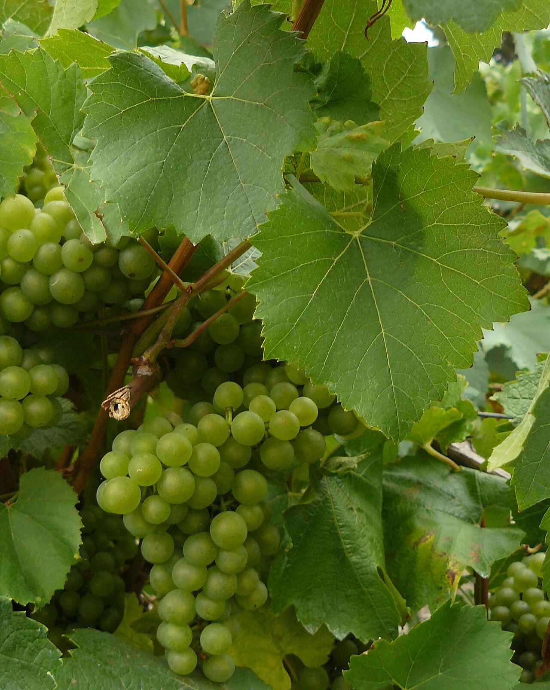

# Melon de Bourgogne

Melon de Bourgogne is a variety easily misled by its name. It is neither a melon nor a Muscat, but a white grape native to Burgundy that became the leading variety around Nantes in the Loire Valley. Three things matter: its shared parentage with Chardonnay, its high acidity and neutral aroma, and the Muscadet tradition of lees ageing.

Figure: Melon de Bourgogne. Image: Cyril5555, CC BY-SA 3.0, via Wikimedia Commons ([source page](https://commons.wikimedia.org/wiki/File:Melon_de_bourgogne.jpg)).

## Definition and names

The French name Melon de Bourgogne is said to refer to the leaf shape, not to fruit aroma. Around Nantes it is called Muscadet, but Muscadet is also the collective name of four appellations, so variety and appellation must be kept apart. In Chinese, "Burgundy melon" is a literal translation, while "Muscadet" usually refers to the wine. It belongs to the European grape Vitis vinifera and has no family relationship with Muscat; the similar names are a historical coincidence.

## Parentage and origin

DNA research confirms that Melon de Bourgogne is a natural cross of Gouais Blanc and Pinot. The same combination also produced Chardonnay and Aligoté, so it is a half-sibling of Chardonnay rather than the same variety. It has been recorded in Burgundy for centuries and was once widespread around Beaune and Dijon; after phylloxera, the Burgundy appellation system gradually recognised only a few white varieties such as Chardonnay, and Melon was excluded from most Burgundy white wine, shifting its centre of gravity downstream to the Loire.

## Botanical character

Bunches are medium to large, berries small to medium with thin yellow-green skins, and ripening is early. It buds early, making spring frost the main risk; thin skins also make it sensitive to grey rot and mechanical damage. Compared with Chardonnay its berries are rounder and its leaf shape closer to circular, which explains the name Melon. Sugar accumulation is modest and acidity falls slowly, giving a relatively wide picking window, though late picking loses the fresh citrus note.

## Viticultural behaviour

Melon de Bourgogne is vigorous and high-yielding, and crop load must be controlled to keep ripeness and concentration. The maritime climate around Nantes is mild and humid, with a longer ripening season than Burgundy, so acidity is retained. Soils are mainly schist, gneiss, granite and clay, and differences in drainage and water retention directly affect body: stony slopes give leaner, more mineral wines, clay parcels rounder ones. Most Muscadet vineyards sit on gentle slopes or plains with a high degree of mechanisation, which helps explain its long-standing affordability.

## Nantes and the Muscadet appellations

The core of Muscadet lies around Nantes, with the slopes where the Sèvre and Maine meet as the most important sub-zone. The four appellations are Muscadet, Muscadet Sèvre-et-Maine, Muscadet Coteaux de la Loire and Muscadet Côtes de Grandlieu. Sèvre-et-Maine accounts for the largest volume and is often seen as having the highest quality ceiling. Since 2011 the region has also created municipal crus communaux, including Clisson, Le Pallet, Gorges, Monnières-Saint-Fiacre, La Haye-Fouassière, Château-Thébaud, Goulaine and Mouzillon-Tillières, with longer lees contact and stricter yields.

## Winemaking and lees ageing

The classic method is a cool fermentation followed by keeping the wine on its fine lees through the winter until bottling the following spring: this is "sur lie". Autolysis of yeast cells releases mannoproteins, adding roundness and bread or cream notes while retaining acidity. Some producers allow malolactic fermentation to soften acidity, but most traditionalists deliberately avoid it to keep the edge. New oak is rare and stainless steel dominates; the municipal crus may use old barrels or longer lees contact.

## Sensory style and pairing

Young Muscadet shows green apple, lemon, white flowers, wet stone and a faint saline note, with high acidity, a light to medium body and a clean finish. Lees ageing adds cream and toast but does not bury the citrus line. It suits oysters, mussels, clams and steamed fish, and also goat cheese and light chicken dishes. The municipal crus age better, developing beeswax and nuts after five to ten years.

## The difference from Chardonnay

The two share the Gouais Blanc and Pinot parents but go in different directions. Chardonnay has thicker skins and a broader aroma, and can take new oak and malolactic fermentation; Melon has thin skins and a neutral aroma, living on acidity and lees texture. Chardonnay is the legal mainstay of Burgundy, while Melon is excluded from Burgundy white wine; around Nantes it is the sole protagonist of Muscadet. Treating Muscadet as "cheap Chardonnay" misses what it actually offers.

## How Muscadet is used, and common misconceptions

Muscadet is often filed as a seafood wine. That is not wrong, but it is too narrow: it also works as an aperitif, a chilled summer wine, or with salads and soft cheese. Common misconceptions include taking Muscadet for a Muscat; assuming all Muscadet is sparkling; thinking lees ageing means added sugar; and believing it cannot age. In fact the municipal crus can keep for more than a decade. Another is that Melon de Bourgogne has disappeared: it still covers several thousand hectares around Nantes, simply no longer part of mainstream Burgundy.

## Producers and vintages

Nantes has many family estates and a cooperative. Domaine de la Pépière, Jo Landron, Pierre Luneau-Papin and Domaine des Herbauges are often cited, while large merchants secure supermarket supply. Vintage differences come mainly from spring frost and harvest rain: cool years give higher acidity and leaner body, warm years more fruit and slightly more alcohol. When buying, look for "sur lie" and a municipal cru rather than the large word Muscadet.

[White wine](ref:white-wine) and [Loire Valley](ref:loire) are the nearest useful comparisons: one clarifies variety character, the other tests regional performance.

**Short definition:** A white grape native to Burgundy, now grown mainly around Nantes in the Loire Valley for Muscadet. A cross of Gouais Blanc and Pinot like Chardonnay, it is high in acidity and neutral in aroma, and often gains roundness from lees ageing. 

Start with where it is grown. From there, consider how it is labelled, then whether the style is dry or sweet. That is how a practical judgment about Melon de Bourgogne is built.

**Key facts.**

| Item | Detail |
| --- | --- |
| In one line | A white grape native to Burgundy, now grown mainly around Nantes in the Loire Valley for Muscadet. A cross of Gouais Blanc and Pinot like Chardonnay, it is high in acidity and neutral in aroma, and often gains roundness … |
| Species | Vitis vinifera |
| Key regions | France、Loire Valley |

**Sources and limits.** The key claims about Melon de Bourgogne are checked against the following sources: International Organisation of Vine and Wine (OIV) (Used to check the variety description and the Vitis species framework), InterLoire (Used to check planting around Nantes and the lees-ageing tradition), Oxford University Press (Consulted for entries on Melon de Bourgogne and Muscadet). Prices, batches and status change; the body is project-written and does not reproduce source text.

## Further reading

- [White wine](ref:white-wine): the drink style to which Muscadet belongs.
- [France](ref:france): the overall framework of French wine.
- [Loire](ref:loire): the parent region of Muscadet.
- [Muscadet](ref:muscadet): the wine and appellations built on this variety.

Further reading: [Aglianico](ref:c-extra-1).
