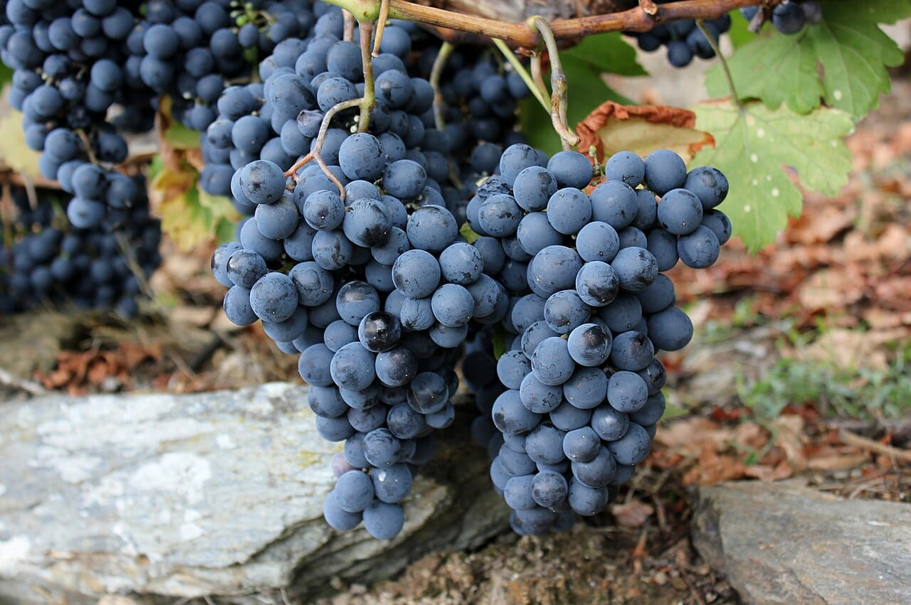
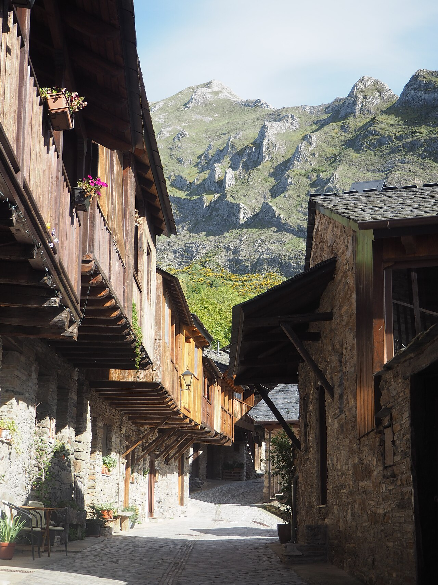

# Mencía

Mencía is an indigenous red grape of the western Iberian Peninsula, centered in northwest Spain's Bierzo and in Galicia's Ribeira Sacra, Valdeorras and Monterrei. Aromatic, with bright acidity and fine, moderate tannin, it shows black cherry, raspberry, violet, dried herb and slate mineral; from an obscure bulk blending grape in the late twentieth century it was revived into one of the most talked-about native reds of Iberia (ref:bierzo).

Two terroir lines should be read separately. Bierzo's slate and red-clay slopes give wines of clear frame and graphite character; the steep terraces of Ribeira Sacra along the Sil and Miño canyons are fresher, more herbal and mineral. The contour changes between slope, altitude and soil say more than a generic variety description.

Figure: Mencía: 48-Uvas de mencía en socalco, Doade, Sober (Lugo) (Wikimedia Commons). Image: feelSacra, CC BY-SA 4.0, via Wikimedia Commons ([source page](https://commons.wikimedia.org/wiki/File:48-Uvas_de_menc%C3%ADa_en_socalco,_Doade,_Sober_(Lugo).jpg)).

## Definition and naming

Mencía is a black-skinned Vitis vinifera grape, VIVC variety number 7623. In Portugal it is called Jaen or Jaen do Dão, and microsatellite profiling confirms the two are genetically identical. Synonyms include Fernao Pires Tinta, Giao, Loureiro Tinto, Mencin, Negra, Negro, Mencia Roble, Tinto Mencia and Tinto Mollar; in León it is Jaén colorado, not to be confused with Jaén blanco or Jaén rosado (both Cayetana variants) or the Jaén tinto of Huelva.

It was long thought to be an ancient clone of Cabernet Franc, sharing some aromas; DNA work at the Universidad Politécnica de Madrid has ruled out that relationship. On the vine it has small-to-medium compact clusters, medium even-sized blue-black berries and uncoloured flesh, budding and ripening early; picking timing is critical, as late harvest loses the bright natural acidity the variety rests on. Market analogies sometimes compare cool-site Mencía to Pinot Noir or Gamay and warmer-site examples to Cabernet Franc, but these are style references, not genetic links (ref:cabernet-franc).

## Origin and spread

Genetic work places the variety's likely origin in Portugal, as a natural cross of Alfrocheiro from the Dão and Patorra from the Douro, which explains its distribution on both sides of the Spain-Portugal border in the peninsula's northwest. The theory that it came from France along the Santiago pilgrimage route has been dismissed by the genetic evidence.

By area, Spain grows more than 9,100 hectares and Portugal about 2,500 hectares. In Spain the plantings concentrate in Bierzo (León province, Castilla y León) and the Galician districts of Ribeira Sacra, Valdeorras, Monterrei and Ribeiro, with smaller blocks in Tierra de León, Cigales and the upper Sil basin; in Portugal it enters blends in the Dão DOC and Beira Interior as Jaen, and there are trial plantings in California. Bierzo DO was provisionally recognised on 3 June 1988 and confirmed on 11 November 1989; Ribeira Sacra DO was established in 1996.

## Botany and cultivation

Bunches are small to medium and compact; berries are medium, uniform and blue-black, with uncoloured pulp. The vine is vigorous and low-yielding, with early budburst and early ripening. Harvest timing is critical: picking too late forfeits the high natural acidity that defines the modern style. Slate, granite and free-draining slopes give heat by day and cool nights that preserve aroma and acidity; flat, fertile blocks tend to yield thin, loose fruit.

Old vines are trained as bush vines close to the ground, roots reaching deep into stony soil. Leaf-fruit balance, leaf removal and limited irrigation set fruit concentration; downy mildew and botrytis need watching in damp years. Within the Bierzo DO, Mencía accounts for 70.5% of planted grapes, the district's dominant red variety (ref:terroir).

## Style and palate

Typical Mencía is medium-bodied with bright to high acidity and fine, moderate tannin. The nose opens on red and black cherry, raspberry, plum and violet, then dried herb, black pepper, crushed slate and a graphite, pencil-lead mineral frame. Alcohol is usually 13–14%; entry bottlings are fresh, juicy and softly tannined, while old-vine and single-site examples are more concentrated with tighter tannin.

Winemaking routes diverge: the traditional route uses large casks or concrete to keep fruit and mineral forward; the modern route uses whole-cluster fermentation, some new oak and short maceration for spice and structure. Top old-vine wines ferment spontaneously and age in neutral large wood to preserve site purity. Standard bottlings drink young; the finest Bierzo and Ribeira Sacra examples hold 15–25 years in bottle, bright fruit in the first decade and leather and dried flower in the second (ref:oak).

## Main regions and representative wines

Bierzo is the heart of the Mencía revival. Descendientes de J. Palacios was founded in Corullón in 1999 by Álvaro Palacios and his nephew Ricardo Pérez Palacios, on steep old-vine bush vineyards. The entry Pétalos draws on old vines across surrounding villages; Villa de Corullón comes from 60–100 year old vines; the flagship La Faraona is a tiny, steep, north-facing slate parcel above Corullón, farmed biodynamically, spontaneously fermented and aged in neutral large wood, at 14.5% alcohol in the 2017 vintage. Raúl Pérez comes from the Castro Ventosa family estate, whose vine-growing in Valtuille de Abajo traces back to 1752; his Ultreia Saint Jacques, Ultreia de Valtuille and El Rapolao are Bierzo benchmarks, alongside producers such as Mengoba, Estefanía, Guímaro and Pittacum.

On the Galician side, Ribeira Sacra's terraces run along the Sil and Miño canyons, and Valdeorras shares its slate with the Godello white. In Portugal's Dão, Jaen blends with Touriga Nacional, Tinta Roriz and Alfrocheiro on granite and schist at about 400–500 m, where large diurnal swings keep the wine fresh and mineral.

## How to drink and pair

Mencía is best at 14–16 °C: young, fruity bottlings lower, concentrated old-vine examples slightly higher. A medium-bowl red glass suits it; top wines benefit from a short decant, while standard bottles drink on opening. Its moderate tannin and bright acid make it more food-flexible than most serious Spanish reds.

Galician seafood such as octopus and lamprey, roast pork, game, lamb, mushroom dishes and hard sheep's cheese all match; tomato-raised braises and cured-ham starters work too. Delicate sweet sauces or rich cream dishes clash with its mineral acidity.

## Buying and common misreadings

The first mistake is treating the old misidentification as a genetic link: Mencía is not a Cabernet Franc clone, and DNA has ruled that out. The second is assuming Mencía can only make light, rosé-style reds: old-vine single sites and top bottlings have firm structure and long ageing. The third is reading the variety name without region and site: Bierzo and Ribeira Sacra differ in slope, soil and style, and within a district village and single-vineyard bottlings are clearly tiered.

On the label, separate DO district, entry bottling from single-village or single-vineyard wine (such as Villa de Corullón or La Faraona), and check vintage and alcohol. Young wines drink within three to five years; top examples cellar for years. Store bottles on their side, away from light and temperature swings. Overseas it reaches market mainly through specialist importers, so check storage history.

## Further reading and see also

- Related: [bierzo](ref:bierzo), [cabernet-franc](ref:cabernet-franc), [red-wine](ref:red), [terroir](ref:terroir), [oak-ageing](ref:oak).
- To compare the two terroir lines, taste a Bierzo old vine and a Ribeira Sacra terrace wine from the same vintage and contrast fruit concentration, tannin texture and graphite-mineral presence.

Start with where it is grown. From there, consider how it is labelled, then whether the style is dry or sweet. That is how a practical judgment about Mencía is built.

[Bierzo](ref:bierzo) and [Red wine](ref:red) are the nearest useful comparisons: one clarifies variety character, the other tests regional performance.

## Related images

Image: Bierzo. Credit: Fogar Mozárabe, CC BY-SA 4.0, via Wikimedia Commons ([source page](https://commons.wikimedia.org/wiki/File:Arquitectura_tradicional_de_El_Bierzo.jpg)). Related image for Mencía.
