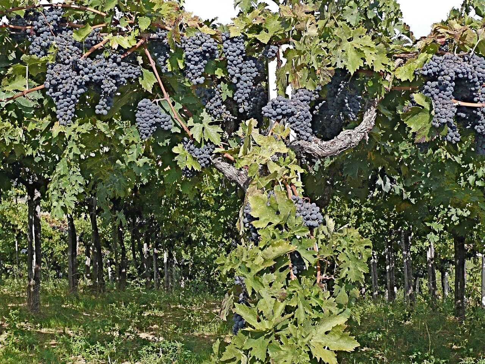
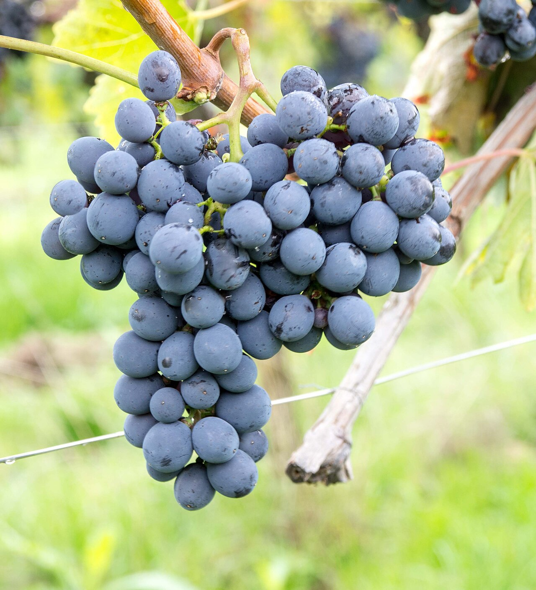

# Montepulciano

Montepulciano is a red grape widely grown across central and southern Italy, with its core region in Abruzzo. The wine is deep coloured, with medium-low tannin and medium-high acidity, showing black cherry, plum, prune and liquorice spice; it makes both easy-drinking young reds and ageworthy reserve bottlings. It has no varietal relationship with the Tuscan town of Montepulciano.

Figure: Montepulciano: Montepulciano grapes growing in Abruzzi (Wikimedia Commons). Image: Peter Forster, CC BY-SA 2.0, via Wikimedia Commons ([source page](https://commons.wikimedia.org/wiki/File:Montepulciano_grapes_growing_in_Abruzzi.jpg)).

## Definition and naming

Montepulciano is a Vitis vinifera red grape, and the name is shared by both an Abruzzo variety and a Tuscan hill town. The two must be read separately: the Tuscan Vino Nobile di Montepulciano is made mainly from Sangiovese (locally Prugnolo Gentile) and does not require Montepulciano grapes in the blend. This variety covers the red variety grown in Abruzzo and across the centre and south ([sangiovese](ref:sangiovese)).

The variety's parentage has not been established by genetic research, and existing records do not place it in a known crossing. A Montepulciano d'Abruzzo label is a regional wine name, not a single-variety guarantee; regulations allow other red grapes such as Sangiovese to be blended in within set proportions.

## Origin and spread

The variety has long been established in central-southern Italy. Cultivation spread toward the coast in the late 19th century, and after the Second World War it became Abruzzo's most widely planted red grape. It grows in all four Abruzzo provinces, L'Aquila, Chieti, Pescara and Teramo; about two-thirds of output comes from the fertile southern province of Chieti, while the most acclaimed low-yield sites are on iron-rich clay and limestone slopes in the northern provinces of Teramo and Pescara.

By classification, Montepulciano d'Abruzzo gained DOC status in 1968. The northern Colline Teramane subzone in Teramo province became a DOC in 1995 and was promoted to a separate DOCG in 2003. Its rules require at least 90% Montepulciano, Sangiovese up to 10%, minimum alcohol 12.50% vol, total acidity no lower than 4.5 g/l and minimum non-reducing extract 25 g/l.

The variety also reaches neighbouring regions: Rosso Conero and Rosso Piceno Superiore in the Marche, Offida Rosso DOCG, and parts of DOC wines in Molise, Lazio, Umbria and Puglia; it is permitted in DOC wines across 20 of Italy's 95 provinces. It is rare in northern Italy because it ripens late and shows green stem and herbal notes if picked too early. According to ISMEA's 2021 inventory based on AGEA parcel records, national plantings are about 30,829 hectares, putting it among Italy's leading red grapes by area ([italy](ref:italy)).

## Botany and cultivation

Bunches are medium to large, with medium, thick-skinned berries, and ripening is late. Thick skins and dark pigments give a deep ruby to purple colour; when fully ripe, extract and alcohol run reasonably high, acidity is medium to high, and tannins are relatively soft rather than tough. The commonest quality risk is letting yields run high, which thins fruit and dilutes colour and structure.

The vine needs a long growing season to ripen fully; sloping, free-draining, sunny sites concentrate the fruit, while fertile flatland blocks tend toward loose, high-yielding wine. Canopy management, thinning and picking date matter more than an assumed varietal nature: picked too early, acidity tastes abrupt and herbal notes linger; picked too late, acidity falls off and the alcohol turns hot. Pergola-trained old vines survive around Teramo, and low-yield old vines are a key source for fine wines ([terroir](ref:terroir)).

## Style and palate

Typical Montepulciano is deep ruby red, turning garnet with age; the nose carries black cherry, plum, prune, blackberry, liquorice, dried herbs, earth and spice, evolving with bottle age into tobacco, leather, cocoa and dark chocolate. The palate is dry and medium bodied, with soft, rounded tannin and acidity carrying the finish; entry wines are juicy and approachable, while reserves are firmer and more concentrated.

Winemaking splits into clear routes. Light styles ferment short in stainless steel for fresh fruit, drunk within the year or a few years. Classic styles macerate 10–20 days and age months in oak or large casks. Reserves use long extraction and small-barrel ageing, with top sites capable of 5–15 years or more of bottle evolution. Some natural-style producers avoid oak entirely, ageing in glass-lined concrete to keep the variety's dark fruit and herbal frame ([oak-ageing](ref:oak)).

It also makes a dark rosato and serves as a blending component adding colour, body and fruit. To judge potential, look at intact acidity and ripe tannins rather than colour depth alone; high-yield bulk bottlings generally lack long cellaring conditions.

## Main regions and representative wines

Abruzzo is the core: Chieti province produces the largest volume, while Teramo and Pescara slopes make the higher-rated site wines; Colline Teramane DOCG is the most watched northern subzone. Rosso Conero in the Marche is built mainly on Montepulciano, often showing more leather and mineral note; elsewhere in the centre and south it mostly appears in blends or local everyday reds.

Representative producers include Emidio Pepe in Torano Nuovo, Teramo, working pergola old vines; berries are hand-destemmed onto a net, fermented by infusion for 7–9 days, aged 18–24 months in glass-lined concrete with no oak at all, rested in bottle at least five years and hand-decanted to order, unfiltered and with zero added sulphites, an iconic estate that moved the variety toward collector level. Masciarelli's Villa Gemma was among the early uses of French oak for Montepulciano. Illuminati, Cantina Zaccagnini (whose Tralcetto reserve macerates 15–20 days at 28–30°C, ages at least nine months in oak and six months in bottle, at about 14% alcohol), La Valentina and Cataldi Madonna are frequent regional references ([red-wine](ref:red)).

The market spans bag-in-box table wines to single-vineyard reserves. Under the same name, high-yield flatland wine and low-yield slope old vines differ markedly in concentration, tannin and ageing potential; producer, site and appellation tier predict the glass better than the variety name.

## How to drink and pair

Classic Montepulciano is served around 14–18°C: light young wines a little cooler, reserves and higher-alcohol versions slightly warmer; too warm, alcohol and tannin turn rough. A medium-large red glass suits it; young wines benefit from a brief 30-minute decant, and reserves can be opened an hour ahead to soften tannin and open fruit and tobacco notes.

Pairing is a strength: cured meats, meat pasta sauces, roast meats, stews, game and aged cheeses all match its acidity and fruit; mushrooms, grilled vegetables and mid-hard cheeses work too. Tannins are not heavy, so it does not need greasy rich sauces; for spicy dishes choose a riper, slightly higher-alcohol vintage.

## Buying and common misreadings

The first misreading is to treat Montepulciano and Vino Nobile di Montepulciano as the same wine. One is an Abruzzo variety; the other a Tuscan Sangiovese wine, sharing the name only through the town; on the label, check region and main variety first. The second is to equate deep colour with heavy tannin. Montepulciano is dark but usually softly tannined, mostly medium bodied; colour comes from thick skins and pigments, not a thick structure.

The third misreading is that this variety can only make cheap everyday reds. Low-yield sites, long maceration and concrete or oak-aged reserves have multi-year bottle potential, and wines of the Emidio Pepe level can evolve for two decades or more; judge by site yield, winemaking tier and vintage, not a general variety impression. Check bottling date and storage: long stock or heat exposure costs the dark-fruit perfume and leaves tannin dry and coarse.

## Further reading and see also

A useful comparison is to set a Colline Teramane or Teramo slope reserve beside a Chieti flatland everyday wine, recording differences in fruit concentration, tannin texture and acidity; then contrast a stainless young wine with a concrete- or oak-aged version to see where winemaking takes this variety.

Planting area, clones and overseas plantings keep updating with variety surveys; for formal citation, check the Italian agriculture ministry, ISMEA statistics, the VIVC register and the relevant regional disciplinari.

- Related: [italy](ref:italy), [sangiovese](ref:sangiovese), [red-wine](ref:red), [oak-ageing](ref:oak), [terroir](ref:terroir).

## Related images

Image: Sangiovese. Credit: Please note: This photo can be reproduced. Please quote the source as indicated below: Ursula Brühl, Julius Kühn-Institut (JKI) Bundesforschungsinstitut für Kul, CC BY-SA 4.0, via Wikimedia Commons ([source page](https://commons.wikimedia.org/wiki/File:VIVC10680_SANGIOVESE_Cluster_in_the_field_20354.jpg)). Related image for Montepulciano.
