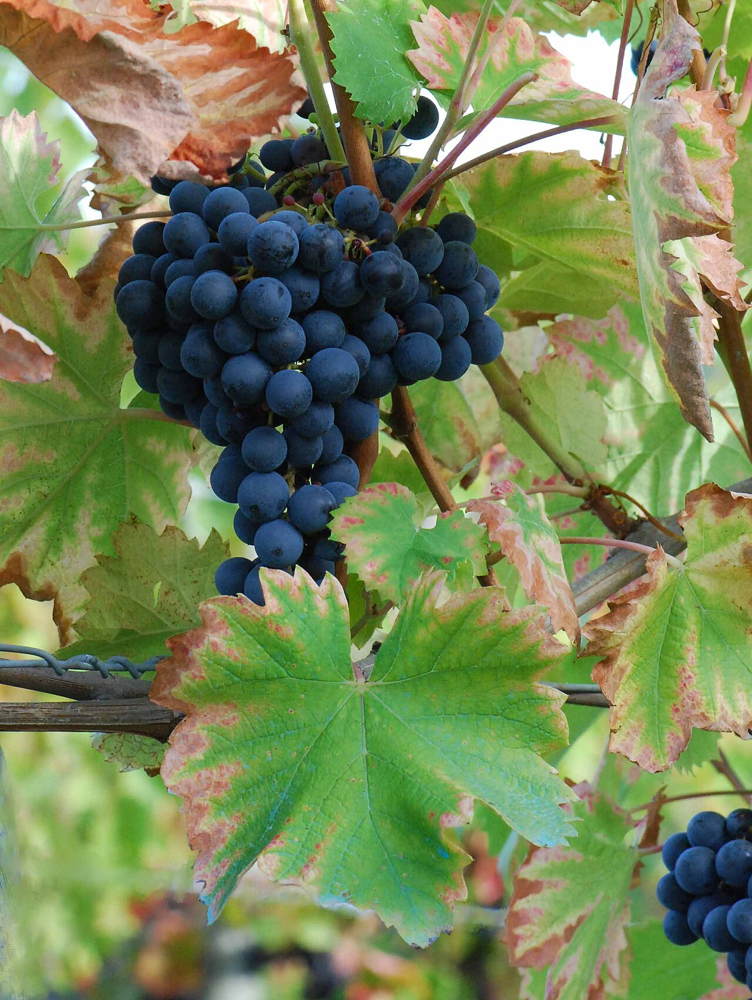

# Mourvèdre

Mourvèdre is a red grape of the Mediterranean coast, known as Monastrell in Spain and Mataro in Australia. It has thick skins, ripens late and tolerates heat and drought, and is often used as a source of structure and colour in blends. In Bandol in Provence and in the southern Rhône it usually appears alongside Grenache and Syrah.

Figure: Mourvèdre. Image: Pancrat, CC BY-SA 3.0, via Wikimedia Commons ([source page](https://commons.wikimedia.org/wiki/File:Balzac_noir-mourvedre.jpg)).

## Definition and synonyms

The English name is Mourvèdre, the Spanish name Monastrell, and Australian growers often say Mataro. These are regional names for the same variety, not different grapes. It belongs to Vitis vinifera and to the Mediterranean group that includes Grenache and Syrah.

In Spain, Monastrell is a core variety in many traditional regions; in France, Mourvèdre more often appears as a blending component. The name differences affect how labels are read, not how the variety is identified.

## Botanical characteristics

Mourvèdre clusters are medium-sized with small berries and thick skins, rich in pigment and tannin. It buds early but ripens very late, needing a long hot season to mature fully; in cool regions or wet autumns it can ripen poorly and leave green tannin.

Thick skins give good disease resistance and heat tolerance, and also a firm tannin structure. The vine is vigorous and needs careful canopy management and yield control, or the foliage becomes dense and the fruit is shaded.

## Main regions

Spain is an important home and centre of planting, with large areas of Monastrell in Murcia, Jumilla and Alicante. Bandol in Provence uses Mourvèdre as one of its main varieties, and the southern Rhône, including Châteauneuf-du-Pape, uses it widely.

Australia, California and South Africa also plant it, usually under the names Mataro or Monastrell. Heat and picking date matter especially for this late-ripening grape: too little heat and both tannin and fruit stay unripe; enough heat and the wine gains dark fruit and spice.

## Typical flavours

Typical aromas include blackberry, black plum and mulberry, often with black pepper, leather, earth and game. The body is medium to full, tannin firm, acidity medium and alcohol often high. In youth the wine can seem tight and closed; with age it develops more complex spice and animal notes.

Compared with [Grenache](ref:grenache), Mourvèdre is deeper in colour, firmer in tannin and higher in acidity; compared with [Syrah](ref:syrah) its fruit leans more to dark berries and earth, with less black pepper. In blends the three often supply fruit, structure and spice in complementary roles.

## Representative wines

Bandol blends are usually Mourvèdre-dominant with Grenache and Cinsault, showing dark fruit, spice and Mediterranean herb notes. In southern Rhône blends, Mourvèdre supplies colour and frame, Grenache supplies fruit and alcohol, and Syrah supplies spice and acidity.

Proportions vary with vintage and producer, so no single wine should be taken as the fixed formula for Mediterranean blends. A variety page describes potential; a wine page records a specific blend.

## Viticulture

The greatest challenge is ripening. Mourvèdre needs enough heat accumulation; picked too late it becomes high in alcohol and low in acidity, picked too early it has green tannin and insufficient fruit. In wet years thick skins give some protection, but grey rot and sour rot still need attention.

Yield control matters as well. Too much crop dilutes colour and tannin and makes the wine thin; moderate water stress helps concentrate flavour, but excessive drought blocks ripening. Irrigation rules and local tradition change the strategy from region to region.

## Common misconceptions

First, whether Mourvèdre is Spanish or French. It has a long history in both countries under different names.

Second, that Mourvèdre is only for blending. It can be made as a single-variety wine, as in Bandol.

Third, that Mourvèdre means coarse, tannic wine. Well-ripened Mourvèdre can show fine spice and fruit detail.

Fourth, that Mataro is a different variety. It is the Australian name for Mourvèdre.

Fifth, that a late-ripening variety always suits hot regions. It needs enough heat, but excess heat also costs acidity and detail.

Mourvedre, known as Monastrell in Spain, is a late-ripening, thick-skinned variety with high tannin and good tolerance of heat and drought. In Provence and the Rhône it is often blended with Grenache and Syrah to add colour, structure and a savoury, gamey note. It needs enough heat to ripen, so its performance varies widely by site. It is not a single spice label. In Bandol, Mourvedre is often blended with Grenache and Cinsault, where its tannin and heat tolerance provide the frame; in Spain, as Monastrell, it can show riper black fruit and herbal notes. Different names, same variety, different labelling traditions. The name on the label may be regional, so the same grape can appear under more than one title.

For Mourvèdre, begin with where it is grown. Then look at how it is labelled, and finally ask whether the style is dry or sweet. The answers point to different choices, not to a single score.

[Wine](ref:wine) explains variety character; [Spain](ref:spain) adds regional performance. Put Mourvèdre between them before deciding what it is.

**At a glance:** A late-ripening red grape from Spain and the Mediterranean coast with thick skins, firm tannin and good heat and drought tolerance; in Provence and the Rhône it is usually blended with Grenache and Syrah. 

Do not reduce Mourvèdre to the name of a wine.

Mourvèdre needs heat to ripen and is usually blended with Grenache and Syrah in Provence and the Rhône; in Bandol it must make up at least half the red blend, which is why the appellation's wines are firm and long-lived.

**Key facts.**

| Item | Detail |
| --- | --- |
| In one line | A late-ripening red grape from Spain and the Mediterranean coast with thick skins, firm tannin and good heat and drought tolerance; in Provence and the Rhône it is usually blended with Grenache and Syrah. |
| Species | Vitis vinifera |
| Key regions | Rhône Valley、Spain |

**Sources and limits.** The key claims about Mourvèdre are checked against the following sources: International Organisation of Vine and Wine (OIV) (Used to check variety descriptions and the Vitis species framework), Oxford University Press (Used for reference on Mourvèdre, Monastrell and Mediterranean planting; Migrated from the former reference list at the end of the article; access date not re-verified), Maison des Vins de Bandol (Used to check the Bandol appellation and the role of Mourvèdre in its blends). Prices, batches and status change; the body is project-written and does not reproduce source text.

For Mourvèdre, this variety was last checked in 2026; prices, batches and availability change, so confirm them against the sources below.

## Further reading

- [Wine](ref:wine): classification, winemaking and regional framework.
- [Red wine](ref:red-wine): tannin, acidity and ageing basics.
- [Spain](ref:spain): the core country for Monastrell.
- [Rhône](ref:rhone): Mourvèdre's place in southern French blends.
- [Provence](ref:provence): the regional background for Bandol.
- [Grenache](ref:grenache): a common blending partner.
- [Syrah](ref:syrah): a common blending partner.

## Related images

Image: Rhône Valley. Credit: Béa at French Wikipedia, Public domain, via Wikimedia Commons ([source page](https://commons.wikimedia.org/wiki/File:Thain1.jpg)). Related image for Mourvèdre.
