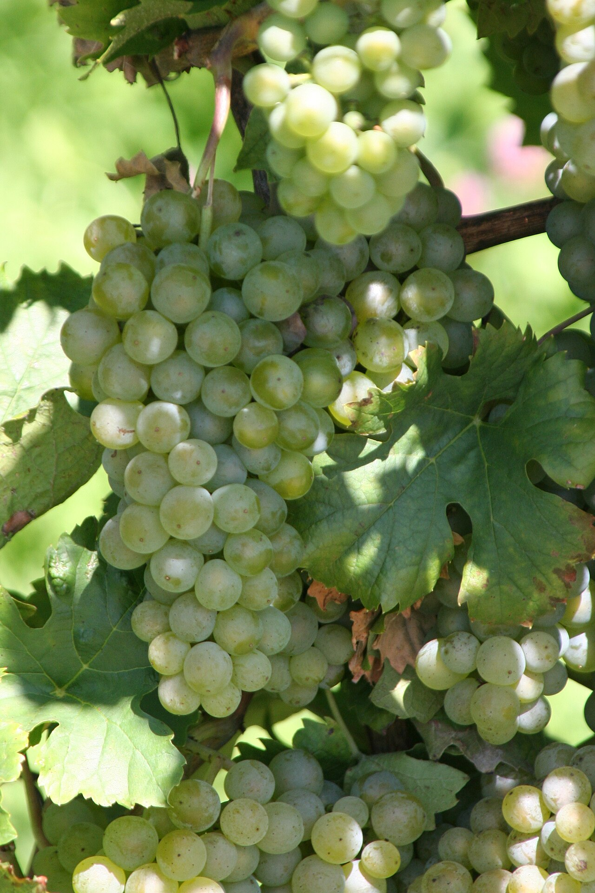

# Müller-Thurgau

A German-bred white grape, a cross of Riesling and Madeleine Royale; early-ripening and high-yielding, with flowers, citrus and a light Muscat note, it is one of Germany’s most planted whites.

In the “Hejiu” variety index, Müller-Thurgau is both a recognisable name and a set of comparable viticultural and winemaking choices. Read it first through its ripening rhythm, acid frame and tannin direction at home, then through what survives or fades when it travels. The gap between Old and New World versions often explains more than the label. For the reader, the point is not a fixed flavour tag but how climate, soil and winemaking decisions turn the same grape into a different wine. This also explains why the same name carries different descriptions across sources: one stresses botany, another market style, another a single region’s rules.

Figure: Müller-Thurgau: Mueller-Thurgau Weinsberg 20060909 (Wikimedia Commons). Image: Rosenzweig, CC BY-SA 3.0, via Wikimedia Commons ([source page](https://commons.wikimedia.org/wiki/File:Mueller-Thurgau_Weinsberg_20060909.jpg)).

## Definition and naming

Müller-Thurgau was bred by the Swiss-German breeder Hermann Müller in 1882 in Thurgau, Switzerland; parentage was long thought to be Riesling × Sylvaner, later corrected to Riesling × Madeleine Royale.

Müller-Thurgau is a vines variety or raw material with a definable botanical origin and cultivation history. The name may come from a place, a shape, a farming habit or a promoter; synonyms and homonyms are common, so check the scientific name or classification first.

## Origin and spread

Early-ripening, high-yielding and cold-tolerant, it suited cooler German sites; in the mid-twentieth century it was Germany’s most planted white, later overtaken by Riesling.

The origin of Müller-Thurgau can usually be traced to a mountain, valley or coast, then spread through trade, migration and replanting after disease. Spread is not copying: in each new environment growers select different clones, rootstocks and pruning.

Müller-Thurgau was bred in 1882 by Hermann Müller in Thurgau, Switzerland, from Riesling and Madeleine Royale. It was long misidentified as a Riesling-Silvaner cross, which helped it trade on Riesling’s name. Rivaner is the same grape under another label, while Liebfraumilch is usually a blend rather than a varietal wine.

## Botany and cultivation

Berries are medium and thin-skinned, early-ripening, with medium acidity; white flowers, citrus, green apple and a light Muscat note.

The performance of Müller-Thurgau depends on budbreak, ripening, vigour, yield and disease resistance. Early varieties carry less risk in cool regions, late varieties need a long autumn; excessive vigour shades fruit, while weak vines crop poorly.

The vine is early-ripening, vigorous and high-yielding, with thin skins and moderate acidity. It suits cool sites where Riesling struggles to ripen, but warm autumns and high yields quickly dilute aroma and acid. Growers control yields, pick early and use cool fermentation to keep white flowers, citrus and a light muscat note.

## Style and palate

It usually makes crisp, inexpensive dry or off-dry whites and is used in mass blends such as Liebfraumilch.

The style of Müller-Thurgau is defined by acidity, tannin or bitterness, alcohol, aroma and texture. It can be made alone or as part of a blend; in a blend it may supply colour, acidity, aroma or structure rather than the dominant flavour.

Müller-Thurgau is usually fermented in stainless steel at low temperature and bottled young, often off-dry. It is not a botrytis or oak-driven variety; lees contact can add a little texture, but new oak usually overwhelms the delicate aroma. Rivaner labels tend to be drier and fresher than Liebfraumilch blends.

## Main regions and representative wines

Representative examples include German Müller-Thurgau and Rivaner, plus plantings in New Zealand, Austria and Switzerland; it is not a premium variety but explains everyday German white structure.

To find representative Müller-Thurgau, start with the place of origin or the most typical region, then compare a New World example. Keep alcohol, sweetness and vintage as close as possible, or you will mistake technique for variety.

Rheinhessen, Pfalz, Baden and Franken are the German core, with Austria, Switzerland, northern Italy, New Zealand and the UK also planting it. Rheinhessen and Pfalz make everyday dry and off-dry wines; Baden is fuller and Franken tighter. The variety rarely reaches premium wine lists, so style and freshness matter more than brand.

## How to drink and pair

To drink Müller-Thurgau, confirm sweetness and alcohol first, then choose temperature and food. Dry high-acid styles suit fat, seafood and salt; sweet styles suit spice, blue cheese and fruit desserts; high alcohol clashes with sweet or very spicy dishes.

Serve at 8–10°C in a medium white glass; over-chilling hides the floral and muscat notes. Salads, vegetables, freshwater fish, chicken and light cheese suit dry versions; off-dry bottles can handle Asian spice. Drink within one to three years and finish an open bottle within two or three days.

## Buying and common misreadings

For Müller-Thurgau, begin with where it is grown. Then look at how it is labelled, and finally ask whether the style is dry or sweet. The answers point to different choices, not to a single score.

### Key dates and figures

- 1970s: in the 1970s–80s, Liebfraumilch exports tied the variety to inexpensive sweet white wine.
- 1980s: from the 1980s, consumers moved to Riesling and drier whites, and plantings fell.
- 1990s: after the 1990s Riesling revival, the variety remained important in Rheinhessen, Pfalz and Baden.
- Alcohol: usually 11–12.5%.

## Further reading and see also

To study Müller-Thurgau, read botanical and viticultural sources first, then taste three wines from different regions side by side. Do not buy many bottles of one style; build a benchmark, then move to blends, sweet or aged versions.

Compare a dry Müller-Thurgau/Rivaner with a Riesling from the same region, then an off-dry Liebfraumilch blend. Fix vintage and sweetness so early ripening, lower acidity and blending are not mistaken for poor Riesling.

- Related: [germany](ref:germany), [riesling](ref:riesling), [white-wine](ref:white), [fermentation](ref:fermentation), [terroir](ref:terroir).
- This variety offers no plant identification, prices or shopping channels; a label name is not a botanical identification.

**At a glance:** A German-bred white grape, a cross of Riesling and Madeleine Royale; early-ripening and high-yielding, with flowers, citrus and a light Muscat note, it is one of Germany’s most planted whites.

Müller-Thurgau was bred in the late nineteenth century by Hermann Müller from Thurgau, who crossed Riesling with Madeleine Royale; it was long treated as a Riesling x Silvaner cross, a claim later corrected by genetic testing. It ripens early and yields generously, which made it a workhorse of German viticulture after the Second World War and a common base for Liebfraumilch. The best sites are cool and well-drained, where the grape keeps a light Muscat note and citrus freshness; warm, high-yielding sites give bland wine. Germany's modern plantings have fallen as growers replant with Riesling, but Müller-Thurgau remains important in Baden, Rheinhessen and the Swiss cantons. A label may say Müller-Thurgau or Rivaner, especially in Austria and Hungary; both names refer to the same variety.
