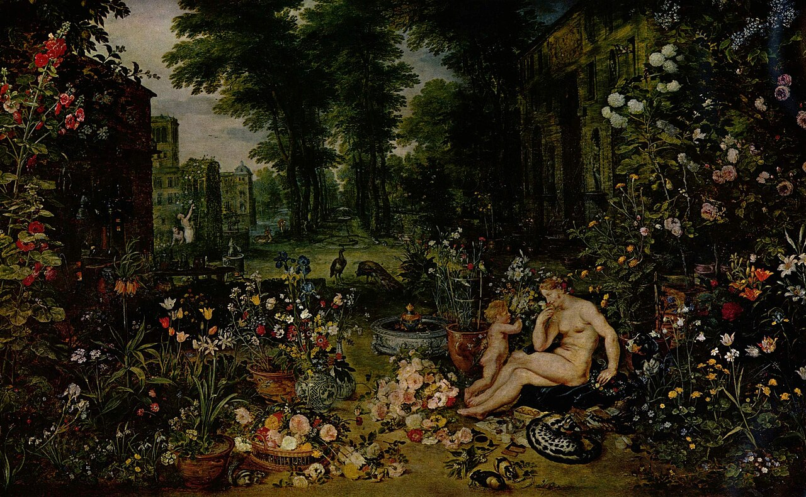

# Muscat

Muscat is not a single variety but an old and varied family of grapes spread across Europe and the Mediterranean. What unites it is aroma: orange blossom, grape, honey and citrus are usually obvious even in youth, and the wines rarely need age to be recognised. That aromatic power is why Muscat appears in almost every wine form—dry white, sweet white, lightly sparkling, fully sparkling, fortified sweet wine and even raisin wine. The first question to ask of any bottle is which Muscat it contains.

Figure: Muscat. Image: Tristan, CC BY 2.0, via Wikimedia Commons ([source page](https://commons.wikimedia.org/wiki/File:Al_Alam_Palace.jpg)).

> **Quick verdict**
> **In one line:** This variety helps you decide whether Muscat suits you, and compare it with other varieties.
>
> - **Best for:** Anyone comparing Muscat with other varieties and trying to pin down the flavour difference.
> - **Not for:** If you want only want a famous producer recommendation and do not care about the variety itself.
> - **Check first:**
>   - Chinese sources use one collective term for the Muscat family, literally "musky fragrance".
>   - The family is usually traced to the eastern Mediterranean and Asia Minor, where sweet Muscat wines were recorded in Greek and Roman writing; the Romans carried the vine to Gaul.

## Definition and synonyms

Chinese sources use one collective term for the Muscat family, literally "musky fragrance". Its most important member is Muscat Blanc à Petits Grains, called Moscato bianco in Italy and also known in France as Muscat de Frontignan. Next comes Muscat of Alexandria, called Zibibbo on the island of Pantelleria in Sicily. A third is Muscat Ottonel, an earlier-ripening, more lightly aromatic Muscat type common in Alsace and Central Europe. The Chinese transcription usually rendered "Mosikatuo" refers to Italian Muscat wine, above all Moscato d'Asti from Piedmont, rather than to a species separate from Muscat. Muscat, Moscato, Muskateller and Moscatel are often the same family under different languages.

## Parentage and origin

The family is usually traced to the eastern Mediterranean and Asia Minor, where sweet Muscat wines were recorded in Greek and Roman writing; the Romans carried the vine to Gaul, Iberia and the Danube basin. Many researchers regard Muscat Blanc à Petits Grains as the oldest and most purely aromatic type. Muscat of Alexandria is also ancient, with larger berries and higher yields, and historically was grown more for the table and for raisins. The relationship between the two is still debated: genetic work shows several independent origins and long chains of vegetative propagation within the family, so it is too simple to call one a mutation of the other. What is certain is that Muscat acquired local names and local styles in Alsace, Italy, southern France, Spain, Portugal, Austria, Hungary, Greece, South Africa and Australia.

## Botanical character

Muscat Blanc à Petits Grains has small to medium bunches and small, thin-skinned berries that turn yellow-green to pale pink, sometimes with a distinct pink blush. The flesh is juicy, sugar rises quickly and acidity is moderate. Muscat of Alexandria has visibly larger bunches and berries, thicker skins and a later ripening date, with higher yields and usually less aromatic concentration. Muscat Ottonel has medium berries, ripens early and has lower acidity. All three carry the family aroma, but at different intensity and with different ripening rhythms. Because the petits grains berries are thin-skinned and the bunches are tight, the variety is prone both to grey rot and to rapid loss of acidity late in the season, making picking date central to quality.

## Viticultural behaviour

The family likes warmth and light, but its members adapt differently. Muscat Blanc à Petits Grains is low-yielding, with tight bunches and thin skins, and is sensitive to grey rot, powdery mildew and spring frost; it performs best on poor, well-drained slopes, and crop control is essential if aroma and acidity are to survive. Muscat of Alexandria is vigorous, high-yielding, heat- and drought-tolerant, reliable in Mediterranean climates, and widely used for table grapes, raisins and sweet wine. Muscat Ottonel ripens early and suits cooler sites, but loses acidity quickly. The common difficulty is the balance between aroma and acidity: heat gives sweet, low-acid fruit, while cool conditions can leave the grapes aromatic but unripe.

## Distribution

Italy has perhaps the richest Muscat diversity. In Piedmont, Moscato d'Asti and Asti are made from Moscato bianco as lightly sparkling and fully sparkling sweet wines; on Pantelleria, Zibibbo makes passito; the south and the islands produce many other Moscato sweets. Southern France is known for vins doux naturels such as Muscat de Beaumes-de-Venise, Muscat de Rivesaltes and Muscat de Frontignan, while Alsace makes mostly dry Muscat d'Alsace. Spanish Moscatel is associated with Valencia and Málaga, Portuguese Moscatel with Setúbal. Austria and Germany call the grape Muskateller and usually make it dry; Hungary, Greece, South Africa, Australia and California also have plantings. Rutherglen in Australia is famous for aged fortified Muscat.

## Legal rules

Muscat has many legal names and very different rules. In Italy, Moscato d'Asti and Asti are DOCGs, the first lightly sparkling, low in alcohol and sweet, the second fully sparkling; both require Moscato bianco as the main variety. Muscat d'Alsace is an AOC, usually dry, and may draw on Muscat Blanc à Petits Grains and Muscat Ottonel among other family members; the exact list follows the current appellation rules. In southern France, Muscat de Beaumes-de-Venise and Muscat de Rivesaltes are vins doux naturels, made by adding neutral spirit during fermentation to retain sugar. Rutherglen Muscat has a local classification based on ageing. Minimum alcohol, residual sugar, variety proportions and ageing all vary, and the appellation on the label usually says more about sweetness and style than the word "Muscat" alone.

## Winemaking and the style spectrum

Muscat covers a full spectrum. The lightest is Moscato d'Asti: cool fermentation with a little carbon dioxide retained in a pressure tank, usually about 5–6% alcohol, sweet but fresh and meant for early drinking. Asti is more strongly sparkling, with a longer bead. Dry Muscat is typified by Alsace, usually fermented in stainless steel so that oak does not mask the aroma, sometimes given lees contact for texture. Vins doux naturels add neutral grape spirit mid-fermentation, preserving both sugar and the fresh Muscat aroma; aged fortified Muscat spends years in oak and develops caramel, orange peel, coffee and nuts. Passito Muscat dries the grapes on racks or in the sun to concentrate sugar and aroma before fermentation. The common aim is to preserve terpene aroma while giving the sweetness a frame of acidity or alcohol.

## Sensory style

Typical Muscat aromas include orange blossom, rose, honeysuckle, grape, lychee, apricot, honey and citrus peel. Muscat Blanc à Petits Grains is the most concentrated, often with clear grape and floral notes; Muscat of Alexandria leans to riper fruit, orange peel and honey, broader rather than finer; Muscat Ottonel is lighter and suits dry wine. Dry Muscat is light to medium in body with moderate acidity and a faint bitterness on the finish, which helps it with asparagus, Asian spices and spicy dishes. Sweet Muscat succeeds when flower and fruit balance the sugar, and good bottles do not feel cloying. Aged fortified Muscat shows raisin, fig, caramel, coffee and cedar, thick in texture and best in small glasses.

## Producers and vintages

In Alsace, Trimbach, Hugel and Weinbach are among the estates that regularly bottle dry Muscat. In Piedmont, Saracco, Vietti and La Spinetta are known for Moscato d'Asti. In Sicily, Donnafugata is associated with Zibibbo sweet wine from Pantelleria. In Rutherglen, Chambers and Campbells represent aged fortified Muscat, while Domaine de Durban is often cited for Beaumes-de-Venise. Vintage matters mainly through acidity and botrytis: cool years give better acid and clearer aroma, hot years give more sugar and less acid, and a damp autumn can bring noble rot—adding complexity to sweet wine but also risking grey rot. Look at picking dates and residual sugar rather than the word "Muscat" alone.

## Common misconceptions

First, that Muscat is one variety; it is a large family with many names. Second, that Muscat is always sweet; Alsace, Austria and Germany often make it dry. Third, that Moscato and Muscat are different species; Moscato is simply Italian. Fourth, that Muscat of Alexandria is the same as Muscat Blanc à Petits Grains; berry size, yield and aromatic concentration differ. Fifth, that fortified Muscat is merely sweet wine with alcohol added; good examples gain complexity from oxidative ageing. Sixth, that Muscat cannot accompany food; dry Muscat works well with asparagus, seafood and spicy dishes.

## Further reading

- [Wine](ref:wine): the broad category to which Muscat belongs.
- [White wine](ref:white-wine): the form in which Muscat is most often met.
- [Aroma](ref:aroma): an entry point to the terpene aroma of Muscat.
- [Fortification](ref:fortification): the key process behind vins doux naturels and fortified Muscat.
- [Alsace](ref:alsace): a leading region for dry Muscat.
- [Italy](ref:italy): the heartland of Moscato and Zibibbo.

## Related images

Image: Aroma. Credit: Jan Brueghel the Elder / Peter Paul Rubens, Public domain, via Wikimedia Commons ([source page](https://commons.wikimedia.org/wiki/File:Jan_Brueghel_d._O._-_Allegorie_van_de_geur.jpg)). Related image for Muscat.
