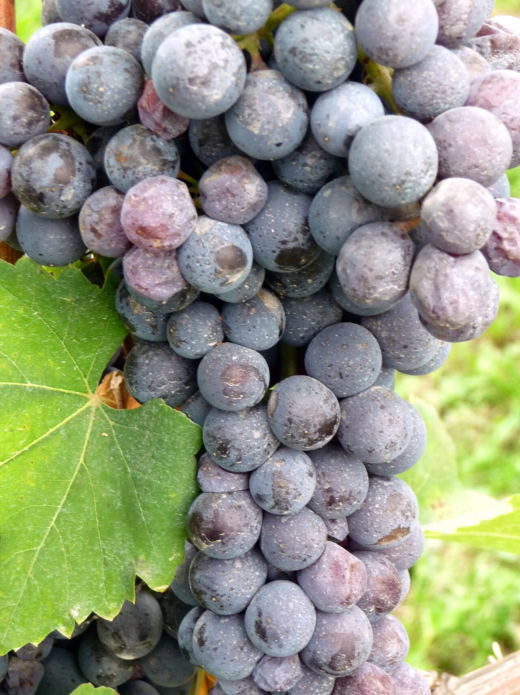

# Nebbiolo

Nebbiolo is the signature red grape of Piedmont in Italy. It ripens late and has thick skins, and the wines are pale in colour yet high in acidity and tannin, with aromas of rose, red cherry and tar when young and dried flowers, leather and truffle with age. Barolo and Barbaresco are both built on it.

Figure: Nebbiolo. Image: Hanna, CC BY 2.0, via Wikimedia Commons ([source page](https://commons.wikimedia.org/wiki/File:Close_up_of_Nebbiolo_cluster_in_Italy.jpg)).

## Definition and synonyms

The Italian name is Nebbiolo, and in the Valtellina area of Lombardy it is also called Chiavennasca. It belongs to the European grape Vitis vinifera and is a distinct old variety, not a local name for Sangiovese or another red grape.

The name is popularly linked to the Italian word nebbia (fog), because it ripens when autumn fog arrives. The origin of the name does not affect identification, which still rests on leaves, clusters, ripening time and aroma.

## Botanical characteristics

Nebbiolo clusters are fairly compact with medium berries, and the skins are thick but low in pigment, so the wine often looks garnet or even brick red and can be mistaken for a light-bodied wine. Budbreak is early, but ripening is very late and needs a long, warm season.

Thick skins bring plenty of tannin and aroma compounds, and acidity stays high. Nebbiolo is sensitive to frost and autumn rain and has a narrow ripening window; in underripe years the tannin can feel harsh and the aroma green.

## Main regions

The core is Piedmont in north-west Italy, where the Langhe hills hold the best-known appellations, Barolo and Barbaresco, with Roero also producing the variety. In Lombardy's Valtellina it is grown as Chiavennasca and usually gives a lighter style.

Outside [Italy](ref:italy) the planted area is limited, with small experimental plots in the United States and Australia, where ripening conditions differ greatly from Piedmont. Region pages describe geography and rules; a variety page describes the potential of the grape.

The Barolo appellation covers 11 communes in the Langhe hills, and Barbaresco covers 3 communes plus one small hamlet of Alba. Soil and altitude differences between communes are often used to explain style: Serralunga d'Alba and Monforte tend toward firmer, longer-lived wines, while La Morra and the village of Barolo itself tend toward more open aromatics. Nebbiolo itself has clones such as Lampia, Michet and Rose, which differ in cluster shape and yield, and nursery and appellation registration affect the planting material growers choose. These differences belong to viticulture and geography, not a quality ranking.

## Typical flavours

Typical aromas are rose, violet, red cherry, plum, tar and liquorice, with dried flowers, leather, earth and truffle emerging with age. Acidity is high, tannin is firm, and body ranges from fairly light to full depending on region, vintage and winemaking. Pale colour with powerful structure is the most commonly misunderstood feature.

For Nebbiolo, begin with where it is grown, then how it is labelled, and finish with whether the style is dry or sweet; that order keeps the account grounded.

## Representative wines

[Barolo](ref:barolo) is the best-known Nebbiolo wine, and its appellation rules require 100% Nebbiolo with at least 38 months of total ageing, including at least 18 months in wood. Barbaresco is usually tighter and reaches its drinking window earlier, and its ageing requirements differ from Barolo's.

Differences between these wines come from commune, soil, picking date and [oak ageing](ref:oak-ageing). A variety page describes Nebbiolo's aromatic and structural potential; wine pages record the decisions of a specific estate.

## Viticulture

The difficulty with Nebbiolo is its long season and narrow ripening window. In cool years it may not ripen fully, leaving harsh tannin and green aromas; in very hot years acidity falls and the wine loses tension. Aspect, altitude and day-night temperature swings therefore matter a great deal.

Yield control affects the concentration of tannin and aroma. High yields give a thinner wine with paler colour, while moderate control gives more focused aroma and a more complete structure. Specific viticultural parameters vary by region and estate, and this variety gives no universal figures.

## Common misconceptions

First, treating Nebbiolo as another name for Barolo. It is the variety; Barolo is the appellation.
Second, equating pale colour with a thin wine. Nebbiolo is low in pigment, yet its tannin and acidity can be powerful.
Third, assuming all Nebbiolo needs decades in bottle. Vintages, regions and winemaking styles differ greatly.
Fourth, assuming Nebbiolo grows only in Piedmont. Valtellina and other places grow it under different names and in different styles.
Fifth, treating a tar note as a fault. Moderate tar with rose is a typical Nebbiolo aroma.

Nebbiolo ripens late and has thick skins, yet its wines can be pale in colour with very high acidity and tannin. Rose, tar and red cherry are classic markers, and Barolo and Barbaresco are built on it. The pale colour can mislead drinkers into expecting a light wine. Ageing potential comes from acidity and tannin, not from colour density, and commune and vintage change the expression.

**At a glance:** The signature red grape of Piedmont in Italy; it ripens late and has thick skins, giving wines that are pale in colour yet high in acidity and tannin, with aromas of rose, tar and red cherry. Barolo and Barbaresco are built on it. 

Read [Red wine](ref:red-wine) for the variety character side of Nebbiolo, and [Oak ageing](ref:oak-ageing) for the regional performance side. Together they locate it.

The usual confusion is to treat Nebbiolo as the name of a wine. Check what it is first, then how the variety is labelled; the two need not agree.

Nebbiolo ripens late and produces pale, high-acid, high-tannin wines; Barolo and Barbaresco rely on long maceration and ageing to soften it, and the best sites are on the Langhe hills.

**Key facts.**

| Item | Detail |
| --- | --- |
| In one line | The signature red grape of Piedmont in Italy; it ripens late and has thick skins, giving wines that are pale in colour yet high in acidity and tannin, with aromas of rose, tar and red cherry. Barolo and Barbaresco are bu… |
| Species | Vitis vinifera |
| Key regions | Italy |

**Sources and limits.** The key claims about Nebbiolo are checked against the following sources: International Organisation of Vine and Wine (OIV) (variety descriptors and the Vitis species framework), Oxford University Press (Consulted for entries on Nebbiolo's botany, aromas and regions), Consorzio di Tutela Barolo Barbaresco Alba Langhe e Dogliani (the Barolo and Barbaresco areas and ageing rules). Prices, batches and status change; the body is project-written and does not reproduce source text.

For Nebbiolo, this variety was last checked in 2026; prices, batches and availability change, so confirm them against the sources below.

## Further reading

- [Red wine](ref:red-wine): red wine categories and basic winemaking.
- [Italy](ref:italy): where Piedmont sits in the Italian wine map.
- [Barolo](ref:barolo): the best-known wine built on Nebbiolo.
- [Oak ageing](ref:oak-ageing): how large and small barrels shape Nebbiolo.

## Related images

Image: Barolo. Credit: Biskuit, CC BY-SA 2.0, via Wikimedia Commons ([source page](https://commons.wikimedia.org/wiki/File:Cascin_Adelaide_Barolo_%26_decanter.jpg)). Related image for Nebbiolo.
