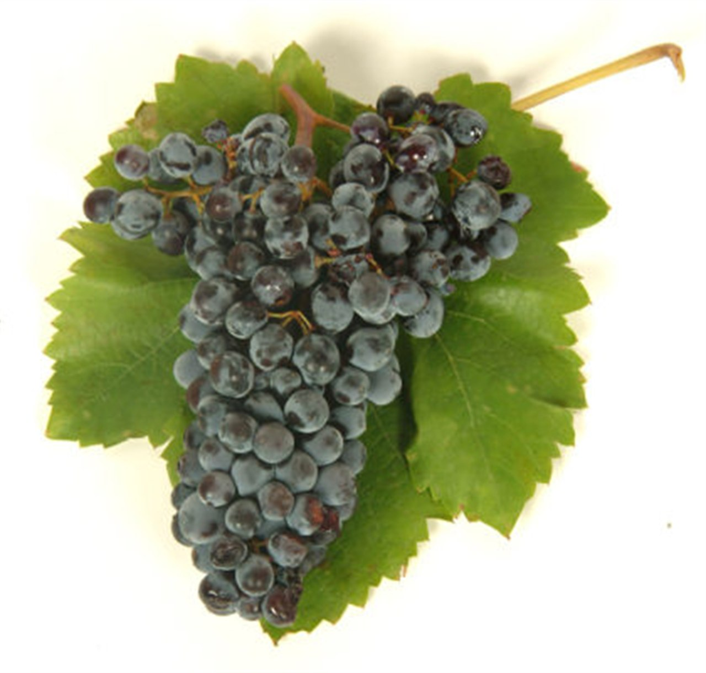

# Nero d’Avola

Sicily’s most important red grape, deep in colour with medium-high tannin, blackberry, black cherry, plum and spice; it performs differently around Noto, Vittoria and Etna and is often blended with Frappato.

Figure: Nero d’Avola: Grappolo di Nero d'Avola (Wikimedia Commons). Image: Fabio Ingrosso from Italy, CC BY 2.0, via Wikimedia Commons ([source page](https://commons.wikimedia.org/wiki/File:Grappolo_di_Nero_d%27Avola.jpg)).

## Definition and naming

Nero d'Avola is Sicily's most widely planted and representative native red grape. In the Italian ministry's wine-grape register its registered name is Calabrese, "from Calabria", and Nero d'Avola is only the official registered alias. The old theory that the variety reached Sicily via Calabria has not been supported by later research. The name literally means "black grape from Avola"; Avola is a small town near Pachino in the province of Siracusa in southeast Sicily, where cultivation is recorded as early as the fifteenth century.

Nero d'Avola and Calabrese on a label are the same variety, and should not be confused with other dark Sicilian native reds. Beyond the variety, the label may name an appellation such as Vittoria, Noto or Etna, or a single vineyard; site and terroir often matter more than the variety itself. Reading the variety means keeping the registered name, appellation rules and the vague market image of "Sicily's workhorse red" apart.

## Origin and spread

The precise ancestors and arrival route remain open to debate. One theory holds that Greek colonists brought the vine to Sicily together with the Aegean bush-training method; the registered name Calabrese preserves the early Calabrian origin conjecture, though modern research does not support that route. What is settled is that about 98% of Italy's Nero d'Avola plantings are concentrated in Sicily itself, and the variety's roots run far deeper at home than overseas. Island plantings total about 16,000 hectares, making it Sicily's leading red grape and roughly the sixth most planted variety nationwide in Italy.

Its island distribution tracks terrain and climate: the warm, dry plains around Noto and Pachino in the southeast reach high ripeness; central hills at 300 to 600 metres on clay-limestone are cooler and keep better acidity; the west around Trapani and Marsala has traditionally been mixed with international varieties; and the high, cooler volcanic soils of Etna produce a tighter, leaner style. Small trials exist overseas in the United States, Australia, South Africa and South America, but at limited scale and influence; the variety's expression remains centred on Sicily.

## Botany and cultivation

Berries are medium with thick, deeply coloured skins; bunches are medium to large, and the variety ripens mid to late. It tolerates heat and drought and suits Sicily's strong sunlight. The vine is vigorous, and unchecked crops dilute colour and structure with thin fruit; after thinning and yield control the skin-to-juice ratio rises and colour, tannin and aroma concentrate. Disease resistance is moderate, and bunch rot and uneven ripening need watching if rain arrives near harvest.

Cultivation balances ripeness against acidity. Southeast lowland sites easily overripen, swelling alcohol and dropping freshness; central highland and volcanic sites ripen slowly and keep acidity and flowers, though vintage variation is wider. Both traditional alberello bush training and modern trellising are used, and planting density, pruning and picking batches directly shape the finished wine. Deep-rooted old vines crop naturally low and are the basis of premium single-vineyard bottlings.

## Style and palate

A typical Nero d'Avola is deep in colour, with blackberry, black cherry, plum, stewed plum, sweet spice, dark chocolate and warm earth; tannin is medium-high, the body full, and acidity tighter or looser according to site climate. Warm southeast sites lean jammy and ripe-fruited with alcohol weight; central hills are more elegant, with violet flowers and clear acidity; around Etna the style leans mineral and volcanic rock. Young fruit is direct; with age it develops dried fruit, leather and smoked spice, and good examples age for 3 to 15 years, flagship wines beyond a decade.

The classic blend is with Frappato: Nero d'Avola supplies colour, body and structure, while Frappato adds flowers, lightness and red fruit. Single-varietal wines span a wide range, from fresh everyday reds to dense, concentrated flagship bottlings, depending on site, yield, extraction and oak. Compared with other [sicily](ref:sicily) reds, its strength is dark fruit and pigment rather than fine flowers; fermentation temperature, maceration length and new-oak proportion decide whether the final wine leans fruit or structure.

## Main regions and representative wines

Cerasuolo di Vittoria is Sicily's only DOCG, around Ragusa and Caltanissetta. Rules require a Nero d'Avola and Frappato blend, with Frappato at 30% to 50% and the remainder Nero d'Avola; the two grapes ferment separately with short temperature-controlled maceration and are blended after alcoholic fermentation. Southeast Noto and Pachino produce ripe, concentrated single-varietal reds; the central Regaleali area follows an elegant, high-acid line, and the Etna surroundings offer a volcanic-soil expression.

Among producers, Azienda Agricola COS is based at Vittoria and was founded in 1980, associated with Giusto Occhipinti. Pithos is 100% Nero d'Avola, grown on red clay-limestone soil at 230 metres in Guyot training, with vines around 25 years old, harvested from late September to early October, and spontaneously fermented and aged in terracotta amphorae. Gulfi, also at Vittoria, makes a representative Cerasuolo di Vittoria blend. Pietradolce focuses on Etna volcanic sites; Tasca d'Almerita's Regaleali estate has grown Nero d'Avola on the San Lucio site since 1954. Cusumano, Morgante, Donnafugata and Firriato are other familiar island names.

## How to drink and pair

Medium-bodied Nero d'Avola is best at 14–16°C; heavy flagship examples can sit at 16–18°C. Too cool and tannin and acidity tighten, too warm and alcohol and jammy fruit amplify. Tannic examples benefit from about half an hour of decanting; older bottles should be settled and decanted off deposit. A broad-bowled glass gives dark fruit and spice room to unfold.

Pairing revolves around Sicilian and Mediterranean red meat: grilled lamb, beef stew, sausages and cured meats, aubergine tomato dishes, mushroom stews and hard aged cheeses all absorb its tannin and acidity. Tomato-sauce pasta, grills and game are safe matches; delicate seafood or spicy dishes are overwhelmed by tannin and alcohol. As a [red-wine](ref:red), its concentration suits substantial main courses.

## Buying and common misreadings

One common mistake is writing off Nero d'Avola as a jammy red across the board. That impression mostly comes from high-yield southeast lowland wines; central hills, volcanic soil and low-yield old-vine examples have clearer acidity and finer aroma, and are not heavy in style. Another mistake is relying on the variety name alone: Vittoria blends, Noto single varietals, Etna volcanic wines and Regaleali hill wines differ in ripeness, acidity and tannin, and vintage strongly affects picking rhythm on the hot island.

When buying, first separate DOCG blend, DOC single varietal and IGT tiers, then read site, producer and vintage. Old vines are not a legal grade; actual yield and vine age follow the producer's note. High alcohol is not itself a mark of quality; balance is. Store away from heat, strong light and vibration; structured reds keep two to three days after opening, and a vacuum stopper slows oxidation.

## Further reading and see also

The most direct comparison is to taste a Cerasuolo di Vittoria blend, a Noto single varietal and an Etna or Regaleali hill wine in the same vintage, setting acidity, fruit and tannin finesse side by side. It ties closely to the volcanic and hill-land [terroir](ref:terroir), the [oak-ageing](ref:oak) choices, the ripeness differences driven by [vintage](ref:vintage), and can be read alongside entries for blending partners such as Frappato.

- Related: [sicily](ref:sicily), [red-wine](ref:red), [terroir](ref:terroir), [oak-ageing](ref:oak), [vintage](ref:vintage).

**In brief:** Sicily’s most important red grape, deep in colour with medium-high tannin, blackberry, black cherry, plum and spice; it performs differently around Noto, Vittoria and Etna and is often blended with Frappato. 
