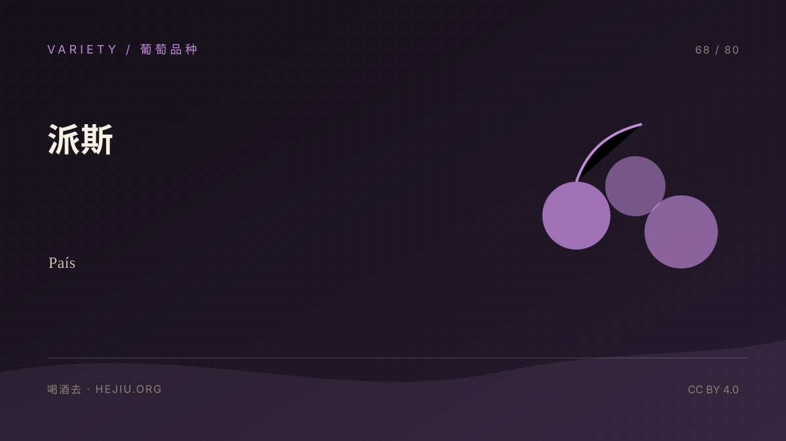

# País

País is one of Chile's oldest cultivated red grapes, today preserved mainly in dry old vineyards of Maule, Itata and Bío-Bío in the south. Its thin skins give a pale colour, acidity stays bright and tannins stay soft; red cherry, strawberry, dried herbs, white pepper and earth are the usual notes. It was the workhorse of Chile's bulk-wine era and has been reassessed in the recent natural-wine revival.

Figure: País. Project-generated or category illustration used for grapes context; not a photograph of the subject.

> **Quick verdict**
> **In one line:** This variety helps you decide whether País suits you, and compare it with other varieties.
>
> - **Best for:** Anyone comparing País with other varieties and trying to pin down the flavour difference.
> - **Not for:** If you want only want a famous producer recommendation and do not care about the variety itself.
> - **Check first:**
>   - Treat País as a light-bodied red, served around 14–16°C, dropping to the low teens in hot weather to keep acidity and fruit upright; too warm.
>   - The first misreading is to dismiss all País as cheap wine.

## Definition and naming

In Spanish, país means "country"; labels also carry local names such as Negra Criolla and Criolla. In California the same lineage is Mission, and in Mendoza it is Criolla Chica: one group of old seedling descendants carried across the Atlantic from Spain. País is often listed as a descendant of Listán Negro, but newer DNA fingerprinting matches it to Spain's Listán Prieto, the old variety surviving in the Canary Islands. It also differs from Criolla Chica and Mission after centuries of isolation, so the clones do not taste identical. As a Vitis vinifera grape, País has no widely circulated modern clone; plantings use vineyard-selected old material, and vine age, training and site shape the result ([terroir](ref:terroir)).

## Origin and spread

País entered South America alongside colonial expansion. In the 16th century conquistadors carried vines to Mexico, then south through Peru into Chile; references often take the vines Cortés brought to Mexico in 1520 as the route's starting point. Monasteries and estates used it for sacramental and table wine, and for more than four centuries it remained Chile's principal red grape, retreating only after Bordeaux varieties were widely planted in the late 20th century.

A 2024 genetic study of old Chilean Criolla varieties found that the earliest vineyards were built almost entirely on the foundation variety Listán Prieto, of which País is the Chilean local type; the same foundation became Mission in California and Criolla Chica in Argentina. Muscat of Alexandria, introduced later in the 17th century, crossed with this foundation to produce American-born Criolla grapes, while País keeps the earlier background.

In the mid-to-late 20th century, País was lumped with cheap bulk wine for its high yields and light body, and old vines in dry valleys were pulled out for Cabernet Sauvignon and Merlot. From the 2000s onward, sommeliers, natural-wine makers and small southern estates rediscovered dry-farmed blocks two or three centuries old, and País moved back onto restaurant lists and into fine-wine discussions.

## Botany and cultivation

Berries are medium-small with thin skins and moderately compact bunches; it ripens in mid-to-late season and needs ample autumn sun in Chile's cooler southern valleys. Ripe fruit is pale, juicy, keeps acidity naturally, and carries modest tannin and skin thickness, explaining its light style. Old vineyards use a bush (gobelet) training system; many blocks rely entirely on rainfall, with roots searching through coastal-range gravel and volcanic soils. Low yields concentrate the berries, while opened-up yields thin the fruit and dilute colour and structure.

Risks sit at ripening and disease alike. Damp springs and flowering rain affect fruit set, and thin-skinned bunches face fungal pressure around harvest. Picked too late, acidity drops and the alcohol turns hot; picked early, green stems and herbal notes remain. Old-vine plots still depend on pruning, thinning and canopy management, even if the tools and training are traditional.

## Style and palate

Typical País ranges from pale ruby to light purple, with red cherry, strawberry, cranberry, dried herbs, white pepper and damp earth, sometimes orange peel and wild flowers. The entry is light and bright in acidity, with fine, not heavy, tannin and a dry finish. It is not a dark, muscular variety; fruit and herbal freshness sit ahead of oak, and the spine comes mainly from acidity rather than tannin.

The most traditional expression is pipeño: whole-cluster or lightly pressed fermentation in clay jars, old barrels or concrete, keeping a little carbon dioxide and cloudiness, bottled in around one-litre bottles with fresh fruit, faint fizz and modest alcohol. Refined examples use controlled fermentation and ageing for cleaner single-vineyard wines ([fermentation](ref:fermentation)). Most País is drunk young; good old-vine sites can age for several years, developing dried fruit, leather and spice, but it does not rely on long oak ageing, and too much new wood covers the light fruit. Judge potential by intact acidity and softly ripe tannins, not colour depth ([oak-ageing](ref:oak)).

## Main regions and representative wines

Within Chile, País concentrates in the south-central valleys. Maule Valley holds one of the largest traditional plantings; Wines of Chile statistics list around 5,991 hectares of País in Maule. Itata Valley sits further south between coastal ranges, where cool climate and granite and slate blocks gather revived small estates. Yumbel in Bío-Bío keeps family-inherited old vines. Mission and Criolla types in California, Mexico and Argentina belong to the same overseas lineage ([itata](ref:itata)).

Chile's 2004 variety survey put País at about 14,858 hectares nationwide, roughly 13% of vineyard area, second only to Cabernet Sauvignon. Much went into bottled bulk wine and blending material; only a small share of southern old-vine plots reached the fine-wine channel. Published area has since fallen from that peak, yet the old blocks' profile has risen.

Representative producers include J. Bouchon in Maule, whose Pais Viejo built the estate's reputation; Cacique Maravilla in Yumbel, Bío-Bío, run by the Manuel Moraga family, traced to 1776 with about 16 hectares of dry-farmed bush vines; Pedro Parra y Familia and Clos des Fous, working traditional varieties in Itata and Maule; De Martino, whose Las Olvidadas series blends old-vine País with Cinsault from Guarilihue; and Los Vinateros Bravos, Garage Wine Co and Louis-Antoine Luyt in the pipeño and natural-wine direction.

## How to drink and pair

Treat País as a light-bodied red, served around 14–16°C, dropping to the low teens in hot weather to keep acidity and fruit upright; too warm, alcohol and herbal bitterness float up. A medium-bowl universal red glass is enough. Young pipeño is drunk fresh after opening and does not need long decanting; standing too long costs its lively fizz and fruit.

Pairings stay light, fresh and savoury: empanadas, grilled seafood, ceviche, roast chicken and mild charcuterie match its bright acidity, as do soft cheeses, herb salads and pepper dishes. Light tannins mean it does not demand heavy red meat; rich, greasy sauces press the fruit down, and a more structured red would be safer ([red-wine](ref:red)).

## Buying and common misreadings

The first misreading is to dismiss all País as cheap wine. Under the same name, a dry-farmed old vine, a low-yield small plot and an industrial high-yield block can be different wines; region, producer and vine-age statement predict style better than the variety name alone. The second is to read "old vines" as a legal grade: the claim comes from plot history, not a certified classification, and old vines can underperform if managed loosely.

The third misreading is to equate País with Listán Negro, Mission or Criolla Chica. They share a lineage but have diverged in clone and flavour through isolation and selection; comparisons should include origin, vintage and winemaking together. Check importer storage and transport temperature: light-bodied, high-acid País is heat-sensitive, and a hot-stored bottle can show muted fruit and abrupt acidity.

## Further reading and see also

The most useful comparison is to set an old-vine Itata or Maule wine beside traditional Cinsault or Carignan from the same place, recording acidity, fruit concentration and tannin differences; then contrast a pipeño-style natural wine with a refined version to see how far winemaking pushes this line. País remains a regional variety, and synonyms, clone assignments and area figures shift with the survey year; for formal citation, check the VIVC register and official regional statistics.

- Related: [itata](ref:itata), [red-wine](ref:red), [terroir](ref:terroir), [fermentation](ref:fermentation), [oak-ageing](ref:oak).
