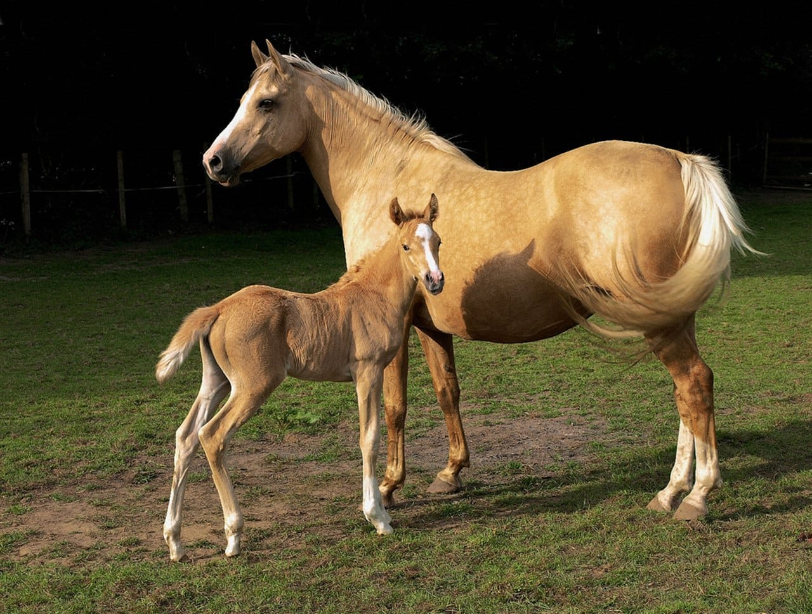
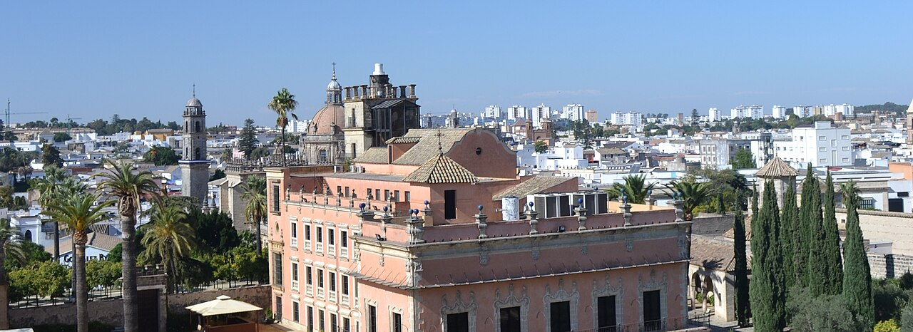

# Palomino

Palomino is the white grape of Andalusia and the main variety of Sherry. It is not aromatic. Acidity is low, sugar is moderate at best, and the flavour is neutral; on its own the wine often tastes thin. That neutrality is exactly what makes it a blank canvas in the cellars of Jerez, where biological ageing under flor or oxidative ageing in oak writes the style. To understand Palomino you have to look past the grape to fortification, ageing and the solera, the machinery that turns a plain white wine into the whole spectrum from Fino to Oloroso (ref:fortified-wine).

Figure: Palomino. Image: (a friend of) Kvetina-Marie, CC BY 2.0, via Wikimedia Commons ([source page](https://commons.wikimedia.org/wiki/File:Mare_and_foal_(Kvetina-Marie).jpg)).

## Definition and synonyms

The variety is Palomino. In the Sherry zone the formal name is Palomino Fino, marking the selection used for fino-style wines; in the Canary Islands it is Listán Blanco, and old Jerez texts also write Palomino de Jerez. South Africa once called it White French, which has nothing to do with any French variety. It belongs to Vitis vinifera. Keep the categories apart: Palomino is a grape, Sherry and Jerez are fortified wines, Fino, Manzanilla and Oloroso are styles, and Pedro Ximénez is another grape. Treating "Palomino" and "Sherry" as synonyms is the commonest mistake.

## Parentage and origin

The parents of Palomino are not established. Research has linked it to old varieties of central Spain, but no parent pair is settled. Two popular stories explain the name: one honours Fernán Yáñez Palomino, a knight of Alfonso X of Castile in the 13th century; the other derives it from paloma, "dove", referring to berry colour or leaf shape. Neither is proven. What is certain is several centuries of cultivation in Andalusia, and its rise to the dominant variety of the zone during the Sherry boom of the 19th century. The chalk soils and dry climate of Jerez also shaped how it is farmed.

## Botanical character

Bunches are large and fairly loose; berries are large and round, yellow-green at ripeness, with thin skins. Thin skins make the vine prone to grey rot and powdery mildew, and they demand gentle pressing so that bitter compounds stay out of the juice. The pulp is juicy, sugar accumulation moderate to low, acidity low, aroma neutral. Leaves are large and five-lobed. Palomino has little potential alcohol, which is why Sherry base wine is usually only 11% to 12%; the rest of the strength comes from adding grape spirit (ref:fortification). Its weaknesses — low acid, low sugar, little flavour — become virtues inside a distilling and ageing system.

## Viticultural behaviour

The vine is vigorous and high-yielding; without crop control the fruit tastes even thinner. It suits the albariza of Jerez, a white chalk soil with calcium and magnesium that forms a hard crust, called bujeo, in the dry season, limiting evaporation while storing winter rain for the vine's summer needs. Traditional pruning is vara y pulgar, a spur plus a replacement cane, at fairly low planting density. Picking usually begins in early September, by hand or machine, and the fruit must reach the winery quickly to limit oxidation. High yield and thin skins are the two management problems growers plan around.

## Distribution

The core is the Sherry triangle of southern Spain: Jerez de la Frontera, Sanlúcar de Barrameda and El Puerto de Santa María, within the DO Jerez-Xérès-Sherry or the DO Manzanilla-Sanlúcar de Barrameda (ref:jerez). Condado de Huelva also grows it, and Montilla-Moriles, dominated by Pedro Ximénez, has Palomino as well. The Canary Islands grow it as Listán Blanco for local whites. South Africa, Australia and the United States have small plantings, mostly for Sherry-style wines or distillation.

## Legal rules

Sherry is regulated by the DO Jerez-Xérès-Sherry and the DO Manzanilla-Sanlúcar de Barrameda. The permitted varieties are Palomino, Pedro Ximénez and Moscatel, with Palomino accounting for the great majority. Strength after fortification is the decisive fork: about 15% to 15.5% alcohol allows flor to grow and leads to biological ageing, while about 17% to 18% suppresses flor and leads to oxidative ageing. Ageing periods, the number of solera stages and label terms such as Fino, Amontillado, Oloroso, Palo Cortado, Cream and VORS are all regulated. Exact strengths and minimum ages follow the current rules.

## Winemaking: two routes of ageing

Base wine is fermented cool in stainless steel or old casks into a dry white of about 11% to 12% alcohol and low acidity, then fortified with grape spirit. The biological route sets strength near 15%, allowing flor, a film of yeast, to grow on the surface (ref:flor). Flor consumes alcohol and oxygen, produces acetaldehyde and yeasty aromas, and protects the wine from oxidation. Sanlúcar's humid coastal air gives a thicker flor, a lighter and saltier wine — the difference between Manzanilla and Fino. The oxidative route raises strength above 17%, so flor cannot survive and the wine meets air in oak, slowly gaining nuts, caramel and spice. Amontillado starts biologically and then turns oxidative; Palo Cortado is the rarer path between the two.

## The solera system

Sherry ages by blending across years rather than by vintage. In the solera system, wine of one style sits in rows of casks, the criaderas, and moves gradually downward, with the oldest row, the solera, drawn for bottling (ref:solera). Each year a proportion is taken out (saca) and replaced from the row above (rocío), and the cycle keeps the style stable. As a result, "vintage" means little in Sherry, although single-vintage (añada) and single-cellar bottlings have appeared in recent years. VORS marks an average age of at least 30 years and belongs to the rare, old category.

## Sensory style

Fino and Manzanilla are pale straw in colour, with bread dough, almond, green apple, sea salt and a hint of herbs. They are dry, light and low in acid but strongly saline, with a bitter-almond finish. Amontillado turns amber, with hazelnut, caramel, leather and orange peel. Oloroso is darker still, with walnut, toffee, cinnamon and dried fruit, and a full body. Palo Cortado combines the finesse of the first with the weight of the second. The sweetness of Cream and PX comes from added Pedro Ximénez or concentrated juice, not from Palomino.

## At the table

Fino and Manzanilla suit olives, Iberian ham, fried fish, seafood and tapas, served at 6 to 8 °C and drunk soon after opening. Amontillado works with soup, mushrooms, poultry and semi-hard cheese; Oloroso with red meat, game and strong cheese; PX and Cream with desserts and blue cheese. Sherry is among the most food-friendly fortified wines and should not be confined to the end of the meal (ref:wine). That is also why it has long lived as a bar wine in its homeland.

## Producers and vintages

Jerez names include González Byass with Tío Pepe, Barbadillo, Lustau, Valdespino, Osborne, Williams & Humbert and Hidalgo-La Gitana for Manzanilla; Equipo Navazos and Callejuela have become known for selected casks. Because of the solera, vintage differences are averaged out; in single-vintage bottlings and old VORS wines, climate and cellar position still leave a trace. Style, age and cellar matter more than the year.

## Common misconceptions

First, that Palomino is a sweet grape; it is dry and neutral, and sweetness comes from PX or concentrated juice. Second, that all Sherry is sweet; Fino, Manzanilla, Amontillado and Oloroso are mostly dry. Third, that flor is a grape or an additive; it is a natural film of yeast. Fourth, that Palomino is only for Sherry; it also goes into Brandy de Jerez and still white wines. Fifth, that Manzanilla is a grape; it is the Sherry style of Sanlúcar. Sixth, that Sherry has no vintages; traditionally true, but single-vintage bottlings are growing in number.

**At a glance:** A white grape of Andalusia and the main variety of Sherry, neutral and low in acidity, whose style comes from biological ageing under flor or oxidative ageing in a solera. 

## Further reading

- [Wine](ref:wine): the broad category to which Palomino belongs.
- [Fortified wine](ref:fortified-wine): the drink style of Sherry.
- [Jerez](ref:jerez): the home region of the grape.
- [Fortification](ref:fortification): the step that sets the wine's path.
- [Flor](ref:flor): the yeast film behind biological ageing.
- [Solera](ref:solera): the blending system used for ageing.

## Related images

Image: Jerez. Credit: Annie and Andrew, CC BY 2.0, via Wikimedia Commons ([source page](https://commons.wikimedia.org/wiki/File:(Jerez_de_la_Frontera)_DSC_0560_(6271831479)_(cropped).jpg)). Related image for Palomino.
