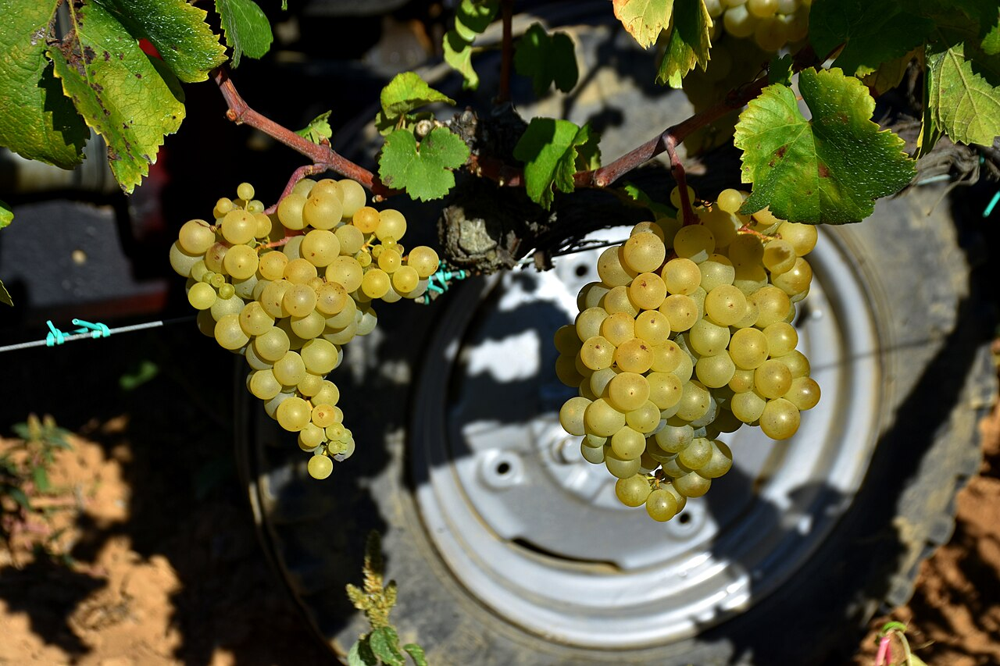
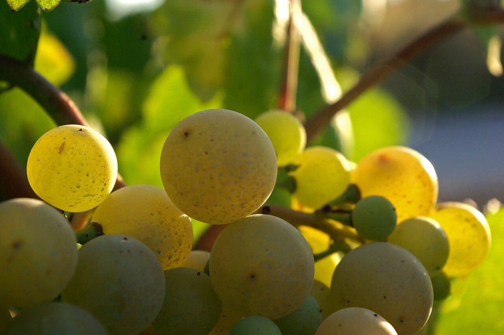

# Parellada

A white grape of Penedès, Catalonia, one of Cava’s three main varieties; high in acidity, light in body, with green apple, citrus and white flowers, often blended with Xarel·lo and Macabeo for freshness.

In the “Hejiu” variety index, Parellada is both a recognisable name and a set of comparable viticultural and winemaking choices. Read it first through its ripening rhythm, acid frame and tannin direction at home, then through what survives or fades when it travels. The gap between Old and New World versions often explains more than the label. For the reader, the point is not a fixed flavour tag but how climate, soil and winemaking decisions turn the same grape into a different wine. This also explains why the same name carries different descriptions across sources: one stresses botany, another market style, another a single region’s rules.

Figure: Parellada: Temps de verema Parellada la més tardana. - Flickr - Angela Llop (Wikimedia Commons). Image: Angela Llop from Spain, CC BY-SA 2.0, via Wikimedia Commons ([source page](https://commons.wikimedia.org/wiki/File:Temps_de_verema_Parellada_la_m%C3%A9s_tardana._-_Flickr_-_Angela_Llop.jpg)).

## Definition and naming

Parellada comes from Penedès, Catalonia, and is one of Cava’s three main varieties; the name may come from “parell” or a parcel name.

Parellada is a vines variety or raw material with a definable botanical origin and cultivation history. The name may come from a place, a shape, a farming habit or a promoter; synonyms and homonyms are common, so check the scientific name or classification first.

## Origin and spread

It adapts to Mediterranean climate and limestone soils, with high acidity and light body; high altitude and sea-breeze sites perform better.

The origin of Parellada can usually be traced to a mountain, valley or coast, then spread through trade, migration and replanting after disease. Spread is not copying: in each new environment growers select different clones, rootstocks and pruning.

Parellada is a Catalan white grape from Penedès and one of the three traditional Cava varieties, alongside Macabeo and Xarel·lo. It was already planted when Cava industrialised in the late nineteenth century, and its late ripening and high acidity made it a natural base-wine variety. The name’s etymology is uncertain and it is not a synonym for Macabeo.

## Botany and cultivation

Berries are medium and thin-skinned, mid-late ripening, with high acidity; green apple, lemon, white flowers, fennel and mineral.

The performance of Parellada depends on budbreak, ripening, vigour, yield and disease resistance. Early varieties carry less risk in cool regions, late varieties need a long autumn; excessive vigour shades fruit, while weak vines crop poorly.

The vine is late-ripening with thin skins, moderate vigour and a slow sugar build, which keeps alcohol low and acidity high. Penedès limestone and clay, sea breezes and altitude help preserve green apple and citrus; thin skins make grey rot a real risk, so ventilation and careful harvest timing matter.

## Style and palate

It is mainly used in Cava base wine for freshness and acidity; still whites are light and usually blended.

The style of Parellada is defined by acidity, tannin or bitterness, alcohol, aroma and texture. It can be made alone or as part of a blend; in a blend it may supply colour, acidity, aroma or structure rather than the dominant flavour.

Parellada is usually whole-cluster pressed for base wine, fermented cool and kept away from oak. In Cava it supplies acidity and lightness; second fermentation and lees ageing add bread, nuts and cream. Still varietal versions are rare because the grape alone can taste lean, so blending with Macabeo and Xarel·lo is the norm.

## Main regions and representative wines

Representative examples include Parellada base wines in Cava, Penedès still whites and blends from Recaredo and Gramona.

To find representative Parellada, start with the place of origin or the most typical region, then compare a New World example. Keep alcohol, sweetness and vintage as close as possible, or you will mistake technique for variety.

Alt Penedès and Baix Penedès are the core, with Costers del Segre also growing the variety; the Cava DO covers a wider area. Recaredo, Gramona, Codorníu and Freixenet are useful reference houses, while Can Ràfols dels Caus has made experimental still blends. Soil and altitude explain more than the variety name alone.

## How to drink and pair

To drink Parellada, confirm sweetness and alcohol first, then choose temperature and food. Dry high-acid styles suit fat, seafood and salt; sweet styles suit spice, blue cheese and fruit desserts; high alcohol clashes with sweet or very spicy dishes.

Serve Cava at 6–8°C and still Parellada at 8–10°C in a tulip or white-wine glass. Seafood, fried food, nuts, salads and light cheese suit the acidity; Cava also works with Iberian ham and tapas. Finish sparkling bottles quickly and still bottles within one or two days.

## Buying and common misreadings

Start with where it is grown. From there, consider how it is labelled, then whether the style is dry or sweet. That is how a practical judgment about Parellada is built.

## Further reading and see also

To study Parellada, read botanical and viticultural sources first, then taste three wines from different regions side by side. Do not buy many bottles of one style; build a benchmark, then move to blends, sweet or aged versions.

Compare Parellada, Macabeo and Xarel·lo in the same Cava blend, then a still Parellada beside a still Macabeo. Fix dosage, vintage and lees ageing so the variety’s acidity and lightness are not confused with dosage or cellar work.

- Related: [xarel-lo](ref:xarello), [macabeo](ref:macabeo), [sparkling-wine](ref:sparkling), [white-wine](ref:white), [fermentation](ref:fermentation).
- This variety offers no plant identification, prices or shopping channels; a label name is not a botanical identification.

**At a glance:** A white grape of Penedès, Catalonia, one of Cava’s three main varieties; high in acidity, light in body, with green apple, citrus and white flowers, often blended with Xarel·lo and Macabeo for freshness.

[Xarel·lo](ref:xarello) and [Sparkling wine](ref:sparkling) are the nearest useful comparisons: one clarifies variety character, the other tests regional performance.

Parellada grows mainly in the Penedès hills and is one of the three base varieties of Cava, together with Macabeo and Xarel·lo. It brings acidity and a light floral note rather than weight, which is why Cava blends rely on Xarel·lo for structure and Parellada for freshness. The variety is sensitive to drought and yields unevenly, so growers often keep it on higher, cooler sites. Still Cava is a rarity; most Parellada goes into sparkling base wines, where its neutrality is an advantage. A Cava label rarely names the proportion of each variety, so the blend is a producer choice rather than a fixed recipe. For a still white, look for Penedès or Catalonia on the label and expect a lean, green-apple profile.

## Related images

Image: Xarel·lo: Xarel lo Cava grapes (Wikimedia Commons). Credit: batega, CC BY 2.0, via Wikimedia Commons ([source page](https://commons.wikimedia.org/wiki/File:Xarel_lo_Cava_grapes.jpg)). Related image for Parellada.
