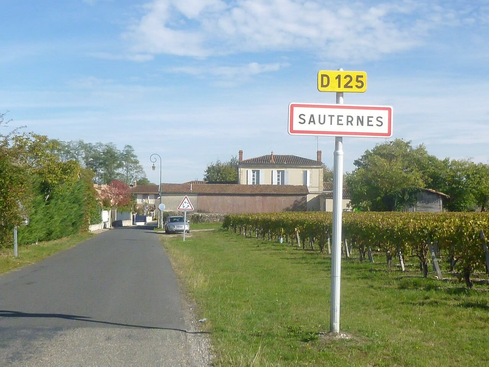

# Petit Manseng

A white grape of Jurançon in southwest France, with small thick-skinned berries, late ripening, tropical fruit, citrus, honey and high acidity; it makes sweet, off-dry and dry wines and is one of France's longest-lived whites.

Figure: Petit Manseng. Photograph: File:Vineyard in Sauternes.jpg. Credit: davitydave, CC BY 2.0 ([source page](https://commons.wikimedia.org/w/index.php?curid=25673556)). Category image; not a claim that it shows the exact product, site or event.

## Definition and naming

Petit Manseng is a white grape of southwest France, grown alongside Gros Manseng in the Jurançon and Pacherenc du Vic-Bilh districts. The Petit refers to its small berries, not a small vine; the distinction between Petit and Gros Manseng was not clearly documented until 1783–1784, and before that the two were often lumped under one Manseng name. A synonym is Petit Manseng Blanc, and labels sometimes say Manseng alone, so the appellation is needed to tell which grape is meant.

DNA analysis shows Petit Manseng is a progeny of Savagnin and itself a parent of Gros Manseng, placing it in the middle of this southwest French variety lineage. Treating it as a single flavour tag is misleading: dry, off-dry and late-harvest sweet wines come from the same grape, separated by picking date, concentration method and residual sugar. The stable structural traits are late ripening, high acidity, thick skins and an intense aroma family.

## Origin and spread

Its cultivation history is tied to the Jurançon district in the Pyrenees foothills southwest of Pau, where vines climb slopes of clay-limestone soil across roughly 650 hectares. Records reach back to the sixteenth century, though its modern reputation rests on late-harvest sweet wines. The Jurançon Sec dry-wine clause was added in 1975, and the Vendanges Tardives late-harvest clause in 1995, giving the dry and sweet product lines that run in parallel today.

Neighbouring Pacherenc du Vic-Bilh, spanning the Gers, Hautes-Pyrénées and Pyrénées-Atlantiques departments, also uses Petit Manseng for dry, moelleux and liquoreux whites. For much of the later twentieth century the variety stayed confined to southwest France, before spreading internationally with renewed interest in sweet whites and high-acid whites. Virginia is the most important New World home: plantings grew from 68 acres in 2011 to 179 acres by the early 2020s, more than 10% of global plantings. Old Australian vines planted under the Petit Manseng name were confirmed by CSIRO DNA analysis in 2020 to be Gros Manseng, misnamed when imported in 1979. Small trials also exist in the Spanish Basque Country, Italy, New Zealand, South Africa and Uruguay.

## Botany and cultivation

Small berries, thick skins and loose bunches are its most obvious botanical traits, alongside late ripening. Thick skins and a loose bunch give reasonable resistance to grey rot and bunch rot, so the fruit can stay on the vine to raisin and concentrate sugar while retaining high acidity; that balance is what lets it carry high residual sugar without cloying. Natural yields are low and bunches small, so yield control rests more on site choice and picking rhythm than on heavy thinning.

Growers balance late-ripening risk against concentration: autumn weather in the Pyrenean foothills is unstable, and sustained rain can ruin a late-harvest plan. Sunny slopes with fast-draining clay-limestone are best for sugar and acidity to ripen together. Pruning, canopy management and picking batches matter more than any supposed variety nature. Heavy shade or early picking loses acidity and aroma detail, while overripening raises alcohol and drops freshness.

## Style and palate

Dry Petit Manseng shows grapefruit, quince, white flowers and citrus peel, with sharp acidity and a textured middle. Sweet and late-harvest versions open into pineapple, mango, apricot, candied pineapple, honey, ginger and spice; residual sugar is high, but high acidity holds the sweetness up and keeps the wine from feeling heavy. Young fruit leads with tropical notes and flowers; with age it develops nut, dried fruit, beeswax and honey tertiary layers, making it one of France's longest-lived white grapes.

Winemaking sets the direction: dry wines are mostly fermented in stainless steel or old barrels to keep freshness and fruit; sweet wines concentrate through late harvest, passerillage on the vine and, where conditions suit, botrytis, picked in successive tries bunch by bunch. Some estates ferment and age in new oak to add texture and complexity; a cuvée such as Quintessence is extremely low-yield and spends two or more years in barrel. Ageing potential should be read from the balance of acidity, structure and alcohol, not colour alone; high acidity is the core support for long bottle life.

## Main regions and representative wines

Jurançon is the core stage. By rule, Jurançon Sec may contain no more than 4 g/L sugar, standard Jurançon has a minimum residual sugar of 40 g/L, and Vendanges Tardives at least 55 g/L. Petit and Gros Manseng together make up at least half of any standard Jurançon blend, and the two Mansengs are the only permitted varieties in Vendanges Tardives. Petit Manseng supplies finesse and acidity; Gros Manseng supplies volume and body.

Among producers, Domaine Cauhapé at Monein was founded by Henri Ramonteu in 1980 and today farms 47 hectares with 13 cuvées. Symphonie de Novembre is 100% Petit Manseng picked in early November, while the flagship Quintessence du Petit Manseng waits until December in successive tries, yields just 9 hl/ha, and ferments and ages two or more years in new French oak. Clos Uroulat dates to 1775 and was taken over by Charles Hours in 1983; its benchmark sweet Clos Uroulat is 100% Petit Manseng, and the dry Cuvée Marie is equally noted. Domaine Bellegarde, Clos Lapeyre and Domaine Larredya are reliable names in the appellation.

## How to drink and pair

Sweet Petit Manseng is served at 6–8°C; too warm and sweetness and alcohol amplify, too cold and honey and dried-fruit notes close down. Dry versions can sit a little higher, at 10–12°C, to open citrus and flowers. A medium-bowl white glass suits either; a sweet wine can use a slightly narrower rim to gather the aroma. After opening, a late-harvest sweet keeps for weeks under refrigeration, as sugar and acidity both slow oxidation.

For food, sweet versions match foie gras, blue cheese, fruit tart and apricot or peach desserts, or stand alone as a digestif; enough acidity keeps the balance against sweet dishes. Dry versions suit white meat, grilled fish, shellfish and poultry in cream sauce, where citrus and flowers carry the dish. Spicy or heavily smoked food pushes the sweetness and alcohol forward and is not a safe match.

## Buying and common misreadings

One common mistake is reading Manseng on a label as Petit Manseng alone: Gros Manseng has larger berries, a wider body and coarser aroma, and the blend ratio sets the style. Where the label does not state proportions, the producer's note is the guide. Another mistake is assuming sweet whites do not age: Petit Manseng precisely uses high acidity to support long bottle life, and good late-harvest wines can keep for more than a decade, developing nut and beeswax layers.

When buying, separate the Sec dry style, standard sweet and Vendanges Tardives tiers first; residual sugar and price differ clearly. The producer predicts the style better than the variety name: the same grape can be made crisp and high-acid or rich and sweet. New World plantings are still building a track record; use southwest French references as the benchmark before comparing overseas versions.

## Further reading and see also

The most direct way to understand Petit Manseng is to compare a Jurançon dry, a standard sweet and a late-harvest wine in the same vintage, watching how acidity moves with residual sugar. It connects to the [white-wine](ref:white) category, the foothill clay-limestone [terroir](ref:terroir), the choices of [fermentation](ref:fermentation) and [oak-ageing](ref:oak), and can be set against international whites such as [chardonnay](ref:chardonnay).

- Related: [white-wine](ref:white), [terroir](ref:terroir), [fermentation](ref:fermentation), [chardonnay](ref:chardonnay), [oak-ageing](ref:oak).

**In brief:** A white grape of Jurançon in southwest France, with small thick-skinned berries, late ripening, tropical fruit, citrus, honey and high acidity; it makes sweet, off-dry and dry wines and is one of France’s longest-lived whites.

## Related images

Image: Thematic illustration for White wine. Project-made bilingual editorial figure, not an on-site photograph. Related image for Petit Manseng.
