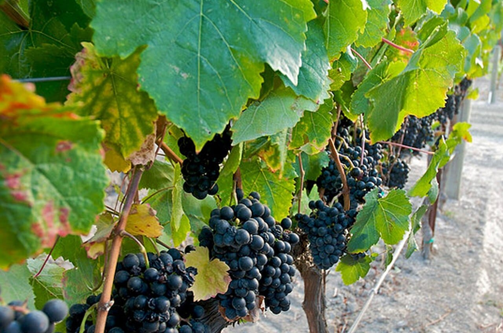

# Petit Verdot

Petit Verdot is the secondary red grape of the classic Bordeaux blend: late ripening, thick skinned, seedy, deep coloured and strongly tannic. In cool Bordeaux it often struggles to ripen fully, while in warmer regions of Australia, Spain, the United States and South America it is increasingly made as a varietal wine to add structure, colour and mid-palate weight.

Figure: Petit Verdot: 01 Petit verdot (Wikimedia Commons). Image: Eric 先魁 Hwang, CC BY 2.0, via Wikimedia Commons ([source page](https://commons.wikimedia.org/wiki/File:01_Petit_verdot.jpg)).

## Definition and naming

Petit Verdot literally means "small green", referring not to berry size but to late ripening: in an imperfect year the berries often stay green when other varieties are already picked. It is a Vitis vinifera red grape, traditionally blended with Cabernet Sauvignon, Merlot, Cabernet Franc and Malbec in Bordeaux-style coupages; older records also carry the synonyms Verdot and lambrusquet ([bordeaux](ref:bordeaux)).

Genetic studies show no proven direct kinship with Cabernet Sauvignon or Cabernet Franc; it developed independently in south-west France, and its VIVC register number is 12974. Commercial plantings use selected clones, and labels rarely state clone or rootstock; site ripeness, yield and oak treatment matter more directly to style.

## Origin and spread

The variety probably originates in the Béarn area of the Pyrenees, with traces of cultivation in the 17th century, before moving into the Gironde and establishing itself in the Médoc and Graves. For centuries it played a secondary but decisive role in Bordeaux blends: a usual proportion of 2% to 10%, yet one that adds tannin, deep colour and spicy floral perfume.

In the 20th century its plantings in its home region shrank and it nearly disappeared, because it is demanding to grow and often fails to ripen in cool Bordeaux vintages. From the 1980s onward, warmer-summer regions rediscovered it: it ripens reliably in warm climates, and varietal wines are structured and deeply coloured. Plantings followed in Australia, Spain, California and Virginia, Argentina, Chile, Uruguay and South Africa.

Its pairing with Cabernet Sauvignon and Merlot sums up the Bordeaux blend logic: Petit Verdot supplies mid-palate weight, colour and tannin frame, Cabernet gives structure and acidity, and Merlot contributes roundness and fruit. At home in Bordeaux it remains a blending component; overseas in warm regions it appears more often as a varietal or a supporting partner in Cabernet blends ([cabernet-sauvignon](ref:cabernet)).

## Botany and cultivation

Bunches are compact and cylindrical, with small, dark blue-black, seedy berries; shoots are low in vigour. Early budbreak makes it sensitive to spring frost, and ripe berries can split and attract botrytis. It ripens about two to three weeks later than Cabernet Sauvignon and needs a long, warm growing season, performing best on free-draining gravelly loam; the gravel terraces of the Médoc and the limestone soils of Saint-Émilion are its more suitable Bordeaux environments.

The central cultivation tension is late ripening versus ripeness. In cool Bordeaux vintages the fruit does not reach full maturity, leaving green-stem bitterness and astringent tannin; only when fully ripe do thick skins and many seeds turn into dark pigment and mature tannin. Yield control, enough canopy light and frost avoidance at flowering are the basics for even ripening; high crops or shade loosen both colour and structure.

## Style and palate

Fully ripe Petit Verdot is exceptionally deep, near saturated inky red; young wines often show banana, pencil shavings, blackcurrant, dark cherry, violet and mint, developing leather, cedar, tobacco, truffle, prune and fig with age. The palate is full, with firm, assertive tannin, vibrant acidity and a thick mid-palate — the component that "holds up" the blend.

In Bordeaux coupages its small share amplifies texture, power and aromatic depth; grand cru bottlings often spend more than twenty months in barrel and large cask, with tannin integrating over long ageing. Overseas varietal wines are usually more extracted and oak-forward, with darker, denser fruit; quality examples have 10–20 years of ageing potential, developing dried fruit, leather and spice, while violet perfume can linger for a surprisingly long time ([oak-ageing](ref:oak)).

To judge potential, look at ripe tannin and intact acidity rather than colour depth; an under-ripe vintage is green and bitter, and even deep colour does not give it cellaring conditions. Alcohol tends to run high, which matters when matching food.

## Main regions and representative wines

In Bordeaux, Petit Verdot accounts for only about 1.3% of red-vineyard plantings, concentrated in left-bank districts such as the Médoc and Graves; a small share appears in the flagship blends of classified growths. Château Palmer, for example, blended the 2004 vintage at 47% Merlot, 46% Cabernet Sauvignon and 7% Petit Verdot, and the 2025 vintage at 55% Merlot, 41% Cabernet Sauvignon and 4% Petit Verdot, at about 13.5% alcohol, aged more than twenty months in barrel and foudre; small Petit Verdot shares also appear in blends from left-bank estates such as Château Margaux ([merlot](ref:merlot)).

Overseas, Australian blocks in Western Australia, South Australia and inland south-eastern valleys, central and south-eastern Spain, Napa and Paso Robles in California, Virginia, plus Argentina, Chile and Uruguay all carry the variety. Sites with warm days and cool nights give it enough ripeness while preserving acidity, the better environment for varietal bottlings. Overseas wines span everyday rich reds to collector-level reserves; producer and site predict the glass better than the variety name.

## How to drink and pair

Serve Petit Verdot as a full-structured red, around 16–18°C; too cold, spice and oak stay shut, too warm, alcohol and rough tannin float up. A large-bowled red glass suits it; young or high-tannin wines benefit from a 30–60 minute decant to soften tannin and open fruit and violet, while aged bottles can be decanted briefly and drunk.

Pairing follows matching intensity: grilled steak, lamb chops, braised short ribs, game, barbecue and rich stews such as Mexican mole are the natural partners, with firm tannin cutting through fatty meat. Aged hard cheeses such as Manchego, aged Gouda or Stilton, portobello mushrooms and chestnut-nut dishes work too. Delicate seafood, white meat and light sauces cannot hold its structure and are not the first choice ([red-wine](ref:red)).

## Buying and common misreadings

The first misreading is to take "Petit" (small) for light bodied. The word refers to late-ripening green berries, not a light style; ripe Petit Verdot is usually full, strongly tannic and deep coloured, and should not be bought with expectations for a light red. The second is to treat it as a Cabernet Sauvignon clone or variant. They are only Bordeaux blend partners, with no direct genetic kinship; Petit Verdot's late ripening, seedy berries and thick skins are independent traits.

The third misreading is that dark, tannic reds must be drunk young. On the contrary, intact acidity and firm tannin are the basis for long ageing; good Petit Verdot moves from dark fruit toward leather, dried fruit and spice after a decade or more in bottle. Judge by ripeness, site yield and ageing method, not a general variety impression. Check vintage ripeness, bottling date and storage: heat or long stock costs the dark fruit and violet perfume, leaving tannin dry and coarse.

## Further reading and see also

A useful comparison is to set the Petit Verdot contribution in a classified Bordeaux blend beside an overseas varietal, seeing how the blend reins in the power while the varietal amplifies dark fruit and tannin; then contrast a ripe vintage with a cooler one to tell green bitterness from mature tannin.

Overseas planting area, clones and parentage keep updating with variety surveys; for formal citation, check the VIVC register, Bordeaux industry bodies and the relevant regional disciplinari.

- Related: [bordeaux](ref:bordeaux), [cabernet-sauvignon](ref:cabernet), [merlot](ref:merlot), [red-wine](ref:red), [oak-ageing](ref:oak).

## Related images

Image: Merlot. Credit: Felloni claire, CC BY-SA 4.0, via Wikimedia Commons ([source page](https://commons.wikimedia.org/wiki/File:Merlot.jpg)). Related image for Petit Verdot.
