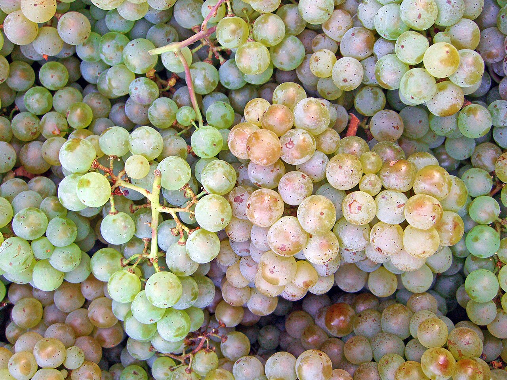

# Pinot Blanc

Pinot Blanc is the white member of the Pinot family, often described as a quiet white grape: its aroma is understated, its acidity moderate to high, its body rounded and its affinity with food broad. It performs consistently in Alsace, Germany and northern Italy, yet has long lived in the shadow of the more fashionable Chardonnay and Riesling. To understand it properly, place it in the mutation chain of Pinot Noir and separate the three traditions of Alsace, Germany and Italy.

Figure: Pinot Blanc. Image: User:Themightyquill, CC BY-SA 2.5, via Wikimedia Commons ([source page](https://commons.wikimedia.org/wiki/File:Pinot-blanc.jpg)).

## Definition and synonyms

Pinot Blanc is a white mutation of Pinot Noir and belongs to the European grape Vitis vinifera. Its German name is Weissburgunder, its Italian name Pinot Bianco, and in Alsace the traditional terms Klevner or Clevner are also used. It sits in the Pinot family with Pinot Gris (Grauburgunder) and Pinot Noir (Spätburgunder), but differs in colour, skin thickness and aroma. Pinot Blanc, Weissburgunder and Pinot Bianco normally mean the same variety; in Alsace, a wine labelled "Pinot" may be a blend of Pinot Blanc and Auxerrois rather than a single variety. Confusing Pinot Blanc with Chardonnay is a common error: both can be neutral whites, but Pinot Blanc usually has lower acidity, a rounder texture and more almond and green-apple character.

## Parentage and origin

Pinot Blanc belongs to the Pinot family of Burgundy. It is considered a somatic mutation of Pinot Noir, and some research treats it and Pinot Gris as different mutations within the same lineage. The Pinot family has a long record in Burgundy, and Pinot Blanc later spread to Alsace, south-west Germany and northern Italy. From the 19th century, Alsace treated it as an important everyday white, while Germany called it Weissburgunder and placed it alongside Spätburgunder and Grauburgunder in a three-colour Pinot naming system. It is not a hybrid but a variation preserved by vegetative propagation, so clones differ considerably in acidity, yield and aroma.

## Botanical character

Pinot Blanc has small to medium bunches and small, thin-skinned berries that turn yellow-green, sometimes with a faint pink tinge. The flesh is juicy, sugar accumulates moderately and acidity falls slowly, which helps it stay fresh in cool regions. Its buds break early and the young shoots are not especially cold-hardy; thin skins make it sensitive to grey rot, powdery mildew and sunburn. Compared with Pinot Gris, the skins are paler and the aroma lighter; compared with Chardonnay, it usually has lower acidity and a more neutral aroma. Because the skins are thin, gentle pressing is important to avoid extracting bitterness and phenolics.

## Viticultural behaviour

Pinot Blanc is moderately to strongly vigorous and can crop heavily, but high yields dilute flavour quickly, so crop control is necessary. It buds early, making spring frost the main risk; tight bunches and thin skins encourage grey rot in damp years, and hail and sunburn can also cause losses. It adapts to many soils, including limestone, marl and gravel, but gives the best balance of aroma and acidity on well-drained, low-fertility slopes. Ripening is early to mid-season, and late picking costs acidity and brings bitterness. Quality-minded growers in Alsace and southern Germany balance ripeness and acidity through green harvesting, strict yields and careful timing rather than simply waiting.

## Distribution

Alsace is one of the classic homes of Pinot Blanc. Pinot Blanc AOC may come from Pinot Blanc and Auxerrois, usually as a dry, medium-bodied everyday white; Crémant d'Alsace also uses Pinot Blanc extensively. Germany calls the grape Weissburgunder and concentrates it in Baden, the Pfalz and Rheinhessen, with styles from dry to lightly sweet, and Baden usually giving the fuller body. Alto Adige in northern Italy is known for Pinot Bianco with a mountain freshness; Friuli and Lombardy also plant it, and Franciacorta's rules allow Pinot Bianco in blends, though in practice the share is small. Austria, Switzerland, Hungary and Slovenia have small plantings; Burgundy itself retains very little; and Champagne lists Pinot Blanc among its permitted varieties, though it is rarely used.

## Legal rules

Alsace Pinot Blanc AOC allows Pinot Blanc to be blended with Auxerrois, and the label may read Pinot Blanc or the traditional Klevner; exact proportions and local rules follow the latest decree. Crémant d'Alsace AOC permits Pinot Blanc in blends or as a single variety. Germany has no separate Weissburgunder appellation; the variety is managed within the Qualitätswein and Prädikat system, and the name may appear on the label. In Italy, Alto Adige DOC allows Pinot Bianco as a varietal wine, with minimum proportions and yields set by the appellation rules. Champagne AOC includes Pinot Blanc among its permitted varieties, but its share is tiny. Rules change, so the label and the current appellation specification remain the practical guide.

## Winemaking

Pinot Blanc is usually made with minimal intervention. Cool fermentation in stainless steel preserves green apple, pear and citrus; lees contact adds creaminess and texture; some ambitious wines ferment in old oak for complexity without heavy vanilla. Malolactic fermentation can be encouraged or blocked: full malolactic softens acidity and adds roundness, while blocking it keeps a brighter edge. Pinot Blanc has little tannin and few phenolics, so pressing must be gentle to avoid bitterness. Sparkling base wines emphasise acidity and neutrality for the second fermentation and ageing. Overall, the aim is not to manufacture a powerful aroma but to keep balance, texture and food affinity.

## Sensory style

Typical Pinot Blanc aromas are green apple, pear, white peach, lemon, almond and white flowers, sometimes with wet stone and a faint smokiness. The body is medium, acidity moderate to high, and the finish often carries a hint of bitter almond—an important difference from Chardonnay. Alsace versions are usually dry, fresh and food-friendly; German Weissburgunder is fuller, showing pear, quince and nuts in ripe years; Alto Adige Pinot Bianco is leaner and more mountain-fresh, with bright acidity and a mineral edge. Ageing potential is moderate: good wines keep for several years but are rarely built for long cellaring. Pinot Blanc should be judged on balance, texture and table performance rather than sheer aromatic intensity.

## Producers and vintages

In Alsace, Trimbach, Hugel and Weinbach have long produced Pinot Blanc; in Alto Adige, Cantina Terlano, Tramin and Nals Margreid are known for Pinot Bianco; family estates in Baden and the Pfalz have built reputations on Weissburgunder. Vintage differences show mainly in acidity and ripeness: cool years give higher acidity and a lighter body and are best drunk early, while warm years give a rounder body, lower acidity and sometimes bitterness or heat. Pinot Blanc is sensitive to picking date—too early and it is green, too late and it loses freshness. Region, producer and vintage say more than the words "Pinot Blanc" alone.

## Common misconceptions

First, that Pinot Blanc is Chardonnay; the two are related but distinct in style, with Pinot Blanc usually rounder and lower in acidity. Second, that Alsace Pinot Blanc is always a single variety; it is often blended with Auxerrois. Third, that Weissburgunder and Grauburgunder are the same; the latter is Pinot Gris. Fourth, that Pinot Bianco and Pinot Grigio are the same; colour and style differ. Fifth, that Pinot Blanc can only make cheap wine; good single sites in Alto Adige and Alsace can show real depth. Sixth, that Pinot Blanc has no acidity; cool sites can give quite high acid. Seventh, that Champagne never uses Pinot Blanc; it is permitted, merely very rare.

## Further reading

- [Wine](ref:wine): the broad category to which Pinot Blanc belongs.
- [White wine](ref:white-wine): the main form of Pinot Blanc.
- [Acidity](ref:acidity): the key to Pinot Blanc's style and food pairing.
- [Alsace](ref:alsace): the classic region for Pinot Blanc and Auxerrois blends.
- [Italy](ref:italy): the home of Alto Adige Pinot Bianco.
