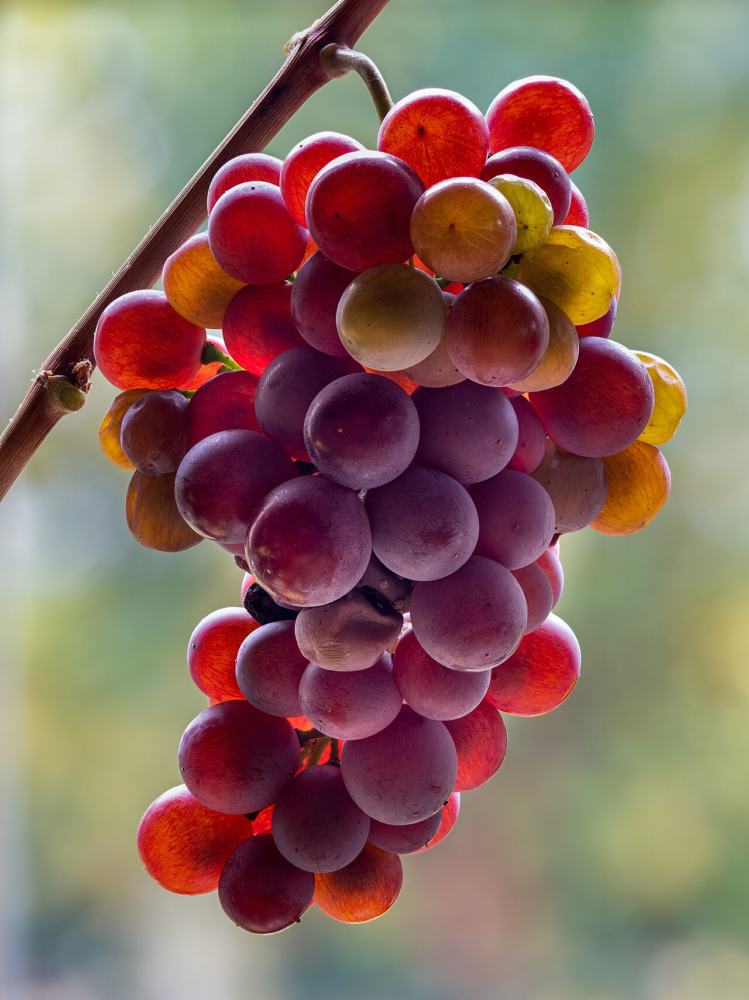

# Pinot Gris

Pinot Gris is a colour mutation of Pinot Noir, its fruit grey-pink rather than purple-black. It ripens early, has thin skins and low acidity, and usually gives a pale wine with pear and apple aromas. The same variety can be full and rich in Alsace or light and crisp in Italy, a difference driven mainly by region and winemaking rather than the grape itself.

Figure: Pinot Gris. Image: Ermell, CC BY-SA 4.0, via Wikimedia Commons ([source page](https://commons.wikimedia.org/wiki/File:Pinot_Grigio-20201027-RM-114053.jpg)).

## Definition and synonyms

The English name is Pinot Gris, Italian Pinot Grigio, German Grauburgunder or Ruländer. It belongs to the European grape Vitis vinifera and is a colour mutation of Pinot Noir, not a separate species. Ruländer comes from the 18th-century German merchant Johann Seger Ruland and traditionally suggests a sweeter or fuller style; Grauburgunder is more often used for dry wine. The name on the label often hints at style: Pinot Grigio usually means light, Grauburgunder usually fuller.

## Parentage and origin

Pinot Gris is a skin-colour mutation of Pinot Noir and part of the Pinot family. The family also includes Pinot Blanc and Pinot Meunier, genetically very close and distinguished mainly by skin colour and aroma. Its origin is generally traced to Burgundy, later spreading to Alsace, Germany and northern Italy. It is not a cross of Pinot Gris and Chardonnay, nor an independent variety implied by some translations.

## Botanical character

Bunches are small to medium, berries small and tightly packed, skins grey-pink to pale purple-grey, flesh juicy. It buds early, ripens early, accumulates sugar quickly and loses acidity quickly; thin skins make it prone to grey rot and botrytis. Small berries mean a high skin-to-juice ratio and easy extraction of colour and aroma, but lower yields and uneven ripening. Against Pinot Noir, Pinot Gris has less pigment and tannin, and the wine can range from pale gold to copper.

## Viticultural behaviour

Pinot Gris is moderately vigorous with low yields, suiting cool, well-drained slopes. It buds early, so spring frost is the main risk; thin skins make autumn rain a grey-rot hazard. Limestone and marl in Alsace, volcanic soils in Baden and gravel or alluvium in northern Italy all give different styles. It responds strongly to yield control: high yields give thin aroma and low acidity, while lower yields improve texture and aroma. Italian bulk Pinot Grigio is mostly grown on plains with high yields and early picking.

## Alsace

Alsace is one of the classic homes of Pinot Gris and counts it among the four noble varieties with Riesling, Gewürztraminer and Muscat. Alsace has 51 Grand Cru sites, and Pinot Gris is permitted in them; Vendanges Tardives and Sélection de Grains Nobles are the sweet tiers, where Pinot Gris performs strongly. Alsace once labelled it Tokay d'Alsace, a name no longer allowed after 2007 to avoid confusion with Hungarian Tokaji. Alsace Pinot Gris is usually full-bodied with low acidity, showing beeswax, pear and almond.

## Germany and Italy

Germany calls it Grauburgunder or Ruländer, with Baden and the Pfalz as the main regions and styles from dry to sweet. Italy is the largest producer, centred on Veneto and Friuli; the delle Venezie DOC created in 2017 covers much of the output and sets variety proportions and style. Italian Pinot Grigio is usually picked early and fermented cool, giving a light, medium-acid wine for early drinking; Friuli's ramato uses brief skin contact for a copper-coloured, spicy style.

## Winemaking and style

Winemaking decides the direction. Light Pinot Grigio ferments cool in stainless steel and avoids malolactic to keep pear, apple and citrus; fuller Grauburgunder and Alsace versions may use oak, lees stirring and malolactic for texture and a waxy note. Brief maceration extracts colour and aroma for copper-toned ramato, while too much extraction brings bitterness. Residual sugar ranges from dry to off-dry depending on region and producer.

## Sensory style and pairing

Young Pinot Gris shows pear, green apple, white peach, citrus and almond, with medium-low acidity and a light to medium body; Alsace and German versions are fuller, with beeswax, honey and spice. Ramato adds strawberry, black tea and ginger. It suits seafood, white meat, salads and soft cheese; light versions work as an aperitif, fuller ones with cream sauces and roast poultry. Low acidity makes it a poor match for very acidic dishes.

## The difference from Gewürztraminer

Pinot Gris and Gewürztraminer are both Alsace noble varieties with pinkish skins, but they differ clearly. Pinot Gris is a colour mutation of Pinot Noir, with pear, apple and almond, slightly higher acidity and a finer texture; Gewürztraminer is an aromatic mutation of Savagnin, with lychee, rose and ginger, lower acidity and a fuller body. Confusing them loses Pinot Gris's restraint and Gewürztraminer's exuberance. Italian Pinot Grigio and Alsace Pinot Gris are the same variety with very different styles.

## Producers and vintages

Alsace names include Zind-Humbrecht, Trimbach and Domaine Weinbach; in Germany, Dr. Heger and Rebholz are known for Grauburgunder; in Italy, Jermann, Livio Felluga and Venica; King Estate in Oregon is an important Pinot Gris producer. Vintage differences come mainly from early ripening and autumn rain: hot years give lower acidity and more alcohol, cool years more freshness and finer aroma. In the market, Pinot Grigio is one of the world's best-selling whites, while serious Pinot Gris remains concentrated in Alsace and Germany.

## Common misconceptions

First, that Pinot Grigio and Pinot Gris are different varieties; they are the same grape in different languages. Second, that Pinot Gris is always light and bland; Alsace and German versions can be full. Third, taking Pinot Gris for a cross with Chardonnay; it is a colour mutation of Pinot Noir. Fourth, assuming ramato is rosé; it is a white grape given brief skin contact. Fifth, that Pinot Gris cannot age; good Alsace and German versions can keep for more than a decade. Sixth, confusing Pinot Gris with Gewürztraminer; their aromas and acidity are completely different.

**In brief:** A grey-skinned colour mutation of Pinot Noir, early-ripening, thin-skinned and low in acidity. Alsace can make it full and rich, while Italy makes it light and crisp as Pinot Grigio; the Italian delle Venezie DOC, created in 2017, expanded that style further.

For Pinot Gris, begin with where it is grown. Then look at how it is labelled, and finally ask whether the style is dry or sweet. The answers point to different choices, not to a single score.

The comparison with [Wine](ref:wine) and [Alsace](ref:alsace) runs through variety character and regional performance. Each answers a different question.

## Further reading

- [Wine](ref:wine): the overall classification of wine.
- [White wine](ref:white-wine): the drink style to which Pinot Gris belongs.
- [Alsace](ref:alsace): the classic region for Pinot Gris.
- [Italy](ref:italy): the main source of Pinot Grigio.
- [Pinot Noir](ref:pinot-noir): the parent variety of Pinot Gris.

## Related images

Image: Alsace. Credit: Jorge Franganillo from Barcelona, Spain, CC BY 2.0, via Wikimedia Commons ([source page](https://commons.wikimedia.org/wiki/File:Colmar_(32350846618).jpg)). Related image for Pinot Gris.
