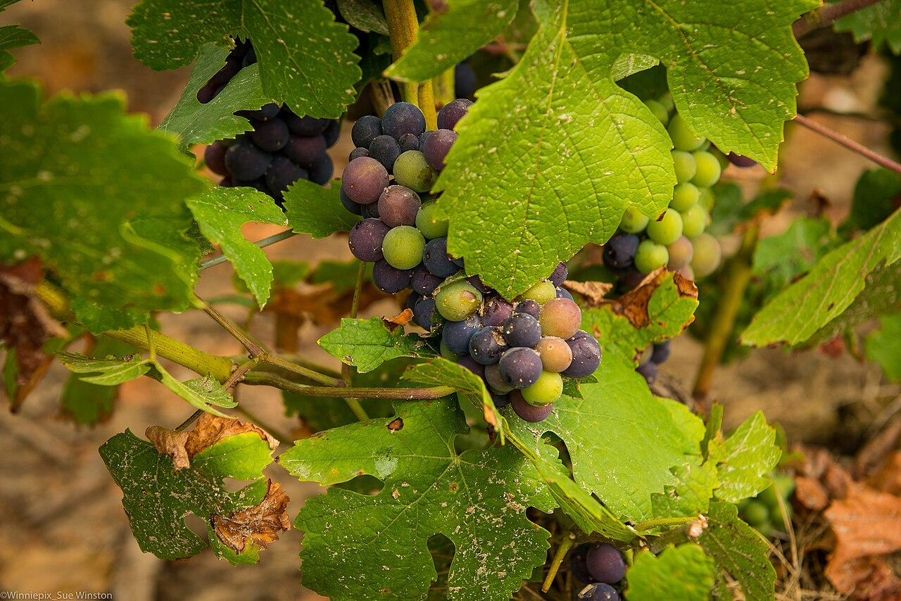

# Pinot Meunier

Pinot Meunier is the most underrated of Champagne's three main permitted varieties. It is a dark-skinned mutation of Pinot Noir, with dark grapes and white flesh, and it buds and ripens early, which makes it reliable on the clay slopes of the Marne Valley. For a long time it was treated as the blending partner that added fruit and roundness; over the past two decades, single-varietal Meunier and Blanc de Noirs Champagnes have brought it a new audience.

Figure: Pinot Meunier. Photograph: Pinot meunier or pinot noir? (28732275257). Credit: Winniepix, CC BY 2.0, via Wikimedia Commons ([source](https://commons.wikimedia.org/w/index.php?curid=156677934)).

## Definition and synonyms

The official name is Pinot Meunier, shortened to Meunier. Its German name, Schwarzriesling, literally means "black Riesling", but it has no family link to Riesling; the name reflects dark skins and an acid structure that reminded growers of Riesling. Another German name, Müllerrebe, means "miller's grape" and shares its origin with the French meunier, a miller. The underside of the leaves carries white down, as if dusted with flour, and this is the source of the name. Samtrot is a mutation of Pinot Meunier grown in small quantities in Württemberg. It is not a separate species but a vegetative variation within the Pinot family, and Meunier, Pinot Meunier and Schwarzriesling usually mean the same grape.

## Parentage and origin

Pinot Meunier is genetically almost identical to Pinot Noir, and the differences come from mutations in certain cell layers, which is why it is often described as a chimera. These mutations affect leaf down and berry colour and also produce small differences in ripening and aroma. The Pinot family has a long history in Burgundy, and Pinot Meunier later became widely planted in Champagne, especially in the Marne Valley. It is not a 19th-century hybrid but an old variation preserved by vegetative propagation, and clones differ markedly in yield, berry size and disease resistance. The question of whether it or Pinot Noir came first has no settled answer; the more accurate view is that both belong to a continually mutating group.

## Botanical character

Pinot Meunier has small bunches and small, thin-skinned berries that turn blue-black, with white flesh. Its most visible feature is the leaf: young and mature leaves carry dense white down on the underside, which gave the vine its name. It buds early and ripens early, slightly ahead of Pinot Noir; acidity is moderate and tannin is softer than in Pinot Noir. Thin skins make colour and flavour easy to extract but also leave the grapes exposed to grey rot and sunburn. Compared with Pinot Noir, the bunches can be tighter, the berries slightly larger and the yield potential higher. Its aroma is dominated by red fruit, with mushroom and woodland notes appearing with age.

## Viticultural behaviour

Pinot Meunier is vigorous and can crop heavily, but high yields dilute flavour, so strict crop control is needed. It buds early, and spring frost is the main risk in Champagne; on the clay and marl slopes of the Marne Valley, its early ripening is an advantage, allowing picking before autumn rain. It is sensitive to downy mildew and grey rot, and damp years demand careful vineyard work. Compared with Pinot Noir it is hardier and more consistent, but in very hot years it can lose acidity and turn jammy. Old-vine Meunier yields little and concentrates well, and is often used for single-varietal Champagne. Champagne's planting rules set strict limits on pruning, yield and harvest, with details following the current regulations.

## Distribution

The core region is Champagne in France, above all the Marne Valley, with smaller plantings in the Montagne de Reims and the Côte des Blancs. Outside Champagne there are scattered plantings in the Loire, Alsace and Burgundy, mostly for blends or experimental wines. Württemberg in Germany is the main home of Schwarzriesling, with plantings in Baden and the Pfalz, mostly for rosé and light reds. Australia, New Zealand, California and northern Italy grow small amounts, often for sparkling blends. Because it ripens early, Pinot Meunier is more reliable than Pinot Noir in cool, frost-prone sites.

## Legal rules

In Champagne AOC, Pinot Meunier is one of the permitted varieties and one of the three main grapes alongside Chardonnay and Pinot Noir; the rules also allow Pinot Blanc, Pinot Gris, Arbane and Petit Meslier, but their plantings are tiny. Champagne regulates blend proportions, minimum alcohol, maximum yields, pressing and ageing, with exact figures set by the current rules. A Blanc de Noirs may be made from Pinot Meunier alone or blended with Pinot Noir; the wine is white because the juice is separated from the skins quickly after pressing. Coteaux Champenois permits still red or rosé from Pinot Meunier. German Schwarzriesling is managed under the Qualitätswein system and may carry the variety name in Württemberg and other permitted regions.

## Winemaking

In Champagne, Pinot Meunier is usually whole-bunch pressed and the juice extracted gently to limit colour and phenolics. The first fermentation may take place in stainless steel or oak, and malolactic fermentation is often used to soften acidity. Blending, or assemblage, is central: base wines from different villages, years and varieties are combined to achieve a consistent house style. Meunier contributes red fruit, roundness and early drinkability. Single-varietal Meunier needs especially careful pressing and longer lees ageing for complexity. Still red wines extract colour and fruit through a short maceration and have light tannin, suiting early drinking. The second fermentation and lees ageing create the bubbles and the bready notes.

## Sensory style

Typical Pinot Meunier aromas are strawberry, raspberry, red cherry, plum and violet, with toast, cream, mushroom and woodland notes emerging with age. As Champagne it has medium body, moderate acidity, generous fruit and a round texture, often more approachable young than a Chardonnay-dominated Champagne; good single-varietal examples can age and develop honey and nuts. As a still red it is pale, soft in tannin and suited to poultry, pork and mushrooms. In rosé Champagne, Meunier brings fresh strawberry and redcurrant. Its acidity is less sharp than Chardonnay's, so it can fill out a high-acid year, while in hot years picking date becomes critical.

## Producers and vintages

Leading single-varietal Meunier Champagnes include Jérôme Prévost's La Closerie, Chartogne-Taillet, Egly-Ouriet and Michel Loriot; among the larger houses, Krug and Bollinger use Meunier in blends to add fruit and breadth. Württemberg estates make rosé and light red from Schwarzriesling. Vintage variation comes mainly from spring frost and autumn rain: severe frost cuts Meunier yields sharply, cool years give fresh fruit and better acidity, and hot years give a riper, heavier wine. Because Meunier is often used in non-vintage blends, its vintage character is most visible in single-varietal and vintage Champagnes.

## Common misconceptions

First, that Pinot Meunier is an inferior grape; good single-varietal examples can be highly refined. Second, that it is only for blending; Blanc de Noirs has proved otherwise. Third, that Schwarzriesling is Riesling; the two are unrelated. Fourth, that Pinot Meunier is a white grape; it is dark-skinned with white flesh. Fifth, that Blanc de Noirs means white grapes; it means a white wine made from dark grapes. Sixth, that Meunier cannot age; good single-varietal and vintage Champagnes can keep for years. Seventh, that Meunier and Pinot Noir are identical; they belong to the same family but are distinct clones with different styles.

## Further reading

- [Wine](ref:wine): the broad category to which Pinot Meunier belongs.
- [Sparkling wine](ref:sparkling-wine): the most important form of Pinot Meunier.
- [Blending](ref:blending): the key to Champagne assemblage.
- [Champagne](ref:champagne): the core region for Pinot Meunier.
- [France](ref:france): the regional and legal framework of French wine.
