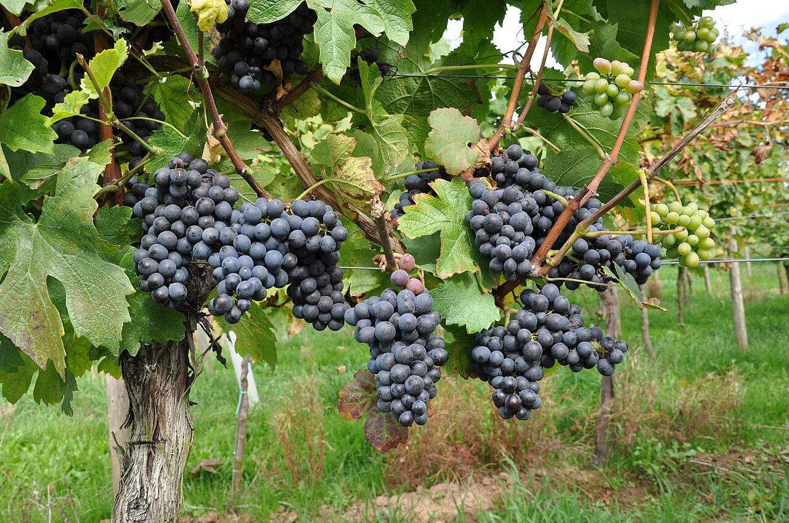

# Pinotage

Pinotage is South Africa's own red grape and one of the few varieties bred in the 20th century to gain a distinct international identity. It was created by crossing Pinot Noir with Cinsaut, combining the smaller berries and aromatic potential of the former with the resilience and yield of the latter. The wine is deep in colour and firm in tannin: in youth it can be bright with mulberry and plum, and after oak and bottle age it can turn to coffee, smoke, leather and earth. Pinotage has had a divided reputation, and the key to understanding it is not the "banana" label but the way clone, vine age, picking date and fermentation temperature shape the result (ref:wine).

Figure: Pinotage. Image: Please note: This photo can be reproduced. Please quote the source as indicated below: Doris Schneider, Julius Kühn-Institut (JKI), Federal Research Centre for, CC BY-SA 4.0, via Wikimedia Commons ([source page](https://commons.wikimedia.org/wiki/File:VIVC9286_PINOTAGE_Full_plant_3638.jpg)).

## Definition and synonyms

Pinotage belongs to the European grape Vitis vinifera and is a red variety. The name combines Pinot (Pinot Noir) and Hermitage, the old South African name for Cinsaut. It is not a mutation of Pinot Noir and not a cross of Pinot Noir and Syrah; its other parent is Cinsaut. Pinotage is a crossing rather than an interspecific hybrid, because both parents belong to Vitis vinifera. Chinese sources use a phonetic rendering, while wine labels almost always print "Pinotage" (ref:red-wine).

## Parentage and origin

In 1925 Abraham Izak Perold, a professor at Stellenbosch University, pollinated Cinsaut with Pinot Noir and raised the first Pinotage seedlings in the experimental vineyard. The seedlings were neglected for a time before being moved to Elsenburg and entering a breeding programme. Planting and trial winemaking spread in the 1940s, the name "Pinotage" was formally adopted in 1959, and it first appeared on a label in 1961. The Pinotage Association was founded in 1995 to improve quality and raise the variety's international profile. The breeding aim was to combine the quality of Pinot Noir with the adaptability of Cinsaut, a goal that also explains the variety's two-sided character.

## Botanical characteristics

Pinotage has small berries, thick skins and deep colour, with high levels of pigment and tannin. The clusters are medium to tight, sugar accumulates quickly, acidity is moderate, and ripening usually comes earlier than Cabernet Sauvignon. Thick skins give some protection in South Africa's hot, dry conditions, but over-extraction can make the wine coarse. The leaves resemble those of Pinot Noir, while the vine is more vigorous and higher-yielding. Because one parent is Cinsaut, the fruit often carries generous flavour and relatively high pH, so acidity balance matters in the cellar. Clonal variation is significant, which helps explain how one variety can produce both light, fresh wines and dense, smoky ones.

## Viticultural characteristics

Pinotage is vigorous and adaptable, and it can be trained on trellises or grown as bush vines. It tolerates drought well, which suits the rain-fed conditions of the Western Cape, but excessive vigour or irrigation in wet years can shade the fruit and increase disease pressure. Crop control is essential: high yields give thin wine with green and nail-polish notes, while low-yielding old vines give deeper colour and finer tannin. The old bush vines of Swartland, grown without irrigation, are particularly good at showing this potential. Because ripening is early, growers can choose between early picking for acidity and fresh fruit and later picking for alcohol and darker fruit.

## Regional distribution

South Africa is the undisputed home of Pinotage (ref:south-africa). Stellenbosch is the traditional centre, where Kanonkop, Simonsig and other estates built the variety's reputation; Swartland, with its old bush vines, dry farming and low-intervention approach, gives tighter wines with spice and earth (ref:swartland). Paarl, Durbanville, Robertson and Wellington also have plantings. Outside South Africa, California, New Zealand, Zimbabwe and Brazil grow small amounts, but their scale and influence are far smaller. The common thread is abundant sunshine and a long ripening season; soil, water and vine age explain most of the differences between regions.

## Legal rules

South African wine is regulated by the Wine of Origin (WO) system. Varietal labelling normally requires at least 85% of the named grape, and vintage and regional claims are also subject to minimum proportions. Pinotage is an officially recognised South African variety. "Cape Blend" is an industry category rather than a strict legal tier: it conventionally requires Pinotage to make up 30% to 70% of the blend, and from the 2019 vintage Pinotage should also be the largest component, with the rest coming from other red varieties. Exact proportions, alcohol levels and ageing requirements follow the latest South African regulations, and because "Pinotage" carries both varietal and brand value, label use is strictly controlled.

## Winemaking

Pinotage is made in a wide range of styles. Producers seeking freshness pick earlier, ferment cool, shorten maceration and avoid heavy new oak; those seeking power extend maceration, use a higher proportion of French or American oak (ref:oak-ageing), and may ferment whole clusters with wild yeast. Historically Pinotage was criticised for banana, nail polish or acetone aromas, which are linked mainly to hot fermentation, poor yeast nutrition or uneven ripeness; modern producers reduce them through temperature control, sorting and gentle extraction. Malolactic fermentation softens acidity, although whether to use it depends on the target style. Pinotage is often blended with Cabernet Sauvignon, Merlot, Syrah or Cinsaut, and Cape Blend formalises that practice as an industry category.

## Sensory profile

Young Pinotage shows mulberry, blackberry, plum, black cherry and violet, often with banana, coffee, mocha, dark chocolate and smoke. The body is medium to full, the tannin firm, the acidity medium and the alcohol usually high. Lighter styles stress fresh fruit and spice and are ready early; richer styles bring leather, earth, tobacco and game and need bottle age to open. Oak changes the profile markedly: new barrels add vanilla, coconut and toast, while older barrels emphasise fruit and earth. Good Pinotage can age for a decade or more, especially from old vines and low-yielding sites.

## Representative producers and vintages

South African producers include Kanonkop, Beyerskloof, Simonsig, Delheim, Warwick, L'Avenir and Ashbourne. Kanonkop's Pinotage is often treated as a benchmark, Beyerskloof is known for a consistent varietal expression and good value, and Simonsig is closely linked to the variety's early commercial history. Swartland producers emphasise dry farming, bush vines and low intervention, giving wines with spice, earth and firmer acidity. Vintage variation comes mainly from winter rainfall, spring frost and summer heat: dry, warm years give more concentrated fruit, while cooler years give better acidity but can ripen unevenly. Site, vine age and picking decisions still explain most of the differences.

## Common misconceptions

First, that Pinotage is Pinot Noir; the two have a parent-offspring relationship but completely different profiles. Second, that Pinotage always smells of banana or nail polish; those are fermentation faults, not fixed variety traits. Third, that "Hermitage" means Syrah; in South African history it usually meant Cinsaut, not the French Rhône name. Fourth, that Pinotage can only make cheap wine; old vines, low yields and careful winemaking can produce structured, ageworthy bottles. Fifth, that it comes only from Stellenbosch; Swartland, Paarl and other districts matter too. Sixth, that Cape Blend is pure Pinotage; the industry convention is 30% to 70% Pinotage with other red varieties making up the rest.

**Short definition:** A South African red grape created in 1925 by crossing Pinot Noir with Cinsaut at Stellenbosch, known for deep colour, firm tannin and a style that ranges from fresh fruit to coffee and smoke. 

## Further reading

- [Wine](ref:wine): the overall path from grape to finished bottle.
- [Red wine](ref:red-wine): the drink style to which Pinotage belongs.
- [South Africa](ref:south-africa): the variety's home region and legal framework.
- [Swartland](ref:swartland): an important source of old-vine Pinotage.
- [Oak ageing](ref:oak-ageing): a key process in shaping Pinotage style.
