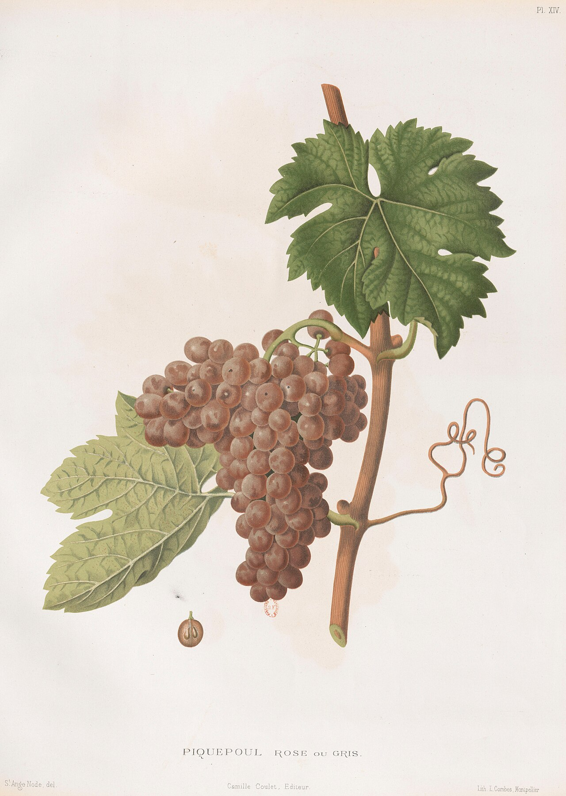

# Piquepoul

Piquepoul (also Picpoul, Picapoll) is an ancient white grape of southern France's Languedoc, best expressed in Picpoul de Pinet AOP on the shores of the Étang de Thau. Late-ripening with naturally high acidity, it makes pale green-gold wines of lemon, green apple and white flower over a saline, iodine mineral note, the archetypal Mediterranean "sea-air" dry white, long matched with Bouzigues oysters and lagoon shellfish (ref:white).

Three Piquepoul forms need separating first: the common Piquepoul Blanc white grape, and the much rarer Piquepoul Noir and Piquepoul Gris. A Picpoul de Pinet label is a 100% Blanc single-variety appellation, not a blend with the black or grey forms. With that distinction in place, read how lakeside limestone, sea breeze and late ripening shape its acidity and savoury edge.

Figure: Piquepoul: Piquepoul rose - Henri Marès (Wikimedia Commons). Image: Charles Node-Saint-Ange, Louis Combes (Lithographe), CC0, via Wikimedia Commons ([source page](https://commons.wikimedia.org/wiki/File:Piquepoul_rose_-_Henri_Mar%C3%A8s.jpg)).

## Definition and naming

Piquepoul is a Vitis vinifera grape, VIVC variety number 9298. The French name reads as "stings the lip", referring to the mouthwatering acidity on the palate. Registered synonyms include Avello, Avillo, Extra, Feher Piquepoul, Languedocien, Picapoll, Picapolla, Picapulla, Picpoul, Picpoul de Pinet, Piquepoul blanc and Piquepoul de Pinet; in Catalonia, Spain, it is Picapoll.

The three forms are told apart by skin colour and use: Blanc goes into dry whites, Noir is a minor permitted red in southern Rhône blends, including Châteauneuf-du-Pape, and Gris is planted on a tiny scale. On the vine it buds late with a long growing season, usually picked mid-September to early October; the skin is thin and the wine keeps high natural acidity at ripening, with good drought tolerance on coastal limestone and slightly saline soils. Picpoul de Pinet AOP bottlings must use 100% Piquepoul Blanc; the certified Blanc clones in France are numbers 176, 237, 238 and 463, and a conservatory of nearly 400 clones was planted in 1994 in the Hérault department.

## Origin and spread

The variety originated in southern France; the first written record appears in a 1384 vine rental contract in Toulouse. The Roman Via Domitia runs through today's vineyards, pointing to a very local vine-growing history. It was originally a dark-skinned variety, with the white and grey forms diverging later; after winning a medal at the 1910 Brussels Expo it began to build an international reputation. Pedigree notes treat the white form as a white mutation of the black.

It has long been concentrated in Languedoc-Roussillon and the southern Rhône, with the related Picapoll grown in Catalonia, Spain. Neglected through much of the later twentieth century, it has returned to attention with the revival of single-variety Picpoul de Pinet whites. French Blanc plantings stood at about 1,000 hectares in 2000 and have since trended upward.

## Botany and cultivation

Budburst is late and the vegetative cycle long, with harvest from mid-September into early October. The skin is thin and the grape keeps high natural acidity at ripening; drought tolerance is good, suiting seaside limestone and mildly saline soils. It is sensitive to powdery mildew, which needs watching in damp years. Night or early-morning harvest locks in acidity and flower aroma.

The cultivation core is leaf-fruit balance: too little leaf area and sugar fails to build; too dense a canopy shades the fruit, lowers acidity and invites disease. Pruning, trellis, leaf removal and limited irrigation all adjust that balance. Lakeside terraces are mostly clay-limestone, lacustrine limestone and schist at an average altitude of about 40 m; sea breeze and the westerly Cers moderate day-night temperature, and night mists preserve freshness. Free-draining, sunny sites suit wines with mineral depth (ref:terroir).

## Style and palate

A typical Picpoul de Pinet is pale lemon-yellow with green tints, dry and light to medium-bodied, with bright to high acidity as its defining feature. The nose opens on lemon, lime, green apple, white pear and grapefruit, then acacia, hawthorn and other white flowers, with fennel, anise, white pepper and thyme herbs; the mid-palate carries the saline and iodine mineral of the lagoon setting, lean and linear rather than fat and fruity.

Most producers ferment in temperature-controlled stainless steel or concrete and use little or no oak, preserving varietal purity and fresh aroma; malolactic conversion is usually skipped to keep the crisp acidity. Standard cuvées spend two to four months on lees, at 11.5–13.5% alcohol. Since 2018 the appellation has run a premium Patience tier: old vines, extended lees contact, cork closure and brown bottle, at least one year in bottle before release, giving more texture and complexity and a five-plus-year horizon; standard bottlings are best within one to two years (ref:fermentation).

## Main regions and representative wines

Picpoul de Pinet AOP is the largest and only still dry single-variety white appellation of the Languedoc. Its vineyards sit northwest of the Étang de Thau in the Agde–Pézenas–Sète triangle, across the six communes of Castelnau-de-Guers, Florensac, Mèze, Montagnac, Pinet and Pomérols, and the sole permitted variety is 100% Piquepoul Blanc. In 2024 the declared area was about 1,514 hectares and production about 86,334 hectolitres; producers number about 24 private estates and 4 cooperatives, with a standard yield ceiling of 66 hl per hectare and a maximum of 72. Roughly two thirds of production is exported, with the UK the largest market.

Representative private estates include Domaine de la Croix Gratiot and Château de Pinet; the cooperative Cave de l'Ormarine is another mainstay. Appellation milestones are VDQS status in 1954, a Coteaux du Languedoc sub-denomination in 1985, unanimous INAO approval for a standalone AOC in February 2013, the decree of 23 September 2013, and EU AOP recognition in 2017.

## How to drink and pair

Piquepoul is served at 8–10 °C in a medium-bowl white glass; no decanting, it drinks on opening. Too cold masks flower and mineral, too high makes the acidity sharp. It is a classic aperitif and food white.

The classic matches are Bouzigues oysters, mussels, clams and other lagoon shellfish, along with grilled fish, prawns, garlic seafood, fish soup and bouillabaisse. Goat cheese, light salads and herb-roasted white meat work too. Rich cream dishes and sweet desserts clash with its crisp acidity. Lagoon tradition serves freshly lifted mussels and oysters steamed with lemon and white wine, where the wine's saline iodine mirrors the shellfish's sea-air; chilled in summer it also opens Provençal seafood stews seasoned with fennel and garlic.

## Buying and common misreadings

The first mistake is lumping the three forms together: a Picpoul de Pinet label is Blanc single variety, not a Noir or Gris blend. The second is assuming Piquepoul gains flavour from oak: the mainstream, traditional and modern alike use little or no oak, and the selling points are acidity, flower and saline mineral. The third is reading the variety name without region: Piquepoul elsewhere in the Languedoc may enter blends, with a different style from the single-variety AOP.

On the label, separate Picpoul de Pinet AOP from other bottlings, standard cuvée from the Patience tier, and check vintage and alcohol. Standard wines drink within three to five years; Patience bottlings cellar for years. Store on the side, away from light and temperature swings. The UK channel takes a large share of exports, so check storage history when buying; an overheated warehouse damages fresh fruit and acidity.

## Further reading and see also

- Related: [white-wine](ref:white), [terroir](ref:terroir), [fermentation](ref:fermentation), [chardonnay](ref:chardonnay), [oak-ageing](ref:oak).
- To compare standard and Patience tiers, taste two bottlings from the same estate and vintage and contrast lees texture, citrus depth and the length of the saline finish.

**Short definition:** A white grape of Languedoc, France, centred on Picpoul de Pinet; high acidity, lemon, sea salt and white flowers, it suits oysters and seafood and represents the Mediterranean “sea-air” white.

## Related images

Image: Terroir. Credit: Friedrich Petersdorff, CC BY-SA 2.0 de, via Wikimedia Commons ([source page](https://commons.wikimedia.org/wiki/File:080110_zell_mosel.JPG)). Related image for Piquepoul.
