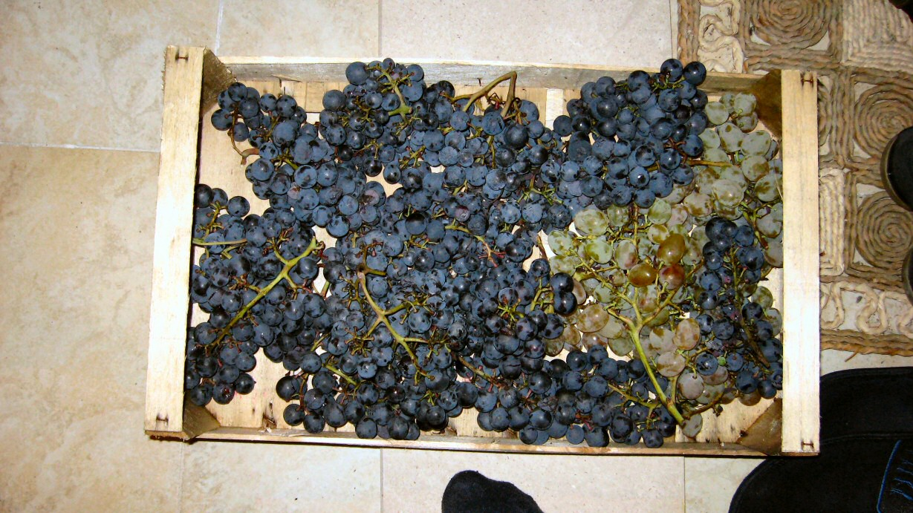

# Plavac Mali

A red grape of the Dalmatian coast, Croatia, a cross of Tribidrag (Zinfandel) and Dobričić; high in tannin and alcohol, with blackberry, dried fruit and spice, with Dingač as the core appellation.

Figure: Plavac Mali: Plavac mali N (Wikimedia Commons). Image: Pero Kvrzica, CC BY 2.0, via Wikimedia Commons ([source page](https://commons.wikimedia.org/wiki/File:Plavac_mali_N.jpg)).

## Definition and naming

Plavac Mali is the signature red grape of Croatia's Dalmatian coast. The name means "small blue grape" in Croatian: Plavac refers to the dark skin, mali to the relatively small berries. Locally it is shortened to Plavac, while labels often carry the full Plavac Mali. It was long confused with Zinfandel, Primitivo and the Croatian native Crljenak Kaštelanski, and the name lineage was only sorted out in the DNA era.

As a Dalmatian native, it is concentrated on the Pelješac peninsula and the coastal islands of Brač, Hvar and Vis, where limestone slopes and the Mediterranean climate shape its high-tannin, high-alcohol skeleton. Reading the variety means keeping botanical kinship, appellation rules and the popular "Balkan Zinfandel" shorthand apart; because it was long confused at home with Tribidrag (Zinfandel/Primitivo) and its kinship conclusions were revised repeatedly from SSR to SNP testing, a Plavac Mali label cannot be read by the variety name alone: the appellation, Dingač or Postup among others, and the producer are needed to judge site and style.

## Origin and spread

For Plavac Mali, begin with where it is grown, then how it is labelled, and finish with whether the style is dry or sweet; that order keeps the account grounded.

That parentage has since been revised. A 2004 study based on 25 SSR markers, Maletić et al., proposed the Tribidrag and Dobričić combination; Lacombe et al. in 2013 and Žulj Mihaljević et al. in 2020 found Mendelian inconsistencies across additional loci and chloroplast markers, calling the parentage into question. In 2024, Marinov et al., using SNP markers, confirmed that Plavac Mali is not a descendant of Tribidrag and Dobričić, although it is closely related to each. In other words, the early "Zinfandel × Dobričić cross" was once the mainstream hypothesis, but the latest genomic evidence does not support a direct parent-offspring relationship; its precise ancestors remain under study.

## Botany and cultivation

Berries are medium to small with thick skins, bunches are not large, and the variety ripens late, needing strong sun and heat to reach physiological ripeness. The vine tolerates heat and drought and suits coastal slopes on limestone and weathered rock; sea breezes and reflected light build colour and tannin in the skins, while fast-draining slopes naturally limit yield. In shaded or low-lying sites it struggles to ripen, leaving acidity and green notes behind.

The growing challenge is balancing ripeness against acidity. Dalmatian summers are hot and dry; picking too ripe swells alcohol and roughs up tannin, while picking too early leaves thin fruit and herbal character. Traditional training is low bush vines, with a low canopy close to the reflected heat of the ground; thinning, cropping limits and picking-date decisions are the keys to quality. Deep-rooted old vines crop low and concentrate flavour, and are the basis of the top bottlings.

## Style and palate

A typical Plavac Mali is deep in colour, with blackberry, black cherry, dried plum, liquorice, black pepper and smoked spice, often with dried-fruit and earthy notes. Tannin is firm, acidity medium to high, and alcohol can easily reach 14–16%; the structure is substantial with ageing potential. Traditional winemaking uses long ageing in large oak for a rich, muscular style; modern estates pick earlier and extract more gently for balance and clearer fruit.

Young wine shows direct fruit with tight tannin; after a few years in bottle it develops leather, dried fruit, tobacco and mushroom tertiary notes. High alcohol and strong tannin are a double-edged sword: over-extraction tastes rough, over-ripening tastes sweet and heavy. Blending is uncommon in Croatia itself, and most representative wines are single-varietal. Compared with [zinfandel](ref:zinfandel), Plavac Mali is usually heavier, with harder tannin and darker dried-fruit rather than fresh red fruit.

## Main regions and representative wines

Dingač is the core appellation. It became Croatia's first protected designation of origin, ZOI, in 1961, and the first wine appellation in the former Yugoslavia. Its sunny steep terraces above the village of Potomje on the Pelješac Peninsula require 100% Plavac Mali and produce the country's most concentrated reds, high in alcohol, with dark fruit, tobacco and dried herbs. Neighbouring Postup has gentler slopes and a relatively more elegant style, also mostly single-varietal; island sites on Brač and Hvar produce representative wines as well.

Representative producers include Miloš, Frano Miloš, on Pelješac, whose barrel-aged and Stagnum bottlings are regarded as benchmarks; Matuško covers both Dingač and Postup across several price tiers; Saints Hills follows a modern style meant for younger drinking; Grgić Vina was founded by the Grgich family. Skaramuca, Korta Katarina, Badel 1862 and Vinarija Dingač are other familiar names. There is almost no scaled planting overseas, and the variety's expression remains essentially Dalmatian.

## How to drink and pair

Substantial Plavac Mali is served at 16–18°C; too cool and tannin and acidity tighten, too warm and alcohol and roughness stand out. Tannic examples benefit from half an hour to an hour of decanting so fruit and tannin open together; older bottles should be settled and decanted off deposit. A broad-bowled glass gives the aroma room to unfold.

Pairing revolves around Adriatic and inland red meat: grilled lamb, beef stew, game, cured pršut and smoked meats, and hard aged cheeses all absorb its tannin and acidity. Delicate seafood or spicy dishes are overwhelmed by alcohol and bitterness; substantial main courses, grills and stews are the safe direction. As a [red-wine](ref:red), its concentration suits the middle of the meal rather than the aperitif moment.

## Buying and common misreadings

One common mistake is treating it as a straight Zinfandel copy. The two are related, but Plavac Mali is heavier, harder-tannined and higher in alcohol, and the styles are not equivalent; a popular analogy cannot replace judging site and craft. Another mistake is relying on the variety name alone: Dingač slopes, Postup gentler ground and island sites differ in ripeness, acidity and concentration, and vintage strongly affects picking rhythm on the hot coast.

When buying, separate the appellation tier first, Dingač, Postup or island IGT, then read producer, vine age and vintage. Old vines are not a legal grade; actual yield and vine age follow the producer's note. High alcohol is not itself a mark of quality; balance is. Store away from heat, strong light and vibration; structured reds keep two to three days after opening, and a vacuum stopper slows oxidation.

### Key dates and figures

- 1998: around 1998, Meredith’s team confirmed that Plavac Mali and Zinfandel were related but distinct.
- 2000: in 2000, Primitivo/Zinfandel was identified as one parent.

## Further reading and see also

The most direct comparison is to taste a Dingač slope wine, a Postup wine and an island bottling in the same vintage, setting tannin finesse, fruit and alcohol side by side. It ties closely to the limestone coastal [terroir](ref:terroir), the [oak-ageing](ref:oak) tradition, the ripeness differences driven by [vintage](ref:vintage), and can be read against the Zinfandel entry for kinship and stylistic divergence.

- Related: [zinfandel](ref:zinfandel), [red-wine](ref:red), [terroir](ref:terroir), [oak-ageing](ref:oak), [vintage](ref:vintage).

[Zinfandel](ref:zinfandel) and [Terroir](ref:terroir) are the two useful reference points for Plavac Mali. [Zinfandel](ref:zinfandel) sets out variety character; [Terroir](ref:terroir) brings in regional performance. Read them together.
