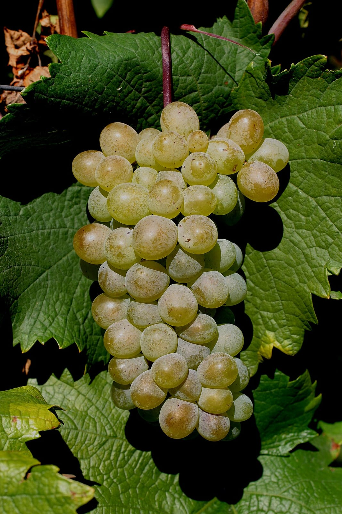

# Rkatsiteli

One of Georgia’s oldest white grapes, high in acidity with green apple, white flowers and spice; it makes crisp dry whites and amber wines through qvevri skin contact, and is central to Georgia’s clay-vessel tradition.

In the “Hejiu” variety index, Rkatsiteli is both a recognisable name and a set of comparable viticultural and winemaking choices. Read it first through its ripening rhythm, acid frame and tannin direction at home, then through what survives or fades when it travels. The gap between Old and New World versions often explains more than the label. For the reader, the point is not a fixed flavour tag but how climate, soil and winemaking decisions turn the same grape into a different wine. This also explains why the same name carries different descriptions across sources: one stresses botany, another market style, another a single region’s rules.

Figure: Rkatsiteli: VIVC10116 RKATSITELI Cluster in the field 9065 (Wikimedia Commons). Image: Please note: This photo can be reproduced. Please quote the source as indicated below: Doris Schneider, Julius Kühn-Institut (JKI), Federal Research Centre for, CC BY-SA 4.0, via Wikimedia Commons ([source page](https://commons.wikimedia.org/wiki/File:VIVC10116_RKATSITELI_Cluster_in_the_field_9065.jpg)).

## Definition and naming

Rkatsiteli comes from Georgia; the name may mean “vine shoot”, and it is widely planted in Kakheti as one of Georgia’s most important whites.

Rkatsiteli is a vines variety or raw material with a definable botanical origin and cultivation history. The name may come from a place, a shape, a farming habit or a promoter; synonyms and homonyms are common, so check the scientific name or classification first.

## Origin and spread

Georgia’s qvevri clay-vessel tradition reaches back 8,000 years; Rkatsiteli fermented on skins for months makes amber, tannic wine.

The origin of Rkatsiteli can usually be traced to a mountain, valley or coast, then spread through trade, migration and replanting after disease. Spread is not copying: in each new environment growers select different clones, rootstocks and pruning.

Rkatsiteli originated in Kakheti, Georgia, where qvevri winemaking predates modern variety registration by centuries. Its parentage is not fully resolved, and its many transliterations across Armenia, Azerbaijan, Ukraine, Russia and Moldova do not prove separate varieties. The name is best treated as one grape with several regional spellings.

## Botany and cultivation

Berries are medium and thin-skinned, mid-late ripening, with high acidity; green apple, pear, white flowers, spice and mineral.

The performance of Rkatsiteli depends on budbreak, ripening, vigour, yield and disease resistance. Early varieties carry less risk in cool regions, late varieties need a long autumn; excessive vigour shades fruit, while weak vines crop poorly.

The vine is vigorous and late-ripening, with thick skins that tolerate humidity but also demand canopy control. Kakheti’s warm days and cool nights preserve acidity; high yields dilute aroma, while old vines and lower yields give denser skins and more spice. Growers pick early for sparkling and dry white, or later for amber wine.

## Style and palate

It makes crisp dry whites, amber wines and sweet wines; qvevri versions show tea, dried herbs, nuts and tannin, very different from ordinary white wine.

The style of Rkatsiteli is defined by acidity, tannin or bitterness, alcohol, aroma and texture. It can be made alone or as part of a blend; in a blend it may supply colour, acidity, aroma or structure rather than the dominant flavour.

Winemaking splits the variety in two. Stainless-steel fermentation without skins gives a pale, high-acid white with green apple and white flowers; skin contact in qvevri for weeks or months extracts tannin, amber colour, dried apricot, tea and spice. The qvevri’s buried, stable temperature is part of the process, not a decorative detail.

## Main regions and representative wines

Representative wines include Pheasant’s Tears, Tbilvino, Teliani Valley and Vinoterra; Kakheti qvevri Rkatsiteli is the emblem of Georgian amber wine.

To find representative Rkatsiteli, start with the place of origin or the most typical region, then compare a New World example. Keep alcohol, sweetness and vintage as close as possible, or you will mistake technique for variety.

Kakheti is the core, with Tsinandali known for dry white blends and Gurjaani for fuller amber wines; Vazisubani and Kartli produce lighter versions. Pheasant’s Tears, Vinifera, Teliani Valley and Chateau Mukhrani are useful reference producers, but the dry and amber styles should be treated as separate benchmarks.

## How to drink and pair

To drink Rkatsiteli, confirm sweetness and alcohol first, then choose temperature and food. Dry high-acid styles suit fat, seafood and salt; sweet styles suit spice, blue cheese and fruit desserts; high alcohol clashes with sweet or very spicy dishes.

Serve dry Rkatsiteli at 8–10°C and amber wine at 12–14°C in a medium-bowled white glass. Dry versions suit seafood, vegetables and fresh cheese; amber versions need roast chicken, spice, nuts or hard cheese to match their tannin. Refrigerate after opening and finish dry bottles within two or three days.

## Buying and common misreadings

To read Rkatsiteli, start with where it is grown, then how it is labelled, then whether the style is dry or sweet; no single check settles it.

### Key dates and figures

- 1990s: from the 1990s, Georgian growers re-emphasised qvevri, skin contact and long maceration.

## Further reading and see also

To study Rkatsiteli, read botanical and viticultural sources first, then taste three wines from different regions side by side. Do not buy many bottles of one style; build a benchmark, then move to blends, sweet or aged versions.

Compare a dry Rkatsiteli and an amber qvevri version from the same vintage before adding other varieties. Then place the dry wine beside Mtsvane or Chardonnay, and the amber wine beside a light red. Keeping grape, vintage and alcohol fixed makes the role of skin contact and vessel clear.

- Related: [white-wine](ref:white), [terroir](ref:terroir), [fermentation](ref:fermentation), [chardonnay](ref:chardonnay), [oak-ageing](ref:oak).
- This variety offers no plant identification, prices or shopping channels; a label name is not a botanical identification.

**In brief:** One of Georgia’s oldest white grapes, high in acidity with green apple, white flowers and spice; it makes crisp dry whites and amber wines through qvevri skin contact, and is central to Georgia’s clay-vessel tradition.

Rkatsiteli is one of the oldest white grapes of Kakheti, Georgia, and remains the country's most planted variety. Classical Georgian winemaking ferments it in qvevri, large buried clay vessels, with skin contact that gives amber colour, tannin and dried-fruit complexity; modern producers also make crisp, unoaked white in the European style. The grape keeps high acidity in hot summers, which is why it can support long maceration without losing freshness. Its name appears on labels as Rkatsiteli or Rkatsiteli Mtsvane blends; Mtsvane is a separate variety often blended for aroma. Outside Georgia, it is planted in eastern Europe and the former Soviet republics, but the qvevri method remains the reference point for understanding the grape.
