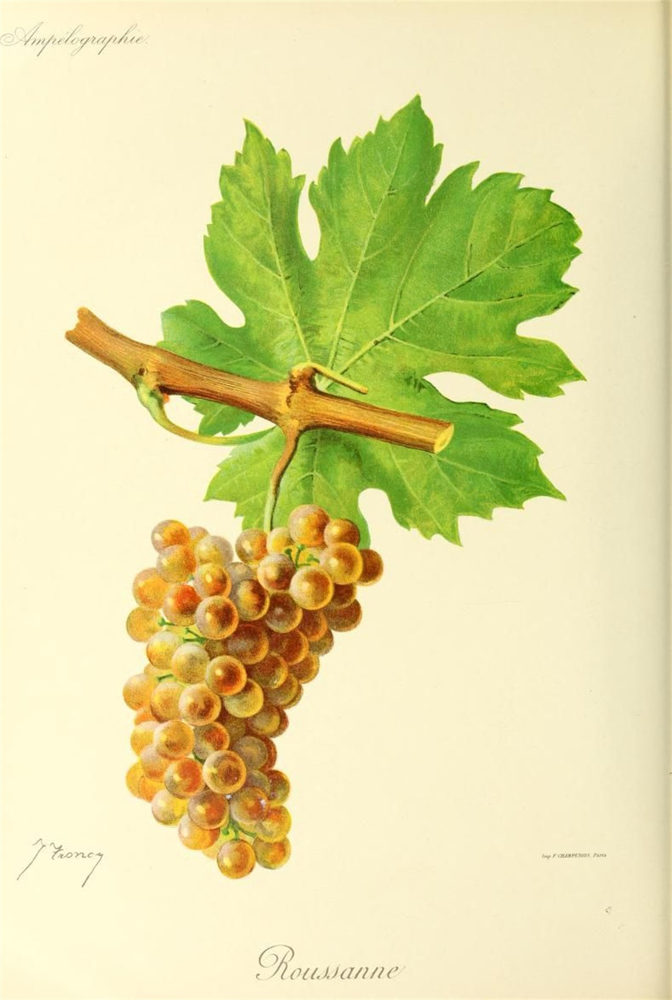

# Roussanne

A white grape of the Northern Rhône, with white flowers, almond, honey and herbal notes, higher acidity and lower yields than Marsanne; usually blended with Marsanne, and also planted in Savoie and Languedoc.

Figure: Roussanne: Roussanne (Wikimedia Commons). Image: Jules Troncy, Public domain, via Wikimedia Commons ([source page](https://commons.wikimedia.org/wiki/File:Roussanne.jpg)).

## Definition and naming

Roussanne is the classic white grape of the Northern Rhône. Its name is thought to derive from the French roux, russet, referring to the speckled gold-burnished colour of the ripe berries. In Savoie it is known as Bergeron; in Isère it is Fromental or Fromentau; other synonyms include Barbin, Martin Cot and Petite Roussette. A Bergeron on a label usually means the same variety from the Chignin-Bergeron district of Savoie.

It shares a parent-offspring genetic relationship with its long-standing blending partner Marsanne, though their growing characters differ sharply. Marsanne is hardier, higher-yielding and wider in structure; Roussanne is more aromatic and more demanding in the vineyard. Treating Roussanne as a fixed flavour tag is misleading: its expression changes with site ripeness, blend proportion and oak ageing. The stable traits are late ripening, acid potential and aromatic intensity.

## Origin and spread

The variety most likely originated in the Northern Rhône, with the earliest written record in the late eighteenth century. DNA evidence shows a parent-offspring relationship with Marsanne, though which is the parent remains open to debate. Historically it took root in Hermitage, Saint-Joseph, Crozes-Hermitage and Saint-Péray in the northern valley; Saint-Péray uses it for both still and sparkling whites. In the southern Rhône it is permitted in Châteauneuf-du-Pape whites, where Marsanne is not.

Global plantings in 2010 were about 1,746 hectares, almost all in France, and the French area had doubled since 2000. Beyond the Rhône, it enters the Chignin-Bergeron sub-region of Savoie under the Bergeron name; in Languedoc, Roussillon and Provence it is often blended with Chardonnay, Marsanne and Vermentino. It is permitted in Montecarlo Bianco in Liguria and Tuscany in Italy. Overseas, Victoria in Australia recorded Roussanne plantings as early as 1882, and today dozens of producers in Victoria and South Australia work with it; there are also small plantings on California's Central Coast and in Yuba County, in the Israeli Golan Heights and in South Africa.

## Botany and cultivation

Roussanne is notoriously difficult to grow. Budburst is mid-season and maturity mid to late, late for a white variety. Vigour is moderate but yields are irregular, and the vine is sensitive to grey rot, powdery mildew and wind damage; in cooler climates it often struggles to ripen fully. Timing the pick is decisive: under-ripe fruit gives sharp acidity and green aroma, while over-ripe fruit can push alcohol past 14% and let acidity and aroma fade.

It needs warm sites, long sunlight and sheltered slopes to bring aroma and sugar to fullness. Canopy management, thinning and disease control take more work than for most whites. Because yields are low and irregular, growers in the Northern Rhône favour the easier Marsanne, which is why Roussanne's area has long stayed below its partner's. On good sites Roussanne develops tight acidity and fine flowers; on flat or low-lying ground it tends to be thin and loose.

## Style and palate

Roussanne is medium to full-bodied, with bright acidity and a textured palate. Typical notes are peach, quince, apricot blossom, lime peel, pear and honeysuckle, with tea-leaf and dried-herbal savouriness. Young wines lead with flowers and citrus; with age they develop honey, butterscotch, beeswax, nuts and dried fruit. In blend with Marsanne, Roussanne supplies aromatic intensity and olfactory layers, while Marsanne fills out structure, body and waxy texture; the resulting whites commonly age for ten years or more.

Winemaking often uses barrel fermentation or lees ageing to build texture, though some estates keep it in stainless steel for freshness. Single-varietal Roussanne is more common in the New World; Rhône tradition leans on blending. Under-ripe picking reads sharp and herbal, over-ripening lets alcohol cover the aroma; fermentation temperature, oak age and lees contact decide whether the final wine leans fresh fruit or rich nuts. Ageing potential should be judged from the balance of acidity, structure and alcohol, not colour alone.

## Main regions and representative wines

The Northern Rhône is the core: Hermitage, Saint-Joseph and Crozes-Hermitage whites are mostly Marsanne–Roussanne blends, and Saint-Péray uses the grape for still and sparkling wines. Chapoutier and Jaboulet are representative large estates around Hermitage and Saint-Joseph, their bottlings led by Marsanne–Roussanne blends. In the southern Rhône, Château Beaucastel's Roussanne Vieilles Vignes from Châteauneuf-du-Pape is one of the few famous wines made from 100% old-vine Roussanne, in very small production.

Chignin-Bergeron in Savoie is its freshest expression outside the Rhône, labelled under the Bergeron name. In Languedoc and Provence regional wines it acts as an aromatic component alongside other whites. Overseas, Sine Qua Non on California's Central Coast makes one of the world's highest-priced Roussanne wines; Australian estates in Victoria and South Australia mostly make single-varietal wines or blends with Marsanne and Viognier.

## How to drink and pair

Medium to full Roussanne is best at 10–12°C; too cold and flowers and honey close down, too warm and alcohol and nutty notes amplify. Barrel-aged, wider examples can sit a little warmer, young fresh versions a little cooler. A medium-bowl white glass works; young wines do not need long decanting, just a few minutes after opening for the aroma to open.

For food, its texture and acidity suit white meat, poultry, cream sauces, grilled sea fish and shellfish; almond, hazelnut and herb seasonings echo the nut and floral notes in the wine. Medium-hard cheese, asparagus and artichoke also match. Heavy oils or dense red meat overwhelm its fine aroma; spicy dishes amplify the alcohol, so a riper vintage is the safer choice.

## Buying and common misreadings

One common misreading is treating Roussanne and Marsanne as interchangeable synonyms. They appear together often but play different roles: Roussanne gives perfume, Marsanne gives backbone, and the blend proportion sets whether the wine is lean or broad and how concentrated the aroma. Another mistake is relying on the variety name alone: Northern Rhône slopes, cool Savoie mountains and warm New World coasts differ in ripeness and acidity, and vintage matters especially for a late-ripening variety.

Read Roussanne through where it is grown, then how it is labelled, and finally whether the style is dry or sweet. The sequence matters.

## Further reading and see also

The most direct comparison is to taste a Hermitage Marsanne–Roussanne blend, a Chignin-Bergeron single varietal and a New World single varietal in the same vintage, setting aroma, texture and acidity side by side. It connects to the [rhone](ref:rhone) terroir, the [marsanne](ref:marsanne) blending partner, the [white-wine](ref:white) category, the choices of [oak-ageing](ref:oak) and the craft of [fermentation](ref:fermentation).

- Related: [rhone](ref:rhone), [marsanne](ref:marsanne), [white-wine](ref:white), [oak-ageing](ref:oak), [fermentation](ref:fermentation).

[Rhône Valley](ref:rhone) and [White wine](ref:white) are the nearest useful comparisons: one clarifies variety character, the other tests regional performance.
