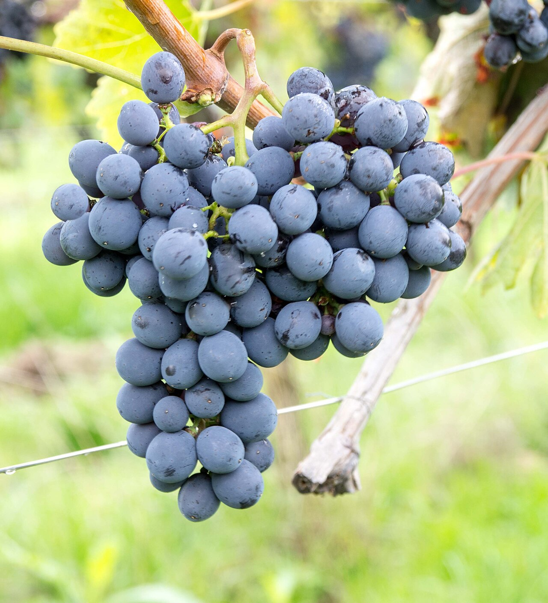
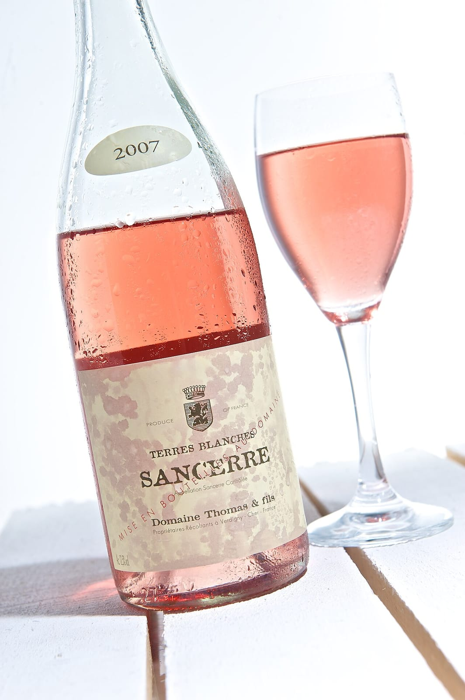

# Sangiovese

Sangiovese is Tuscany's most representative red grape, with high acidity, medium tannin and notes of sour cherry, tomato leaf, leather and earth. It is the core variety of Chianti and Brunello di Montalcino and is also used for rosé. Its clones vary widely, so the same variety can show different styles in different regions.

Figure: Sangiovese. Image: Please note: This photo can be reproduced. Please quote the source as indicated below: Ursula Brühl, Julius Kühn-Institut (JKI) Bundesforschungsinstitut für Kul, CC BY-SA 4.0, via Wikimedia Commons ([source page](https://commons.wikimedia.org/wiki/File:VIVC10680_SANGIOVESE_Cluster_in_the_field_20354.jpg)).

## Definition and aliases

Sangiovese is the common name, with Chinese translations including 桑娇维赛. It belongs to the European grape Vitis vinifera, and the origin of the name has several explanations. Sangiovese is not "Italy's Merlot"; it has higher acidity and more sour-cherry and herbal fruit. Treating it as a soft variety misreads its structure and food pairing.

Sangiovese has several clones and local types, such as Brunello and Prugnolo Gentile. Clones differ in berry size, ripening and aroma, which is one reason styles differ across Tuscany.

## Botanical characteristics

Clusters are medium, berries are roundish, skins are relatively thick, and pigment and tannin are medium. Budbreak is late and ripening is late, suiting warm to temperate climates. Thick skins give some resistance to botrytis, but canopy management is still needed in wet years.

Sangiovese acidity is very high, one of its clearest structural traits. High acidity makes it fresh with food, but it also needs enough fruit and tannin for balance. Clone and regional ripeness change the ratio of acidity to fruit.

## Main regions

Sangiovese originates in Italy, with Tuscany as the core region. Chianti, Chianti Classico, Brunello di Montalcino and Vino Nobile di Montepulciano are all based on Sangiovese. It is also grown elsewhere in Italy and in the United States, Australia and Argentina, but the Tuscan tradition is the most complete.

Tuscan sub-regions differ clearly. Chianti Sangiovese usually has high acidity with sour cherry and herbal notes; Brunello di Montalcino is more concentrated and structured, often with long oak ageing. Altitude, soil and clone explain a style better than the variety name.

## Typical flavours

Typical Sangiovese aromas include sour cherry, red plum, tomato leaf, leather, tobacco and earth. Acidity is high, tannin medium and the body medium. While young it is sour cherry and herbs; after [oak ageing](ref:oak-ageing) it may gain vanilla, spice and smoke, and with age leather, dried fruit and earth.

The "tomato leaf" note is often treated as a signature, but it is not obvious in every wine. Ripeness, clone and winemaking all change the expression. Judge Sangiovese by whether acidity balances the fruit, whether tannin is fine, and whether oak obscures the variety.

## Representative wines

Chianti and Brunello di Montalcino are two representative groups. Chianti is usually fresher and earlier to drink; Brunello is more concentrated and needs longer ageing. Tuscany also makes Sangiovese-based rosé; in [rosé wine](ref:rose), Sangiovese usually shows sour cherry and floral notes with a fresh style.

## Viticulture

The key viticultural focus is ripeness and acid balance. Sangiovese ripens late, so cool vintages may leave it underripe and too acidic, while warm vintages can lower acidity and ripen the fruit too much. Producers balance ripeness and structure through site altitude, harvest timing and clone choice.

Yield control also affects flavour concentration. Too much yield dilutes fruit and makes tannin coarse; moderate control brings more concentrated sour cherry and herbal notes. Diurnal range and soil drainage in different regions change ripening and acid retention.

## Common misconceptions

First, that Sangiovese is simply a tart, astringent red. High acidity must be understood together with fruit, tannin and food pairing.

Second, that Sangiovese only makes Chianti. It is also used for Brunello and rosé.

Third, that the older the Sangiovese the better. Ageing depends on vintage, structure and storage.

Fourth, that the tomato-leaf note is a defect. Moderate herbal notes are a variety trait.

Fifth, that all Sangiovese is the same. Clone, region and winemaking create clear differences.

Sangiovese is the signature red variety of Tuscany, with high acidity, moderate tannin and sour-cherry, tomato-leaf and earthy notes. Chianti and Brunello di Montalcino are built on it. Several clones and local types differ in colour, tannin and ripening, so the name does not guarantee one profile. Subzone and blend ratio are more specific than the variety name alone. Chianti Classico, Brunello di Montalcino and the coastal Tuscan wines use Sangiovese differently, and clone selection changes colour, tannin and ripening. The variety name does not settle the style; the subzone, blend and ageing regime do more of the work. A varietal wine can still carry the rules of its zone, and the producer remains the practical guide.

**At a glance:** Tuscany's signature red grape, with high acidity and medium tannin and notes of sour cherry, tomato leaf and earth; it is the core variety of Chianti and Brunello. 

Start with where it is grown. From there, consider how it is labelled, then whether the style is dry or sweet. That is how a practical judgment about Sangiovese is built.

The comparison with [Wine](ref:wine) and [Rosé Wine](ref:rose) runs through variety character and regional performance. Each answers a different question.

The name of a wine is not a safe shorthand for Sangiovese. Check what it is, then how the variety is labelled; where they diverge, prefer the specific source.

Sangiovese is the base of Chianti, Brunello and Rosso di Montalcino; high acidity and grippy tannin make it depend on oak and ageing for balance, while warmer sites in southern Tuscany give riper fruit.

Sangiovese has many clones, and the difference between Chianti's brighter style and Brunello's fuller one comes as much from site and clone as from winemaking.

**Key facts.**

| Item | Detail |
| --- | --- |
| In one line | Tuscany's signature red grape, with high acidity and medium tannin and notes of sour cherry, tomato leaf and earth; it is the core variety of Chianti and Brunello. |
| Species | Vitis vinifera |

**Sources and limits.** The key claims about Sangiovese are checked against the following sources: International Organisation of Vine and Wine (OIV) (Used to check varietal descriptors and the Vitis species framework), Oxford University Press (Used for reference on Sangiovese clones, regions and style; Migrated from the former reference list at the end of the article; access date not re-verified), European Union (Used to check the EU framework for wine regions and labelling). Prices, batches and status change; the body is project-written and does not reproduce source text.

For Sangiovese, this variety was last checked in 2026; prices, batches and availability change, so confirm them against the sources below.

## Further reading

- [Wine](ref:wine): the classification, winemaking and regional framework of wine.
- [Red wine](ref:red-wine): the basics of tannin, acidity and ageing.
- [Rosé wine](ref:rose): the use of Sangiovese in rosé.
- [Oak ageing](ref:oak-ageing): the barrel-ageing tradition of Brunello.

## Related images

Image: Rosé Wine. Credit: THOR, CC BY 2.0, via Wikimedia Commons ([source page](https://commons.wikimedia.org/wiki/File:Sancerre_rose_Wine.jpg)). Related image for Sangiovese.
