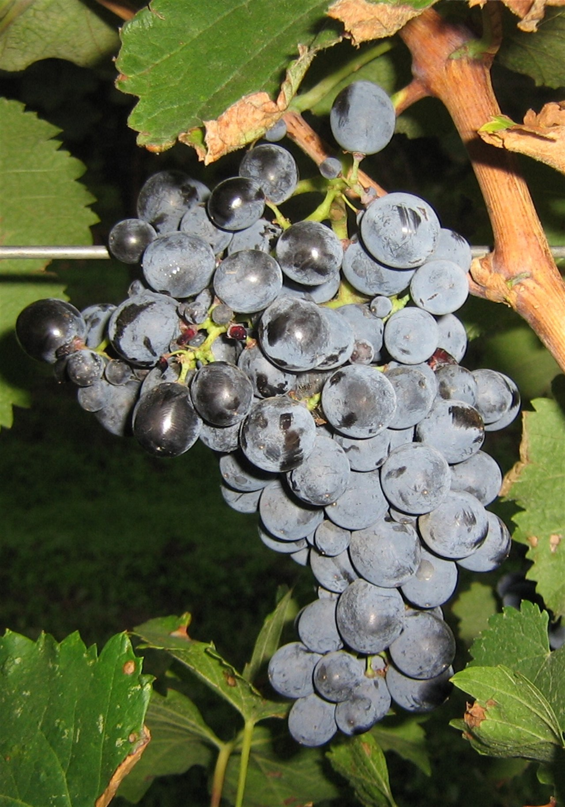

# Saperavi

Saperavi is Georgia's most important red grape, a rare teinturier variety with red pigment in both flesh and skin. The wine is deep, almost inky, with high acidity and firm tannin; it is made dry, semi-sweet, sweet or fortified, using both traditional qvevri and European methods, and it stands as a national emblem of Georgian wine.

Figure: Saperavi: Saperavibunch (Wikimedia Commons). Image: Lebowskyclone, CC BY-SA 3.0, via Wikimedia Commons ([source page](https://commons.wikimedia.org/wiki/File:Saperavibunch.jpg)).

> **Quick verdict**
> **In one line:** This variety helps you decide whether Saperavi suits you, and compare it with other varieties.
>
> - **Best for:** Anyone comparing Saperavi with other varieties and trying to pin down the flavour difference.
> - **Not for:** If you want only want a famous producer recommendation and do not care about the variety itself.
> - **Check first:**
>   - Dry and reserve Saperavi is served around 16–18°C; semi-sweet versions can be a little cooler, around 14–16°C.
>   - The first misreading is to treat a teinturier as an ordinary dark red grape.

## Definition and naming

In Georgian, Saperavi means "dye" or "something to colour with", a direct reference to the strong colouring power of its red flesh. In most red grapes pigment sits only in the skin, so juice runs pale pink; in Saperavi the pulp itself carries anthocyanin, and crushed berries yield a saturated purple-crimson juice. The resulting wine is often nearly opaque in youth, its most obvious identifying trait.

As an ancient Vitis vinifera variety, Saperavi carries many local types and clones: ampelographic studies over more than 150 years have discussed at least 17 variations, each with its own local name. Its kinship with other old Caucasian seedlings has not been fully settled by genetic research. A Saperavi label usually does not state clone, and site, altitude and winemaking matter more directly to style ([terroir](ref:terroir)).

## Origin and spread

Saperavi is native to Georgia, its cultivation woven into the country's 8,000-year winemaking tradition. Its core region is eastern Kakheti, where villages such as Mukuzani, Khashmi, Anaga, Kardenakhi, Shilda, Napareuli, Kondoli and Tsinandali are known for it. It is extremely cold hardy, tolerating frost down to -27°C, which suits high-altitude and inland continental climates; it ripens late, taking about 160 days from budbreak to full maturity.

Beyond the Caucasus it spread to Moldova, Ukraine, Bulgaria, Russia, Azerbaijan and Armenia, and in recent decades to the Finger Lakes in New York (first planted by Konstantin Frank in 1958) and Australia, where it gained a foothold in the 1990s, among other New World sites. Industry estimates put global Saperavi plantings at about 6,500 hectares, roughly 73% in Georgia; Russia holds about 716 hectares, Moldova about 573 and Kazakhstan about 428, the largest overseas areas.

Within Georgia it is the most widely planted red grape: the National Wine Agency records over 4,000 hectares nationwide, about 10% of all vineyard area, and a higher share of total wine production. In the Soviet period it went largely into blends and bulk reds; since independence, fine-wine estates have put single-vineyard, qvevri-aged and old-vine blocks back in view.

## Botany and cultivation

Bunches are medium, with medium-small thick-skinned berries and red flesh; the vine is vigorous, with strong disease and cold resistance among red varieties. Late ripening needs a long growing season, and sites picked too cool or too early retain herbal and green-stem notes. Warm, dark-soil sites give darker fruit and higher alcohol, while sites under mountain breezes lean to red berries and elegance; the perfume is quite terroir-sensitive.

Yield control matters for concentration: low-yield old vines balance fruit, acidity and tannin best, while high crops keep colour but loosen fruit and structure. Canopy management, thinning and picking date decide whether the fruit reaches ideal ripeness. Kakheti's semi-arid climate brings low rainfall and ample sun, and traditional blocks rely on natural rainfall combined with mountain irrigation.

## Style and palate

Typical Saperavi is deep inky red to garnet-black, with blackberry, blackcurrant, sour cherry, plum, liquorice, tobacco, grilled meat, chocolate and spice. The palate is sappy with firm tannin and considerable acidity; alcohol usually runs between 12 and 14%. Cool sites lean to red berries and elegance, warm sites to black fruit, meaty notes and higher alcohol, so the style range is wide.

Winemaking follows two routes. The traditional qvevri method ferments and ages the grapes, often with whole clusters, in large buried clay jars; long skin and pulp contact gives earth, dried hay, nut and mineral notes, with more prominent tannin and acidity, and good qvevri wines can age 40–50 years. The European route ferments in stainless steel or oak, ageing in French, American, Slavonian, Russian or Hungarian oak; fruit stays cleaner, and structure is built from both oak ageing and maceration ([oak-ageing](ref:oak)).

By sweetness and style it can be dry, semi-sweet, sweet or fortified. Mukuzani is the dry benchmark: rules require harvest sugar of at least 19%, complete fermentation to dryness, a yield cap of 10 tonnes per hectare and no more than 650 litres of wine per tonne of grapes, with the traditional standard at least three years in oak. Kindzmarauli is the naturally semi-sweet red of the Kvareli district, made since 1942 from 100% Saperavi at 12–13.5% alcohol; Akhasheni is the semi-sweet type around Gurjaani. Standard bottlings age comfortably 10+ years, and top sites have 15–20 years or more of evolution ahead ([vintage](ref:vintage)).

## Main regions and representative wines

Kakheti is the core: the Mukuzani subzone is known for dry, oak-aged, structured wines; the black shale soils of the Duruji valley in Kvareli give Kindzmarauli its semi-sweet style; villages such as Tsinandali, Napareuli and Khashmi hold single-vineyard blocks. Other Georgian regions and overseas areas in Moldova, Russia and Ukraine also plant it, but the style reference remains Kakheti.

Representative producers include Pheasant's Tears, whose Tibaani qvevri Saperavi uses four clones from about 25-year-old vines on 4 hectares, with 70% destemmed and crushed and 30% whole cluster; semi-carbonic fermentation lightens extraction and adds finesse, served at 16–18°C, decanted, with 5–15 years of ageing. Tsinandali Estate and Teliani Valley are large domestic references; Kindzmarauli Marani is known for the classic semi-sweet; Tbilvino, the Château Mukhrani reserve, Chelti and Orilo's Khashmi single vineyard are frequent names in reviews.

In the market, Saperavi spans everyday table wines to collector-level qvevri bottlings. Under the same name, stainless young wines and low-yield old-vine, long-aged reserves differ markedly in concentration, tannin and ageing potential; producer, site and appellation tier predict the glass better than the variety name. It is often compared with Cabernet Sauvignon for structure and ageing, but the skin pigmentation and Caucasian terroir bring an independent expression of dark fruit, meatiness and spice ([cabernet-sauvignon](ref:cabernet)).

## How to drink and pair

Dry and reserve Saperavi is served around 16–18°C; semi-sweet versions can be a little cooler, around 14–16°C. A large-bowled red glass gathers the aromas; young and qvevri styles benefit from 20–30 minutes of decanting, which softens tannin and opens fruit and tobacco. Too warm, alcohol and tannin turn rough; too cold, spice and mineral layers stay shut.

Pairing is a strength: grilled steak, lamb, ribs, braises and game stand up to its acidity and tannin; aged cheeses, tomato pasta sauces and pizza work too. Semi-sweet versions match spicy or lightly sweet dishes that balance the tannin's dryness. Delicate seafood and white meats usually cannot hold its structure and are not the first choice.

## Buying and common misreadings

The first misreading is to treat a teinturier as an ordinary dark red grape. Saperavi's pigment sits in the flesh, so the colour comes from the variety itself, not later soaking or adjustment; the depth comes with high acidity and firm tannin, and colour alone does not indicate body weight. The second is to assume Saperavi is only dry red. Dry, semi-sweet, sweet and fortified styles all exist, set by regional rules and winemaking; on the label, first separate Mukuzani dry, Kindzmarauli semi-sweet and the other types.

The third misreading is that high-tannin, high-acid reds must be drunk young. On the contrary, intact acidity and tannin structure are the basis for long ageing; good Saperavi moves from dark fruit toward leather, dried fig and spice after a dozen years in bottle. Judge by site yield, ageing method and vintage, not a general variety impression. Check bottling date, storage and transport temperature: heat or long stock costs the dark-fruit perfume and leaves tannin dry and coarse.

## Further reading and see also

A useful comparison is to set a Mukuzani oak dry red beside a qvevri Saperavi, recording differences in fruit, earthy mineral and tannin texture; then contrast Kindzmarauli semi-sweet with a dry version to see how residual sugar shapes acidity and structure.

Planting area, clones and overseas plantings keep updating with variety surveys; for formal citation, check the Georgian National Wine Agency, the VIVC register and the relevant regional disciplinari.

- Related: [red-wine](ref:red), [terroir](ref:terroir), [oak-ageing](ref:oak), [vintage](ref:vintage), [cabernet-sauvignon](ref:cabernet).

**Short definition:** A red grape from Kakheti, Georgia, known for the deep colour and high acidity that come from its red-fleshed (teinturier) skins; it makes dry, semi-sweet, sweet and fortified wines and is Georgia’s national wine symbol.
