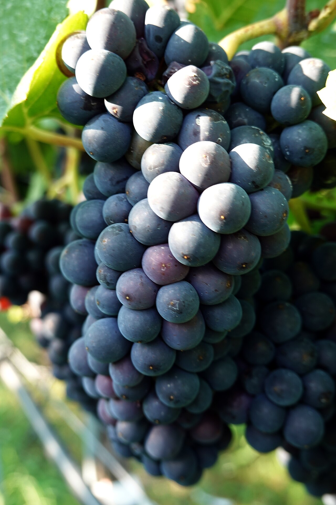
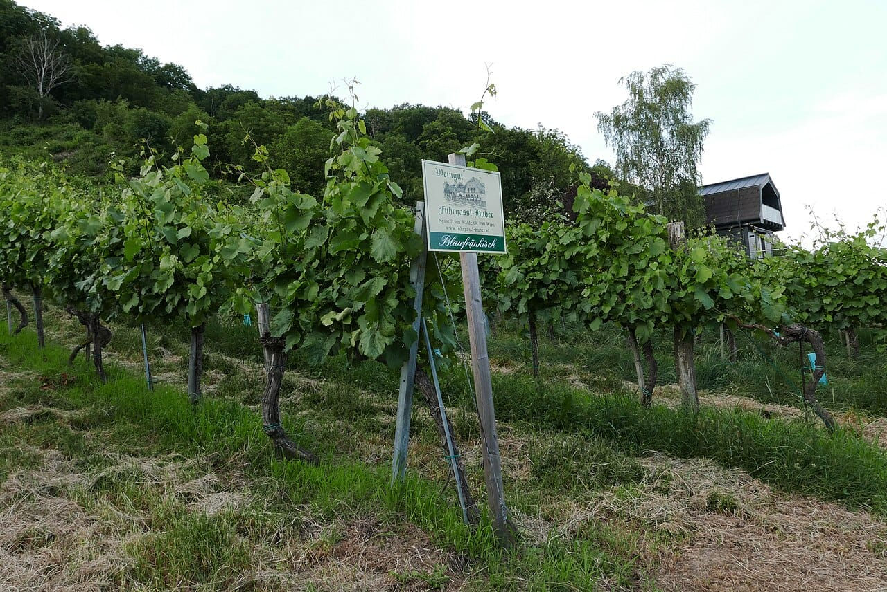

# St. Laurent

St. Laurent (German Sankt Laurent, Czech Svatovavřinecké) is a dark-skinned red grape of Central Europe's cool climates, centered in Austria's Niederösterreich and Burgenland and in Czech Moravia. Aromatic and deep-coloured, it has bright acidity and medium-plus tannin: firm and tight when young, velvety with age, with black cherry, sour cherry, blackberry, plum, violet and spicy earth, often placed between Pinot Noir and Blaufränkisch in style (ref:pinot).

The first thing to understand is how tricky it is in the vineyard: unstable yields, thin skin prone to disease, stony soils and careful canopy management required. That difficulty is also why fine examples carry a clear site expression. With that in place, comparing its contours across Austria's Thermenregion, the Burgenland lakeside and Czech Moravia says more than the variety name alone.

Figure: St. Laurent: HBLA Klosterneuburg St Laurent 1 (Wikimedia Commons). Image: Geolina163 + 1971markus, CC BY-SA 4.0, via Wikimedia Commons ([source page](https://commons.wikimedia.org/wiki/File:HBLA_Klosterneuburg_St_Laurent_1.jpg)).

## Definition and naming

St. Laurent is a black-skinned Vitis vinifera grape, VIVC variety number 10470. The German name is Sankt Laurent, French regions call it Saint Laurent, and the Czech name is Svatovavřinecké, Hungarian Szent Lőrinc. Synonyms include Blauer Saint Laurent, Laurenzitraube, Laurenztraube, Lorentstraube, Lorenztraube, Lovrenac Crni, Lovrijenac, Saint Laurent noir, Saint Lorentz, Schwarzer Lorenztraube and Sentlovrenka.

The name marks the feast of St. Lawrence on 10 August, roughly when the berries begin veraison; it has no direct link to French villages called Saint-Laurent. On the vine it has medium, triangular or five-lobed leaves, medium tight conical clusters and blue-black, oval, thin-skinned berries; it buds early and is vulnerable to spring frost, and the thin skin makes it prone to downy mildew, powdery mildew and grey rot. DNA work places it in the Pinot family, possibly an offspring of Pinot Noir and a second parent, suggested to be Savagnin, though the second parent remains unconfirmed and the relationship continues to be debated (ref:terroir).

## Origin and spread

The origin is unsettled; Austria is the likeliest home, with a nineteenth-century record in the Thermenregion south of Vienna, and one theory traces an arrival via Alsace and Germany. It is Austria's third most planted red variety, at about 794 hectares in 2008, and expanded through the 2000s with the country's red-wine trend. The Czech Republic grows the largest area, as Svatovavřinecké, about 6% of national vineyards or 1,053 hectares, concentrated in Moravia and entered in the Czech State Register of Grape Varieties in 1941.

Smaller plantings exist in Slovakia, Germany's Pfalz and Hungary, with experimental blocks in Canada, New Zealand and California. As a parent, it was crossed with Blaufränkisch in 1922 to create Zweigelt, Austria's most planted red variety; in 1960 the same cross gave André, which entered the Czech national register in 1980 (ref:blaufrankisch).

## Botany and cultivation

The vine is vigorous, with medium triangular or pentagonal leaves; bunches are medium, conical and dense, berries blue-black and oval with thin skins. Budburst is early, leaving it open to spring frost; the thin skin is sensitive to downy and powdery mildew and botrytis, calling for airy sites and careful canopy management. Yields are unstable and harvest selection strict; stony deep soils, rather than rich clay, suppress vigour and concentrate fruit.

The cultivation core is vigour control and leaf-fruit balance: over-rich soil pushes shoot growth and loose fruit, while shade invites disease and lowers acidity. Pruning, trellis, cover crops competing for water and nutrients, and leaf removal all adjust that balance. Cool night breezes and free-draining slopes preserve acidity and aroma. This is a variety that needs patience in the vineyard; high-crop blocks rarely make layered wines.

## Style and palate

A typical St. Laurent runs deep purple or garnet, with an aromatic bouquet of black cherry, sour cherry, blackberry, blackcurrant and plum, then violet, rose, raspberry, cardamom, smoke, spice and forest floor; bottle age brings leather, tobacco, graphite and bramble. The palate is medium-bodied with bright acidity and medium-plus tannin, tight and structured young, rounding to velvet with cellaring; the finish carries savoury notes and bitter almond.

Most producers age it in large or old oak to keep fruit and spice; too much new wood masks the delicate Pinot-like aroma. Some use whole-cluster fermentation for structure, while most destem to keep a clean fruit profile. Standard bottlings drink young; quality Austrian old-vine and single-site examples hold for several years to a decade or more, unfolding classic Pinot-like secondary notes only after long ageing (ref:oak).

## Main regions and representative wines

Austrian production concentrates in the Thermenregion south of Vienna, around Neusiedlersee and Mittelburgenland in Burgenland, plus Carnuntum, the Weinviertel and Vienna itself. In the Thermenregion, Johanneshof Reinisch is the benchmark for the variety; Michael Reinisch makes a base wine plus single-site bottlings such as Holzspur Grand Reserve and Frauenfeld. Stift Klosterneuburg makes St. Laurent in both Niederösterreich and the Thermenregion. Burgenland representatives include Rosi Schuster, Umathum, Zantho, Keringer and Juris; on the Niederösterreich side, R & A Pfaffl, Schloss Gobelsburg and Hans & Philipp Grassl, while Johannes Trapl in Carnuntum makes a delicate style.

Czech Moravia's Svatovavřinecké is the region's leading red, usually a juicy, fruity everyday red and a staple for St. Martin's young wine; its style is softer than the Austrian version, acidity rounding with age. Germany's Pfalz and Slovakia hold small blocks, with limited volume and brand recognition.

## How to drink and pair

St. Laurent is served slightly cool, around 14–17 °C: young, fruity bottlings lower, concentrated aged wines slightly higher. A Burgundy-style red glass gathers the Pinot-like flower and fruit; top wines benefit from a short decant.

It matches braised beef, red braises, game, roast goose or duck, strongly flavoured hard cheese and cured-meat starters; tomato-raised stews, burgers and spicy wings meet its savoury spice. Delicate seafood and sweet desserts clash with its tannin and acidity. On Austrian tables it sits beside game, roasted red meat and mountain hard cheese, while juicy Moravian everyday bottlings suit grilled meats, sausages and home-style stews. Young fruity versions suit grills; concentrated aged wines carry rich sauces and game.

## Buying and common misreadings

The first mistake is equating it with Pinot Noir: both sit in the Pinot family, but St. Laurent is darker-fruited and more structured in tannin, not a Pinot clone. The second is assuming it only makes light reds: fine Austrian examples are firm-structured and ageworthy, between Pinot Noir and Blaufränkisch. The third is reading the variety name without region and producer: a Czech everyday bottling and an Austrian single site differ clearly in structure and ageing direction.

On the label, separate country and district, everyday wine from Reserve or single-site, and check vintage and alcohol. Young wines drink within three to five years; aged examples cellar for years. Store on the side, away from light and temperature swings. Overseas it remains a niche Central European variety, so check the import channel and storage history when buying.

## Further reading and see also

- Related: [pinot-noir](ref:pinot), [blaufrankisch](ref:blaufrankisch), [red-wine](ref:red), [terroir](ref:terroir), [oak-ageing](ref:oak).
- To compare the two regions, taste an Austrian Thermenregion and a Czech Moravian Svatovavřinecké from the same vintage and contrast fruit concentration, tannin texture and savoury finish.

Begin with where it is grown, move on to how it is labelled, and finish with whether the style is dry or sweet. That order keeps the reading of St. Laurent practical.

Put [Pinot Noir](ref:pinot)'s variety character next to [Red wine](ref:red)'s regional performance; the difference marks the boundary.

## Related images

Image: Blaufränkisch: Ried Neuberg Blaufränkisch (Wikimedia Commons). Credit: Geolina163, CC BY-SA 4.0, via Wikimedia Commons ([source page](https://commons.wikimedia.org/wiki/File:Ried_Neuberg_Blaufr%C3%A4nkisch.jpg)). Related image for St. Laurent.
