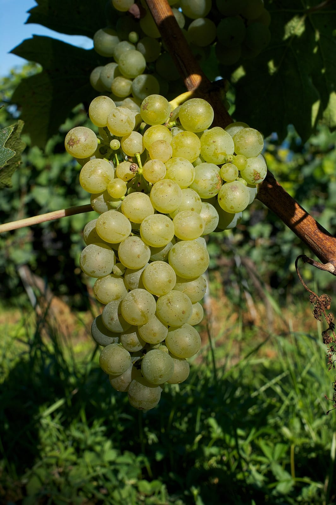

# Sylvaner

A Central European white grape planted in Alsace, Germany and Austria; medium-bodied with medium-high acidity, green apple, white flowers, herbs and mineral, often underrated.

Figure: Sylvaner: Cépages du Vully Riesling Sylvaner 2 (Wikimedia Commons). Image: Chandres, CC BY-SA 3.0, via Wikimedia Commons ([source page](https://commons.wikimedia.org/wiki/File:C%C3%A9pages_du_Vully_Riesling_Sylvaner_2.jpg)).

## Definition and naming

In the German official register the variety is Grüner Silvaner, though the spelling Silvaner appears just as often; older records also carry the synonyms Gros-Rhin, Johannisberger and Sylvaner verde. It is a light-skinned Vitis vinifera grape used for both table and wine production. The name has been linked to the Latin silva, forest, but modern ampelography does not treat that as evidence of a direct relationship to wild vines. When Sylvaner and Silvaner both appear on labels, the difference is usually a spelling habit, not a separate variety.

Three layers have to be read apart: the botany of parentage and ripening, the appellation rules on blending and sweetness, and the simplified neutral image it carries in the market. Sylvaner's reputation has long been summed up as high-yield and bland, but that impression owes more to past uncontrolled cropping than to any built-in ceiling of the variety.

## Origin and spread

DNA fingerprinting identifies Sylvaner as a natural cross of Traminer and the ancient variety Österreichisch-Weiß, Austrian White, which points to an origin in the Austrian Empire; an older theory placed it in Transylvania. After the Thirty Years' War the vine moved from Austria into Germany. The earliest surviving record dates from 5 April 1659, when an administrator of the Castell estate in Franken bought 25 Sylvaner vines, planted the next day in the Reitsteig vineyard below the Schlossberg. Documents from Ebrach monastery in 1665 also mention the variety, and Alberich Degen, abbot from 1658 to 1686, was an early propagator. Germany marked the 350th anniversary of Sylvaner's arrival in 2009.

After the Second World War, Sylvaner was planted widely in Germany and Alsace. In the 1960s and 1970s it reached roughly 30% of Germany's vineyard area and about 25% of Alsace's, and until 1970 it was the most widely planted white grape in Germany, before Müller-Thurgau overtook it. A large share of the fruit went into semi-sweet blends such as Liebfraumilch; overproduction and changing tastes damaged its reputation, and many old vines were grubbed up. Alsace, where dry whites had been made from the variety for decades, kept more of its standing. Today Germany has about 5,000 hectares of Sylvaner, around 4.6% of the national vineyard area. Franken holds the highest share at 24.5%, though the largest single area lies in Rheinhessen.

## Botany and cultivation

The vine is vigorous, with early to mid-season budburst and ripening; berries are medium and thin-skinned. It reaches high must weights naturally while keeping medium-high acidity. That vigour cuts both ways: left unchecked, yield rises and the fruit dilutes into an empty, neutral flavour; under strict yield control the site's mineral, soil and herbal detail comes through. Unlike Riesling, which leans on pronounced perfume, Sylvaner acts more as a blank canvas for terroir, which is why site choice and pruning weight affect the finished wine so strongly.

The main cultivation work revolves around yield control and preserving acidity. Guyot pruning, thinning and canopy restriction bring sugar, acidity and aroma back into balance; rain and frost at flowering and ripening remain risks in the Central European continental climate. Good sites in Alsace and Franken sit on slopes with fast drainage and strong sun, where Sylvaner can develop a more concentrated structure than flatland high-yield fruit.

## Style and palate

A typical Sylvaner is pale gold to light yellow-green, with green apple, pear, white flowers, elderflower and dried herbs on the nose, plus a faint mineral and soil note. The body is medium, the acidity clear but not sharp, and the finish often carries a herbal bitterness. Franken examples usually show more mineral weight and substance, while Alsace versions are more open in fruit and brighter in acidity. Some German sites also make late-harvest or sweet styles, where high acidity balances residual sugar.

Winemaking shifts the direction noticeably: stainless-steel fermentation highlights freshness and fruit, while large or old barrels add texture and nutty notes. Blending with Riesling or Elbling supplies aromatic backbone, and single-varietal wines show the site more directly. Young wines lead with fruit and herbs; in good vintages they can age for several years, developing honey, nut and dried-pear tertiary notes. Ageing potential should be judged from acidity, structure and alcohol, not colour alone.

## Main regions and representative wines

Franken is the German stronghold, and the traditional Bocksbeutel flask has become its visual signature. Juliusspital in Würzburg, founded in 1576, farms Sylvaner on sites including the Würzburger Stein, with wines that are mineral, saline and substantial. Bürgerspital zum Heiligen Geist, established in 1319, is another celebrated source of Würzburg old-vine Sylvaner. Fürstlich Castell'sches Domaenenamt at Castell descends from the estate where the 1659 record was first written down, and VDP estates such as Rainer Sauer continue to produce single-vineyard Sylvaner in Franken.

In Alsace, Sylvaner was admitted to the Alsace Grand Cru list only in 2006, and only for the Zotzenberg vineyard, where Sylvaner covers about 14 hectares. Representative estates include Domaine René Muré at Clos Saint Landelin in Ribeauvillé, Boeckel, which makes a Zotzenberg Grand Cru Sylvaner, and site-focused producers such as Ernest Burn, Agathe Bursin and Paul Kubler. Small plantings also exist in Austria, in Valais in Switzerland and in the Eisack Valley of Alto Adige, Italy, in a fresh herbal style.

## How to drink and pair

Dry Sylvaner is best at 10–12°C; colder and the mineral and floral notes close down, warmer and herbal bitterness and alcohol become obvious. A medium-bowl universal glass works; young wines do not need long decanting, just a few minutes after opening for the aroma to open up.

For food, its acidity and herbal character suit German and Alsace home cooking: pork, sausages, roast pork knuckle, asparagus, mushrooms, creamy risotto and medium-hard cheeses all match it, as do freshwater fish and white meat. Spicy or heavily smoked dishes amplify the bitterness, so a riper vintage is the safer choice. Off-dry or late-harvest versions pair with fruit desserts, blue cheese or as a digestif.

## Buying and common misreadings

One common misreading is to write off all Sylvaner as a bland everyday white. The blandness mostly comes from high-yield blend wines; low-yield single-vineyard, old-vine and good-site Sylvaner has a clear acid spine and mineral length, and is neither cheap nor simple. A second mistake is to rely on the variety name alone: Franken, Rheinhessen, Alsace and Austria differ in climate, and their fruit, acidity and mineral notes diverge accordingly. Vintage matters a great deal for ripeness in Central European whites.

On the label, separate dry, off-dry and late-harvest styles first: residual sugar sets the pairing direction, and sweetness cannot be judged from the variety name. The producer and site predict the wine better than the variety name. Expect easy-drinking freshness, not complexity, from bulk Liebfraumilch-style bottlings. Store away from heat and light, and finish light whites within one to three days of opening.

## Further reading and see also

The most useful comparison is to taste a Franken single vineyard, an Alsace Zotzenberg and a Rheinhessen wine side by side in the same vintage, noting differences in acidity, fruit and mineral. It can be read alongside the [white-wine](ref:white) category, the slope-site [terroir](ref:terroir), the choices of [fermentation](ref:fermentation) and the international benchmark represented by [chardonnay](ref:chardonnay); the [alsace](ref:alsace) entry gives the background for its planting in northeast France.

- Related: [alsace](ref:alsace), [white-wine](ref:white), [terroir](ref:terroir), [fermentation](ref:fermentation), [chardonnay](ref:chardonnay).

## Related images

Image: Alsace. Credit: Jorge Franganillo from Barcelona, Spain, CC BY 2.0, via Wikimedia Commons ([source page](https://commons.wikimedia.org/wiki/File:Colmar_(32350846618).jpg)). Related image for Sylvaner.
