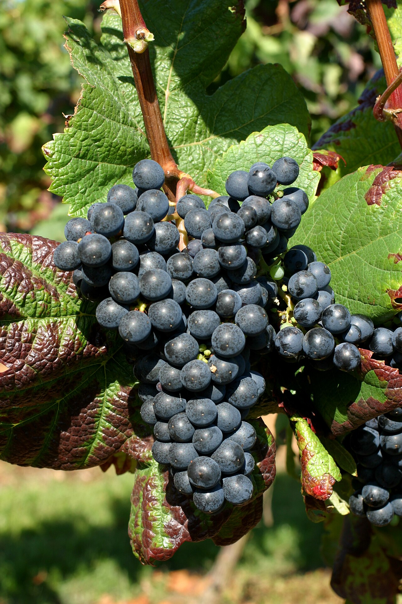

# Tannat

A red variety from Madiran in southwest France, known for high tannin, deep colour and long ageing; in Uruguay it became a national signature, often blended with Merlot or Cabernet Franc to soften structure.

In the “Hejiu” variety index, Tannat is both a recognisable name and a set of comparable viticultural and winemaking choices. Read it first through its ripening rhythm, acid frame and tannin direction at home, then through what survives or fades when it travels. The gap between Old and New World versions often explains more than the label. For the reader, the point is not a fixed flavour tag but how climate, soil and winemaking decisions turn the same grape into a different wine. This also explains why the same name carries different descriptions across sources: one stresses botany, another market style, another a single region’s rules.

Figure: Tannat: VIVC12257 TANNAT Cluster in the field 8302 (Wikimedia Commons). Image: Please note: This photo can be reproduced. Please quote the source as indicated below: Doris Schneider, Julius Kühn-Institut (JKI), Federal Research Centre for, CC BY-SA 4.0, via Wikimedia Commons ([source page](https://commons.wikimedia.org/wiki/File:VIVC12257_TANNAT_Cluster_in_the_field_8302.jpg)).

## Definition and naming

Tannat comes from Madiran and the Pyrenean foothills in southwest France; the name may derive from a local description of high tannin, and it is the core of the Madiran AOC.

Tannat is a vines variety or raw material with a definable botanical origin and cultivation history. The name may come from a place, a shape, a farming habit or a promoter; synonyms and homonyms are common, so check the scientific name or classification first.

## Origin and spread

In the late nineteenth century it travelled to Uruguay with Basque and French migrants, adapted to local conditions and became a national signature; Uruguay is one of the world’s key Tannat regions.

The origin of Tannat can usually be traced to a mountain, valley or coast, then spread through trade, migration and replanting after disease. Spread is not copying: in each new environment growers select different clones, rootstocks and pruning.

Tannat originated in south-west France, around Madiran, Irouléguy and Saint-Mont, where it was planted on slopes and used for structured reds. Basque migrants carried it to Uruguay in the nineteenth century, and it became the country’s signature red. The name probably refers to tannin, but the etymology is not settled; French and Uruguayan Tannat are the same grape.

## Botany and cultivation

Berries are small with thick skins and many seeds, giving high tannin and colour; it ripens late and needs heat, but loses acidity when overripe, so the picking window is narrow.

The performance of Tannat depends on budbreak, ripening, vigour, yield and disease resistance. Early varieties carry less risk in cool regions, late varieties need a long autumn; excessive vigour shades fruit, while weak vines crop poorly.

The vine is late-ripening with thick skins, high tannin and high colour. Madiran’s gravel and clay, oceanic influence and autumn sun allow slow ripening; Uruguay’s warmth gives riper tannin and fuller fruit. High yields make tannin coarse, so growers control yields and pick before alcohol rises too far.

## Style and palate

The wine is usually deep purple-black, high in tannin and acidity, with blackberry, black plum, liquorice and smoke when young; leather, tobacco, truffle and game with age.

The style of Tannat is defined by acidity, tannin or bitterness, alcohol, aroma and texture. It can be made alone or as part of a blend; in a blend it may supply colour, acidity, aroma or structure rather than the dominant flavour.

Tannat is usually macerated for a long period and aged in oak, often with Cabernet Sauvignon or Cabernet Franc in Madiran and with Merlot or Cabernet in Uruguay. Whole-cluster fermentation and extended maceration can soften or complicate tannin; new oak adds vanilla but can mask the grape’s leather and blackberry core.

## Main regions and representative wines

Representative wines include Château Montus and Château d’Aydie in Madiran and Bodega Garzón, Pisano and Juanicó in Uruguay; Merlot and Cabernet Franc are common blend partners.

To find representative Tannat, start with the place of origin or the most typical region, then compare a New World example. Keep alcohol, sweetness and vintage as close as possible, or you will mistake technique for variety.

Madiran is the French core, with Château Montus, Domaine Capmartin and Château d’Aydie as references; Irouléguy is lighter and more mountainous, Saint-Mont softer. Uruguay’s Canelones and Maldonado regions, with Pisano, Garzón and Bodega Bouza, produce the international benchmark. The two countries give different expressions of the same high-tannin grape.

## How to drink and pair

To drink Tannat, confirm sweetness and alcohol first, then choose temperature and food. Dry high-acid styles suit fat, seafood and salt; sweet styles suit spice, blue cheese and fruit desserts; high alcohol clashes with sweet or very spicy dishes.

Serve at 16–18°C in a large red-wine glass; young Tannat needs one to two hours of decanting, older bottles only a brief decant. Steak, roast meat, game, hard cheese and rich stews suit the tannin; delicate seafood and spicy dishes make it harsh. Drink within two or three days of opening.

## Buying and common misreadings

Start with where it is grown. From there, consider how it is labelled, then whether the style is dry or sweet. That is how a practical judgment about Tannat is built.

## Further reading and see also

To study Tannat, read botanical and viticultural sources first, then taste three wines from different regions side by side. Do not buy many bottles of one style; build a benchmark, then move to blends, sweet or aged versions.

Compare a Madiran Tannat with a Uruguayan Tannat at similar alcohol and vintage, then Tannat with Merlot and Syrah. Record maceration and oak; the comparison should show Tannat’s colour and tannin, not simply “a big red”.

- Related: [merlot](ref:merlot), [red-wine](ref:red), [oak-ageing](ref:oak), [terroir](ref:terroir), [vintage](ref:vintage).
- This variety offers no plant identification, prices or shopping channels; a label name is not a botanical identification.

**In brief:** A red variety from Madiran in southwest France, known for high tannin, deep colour and long ageing; in Uruguay it became a national signature, often blended with Merlot or Cabernet Franc to soften structure.

[Merlot](ref:merlot) and [Oak ageing](ref:oak) are the two useful reference points for Tannat. [Merlot](ref:merlot) sets out variety character; [Oak ageing](ref:oak) brings in regional performance. Read them together.

Tannat's high tannin and acidity once made Madiran wines famously tough; modern winemaking softens it with oak and blending, while Uruguay built a national style around the variety and often blends it with Merlot or Cabernet Franc.

Tannat's name comes from the French for tannin, and Madiran's traditional long maceration is the reference for its firm structure.
