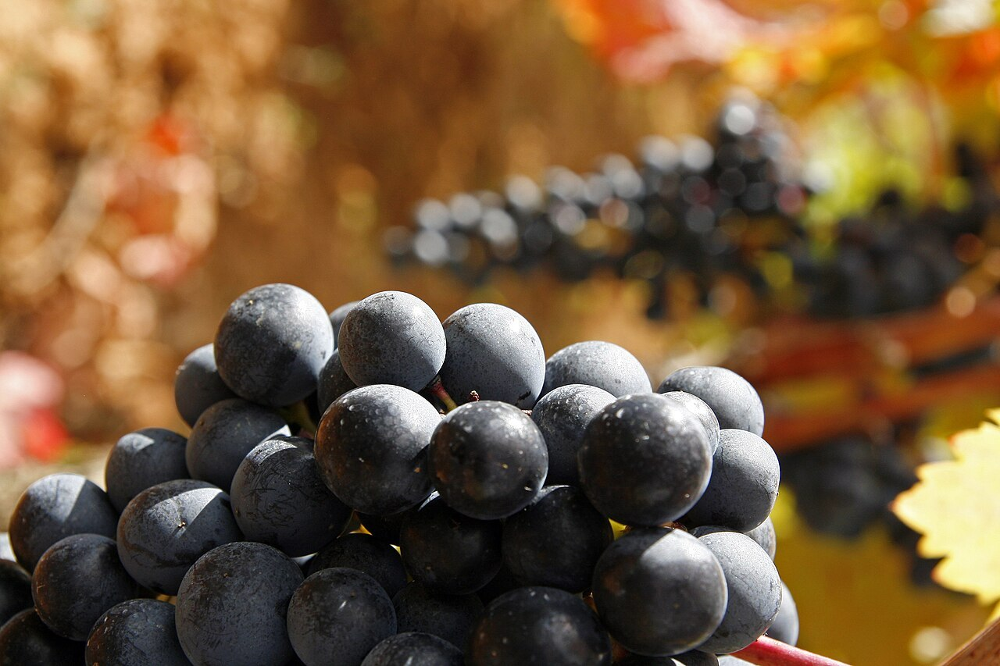

# Tempranillo

Tempranillo is one of Spain's signature red grape varieties, with relatively thick skins and early ripening and notes of cherry, plum, leather and tobacco. In Rioja and Ribera del Duero it is often aged in oak, producing a complete, food-friendly style. It is also used for rosé wine and is gradually spreading beyond Spain.

Figure: Tempranillo. Photograph: Tempranillo grapes from Rioja Alavesa. Credit: María Jesús Tomé, CC BY 2.0, via Wikimedia Commons ([source](https://commons.wikimedia.org/w/index.php?curid=16191821)).

## Definition and aliases

Tempranillo is the common name, with regional names such as Tinto Fino and Tinta del País in Spain. It belongs to the European grape Vitis vinifera, and its name is linked to early ripening. Tempranillo is not "Spain's Cabernet Sauvignon"; its acidity, tannin and aroma structure are distinct. Treating it as a Cabernet substitute ignores its place in Spanish tradition.

Tempranillo has many aliases, so buying should rely on region and label rules rather than a translated variety name. Regional name differences also reflect local viticultural traditions.

## Botanical characteristics

Clusters are medium, berries are roundish, skins are relatively thick, and pigment and tannin are medium to high. Budbreak is early and ripening is early, suiting temperate to warm climates. Thick skins give some resistance to botrytis, but canopy management is still needed in wet years.

Acidity is medium, the body medium to full, and with age it may develop leather, tobacco and dried-fruit notes. Its aroma is less overt than Cabernet Sauvignon and leans toward red fruit and spice; clones and regions also differ.

## Main regions

Tempranillo's origin is generally traced to northern Spain, with Rioja and Ribera del Duero as two core regions. Rioja Tempranillo is often blended with Grenache and Graciano and aged in oak for a rounder style; Ribera del Duero Tempranillo is more concentrated and structured. It is also grown elsewhere in Spain, in Portugal, Argentina and Australia.

Styles differ clearly by region. Cooler Rioja sites give higher acidity and finer aroma; the continental climate of Ribera del Duero brings riper fruit and firmer tannin. Climate, altitude and soil explain a style better than the variety name.

## Typical flavours

Typical Tempranillo aromas include cherry, plum, strawberry, leather, tobacco and vanilla. Acidity is medium, tannin medium to high, and the body medium to full. While young it is red-fruit driven; after [oak ageing](ref:oak-ageing) it may gain vanilla, spice and smoke, and with age leather, dried fruit and earth.

Tempranillo's aroma is less intense than Cabernet Sauvignon, but its structure is complete and food-friendly. Judge it by whether acidity supports the body, whether tannin is fine, and whether oak is integrated with the fruit; aroma intensity alone misses structure.

## Representative wines

Traditional Rioja wines are often Tempranillo-dominant, with vanilla, leather and tobacco notes after oak ageing; Ribera del Duero wines are more concentrated and structured. Spanish rosé also uses Tempranillo; in [rosé wine](ref:rose), Tempranillo usually shows strawberry and cherry with a fresh style.

## Viticulture

The key viticultural focus is ripening and acid retention. Tempranillo ripens early, so warm regions may lose acidity and ripen the fruit too much, while cool regions risk insufficient ripeness. Producers balance sugar, acidity and structure through site altitude, harvest timing and blending.

Yield control also affects flavour concentration. Too much yield dilutes fruit and makes tannin coarse; moderate control brings more concentrated red fruit and a more complete structure. Diurnal range and water availability in different regions change the ripening rhythm.

## Common misconceptions

First, that Tempranillo is Spain's Cabernet Sauvignon. The two differ in aroma, acidity and tannin structure.

Second, that Tempranillo only makes red wine. It is also used for rosé.

Third, that the older the Tempranillo the better. Ageing depends on vintage, structure and storage.

Fourth, that more oak is better. Oak must balance fruit and acidity.

Fifth, that Tempranillo only suits Spanish food. Its structure and acidity also suit many meats and cheeses.

Tempranillo is a leading Spanish red variety, with thickish skins, relatively early ripening and notes of cherry, leather and tobacco. Rioja and Ribera del Duero often use oak ageing to shape its structure. It suits sites with a short enough growing season to ripen before autumn cools, but clones and blends change acidity and colour. “Tempranillo” is not a synonym for a single Rioja style. Rioja’s oak-ageing labels and Ribera del Duero’s denser style are not fixed properties of Tempranillo; they reflect regional rules, climate and winemaking choices. Read the subzone and ageing designation first, then place the variety name back into that context. A single variety can support several very different wine identities. The label remains a better guide than a variety slogan, and a varietal wine can still belong to a regional tradition with its own rules.

**At a glance:** Spain's signature red grape, with relatively thick skins and early ripening and notes of cherry, leather and tobacco; Rioja and Ribera del Duero often use oak ageing to shape its structure. 

Tempranillo is best read by starting with where it is grown, moving to how it is labelled, and ending with whether the style is dry or sweet.

International Organisation of Vine and Wine (OIV), Oxford University Press, European Union are the main sources behind this entry on Tempranillo. Each is cited where it bears on a specific claim; none is asked to carry the conclusion alone.

Tempranillo ripens early and loses acidity quickly in hot years; Rioja and Ribera del Duero use different elevations and oak regimes to shape it, with Ribera's high plateau giving firmer structure and Rioja's cooler sites more perfume.

Tempranillo is called Tinto Fino in Ribera del Duero and Ull de Llebre in Catalonia, so the synonym on the label can obscure the variety.

**Key facts.**

| Item | Detail |
| --- | --- |
| In one line | Spain's signature red grape, with relatively thick skins and early ripening and notes of cherry, leather and tobacco; Rioja and Ribera del Duero often use oak ageing to shape its structure. |
| Species | Vitis vinifera |

**Sources and limits.** The key claims about Tempranillo are checked against the following sources: International Organisation of Vine and Wine (OIV) (Used to check varietal descriptors and the Vitis species framework), Oxford University Press (Used for reference on Tempranillo origin, regions and winemaking; Migrated from the former reference list at the end of the article; access date not re-verified), European Union (Used to check the EU framework for wine regions and labelling). Prices, batches and status change; the body is project-written and does not reproduce source text.

For Tempranillo, this variety was last checked in 2026; prices, batches and availability change, so confirm them against the sources below.

## Further reading

- [Wine](ref:wine): the classification, winemaking and regional framework of wine.
- [Red wine](ref:red-wine): the basics of tannin, acidity and ageing.
- [Rosé wine](ref:rose): the use of Tempranillo in rosé.
- [Oak ageing](ref:oak-ageing): the Rioja tradition of barrel ageing Tempranillo.
