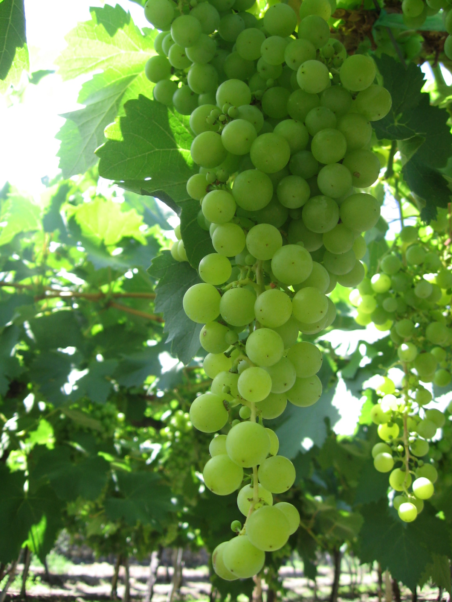

# Torrontés

Torrontés is Argentina's most distinctive native white grape, known for rose, orange blossom, jasmine, lychee and citrus aromatics. High-altitude Salta versions are bright in acidity and concentrated in perfume, with a dry palate that is often mistaken for a Muscat family wine.

Figure: Torrontés: Torrontes (Wikimedia Commons). Image: Jnurin Justin Nurin, CC BY-SA 3.0, via Wikimedia Commons ([source page](https://commons.wikimedia.org/wiki/File:Torrontes.JPG)).

## Definition and naming

What is grown in Argentina under the name Torrontés covers three distinct varieties: Torrontés Riojano, Torrontés Sanjuanino and Torrontés Mendocino. A label that says only Torrontés usually means Riojano, the most widely planted and most aromatic type used for quality wine. Sanjuanino is often blended with other whites, while Mendocino is the least planted and least aromatic; older records also carry local synonyms such as Torrontel.

Two confusions follow the name. First, despite Muscat-like perfume, it is not itself a Muscat variety. DNA studies show Riojano and Sanjuanino are crossings of Muscat of Alexandria and Criolla Chica, while the second parent of Mendocino remains unidentified. Second, Galicia in Spain also has a variety called Torrontés, related to Albillo Mayor, but DNA evidence shows no kinship with Argentine Torrontés; they share only the name ([muscat](ref:muscat)).

As a Vitis vinifera white, Torrontés has medium bunches of small, thin-skinned berries and ripens in mid-to-late season. Commercial plantings use selected clones; labels rarely state clone or rootstock, and vine age, altitude and site matter more directly to style ([terroir](ref:terroir)).

## Origin and spread

Torrontés is a natural crossing formed on Argentine soil, not imported directly from Spain. One parent, Criolla Chica (the Mission, Listán Prieto lineage), was a foundational variety brought to the Americas in the early colonial period; Muscat of Alexandria arrived around the 17th century, and the two crossed naturally in Argentine vineyards, with long selection producing today's three types.

For Torrontés, begin with where it is grown. Then look at how it is labelled, and finally ask whether the style is dry or sweet. The answers point to different choices, not to a single score.

Through most of the 20th century Torrontés was treated as bulk white-wine material, light in aroma and loose in texture. From the 1980s onward, winemakers such as Susana Balbo at Michel Torino began treating it as a quality white, controlling picking and fermentation temperature, and high-altitude Cafayate versions gradually drew international attention.

## Botany and cultivation

Berries are small and thin-skinned, with moderately compact bunches, ripening in mid-to-late season. In high-altitude valleys, strong sun and wind thicken skins and build aromatic compounds, while cool nights preserve acidity and volatile perfume. Lower-altitude or warmer sites lose acidity more easily, turning the perfume loose and the alcohol hot.

Cultivation depends on altitude and diurnal swing. The town of Cafayate sits around 1,683 metres; vineyards mostly lie between 1,700 and 2,000 metres, with Colomé's highest block at 3,111 metres. Annual rainfall in the valley is about 80–250 millimetres, irrigation comes from Andean snowmelt, and soils are poor sandy loam. Wind, drought and intense ultraviolet pressure at flowering and harvest are part of the normal environment.

The main risk is over-ripening: floral and lychee notes turn jammy and acidity drops, while picking too early leaves herbal and green-stem flavours. Canopy management and thinning balance the light an aromatic variety needs against excess shade, and irrigation volume directly controls berry concentration.

## Style and palate

Typical Torrontés is pale straw yellow with green reflections, carrying jasmine, rose petal, orange blossom, lychee, peach, apricot, grapefruit, lime and a touch of white pepper. The palate is dry, light to medium bodied, fresh and round, with bright acidity and a citrus-floral finish. The contrast between aromatic intensity and a dry palate is the telling sign.

Fermentation usually takes place cool in stainless steel to preserve fresh floral perfume, with little or no new oak; some producers use a little barrel ageing or lees contact for roundness and nutty notes. Besides young dry wines there are late-harvest Torrontés Tardío styles with higher residual sugar, honey and dried-fruit character ([fermentation](ref:fermentation)).

Most Torrontés is drunk within 1–2 years of vintage, when fresh perfume is at its core; good high-altitude vintages can age two or three years in bottle, developing preserved fruit and spice, but they are not built for long cellaring. Judge potential by intact acidity and concentrated perfume, not alcohol level ([white-wine](ref:white)).

## Main regions and representative wines

The most respected region is the Calchaquí Valley in Salta, with Cafayate the benchmark town. La Rioja and San Juan plant Sanjuanino and some Riojano, while Mendoza plantings go mostly into blends and entry wines. Within Argentina, Riojano covers about 8,700 hectares and Sanjuanino about 4,850 hectares in recent surveys; Mendocino has the smallest area.

Representative producers include Bodega Colomé, established in 1831, whose four vineyards stretch from 1,700 to 3,111 metres; its 100% Torrontés is about 13% alcohol with acidity of 6.15 g/l. Bodega Nanni was founded in 1897 by Italian immigrants and is now a fourth-generation family estate; its Chimpa holding has about 50 hectares at 1,750 metres and has been certified organic since 1996. Piattelli grows Riojano at around 5,890 feet (about 1,795 metres) in Cafayate; La Linda uses 30-year-old vines at 1,700 metres; El Esteco's Don David and Susana Balbo's own brand are frequent reference points ([salta](ref:salta)).

In the market, Torrontés is one of Argentina's export white-wine calling cards, spanning entry table wines to high-altitude single-vineyard bottlings. Under the same name, high-altitude small plots and flat high-yield blocks differ markedly in perfume and acidity, so producer and altitude predict style better than the variety name alone.

## How to drink and pair

Serve Torrontés around 8–11°C, fairly cool to hold floral and citrus perfume; too warm, alcohol and oily texture cover the aromatics. A medium-rimmed white wine glass is enough, and young wines need no decanting; it is also common as an aperitif on its own.

Pairings run to spicy dishes such as chilli chicken and Argentine-style grilled meat, seafood, grilled fish, white meat, appetisers and soft cheeses; its acidity stands up to tomato and citrus sauces. Dry, low-sugar Torrontés does not suit sweet dishes, while late-harvest versions can go with blue cheese or dried-fruit desserts.

## Buying and common misreadings

The first misreading is to treat Torrontés as a Muscat grape. It has a Muscat parent, but its aroma profile is independent, the palate drier and the acidity higher; it should not be bought with expectations for a sweet Muscat wine. The second is to regard Spanish Torrontés and Argentine Torrontés as the same variety; they share only the name, with unrelated origins and styles.

The third misreading is to assume aromatic varieties must be low in acidity. High-altitude Torrontés is built on a bright acid spine; judge by regional altitude and vintage rather than perfume intensity. Check vintage and bottling date: Torrontés has a short drinking window, and a wine that has travelled far or sat in stock for a long time loses its fresh floral notes.

### Key dates and figures

- 1986: a 1986 book linked the variety to Spanish Torrontés; later DNA work overturned that identification.

## Further reading and see also

A useful comparison is to set a high-altitude Cafayate Riojano beside a San Juan or Mendoza Sanjuanino, recording differences in perfume, acidity and body; then contrast dry and late-harvest versions to see how residual sugar shapes style.

Planting area, clones and parentage of Torrontés keep updating with variety surveys; for formal citation, check Argentine INTA variety records, the VIVC register and official regional statistics. For everyday buying, high-altitude Cafayate or Calchaquí Valley Riojano usually shows clearer perfume and firmer acidity, while San Juan and Mendoza Sanjuanino leans toward riper fruit; the two should not be treated as the same style.

- Related: [salta](ref:salta), [muscat](ref:muscat), [white-wine](ref:white), [terroir](ref:terroir), [fermentation](ref:fermentation).

[Salta](ref:salta) and [White wine](ref:white) are the two useful reference points for Torrontés. [Salta](ref:salta) sets out variety character; [White wine](ref:white) brings in regional performance. Read them together.
