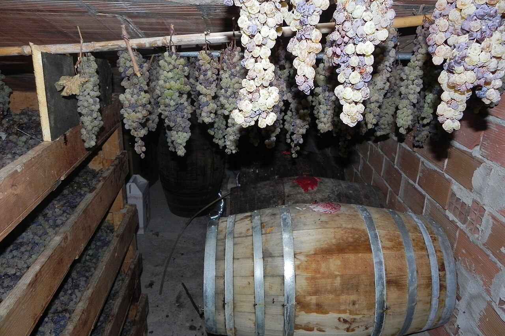

# Trebbiano

Trebbiano is a name that misleads. It is both a group of white grapes widely planted in Italy and, in France, the grape the country calls Ugni Blanc, the mainstay of Cognac and Armagnac. The same variety is Trebbiano Toscano in Italy and Ugni Blanc in France, and it does completely different work in the two places: Italy uses it for light white wines and as a base for sweet wines, while France distils it into the world's best-known brandies. Any account of the grape has to follow both threads (ref:white-wine).

Figure: Trebbiano. Photograph: Tuscany Vin Santo (holy wine) dried Trebbiano grapes. Credit: Gabriele Cantini, CC BY 2.0, via Wikimedia Commons ([source](https://commons.wikimedia.org/w/index.php?curid=19365493)).

## Definition and synonyms

Trebbiano Toscano is the Italian name and Ugni Blanc the French one; they refer to the same variety. It belongs to Vitis vinifera. The difficulty is that "Trebbiano" is also a family label. Trebbiano Romagnolo, Trebbiano Spoletino and Trebbiano Giallo are separate varieties or distinct biotypes, and Trebbiano d'Abruzzo is at once a denomination and a name long used for the grape, although modern research suggests much of the old planting there is Bombino Bianco. A label saying "Trebbiano" may therefore point to different genetic material, and the zone and producer note matter. Treating the name as one variety is the first obstacle to understanding it.

## Parentage and origin

The origin of Trebbiano is unresolved. The name may come from an Italian place name such as Trebula, or from a Roman-era term, but the vine was already widespread in central Italy in the Middle Ages. Ugni Blanc appears later in French records and is generally thought to have arrived in Provence and the Charente through Mediterranean trade. DNA work links Trebbiano Toscano to the western Mediterranean variety group, but no parent pair is confirmed. What is clear is that it was replanted on a large scale after the phylloxera crisis of the 19th century, because it was productive, late-ripening and high in acid — exactly what the Charente's distilling industry needed, a choice that shaped Cognac for more than two centuries.

## Botanical character

Bunches are large and fairly compact; berries are medium and round, yellow-green at ripeness, with thin skins. Thin skins make the vine prone to grey rot and allow oxidation during pressing. Leaves are medium and five-lobed. Trebbiano buds late and ripens late; in an oceanic climate like the Charente, picking often falls in early October, with modest sugar and still-high acidity, which is precisely the state wanted for a distillation base. Low sugar means low alcohol, and high acid keeps the wine fresh through fermentation and distillation (ref:acidity). In Italy it behaves similarly: generous yields, pale colour, marked acidity and a largely neutral aroma.

## Viticultural behaviour

The vine is vigorous and high-yielding, and few varieties suffer more from that generosity. Without crop control the wine is thin; with lower yields, aroma and texture improve clearly. Late budding avoids spring frost, but the long ripening season leaves it exposed to autumn rain, grey rot and dropped fruit. In Cognac, growers often pick before full ripeness to keep acidity and limit alcohol, the opposite of the logic in most quality wine regions. The chalk soils of the Cognac zone, in the Grande Champagne and Petite Champagne areas, drain well and hold enough water for even ripening; Italian hills and alluvial plains give different yields and different rhythms.

## Italian regions and styles

In Italy Trebbiano is planted from north to south. Tuscany uses it for the base of Vin Santo and once included it in Chianti blends; Orvieto in Umbria blends Trebbiano Toscano, called Procanico locally, with Grechetto; Trebbiano d'Abruzzo is a serious white wine zone, where old-vine bottles from Valentini and Emidio Pepe show that the grape can age; Trebbiano Romagnolo in Emilia-Romagna goes into everyday wine and vinegar; Lazio, the Marche and Sicily also have plantings (ref:italy). Italian Trebbiano is usually light, high in acid and neutral, made to drink young, though low-yielding old vines can produce something far deeper.

## Cognac and Armagnac: the distiller's grape

In France, Ugni Blanc dominates both Cognac and Armagnac, accounting for the great majority of Cognac's vineyards. The base wine must be high in acid, low in alcohol, usually 8% to 10%, and clean in aroma to survive distillation. Cognac uses the Charentais pot still, distilling twice to a spirit of about 70% before ageing in French oak (ref:cognac). Armagnac more often uses a continuous still, the alambic armagnacais, taking a single distillation at lower strength and producing a coarser, fruitier spirit (ref:armagnac). Both zones permit Ugni Blanc, Colombard and Folle Blanche, among others, and Cognac allows a few additional varieties in small proportion.

## Legal rules

The Cognac AOC dates from 1936 and sets the permitted varieties, the distillation method, the deadline for distillation, usually 31 March after the harvest, and minimum ageing. VS, VSOP and XO require at least 2, 4 and 10 years respectively, subject to the current rules. Armagnac works under similar rules with a different distillation method, and its minimum ages have converged with Cognac's in recent years. In Italy, Trebbiano d'Abruzzo, Orvieto and Vin Santo each have their own DOC or DOCG rules on variety proportions and ageing. Wherever proportions or years are involved, the latest official specification governs, and the zone and vintage on the label usually say more than marketing terms.

## Winemaking and style

Italian dry whites are usually fermented cool in stainless steel with malolactic fermentation avoided, to preserve acidity and citrus aroma; some estates use old oak and lees for texture. Vin Santo dries the grapes in airy rooms for months, concentrates the sugar, ferments slowly and matures for years in small old casks, giving an amber sweet wine of honey and nuts. Cognac base wine is made with strictly limited sulphur, usually without malolactic fermentation, and distilled soon after fermentation. In distillation Ugni Blanc reads as grape, green apple and white flowers, turning to vanilla, cinnamon, dried fruit and leather with oak ageing.

## Sensory style

As a white wine, Trebbiano is usually pale lemon, with lemon, green apple, pear, white flowers and almond, light to medium body, high acidity, low alcohol and a shortish finish. Better versions from Umbria and Abruzzo can show longer length and a mineral edge, and old-vine Valentini can age for decades. As a distillate, Ugni Blanc supplies clean acidity and neutral fruit, and the complexity comes from distillation and oak. Keeping the two identities apart stops us judging Cognac by the standards of white wine, or Italian dry white by the standards of Cognac.

## Producers and vintages

Cognac houses include Hennessy, Rémy Martin, Martell and Courvoisier, which normally blend across zones and years; in Armagnac there are Darroze, Château de Laubade and Delord. In Italy, Valentini and Emidio Pepe are benchmarks for old-vine Trebbiano d'Abruzzo, Capezzana and other Tuscan estates are known for Vin Santo, and Orvieto has several historic houses. Vintage matters little in blended Cognac and a great deal in Italian white: cool years give higher acid and lighter body, hot years more weight but less freshness.

## Common misconceptions

First, that Trebbiano is a single variety; it is a family of names with different genetic backgrounds. Second, that Trebbiano can only make cheap wine; old vines and low yields can produce white wines worth ageing. Third, that Ugni Blanc is only for distillation; it also makes still white wines. Fourth, that Trebbiano d'Abruzzo must be Trebbiano Toscano; the local mix is more complicated than the name suggests. Fifth, that high yield is a fault of the grape; it is a matter of vineyard management. Sixth, that every Trebbiano ages well; most bottles are for drinking young, and only a few low-yielding old-vine wines repay keeping.

## Further reading

- [Wine](ref:wine): the broad category to which Trebbiano belongs.
- [White wine](ref:white-wine): its main style in Italy.
- [Italy](ref:italy): the background to its Italian denominations.
- [Cognac](ref:cognac): the most important distilling region for Ugni Blanc.
- [Armagnac](ref:armagnac): the other brandy built on the grape.
- [Acidity](ref:acidity): why it suits both light whites and distillation.
