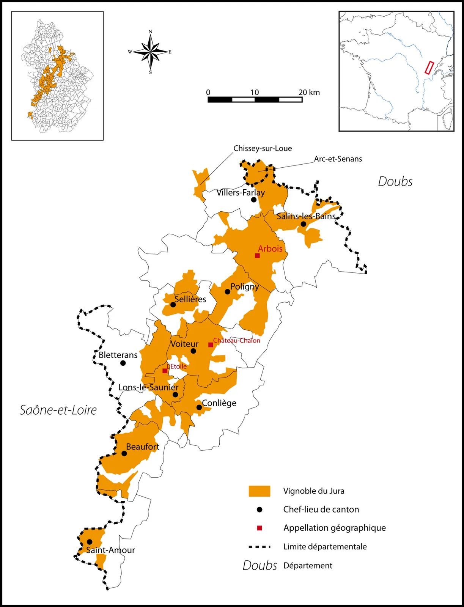
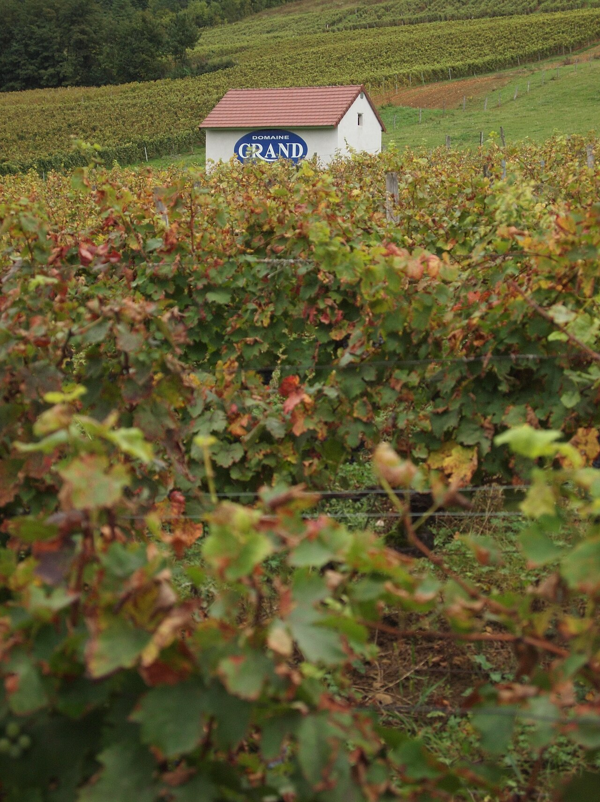

# Trousseau

A red grape of the Jura, France, pale in colour, high in acidity and low in tannin, with red cherry, spice and earth; it makes light reds, rosés and sparkling wine and is central to the Jura’s light-body tradition.

In the “Hejiu” variety index, Trousseau is both a recognisable name and a set of comparable viticultural and winemaking choices. Read it first through its ripening rhythm, acid frame and tannin direction at home, then through what survives or fades when it travels. The gap between Old and New World versions often explains more than the label. For the reader, the point is not a fixed flavour tag but how climate, soil and winemaking decisions turn the same grape into a different wine. This also explains why the same name carries different descriptions across sources: one stresses botany, another market style, another a single region’s rules.

Figure: Trousseau. Photograph: File:Vignobles jura.png. Credit: DalGobboM ¿!i?, CC BY-SA 3.0 ([source page](https://commons.wikimedia.org/wiki/File:Vignobles_jura.png)). Category image; not a claim that it shows the exact product, site or event.

## Definition and naming

Trousseau comes from the Jura in eastern France and is related to Savoie and Swiss varieties; it is planted in Arbois, Côtes du Jura and around Château-Chalon.

Trousseau is a vines variety or raw material with a definable botanical origin and cultivation history. The name may come from a place, a shape, a farming habit or a promoter; synonyms and homonyms are common, so check the scientific name or classification first.

## Origin and spread

Berries are small and thin-skinned, late-ripening, with high acidity and low tannin; pale colour, red cherry, strawberry, pepper, spice and earth.

The origin of Trousseau can usually be traced to a mountain, valley or coast, then spread through trade, migration and replanting after disease. Spread is not copying: in each new environment growers select different clones, rootstocks and pruning.

Trousseau is a red grape of eastern France, centred on the Jura and Franche-Comté, where it was planted on the slopes of Arbois, Côtes du Jura and Château-Chalon in the eighteenth and nineteenth centuries. It is called Bastardo in Portugal and has small plantings in Spain and Italy. Trousseau Gris is a colour mutation of the same variety, not a separate grape.

## Botany and cultivation

Traditionally used for light reds and rosé, and sometimes in Jura sparkling wine; warm vintages balance better, cold years stay very tart.

The performance of Trousseau depends on budbreak, ripening, vigour, yield and disease resistance. Early varieties carry less risk in cool regions, late varieties need a long autumn; excessive vigour shades fruit, while weak vines crop poorly.

The vine is early-to-mid ripening with thin skins, high acidity and low tannin. Jura’s limestone and clay give a mineral edge, while cool autumns preserve acidity; warm years can strip freshness quickly. Thin skins make grey rot a risk and also explain the pale colour, so canopy management and early picking are essential.

## Style and palate

It is usually whole-cluster fermented or briefly macerated to avoid over-extraction; old or large oak preserves fruit and acidity.

The style of Trousseau is defined by acidity, tannin or bitterness, alcohol, aroma and texture. It can be made alone or as part of a blend; in a blend it may supply colour, acidity, aroma or structure rather than the dominant flavour.

Winemaking depends on the intended colour: short maceration gives rosé, longer maceration a light red, and whole-cluster fermentation adds stem spice and structure. New oak is rare because it would overwhelm the delicate fruit; old barrels or tanks are the norm. The result is a wine of lightness and acidity, not a concentrated red.

## Main regions and representative wines

Representative wines include Domaine des Ardoisières, Domaine Tissot and Jean-François Ganevat; Jura Trousseau is often blended with Poulsard and Savagnin.

To find representative Trousseau, start with the place of origin or the most typical region, then compare a New World example. Keep alcohol, sweetness and vintage as close as possible, or you will mistake technique for variety.

Arbois gives the fullest Trousseau, Côtes du Jura a lighter version, Château-Chalon more mineral tension and Étoile sparkling wines a red-fruit profile. Overnoy, Ganevat, Tissot and Puffeney are reference producers; in Portugal, Bastardo is used in Douro and Madeira blends rather than as a Jura-style red.

## How to drink and pair

To drink Trousseau, confirm sweetness and alcohol first, then choose temperature and food. Dry high-acid styles suit fat, seafood and salt; sweet styles suit spice, blue cheese and fruit desserts; high alcohol clashes with sweet or very spicy dishes.

Serve light red at 14–16°C, rosé and sparkling at 8–10°C. Roast chicken, pork, mushrooms, vegetables and light cheese suit the acidity; fried food also works. Do not over-chill the red or expect a dense Burgundy-like structure. Drink within two or three days of opening.

## Buying and common misreadings

For Trousseau, begin with where it is grown. Then look at how it is labelled, and finally ask whether the style is dry or sweet. The answers point to different choices, not to a single score.

## Further reading and see also

To study Trousseau, read botanical and viticultural sources first, then taste three wines from different regions side by side. Do not buy many bottles of one style; build a benchmark, then move to blends, sweet or aged versions.

Compare Trousseau with Poulsard and Pinot Noir from the Jura, then a Jura Trousseau with a Portuguese Bastardo blend. Fix vintage and maceration length; colour and tannin will show why Trousseau is a light-red variety rather than a failed Pinot Noir.

- Related: [jura](ref:jura), [red-wine](ref:red), [rose-wine](ref:rose), [sparkling-wine](ref:sparkling), [terroir](ref:terroir).
- This variety offers no plant identification, prices or shopping channels; a label name is not a botanical identification.

**Short definition:** A red grape of the Jura, France, pale in colour, high in acidity and low in tannin, with red cherry, spice and earth; it makes light reds, rosés and sparkling wine and is central to the Jura’s light-body tradition. 

Start with [Jura](ref:jura) for variety character, then read [Rosé Wine](ref:rose) for regional performance. Seeing both keeps Trousseau from being confused with a neighbouring idea.

Trousseau is the Jura's light red grape, known as Trousseau Noir in France and as Bastardo in Portugal; it ripens late and gives pale colour, high acidity and low tannin. The best sites are on the gravel and marl slopes around Arbois and Pupillin, where the grape makes translucent reds with red cherry, spice and earth. It is also used in rosé and sparkling wine, and in the Jura's vin de paille sweet wines. The variety needs warmth to ripen but not too much, or it loses acidity; climate change has made late picking more common. A Trousseau label from Arbois or Côtes du Jura is the clearest reference; in Portugal, Bastardo is often blended rather than bottled alone.

## Related images

Image: File:Bodegas Grand vineyard in Passenans, Jura, France.jpg. Credit: Francisco Gonzalez, CC BY 2.0, via Wikimedia Commons.. Credit: Francisco Gonzalez, CC BY 2.0, via Wikimedia Commons ([source page](https://commons.wikimedia.org/w/index.php?curid=25637605)). Related image for Trousseau.
