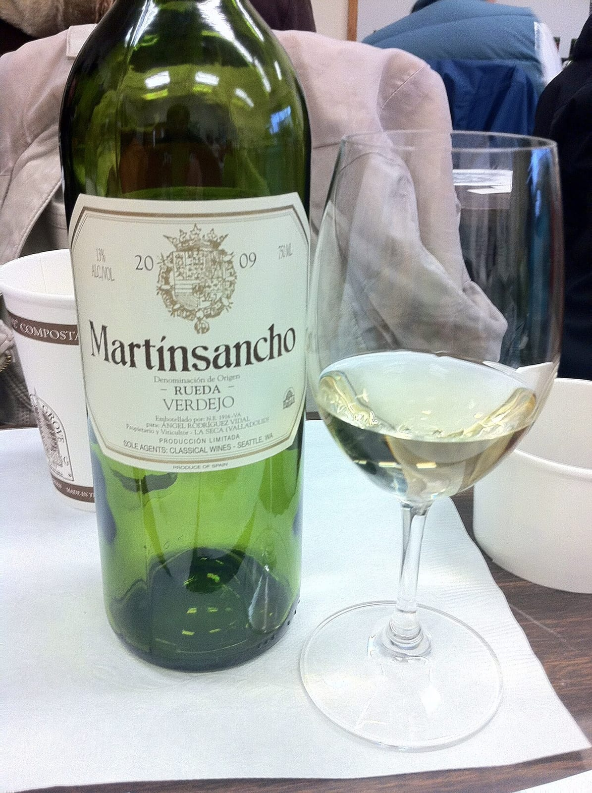

# Verdejo

A white grape of Rueda in Spain, with fennel, citrus, white flowers and herbal notes and crisp acidity; often blended with Sauvignon Blanc or Viognier, it is the core of modern Spanish white wine.

In the “Hejiu” variety index, Verdejo is both a recognisable name and a set of comparable viticultural and winemaking choices. Read it first through its ripening rhythm, acid frame and tannin direction at home, then through what survives or fades when it travels. The gap between Old and New World versions often explains more than the label. For the reader, the point is not a fixed flavour tag but how climate, soil and winemaking decisions turn the same grape into a different wine. This also explains why the same name carries different descriptions across sources: one stresses botany, another market style, another a single region’s rules.

Figure: Verdejo: Rueda Verdejo (Wikimedia Commons). Image: Agne27, CC BY-SA 3.0, via Wikimedia Commons ([source page](https://commons.wikimedia.org/wiki/File:Rueda_Verdejo.JPG)).

## Definition and naming

Verdejo comes from Rueda in Castilla y León, Spain; the name may refer to “green” or early ripening, and it leads the Rueda DO whites.

Verdejo is a vines variety or raw material with a definable botanical origin and cultivation history. The name may come from a place, a shape, a farming habit or a promoter; synonyms and homonyms are common, so check the scientific name or classification first.

## Origin and spread

Its origin is debated between North Africa and Iberia, and genetic work continues; it performs reliably on the dry plateau of central Spain with wide diurnal range.

The origin of Verdejo can usually be traced to a mountain, valley or coast, then spread through trade, migration and replanting after disease. Spread is not copying: in each new environment growers select different clones, rootstocks and pruning.

Verdejo is a white grape from Rueda in Castilla y León, planted there at least since the eighteenth century. It came to wider attention in the 1970s and 1980s, when stainless-steel fermentation and cold handling made its fennel and citrus aroma clearer. Marqués de Riscal and Palacio de Bornos helped turn it into a modern Spanish white; Verdelho is a different grape from Madeira and the Douro.

## Botany and cultivation

Berries are medium and thin-skinned, early to mid-ripening; high yields give faint aroma and low acidity, while controlled yields bring fennel, lemon, grapefruit, white flowers and mineral.

The performance of Verdejo depends on budbreak, ripening, vigour, yield and disease resistance. Early varieties carry less risk in cool regions, late varieties need a long autumn; excessive vigour shades fruit, while weak vines crop poorly.

The vine is early-to-mid ripening with thin skins and high acidity, and it can crop heavily. Rueda’s continental climate and day–night temperature swing preserve acidity; thin skins make grey rot a risk, so growers ventilate the canopy and pick at night. High yields dilute fennel and body, while old vines concentrate both.

## Style and palate

It is usually fermented in stainless steel to keep freshness and aroma; some estates use lees stirring and oak for texture and nutty notes.

The style of Verdejo is defined by acidity, tannin or bitterness, alcohol, aroma and texture. It can be made alone or as part of a blend; in a blend it may supply colour, acidity, aroma or structure rather than the dominant flavour.

Verdejo is usually fermented cool in stainless steel and bottled young; lees stirring adds texture and a creamier middle, while oak can add body but obscures fennel. Blends with Sauvignon Blanc, Viognier or Viura change the aromatic profile: Sauvignon adds green herb, Viognier body, Viura floral softness.

## Main regions and representative wines

Representative wines include José Pariente, Palacio de Bornos, Cuatro Rayas and Verdeal; Rueda Verdejo is often blended with Viura and Sauvignon Blanc.

To find representative Verdejo, start with the place of origin or the most typical region, then compare a New World example. Keep alcohol, sweetness and vintage as close as possible, or you will mistake technique for variety.

Rueda is the core, with Rueda Verdejo requiring a Verdejo-dominant blend and Rueda allowing more flexibility. Ossian and Palacio de Bornos are useful references for old-vine and lees-driven styles; Castilla y León’s warmer sites give riper, less herbal wines. Soil and altitude explain acidity better than the brand.

## How to drink and pair

To drink Verdejo, confirm sweetness and alcohol first, then choose temperature and food. Dry high-acid styles suit fat, seafood and salt; sweet styles suit spice, blue cheese and fruit desserts; high alcohol clashes with sweet or very spicy dishes.

Serve at 8–10°C in a medium white glass; over-chilling suppresses fennel. Seafood, salads, vegetables, chicken and light cheese suit the wine, and fennel, tomato and olive oil are especially good matches. Drink within one to three years and finish an open bottle within two or three days.

## Buying and common misreadings

Read Verdejo through where it is grown, then how it is labelled, and finally whether the style is dry or sweet. The sequence matters.

## Further reading and see also

To study Verdejo, read botanical and viticultural sources first, then taste three wines from different regions side by side. Do not buy many bottles of one style; build a benchmark, then move to blends, sweet or aged versions.

Compare a Rueda Verdejo with a Rueda blend, then Verdejo with Sauvignon Blanc and Viognier. Keep vintage and alcohol fixed; fennel and acidity should identify Verdejo, while green pepper points to Sauvignon and a rounder body to Viognier.

- Related: [rueda](ref:rueda), [sauvignon-blanc](ref:sauvignon), [viognier](ref:viognier), [white-wine](ref:white), [terroir](ref:terroir).
- This variety offers no plant identification, prices or shopping channels; a label name is not a botanical identification.

Read [Rueda](ref:rueda) for the variety character side of Verdejo, and [Viognier](ref:viognier) for the regional performance side. Together they locate it.

**In brief:** A white grape of Rueda in Spain, with fennel, citrus, white flowers and herbal notes and crisp acidity; often blended with Sauvignon Blanc or Viognier, it is the core of modern Spanish white wine.

Verdejo is the core white of Rueda, on the high plateau of Castilla y León, where cold nights preserve acidity in a hot, dry summer. The best wines come from old vines on gravel and limestone, and the variety shows fennel, citrus and a bitter herbal finish rather than the tropical fruit of warmer climates. Rueda rules allow blending with Sauvignon Blanc and Viognier, and many commercial wines use that to add aroma; a label that says Verdejo alone is usually more varietal and more acidic. The grape was long used for oxidative wines before the 1970s shift to clean, temperature-controlled fermentation. When comparing bottles, check whether the wine is young and unoaked or aged on lees, because that changes texture more than the variety itself.
