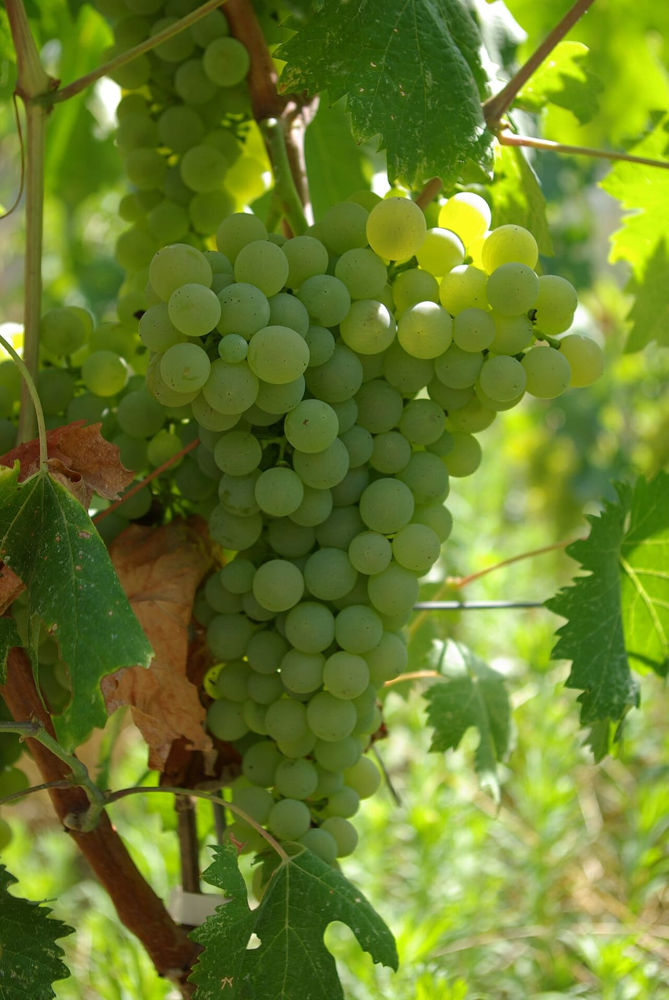

# Vermentino

A Mediterranean coastal white grape planted in Sardinia, Liguria, Tuscany and Provence (as Rolle); citrus, white flowers, sea salt and herbs, medium-high acidity, suited to seafood.

Figure: Vermentino: Rolle (Vermentino) (Wikimedia Commons). Image: Magnetto, CC BY-SA 3.0, via Wikimedia Commons ([source page](https://commons.wikimedia.org/wiki/File:Rolle_(Vermentino).jpg)).

## Definition and naming

Vermentino is a light-skinned Vitis vinifera variety that carries a tangle of local names along the western Mediterranean. In Provence and Languedoc it is called Rolle; in Corsica it is Vermentinu. DNA typing has confirmed that Pigato of Liguria and Favorita of Piedmont are the same grape, while whether the French Rollo grown near Nice is identical remains unresolved. Older records list further synonyms such as Agostenga, Brustiano, Carbes and Malvoisie de Corse. When these names appear on a label, the variety register and appellation rules have to be checked side by side; transliteration alone does not settle identity.

In the variety index, Vermentino is both a familiar label name and a set of comparable viticultural and winemaking choices. It matters which level of information a label gives: the variety, the appellation or a blend name. Vermentino di Gallura is a defined appellation, Pigato is the Ligurian local name, and Rolle is the French-speaking term. They point to the same grape, but the permitted blend proportions, minimum alcohol levels and allowed vineyard sites differ by rule.

## Origin and spread

Three origin hypotheses have long been in circulation: arrival from Spain along trade routes, a homeland in northwest Italy, or an earlier eastern Mediterranean path via Greece. The VIVC catalogue lists Italy as the origin, and recent DNA work leans toward the Italian northwest and Liguria. A documentary thread reaches back to the fourteenth century, when Ligurian texts mention the vine under the name Arratelau, before the later cross-sea trade. Genetics and records currently give a direction only; the parentage and precise spread route still have gaps, and shared names do not prove a shared variety around the Mediterranean.

The vine spread along western Mediterranean trade and migration routes, and its present strongholds are the Gallura peninsula in northern Sardinia, the Ligurian coastal terraces, the Tuscan coast, Corsica and Provence. Global plantings exceed 11,500 hectares: roughly 5,000 hectares in Italy and 3,500 hectares in France. In Provence, Rolle now accounts for more than half of the grapes used in Côtes de Provence whites, having largely replaced the older Ugni-blanc-style varieties.

## Botany and cultivation

The leaves are deep green and five-lobed; the bunches are conical and the ripe berries carry an amber-yellow cast. Berries are medium and thin-skinned, and the variety ripens mid to late. The vine tolerates drought, favouring sunny slopes with strong reflected light; fast-draining granite and limestone limits yields and concentrates flavour. Sea breezes bring both cooling and disease pressure: strong wind at flowering and ripening thickens the skins, but can also drop fruit and loosen the bunch.

What shapes the style most directly is yield control and leaf-to-fruit balance. Too little foliage and sugar and ripening fall short; too thick a canopy shades the fruit and lowers acidity and aroma purity. Coastal terraces are mostly trained to Guyot with vertical trellising, and leaf removal, thinning and picking dates are all arranged around preserving acidity. Vermentino does not rely on the intense perfume of aromatic varieties; its clarity comes largely from low yields, drainage and the water stress created by coastal winds.

## Style and palate

A typical Vermentino is pale straw yellow with greenish tints. The nose shows white blossom, lemon, grapefruit, peach peel and dried herbs, often with a touch of flint and sea salt. On the palate the acidity is bright, with a faint bitter-almond finish; the mineral note varies in strength from site to site. Most wines are fermented in stainless steel to keep freshness and salinity. Some estates in Gallura and Bolgheri in Tuscany use lees stirring, short oak contact or skin contact to build a broader texture and riper fruit.

The style spans a wider range than the label suggests. Young dry whites lead with citrus and herbs and are meant for early drinking; a few late-harvest wines concentrate pineapple, honey and dried pear and can age for several years. From the same site, cool maceration draws out flowers and colour, while warmer fermentation brings more fruit and texture. The variety supplies the skeleton; fermentation temperature, oak ageing and lees contact are the variables that push a wine in different directions. Compared with an international variety such as [chardonnay](ref:chardonnay), Vermentino leans less on oak sweetness and more on acid and mineral structure.

## Main regions and representative wines

Gallura in northeast Sardinia is its most admired home. Vermentino di Gallura gained DOC status in 1975 and was promoted to DOCG in September 1996; it remains Sardinia's only DOCG. The rules require at least 95% Vermentino, with a minimum alcohol of 12% for the standard wine and 13% for the Superiore. The topsoil is granite sand, vineyards reach about 500 metres in elevation, and the Mistral moderates day-night temperatures. Across the island there is also the Vermentino di Sardegna DOC, established in 1988 with at least 85% Vermentino, and the Isola dei Nuraghi IGT tier.

Representative producers cluster around Arzachena and Olbia. Capichera is run by Fabrizio and Mario Ragnedda; the first Vermentino under the Capichera label reached the market in 1981, and the flagship Vign'angena and late-harvest cuvées are reference points for Gallura style. Argiolas is based at Serdiana, while Pala, Piero Mancini and Vigne Surrau also hold positions in the district. In Liguria, Colli di Luni works under the Pigato name; around the Cinque Terre the vine is grown with Bosco and Albarola and contributes to the Sciacchetrà passito. Poggio al Tesoro Solosole from Bolgheri in Tuscany represents the riper coastal style. In Corsica, Patrimonio AOC, created in 1968, permits Vermentino as its sole white grape.

## How to drink and pair

Light Vermentino is best served at 8–10°C; wider, lees- or oak-aged versions can sit at 10–12°C. Too cold and the white flowers and mineral aroma close down; too warm and alcohol and bitterness take over. A medium-bowl universal glass is enough; there is no need for a narrow specialist shape. After opening, pour a small glass and leave it for about ten minutes before judging how the aroma unfolds.

Pairing revolves around seafood and light dairy: grilled or pan-fried fish, shellfish, prawns and crab, herb salads and goat cheese all match its acidity and saline edge. Lemon, rosemary and capers in coastal dishes echo the herbal notes in the wine. Rich cream sauces or red meat overwhelm its clarity and are not ideal matches. As an aperitif or with light starters, its high acidity also acts as a palate refresher.

## Buying and common misreadings

Start with where it is grown. From there, consider how it is labelled, then whether the style is dry or sweet. That is how a practical judgment about Vermentino is built.

A common misreading is to treat Vermentino as one fixed flavour tag. Warm lowland fruit ripens more fully and shows more alcohol weight; high-altitude and coastal sites keep tighter acidity with more herbal and mineral character. Whether an estate uses lees or oak also changes the texture. Reading the producer, the site tier and the vintage predicts the wine better than the variety name alone. Ageing potential should not be overstated: most dry whites are best within two or three years of release, while a few late-harvest and old-vine bottlings last longer.

## Further reading and see also

The most direct way to understand the variety is to compare a Gallura dry white, a Ligurian Pigato and a Provence Rolle blend in the same vintage, noting how acidity, bitterness and mineral differ among them. It connects to the winemaking approach of [white-wine](ref:white), the coastal [terroir](ref:terroir), the choices of [fermentation](ref:fermentation) and the use of [oak-ageing](ref:oak).

- Related: [white-wine](ref:white), [terroir](ref:terroir), [fermentation](ref:fermentation), [chardonnay](ref:chardonnay), [oak-ageing](ref:oak).

## Related images

Image: Chardonnay. Credit: Jenavive at English Wikipedia, Public domain, via Wikimedia Commons ([source page](https://commons.wikimedia.org/wiki/File:Chardonnay.jpg)). Related image for Vermentino.
