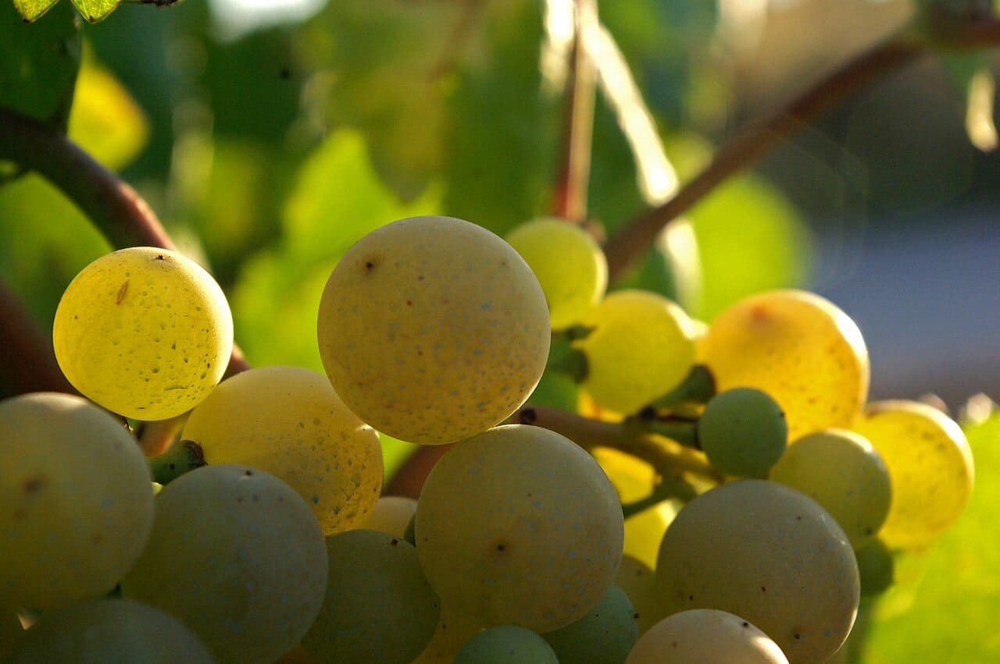
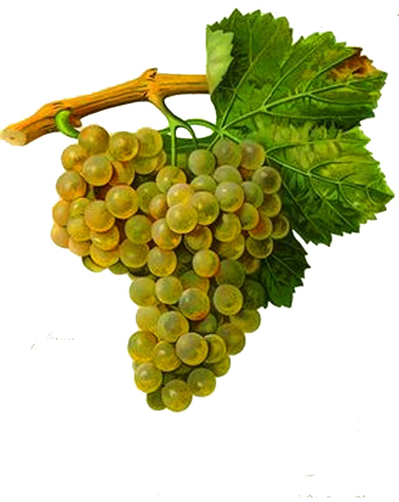

# Xarel·lo

Xarel·lo is an autochthonous white grape of the Penedès in Catalonia, Spain, and one of the classic Cava sparkling trinity. It carries high acidity and a clear frame, with green apple, citrus, white flowers, fennel and mineral salinity; it supports long-aged Cava and is increasingly made as a structured still white.

Figure: Xarel·lo: Xarel lo Cava grapes (Wikimedia Commons). Image: batega, CC BY 2.0, via Wikimedia Commons ([source page](https://commons.wikimedia.org/wiki/File:Xarel_lo_Cava_grapes.jpg)).

## Definition and naming

The Catalan spelling carries an interpunct, Xarel·lo; other languages write it Xarel-lo or Xarello. Local synonyms include Pansa Blanca around Alella, Cartoixà in the Penedès, and Premsal Blanc (Moll) in Mallorca. The name is traced to the Italian chiarello, meaning "claret", possibly referring to an occasional pink tint of the skins rather than the wine's colour.

It is often blended and sometimes confused with Macabeo (Viura); DNA profiles suggest the two may be related, but they are not the same variety. As a Vitis vinifera white, Xarel·lo has compact bunches of medium, thick-skinned berries, with medium budburst and ripening. Commercial plantings use selected clones, and labels rarely state clone or rootstock ([macabeo](ref:macabeo)).

## Origin and spread

The most likely origin is the Penedès, where the variety was first recorded under this name in Sitges in 1785; it is recognised as an autochthonous Catalan grape. It is concentrated almost entirely in Catalonia: about 99% of Spanish Xarel·lo lies in the region, with authorised plantings across the Penedès, Alella, Conca de Barberà, Costers del Segre, Tarragona and the Binissalem area of Mallorca.

Through its long local history it was a base variety for Penedès still whites and Cava base wine. In the 20th-century industrial Cava era it mainly supplied structure as a blending component. In 1998 Segura Viudas launched Creu de Lavit, a varietal Xarel·lo, one of the early moves to take the grape beyond blending material toward a standalone wine. Since then Penedès estates have made barrel-fermented and lees-aged still Xarel·lo, and the grape has become a white-wine style in its own right rather than only "Cava's backbone".

Only scattered experimental plantings exist abroad; small blocks in France, the United States and Australia have not reached scale, and the variety's style and reputation remain tied to Catalan sites.

## Botany and cultivation

Bunches are medium and compact, with medium, thick-skinned berries; polyphenols and antioxidants are relatively high, and the juice balances sugar and acidity with a decent potential alcohol. Budburst and ripening are medium, it adapts to most soils and performs best on calcareous, free-draining ground, and it is relatively drought tolerant through the Mediterranean summer.

Its weak points sit in fruit set and disease: it is prone to coulure (poor fruit set) and sensitive to both powdery and downy mildew; damp flowering and a dense canopy worsen shatter and fungal pressure. Strong sun can over-concentrate skin phenolics and bring bitterness, so canopy management balances sun protection, ventilation and ripening light. Only with crop thinning does berry concentration and ageing potential emerge.

## Style and palate

Typical Xarel·lo is pale straw yellow, with green apple, pear, grapefruit, lemon, white flowers, fennel, almond and mineral salinity. The palate is dry and medium bodied, with bright acidity, a clear frame and a rounded, textured mouthfeel. It is not a light aromatic white; structure and length of finish are the telling signs, and low-yield site wines can age for several years.

In Cava it adds body, structure and freshness and extends the sparkling wine's life; in long-aged blends it balances the fruit of Macabeo against the freshness of Parellada ([parellada](ref:parellada)). After second fermentation in bottle and long lees ageing, the nose turns to toast, almond, honey and nuts, with a creamier texture ([sparkling-wine](ref:sparkling)).

In still wines, cool stainless fermentation preserves green fruit and flowers; barrel fermentation or lees contact, with stirring, adds roundness, nut and butter notes. Some low-yield old-vine blocks make barrel-aged whites that develop preserved fruit, dried hay and spice with bottle age. Judge potential by intact acidity and ripe phenolics, not colour depth ([white-wine](ref:white)).

## Main regions and representative wines

The Penedès is the core region, with Sant Sadurní d'Anoia the cradle of Cava; Alella, Conca de Barberà and Costers del Segre also have local plantings. According to the Cava regulatory body, Xarel·lo covers about 9,825 hectares in the Cava zone, ahead of Parellada at 7,385 hectares, making it the second most planted white grape in the Cava system.

Representative producers include Recaredo, known for very long lees-aged Cava in which Xarel·lo holds a major share; Gramona, Raventós i Blanc, Juvé & Camps and Sumarroca as long-standing Penedès sparkling references; Segura Viudas, making a varietal Xarel·lo since 1998. In still wines, J. Fortuny Fàbregas' Blanc de Mayte comes from a single vineyard planted in 1954 at 216 metres, yields below 4,500 kg per hectare, with at least eight months on lees; Vallformosa and other estates also release varietal still Xarel·lo.

In the market, varietal Xarel·lo spans entry table wines to high-altitude old-vine single-vineyard bottlings. Under the same name, Cava base wine and a fine still white differ markedly in concentration, oak and ageing potential; producer and site predict the glass better than the variety name alone.

## How to drink and pair

Sparkling Xarel·lo is served as a traditional-method sparkling at around 8–10°C; still whites can be a degree or two warmer, just over ten degrees. Too warm, and acidity looks thin and alcohol floats up. A medium-rimmed white glass is enough; young wines need no decanting, and long-aged Cava can be opened a short while ahead to let toast and nut notes unfold.

Pairings run to seafood, white meat and Mediterranean dishes: baked cod, trout, prawns and shellfish, grilled fish, seafood rice, leafy salads and lemon vinaigrette all match its acidity and mineral note; Iberian ham and soft to semi-hard cheeses work too. With light tannins it does not demand heavy red meat, and overly sweet or rich sauces cover its saline frame.

## Buying and common misreadings

The first misreading is to treat Xarel·lo as mere Cava material. It carries the frame in Cava blends, but a fine still Xarel·lo is a different wine, whose barrel and lees complexity is not expressed in sparkling form; on the label, first separate sparkling from still. The second is to confuse it with Macabeo. The two often partner and may be related, but Xarel·lo has thicker skins, heavier phenolics and a firmer frame, while Macabeo shows fruit and a softer texture.

The third misreading is to assume high-acid whites cannot age. Low-yield, ripe-phenolic Xarel·lo with intact acidity has multi-year bottle potential; judge by site yield and winemaking rather than a general variety impression. Check vintage and bottling date: long stock or heat exposure costs the green fruit and flowers, and the mineral salinity turns muffled.

## Further reading and see also

A useful comparison is to set a long-aged Penedès Cava beside a still varietal Xarel·lo from the same region, recording the shift from toast and nuts to green fruit and fennel; then contrast stainless-fermented with barrel-aged versions to see the role of lees and oak on this variety.

Planting area, clones and parentage keep updating with variety surveys; for formal citation, check the Cava regulatory body's records, the VIVC register and the official Catalan variety catalogue.

- Related: [macabeo](ref:macabeo), [parellada](ref:parellada), [sparkling-wine](ref:sparkling), [white-wine](ref:white), [fermentation](ref:fermentation).

**At a glance:** A core white grape of Penedès and Cava sparkling wine in Spain, high in acidity with green apple, citrus, white flowers and mineral; with Macabeo and Parellada it forms the classic Cava trio.

## Related images

Image: Macabeo: Maccabeo blanc (Wikimedia Commons). Credit: Viala et Vermorel, Public domain, via Wikimedia Commons ([source page](https://commons.wikimedia.org/wiki/File:Maccabeo_blanc.jpg)). Related image for Xarel·lo.
