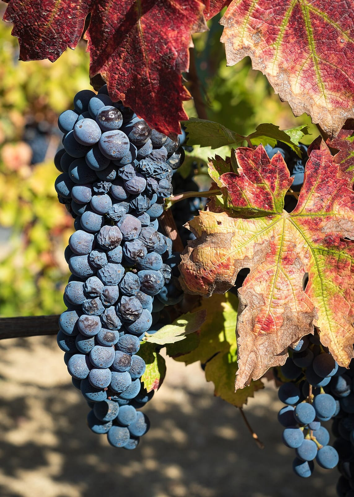

# Zinfandel

Zinfandel is California's signature red grape and one of the few varieties that matters on both sides of the Atlantic. In Puglia, Italy, it is called Primitivo; on the Dalmatian coast of Croatia it survives under the older names Tribidrag and Crljenak Kaštelanski. Jammy blackberry, black pepper and high alcohol are its most familiar face, yet well-farmed old vines can show spice, dried herbs and a mineral edge. The variety makes more sense when it is set against migration, shipping and the California Gold Rush than when it is reduced to a single phrase on a label such as "old vine" (ref:wine).

Figure: Zinfandel. Image: Frank Schulenburg, CC BY-SA 4.0, via Wikimedia Commons ([source page](https://commons.wikimedia.org/wiki/File:Ripe_Zinfandel_grapes_in_Dry_Creek_Valley-8958.jpg)).

## Definition and synonyms

Zinfandel belongs to the European grape Vitis vinifera and is a red variety. Its Italian name is Primitivo, while Tribidrag and Crljenak Kaštelanski are the Croatian names for the same genotype. The spelling Primativo, often seen in English-language material, is a misspelling of Primitivo rather than a separate variety. "White Zinfandel" is a pale pink wine made from this red grape, not a white grape; and "old vine" is a marketing term, not a botanical class (ref:red-wine).

## Parentage and origin

The parents of Zinfandel are still not fully established, but its geographic origin is clear. In the 1990s Carole Meredith at the University of California, Davis, working with Croatian researchers, matched California Zinfandel to Crljenak Kaštelanski from Dalmatia. Plavac Mali, another Dalmatian variety, is a cross of Zinfandel and the local Dobričić, which helps explain why the three are often confused. Zinfandel reached the eastern United States through European nurseries in the 1820s and spread across California during the Gold Rush. During Prohibition, exemptions for home winemaking and sacramental wine helped some old vineyards survive; those parcels later became an important source of old-vine Zinfandel.

## Botanical characteristics

The clusters are large and the berries medium to large, with medium-thick, deeply coloured skins. The variety's most distinctive botanical trait is uneven ripening within a single bunch: some berries are already shrivelled and sweet while others remain hard and acidic, a condition growers call "hens and chicks". This makes picking decisions difficult. Sugar rises quickly and acidity falls quickly, so hot sites can produce fruit that is high in alcohol and low in freshness. The skins are rich in pigment but not especially heavy in tannin. Tight clusters make the variety prone to grey rot and sour rot when autumn rain arrives.

## Viticultural characteristics

Zinfandel is vigorous and high-yielding, and it adapts to a wide range of soils, from poor slopes to valley alluvium. It buds early, so spring frost is a real risk, and it ripens in the middle of the season, around or slightly before Cabernet Sauvignon. Because sugar accumulates so fast, growers must balance flavour ripeness against acid loss. Old vines in California are often head-trained and dry-farmed; low yields and small berries give more concentrated flavour and finer tannin. Overcropping produces thin, jammy wine with little structure, while delaying harvest in a hot site can give raisined fruit and bitterness.

## Regional distribution

The United States is the most important modern home of the variety (ref:usa). California plants it in Mendocino, Sonoma (Dry Creek Valley, Russian River, Alexander Valley), Napa, Lodi, Amador County and Paso Robles. Dry Creek Valley is known for spice and structure, Lodi for old vines and value, and the Amador hills for firmer acidity and a mineral tone. Puglia in southern Italy is the heart of Primitivo (ref:italy), with Manduria and Gioia del Colle as the best-known appellations; the warm, dry climate ripens the fruit earlier and gives a darker, dried-fruit profile. Croatia has begun replanting in Dalmatia, and Australia, South Africa and South America have small experimental holdings.

## Legal rules

In the United States, varietal labelling normally requires at least 75% of the named grape, while geographic labelling is governed by the AVA system; "old vine" and "ancient vine" have no federal definition, so they remain marketing language rather than a legal tier. In Italy, Primitivo di Manduria is a DOC, while its sweet Dolce Naturale version became a DOCG in 2011, the first in Puglia; Gioia del Colle has its own DOC rules. Minimum variety proportions, alcohol levels and ageing requirements differ between appellations, and the latest regional regulations should be consulted. Because Zinfandel and Primitivo are the same genotype, the names are not interchangeable across markets, and the label must satisfy the rules of the country where the wine is sold.

## Winemaking

Zinfandel's high sugar means that finished alcohol is often 14% to 16%, and some old-vine or late-picked wines go higher (ref:alcohol-by-volume). That alcohol brings sweetness and warmth, so producers may acidify, pick earlier or harvest at night to keep balance. Traditional California methods include whole-cluster fermentation, wild yeast, open-top fermenters and punchdowns, followed by ageing in American oak that adds vanilla, coconut and sweet spice. Old-vine parcels are often field blends containing Petit Sirah, Carignan and Alicante Bouschet, which add colour, tannin and acidity. White Zinfandel is made by short maceration or saignée; it became popular in California from the 1970s and often carries residual sugar.

## Sensory profile

Young Zinfandel shows blackberry, raspberry jam, black cherry, black pepper, dried thyme and fig, with a full body, medium to high tannin and medium acidity. High alcohol can make the finish feel sweet, but good wines use acidity and tannin to carry the fruit. Primitivo tends toward black plum, dried fig, liquorice and tobacco, with firmer tannin and slightly lower acidity. Oak ageing adds vanilla, cocoa, mocha and baking spice; bottle age brings leather, tobacco, truffle and dried fruit. The ageing potential of old-vine Zinfandel is often underestimated, and well-structured examples can improve for a decade or more.

## Representative producers and vintages

California producers include Ridge, whose Lytton Springs and Geyserville are benchmarks for old-vine field blends; Ravenswood, Turley, Bedrock, Seghesio and Robert Biale. Ridge stresses site and low intervention, Turley is known for old vines and concentrated styles, and Bedrock focuses on historic parcels. In Puglia, Feudi di San Marzano and Leone de Castris are representative producers, the former more modern and fruit-driven, the latter retaining a more traditional approach to ageing. Vintage variation comes mainly from summer heat and harvest rain: hot years give higher alcohol and riper fruit, cooler years give better acidity and firmer tannin, while site and picking decisions still matter most.

## Common misconceptions

First, that White Zinfandel comes from a white grape; it is a rosé made from a red variety. Second, that Zinfandel and Primitivo are different grapes; they share one genotype but differ in clones, regions and regulations. Third, that "old vine" has a legal meaning; the United States has no uniform standard. Fourth, that high alcohol is always a fault; in a balanced wine it is part of the style. Fifth, that Zinfandel is native to the United States; it originated in Dalmatia. Sixth, that the variety can only make jammy blockbusters; cool sites, old vines and restrained winemaking can produce detailed wines with spice and mineral notes.

## Further reading

- [Wine](ref:wine): the broad framework from fermentation to classification.
- [Red wine](ref:red-wine): the drink style to which Zinfandel belongs.
- [United States](ref:usa): the variety's most important modern region.
- [Italy](ref:italy): the home of Primitivo and its appellations.
- [Alcohol by volume](ref:alcohol-by-volume): the measure that explains Zinfandel's high-alcohol profile.

## Related images

Image: ' 09 - ITALY - Vineyard and signs Emilia Romagna wine - Mollino. Credit: Topural 1, CC BY-SA 2.0, via Wikimedia Commons.. Credit: Topural 1, CC BY-SA 2.0, via Wikimedia Commons ([source page](https://commons.wikimedia.org/w/index.php?curid=35825496)). Related image for Zinfandel.
