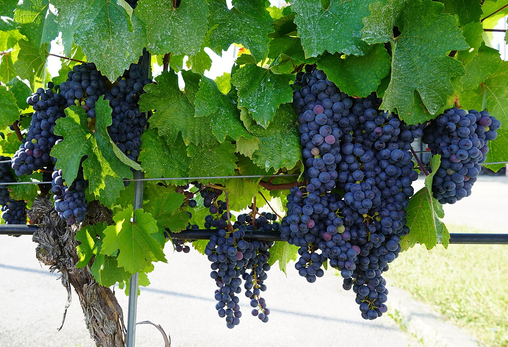

# Zweigelt

Zweigelt is Austria's most planted red grape, bred in 1922 at Klosterneuburg by Fritz Zweigelt from Blaufränkisch and St. Laurent. It ripens early, crops well and tolerates cold; the wine is deep coloured with soft tannins, black cherry, violet and spice, spanning light young wines to oak-aged reserve bottlings.

Figure: Zweigelt: Rebsorte Zweigelt, Versuchsgut Agneshof der HBLA und dem Bundesamt für Wein- und Obstbau, Klosterneuburg 01 (Wikimedia Commons). Image: Naturpuur, CC BY-SA 4.0, via Wikimedia Commons ([source page](https://commons.wikimedia.org/wiki/File:Rebsorte_Zweigelt,_Versuchsgut_Agneshof_der_HBLA_und_dem_Bundesamt_f%C3%BCr_Wein-_und_Obstbau,_Klosterneuburg_01.jpg)).

## Definition and naming

Blauer Zweigelt is a bred Vitis vinifera red, a crossing of St. Laurent and Blaufränkisch. From St. Laurent it takes bright cherry perfume and silky elegance; from Blaufränkisch, spice and good acidity; the deep purple-crimson colour of both parents passes to the offspring. Rotburger was its original name; the official register name became Zweigeltrebe Blau in 1972 and Blauer Zweigelt in 1978.

The name was long confused with Rotberger, a variety bred around the same time in Geisenheim, Germany; the two were separated only in the 1970s. Today Blauer Zweigelt, Zweigelt and Rotburger all refer to the same Austrian variety. As a bred crossing it does not carry the many local clones of an old landrace; commercial plantings use officially registered clones, and vine age, site and winemaking matter more than a clone label ([blaufrankisch](ref:blaufrankisch)).

## Origin and spread

The crossing was made in 1922 at the federal viticulture research station in Klosterneuburg, Lower Austria, by viticulture professor Friedrich "Fritz" Zweigelt; the crossing register entry was Klosterneuburg 71. Large-scale planting began after 1950, and in the 1950s Lenz Moser's high-training vineyard system helped the variety fit modern vineyard management; plantings have risen ever since.

In 1995 Zweigelt was recognised by the EU as a recommended variety for Vienna, Lower Austria, Burgenland and Styria, and Austria's return to native red varieties in the 1990s consolidated its position. Official Austrian figures put national Zweigelt plantings at over 6,200 hectares, about 46% of red-vineyard area and roughly 13% of the total Austrian vineyard of about 45,500 hectares; the Austrian Wine industry guide lists about 5,940 hectares, making it the country's number one red grape.

Beyond Austria it has small plantings in southern Germany, Hungary, the Czech Republic and Slovakia, with experimental blocks in Canada, Australia and New Zealand. Overseas scale is limited, and the style reference remains the Austrian regions.

## Botany and cultivation

Berries are medium with thick skins and compact bunches; shoots are vigorous, disease resistance is relatively good, and budburst and ripening are early. Early ripening lets it reach maturity in Austria's cooler regions ahead of autumn damp, though flowering and young fruit still need spring-frost care. High yield is a strength, but letting crops run dilutes colour, perfume and structure.

The cultivation balance is yield and canopy: thinning lowers crop load, enough leaf area supports ripening, and dense shade is avoided to protect acidity and limit disease. Sites diverge clearly: warm lakeside blocks give riper fruit and a broader body, while slope and clay sites keep acidity upright and perfume finer. Under the same name, a low-yield old vine and a high-yield new plot can make two different wines ([terroir](ref:terroir)).

## Style and palate

Typical Zweigelt is deep ruby to purple, with black cherry, morello cherry, raspberry, plum, violet, black pepper and licorice. The palate is dry, light to medium bodied, with soft rather than coarse tannin and bright acidity, finishing on fruit and spice. Entry wines are round and juicy; reserve versions show darker fruit, firmer tannin and vanilla and chocolate notes from oak.

Winemaking falls into three layers. Light styles ferment short in stainless steel and bottle quickly for fresh cherry and herbal character, drunk within the year. Classic styles macerate 10–15 days for colour and moderate structure, age six to twelve months in tank or large cask, and keep 3–5 years. Reserve versions use long extraction and twelve to eighteen months in small barriques, with top sites capable of 8–12 years of ageing. Alcohol usually sits between 11.5 and 13.5% ([oak-ageing](ref:oak)).

Zweigelt is also a fine blending partner: with its parents, Cabernet Sauvignon or Merlot it contributes fruit, colour and roundness to balance frame and tannin. Most bottlings are drunk within a few years of release, when fresh fruit is central; good reserve bottles develop dried fruit, leather and bottle spice with age while staying harmonious.

## Main regions and representative wines

It is planted in every Austrian region, with the most respected examples from Burgenland, particularly the eastern shore of Lake Neusiedl. The lake moderates temperature, sun and warmth are ample, rainfall is moderate and the lakeside buffers diurnal swing, giving ripe, concentrated Zweigelt. Mittelburgenland, Carnuntum, Leithaberg, Lower Austria and the Vienna suburbs also hold representative blocks.

Representative producers include Moric, Prieler and Weninger in Burgenland, and Stadlmann in the Thermenregion; each sets a reference in old-vine low yield, lakeside site or oak reserve style. The market spans heuriger-style light wines to single-vineyard reserves; under the same name, stainless young wines and barrique reserves differ markedly in concentration, tannin and ageing potential, so producer and site predict the glass better than the variety name ([red-wine](ref:red)).

## How to drink and pair

Light, unoaked Zweigelt is served slightly cool, around 13°C; fuller or oak-aged versions show best between 15 and 18°C, and too cold mutes spice and oak. A medium-large rounded red glass gathers the aromas; young wines need no decanting, while structured reserves can be given a brief 30–60 minutes to soften tannin and open fruit.

Pairing is a strength: Austrian classics such as roasted pork hock, grilled sausages with mustard, duck confit, roast chicken and barbecue meats stand up to its acidity and fruit; mushrooms, grilled vegetables, pasta salad and mid-hard cheeses work too. Tannins are light, so it does not demand heavy red meat or rich sauces; for spicy dishes choose a riper vintage.

## Buying and common misreadings

The first misreading is to take Zweigelt for a Blaufränkisch clone or variant. It is an independent crossing with Blaufränkisch as one parent, but its style is softer and more forward-fruited; it should not be bought with expectations for Blaufränkisch's high acidity and tough tannin. The second is to equate deep colour with heavy body. Zweigelt is dark but usually softly tannined, mostly light to medium bodied; colour comes from thick skins and dark pigments, not a thick structure.

The third misreading is that Zweigelt must be drunk young. Light styles have a short window, but low-yield sites, long maceration and barrel-aged reserves have multi-year bottle potential; judge by winemaking tier and site, not a general variety impression. Check vintage, bottling date and storage: long stock or heat exposure costs the cherry and violet perfume, and tannin turns dry.

## Further reading and see also

A useful comparison is to set a Neusiedlersee classic beside a Carnuntum or Leithaberg reserve, recording differences in fruit ripeness, tannin texture and oak; then contrast a stainless young wine with a barrique version to see where winemaking takes this variety.

Planting area, clones and overseas plantings keep updating with variety surveys; for formal citation, check the Austrian official agriculture body, the VIVC register and the relevant DAC regional records.

- Related: [blaufrankisch](ref:blaufrankisch), [st-laurent](ref:st-laurent), [red-wine](ref:red), [terroir](ref:terroir), [oak-ageing](ref:oak).

To read Zweigelt, start with where it is grown, then how it is labelled, then whether the style is dry or sweet; no single check settles it.