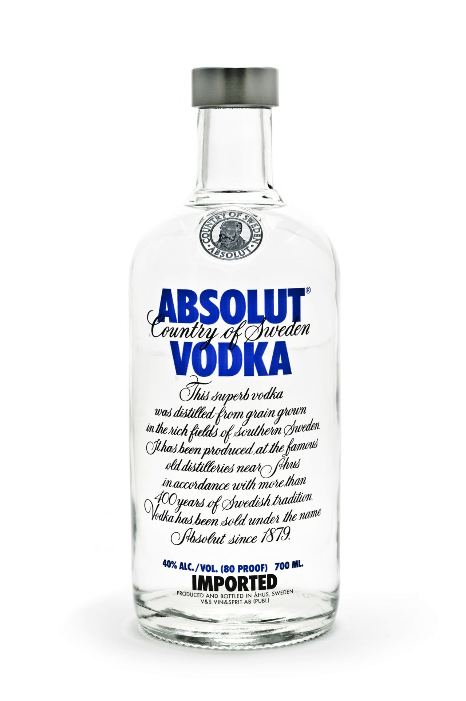

# 绝对伏特加

绝对伏特加（Absolut）是瑞典[伏特加](ref:vodka)品牌，现由[保乐力加](ref:producer)持有。品牌以单一产地、冬小麦原料与连续[蒸馏](ref:distillation)为卖点，透明瓶身与极简标签、以及长期的艺术广告合作，使其成为全球知名度最高的伏特加品牌之一。

图：绝对伏特加原味瓶，透明瓶身与蓝色字标清晰可见。图片：Justus Blümer，CC BY 3.0，via [原图页面](https://commons.wikimedia.org/wiki/File:Absolut_vodka_bottle.png)。

## 品牌定义

品牌、酒厂与品类是三个层面。绝对伏特加是品牌，伏特加是品类，位于瑞典南部 Åhus 的酒厂是生产地点。把品牌名当作品类名，或把“绝对”理解为法定等级，都会造成误解。

“Absolut”在瑞典语中意为“绝对、完全”，品牌名来自早期产品名中的“绝对纯净”表述，属于命名传统，不是第三方检测结论，也不代表所有版本具有相同的纯净度。品牌名与酒液的化学指标是两件事。

品牌下有原味与多种风味版本，它们的配方、糖分、香气与酒精度不同。讨论“绝对伏特加什么味道”，应先说明是原味还是某一风味版本；把风味版本当作原味，会误判品牌的基础风格。

## 所属生产者

品牌的生产者为[保乐力加](ref:producer)。保乐力加是总部位于巴黎的跨国葡萄酒与烈酒集团，业务覆盖伏特加、威士忌、茴香酒与葡萄酒等。绝对伏特加是其伏特加板块的核心品牌之一。

品牌的生产长期集中在瑞典 Åhus，官方表述强调“单一产地”（one source）：原酒在同一地区生产，水源、小麦与蒸馏设施形成稳定的风味基础。全球分销与品牌运营由集团体系承担，具体所有权变更的年份与交易结构以官方披露为准。

需要区分“品牌归属”与“生产地点”：品牌属于保乐力加，生产集中在瑞典，但不同市场的标签、进口商与包装版本可能不同。标签上的产地、生产商与进口商信息，是判断具体一瓶酒来源的直接依据。

## 产品线

公开产品资料常见的核心产品是绝对伏特加原味（Absolut Original），以冬小麦与连续蒸馏为基础，风格干净、谷物感明显。风味系列包括柠檬（Citron）、胡椒（Peppar）、香草（Vanilia）、覆盆子（Raspberri）、青柠（Lime）、野莓（Wild Berries）、柑橘（Mandrin）等，不同市场的在售口味并不完全一致。

品牌还有高端线绝对 Elyx，强调铜制蒸馏与更精细的工艺定位；以及面向免税、礼盒与特定活动的限量包装。各版本的酒精度、容量、糖分与香气强度不同，产品线会随市场调整，具体清单以品牌官网为准。

购买时应核对标签上的产品名称、风味标识、酒精度、容量、产地与生产商，而不是只凭瓶身颜色或“绝对”字样判断。风味版本的甜感与香气来自配方，不等于原味产品的风格。

## 定位与价格带

品牌整体处于主流到中端的价格带：原味是调酒与餐饮场景的常见基酒，风味版本覆盖家庭调饮与派对场景，Elyx 上探高端。价格会随国家、渠道、税率、促销与包装规格变化，本页不列具体零售价。

价格带是市场定位，不等于质量等级。伏特加的品质评价涉及原料、[蒸馏](ref:distillation)次数、过滤、水质与口感平衡，不能仅凭“绝对”二字或价格推断。不同市场的同名产品也可能存在版本与容量差异。

对消费者而言，更实用的判断方式是先确定用途：调酒、纯饮、佐餐还是送礼；再比较标签上的酒精度、容量、产地与风味标识。把广告语当作质量结论，容易忽略实际口感与配方差异。

## 历史

品牌历史通常从 19 世纪瑞典南部 Åhus 的酒厂讲起，具体建厂年份以官方品牌史为准。20 世纪 70 年代末，酒厂以 Absolut 品牌推出面向国际市场的新产品，早期名称与“绝对纯净的烈酒”有关；此后品牌借助统一瓶形、极简标签与艺术广告，在国际市场迅速建立识别度。

20 世纪 80 年代起，品牌与艺术家、设计师合作推出广告与限量瓶，形成“艺术与商业结合”的传播传统；这类合作属于品牌文化资产，不代表产品质量或年份。此后品牌经历所有权整合，最终进入保乐力加体系，具体交易节点以官方披露为准。

品牌史中的“酒厂建立”“Absolut 品牌推出”“集团化”是不同层面的节点，不宜压缩成一个年份。广告史与产品史也应分开叙述，避免把传播成就当作质量认证。

## 名称与标识

“绝对伏特加”是 Absolut Vodka 的中文直译，其中“绝对”对应 Absolut，“伏特加”对应品类。中文译名不承载配方或等级信息；英文品牌名常以 Absolut 单独出现，瓶身与标签上的字体、排版构成主要识别。

品牌标识以透明玻璃瓶、简洁字体、银色与蓝色标签、以及缺少多余装饰的版面著称。早期标签刻意减少文字，让品牌名成为视觉中心；这种设计后来被大量模仿，也带来仿冒问题。购买时应核对防伪标识、生产商、批次与正规渠道。

“Absolut”在瑞典语中与“absolute”同源，但中文“绝对”不是质量等级或法定分类。把品牌名当作“最纯”的证明，是把营销语言误读为技术标准。

## 常见误区

第一，把“绝对”当作法定纯度等级。它是品牌名，不是检测或法规分类。
第二，把伏特加当作“无色无味所以没有差别”。原料、水质、蒸馏与过滤都会影响口感。
第三，把风味版本当作原味加果汁。风味版本的配方与香气设计是独立产品。
第四，把瑞典产地当作每一瓶的灌装地。产地与灌装信息应以标签为准。
第五，用价格或广告判断品质。广告投入与酒液质量不是同一回事。
第六，把不同市场的同名产品当作完全相同。酒精度、容量与配方可能存在版本差异。

## 延伸阅读

- [保乐力加](ref:producer)：品牌所属生产者。
- [伏特加](ref:vodka)：伏特加的大类、原料与基本工艺。
- [蒸馏](ref:distillation)：烈酒生产的关键工艺。
- [小麦](ref:wheat)：品牌强调的谷物原料。
- [如何读标签](ref:label-guide)：核对酒精度、产地与生产商的方法。

**关键事实。**

| 项目 | 内容 |
| --- | --- |
| 一句话定位 | 瑞典伏特加品牌，现由保乐力加持有；以单一产地、冬小麦原料与连续蒸馏为卖点，透明瓶身、极简标签与长期艺术合作使其成为全球知名伏特加品牌之一 |
| 持有公司 | 保乐力加 |
| 官网 | absolut.com |
