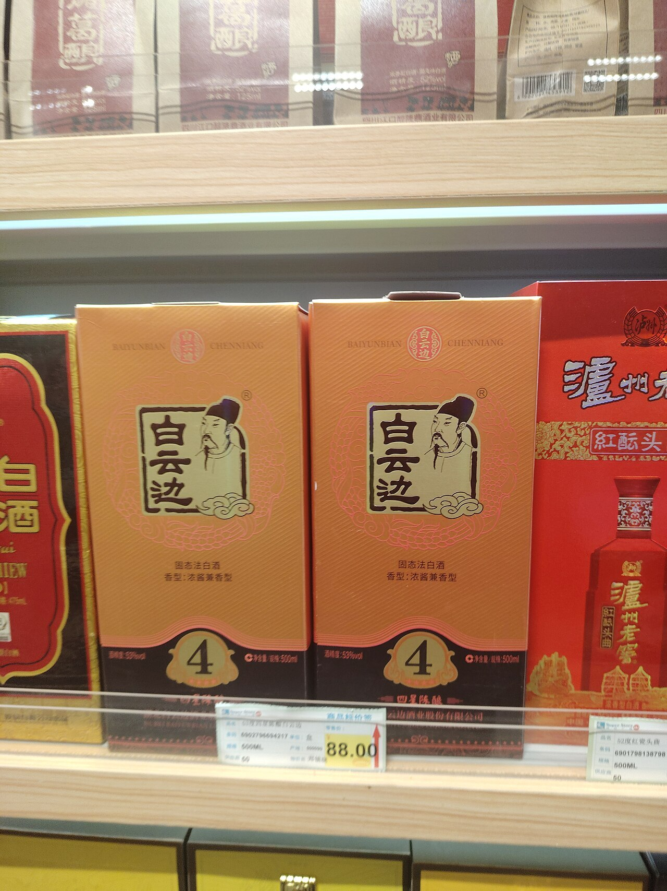

# 白云边

白云边是湖北松滋的[兼香型白酒](ref:mixed-aroma)品牌，名称取自李白“且就洞庭赊月色，将船买酒白云边”。它的辨识度来自一种风格判断：入口偏浓香的窖香与粮香，回味带酱香的焦糊与醇厚，行业里常用“浓头酱尾”概括。品牌的产品线围绕年份、年代与星级展开，价格带跨度不小。

图：白云边。摄影：一款白云边酒。署名：Lhzss8，CC BY-SA 4.0，来自 Wikimedia Commons（[来源](https://commons.wikimedia.org/w/index.php?curid=196443757)）。

## 品牌名：一句唐诗的产物

“白云边”先是一个地理意象，再是一个白酒商标。李白原诗写的是洞庭湖边的月夜与买酒，品牌借用的是“白云”与“酒”的组合，而不是某种酿造工艺。理解这一点，就不会把诗句当成品质证明。

品牌名与产地名并不完全重合：白云边产在松滋，而诗句写的是洞庭。品牌借的是文化地理，不是行政区划。看瓶标时，生产商与产地仍是判断依据。

## 香型定位：兼香的“教科书”

兼香型要求在香气上同时呈现浓香的窖香与酱香的酱香、焦香，口感上兼顾醇厚与细腻。国家标准 GB/T 23547 对浓酱兼香型白酒有明确要求，白云边是这一品类中最常被引用的样本之一。

“兼香”不是把两种酒简单混合，而是从[制曲](ref:qu-making)、[发酵](ref:fermentation)到摘酒都有对应安排。浓香部分强调续糟配料与混蒸混烧，酱香部分强调高温堆积与多轮次取酒，两条路线的基酒按比例组合。

## 产品线：年份、年代、星级

公开产品展示把白云边分为三条主线：年份系列、年代系列与星级系列。年份系列以“十五年”“二十年”“三十年”命名，年代系列以时代记忆命名，星级系列以“五星”等星级命名。

三条线不是三个品牌，而是同一品牌下的价格与场景分区。年份系列承担商务与礼赠，年代系列覆盖怀旧与宴席，星级系列更贴近日常聚饮。选购时先确定场景，再看系列。

## 年份系列：从十五年到三十年

年份系列是品牌的核心。公开资料可见：三十年陈酿为 53%vol、668ml；二十年陈酿有 45%vol 与 42%vol、500ml 两种；十五年陈酿常见 45%vol、500ml。2025 年，“白云边 15 年（45%vol）”获“湖北产区酒体设计卓越奖”。

年份数字是产品名的一部分，不等于瓶中酒龄。企业可能用不同年份基酒勾调，具体比例属于工艺信息。把“十五年”理解成“整瓶酒存放十五年”，是这一系列最常见的误读。

## 度数选择与饮用场景

同一系列常提供不同度数：高度数突出香气与骨架，低度数强调入口柔和。42%vol、45%vol 与 53%vol 的差异，不只是“烈不烈”，还会改变香气释放与回味长度。

宴席场景常用 42%vol 或 45%vol，商务与礼赠更偏好 53%vol。选择时应结合饮用者习惯与配餐，而不是只看年份数字。度数越高不等于质量越好，适合自己的口感才是关键。

## 风味结构：浓头酱尾

“浓头酱尾”是白云边最常用的风味概括：入口有浓香的窖香、粮香与甜感，中段转向酱香的焦糊、坚果与醇厚，回味较长。不同年份、不同度数的平衡点并不相同。

风味描述是感官概括，不是质量等级。真正可核对的是瓶标上的香型、酒精度、容量、执行标准与生产日期。把“浓头酱尾”当成固定配方，也会忽略批次差异。

## 包装与宴席文化

白云边的包装以白、金、红为主，年份系列多用对称构图与年份数字，年代系列强调复古标签，星级系列用星级符号做视觉分层。礼盒常出现在婚宴、寿宴与商务往来中。

包装也带来误判风险：盒子越大、金色越多，不等于酒体越好。判断时应回到标签与渠道，而不是把包装成本当成质量信号。

## 渠道与区域深耕

白云边的核心市场在湖北，松滋与荆州是产地市场，武汉及江汉平原是重点。渠道以经销商、烟酒店、宴席团购为主，商超与电商作为补充。品牌在本地宴席市场有较强的可见度。

省外市场方面，白云边以兼香差异化进入，但面临全国性名酒与当地品牌的竞争。公开资料没有披露分省销售占比，本文不推测。

## 荣誉与口碑

“湖北产区酒体设计卓越奖”是 2025 年的行业奖项，评审关注香气、口感与产区风格。它说明产品在专业评审中有位置，但不等于所有批次都完全一致。

消费者口碑方面，白云边在湖北常被视为“兼香代表”与“宴席用酒”，省外消费者则更容易把它当成“湖北特产”。这种地域认知差，是品牌全国化要面对的现实。

## 与生产者的边界

[生产企业](ref:producer)负责酿造、产能、股权与标准参与；品牌负责名称、系列、价格带与消费者沟通。企业参与标准起草，不等于每一瓶酒都按最高等级生产；品牌的历史叙事，也不等于企业的股权结构。

把两者混为一谈，会得出“参与标准起草所以每瓶都高端”“改制所以配方变了”这类错误推论。分开阅读，才能把企业治理与商品选择各自放回原位。

## 选购辨识

第一步看生产商是否为湖北白云边酒业股份有限公司；第二步看香型是否为浓酱兼香型；第三步看酒精度、容量与执行标准；第四步看系列名与批次。年份数字只能作为产品名理解。

宴席场景可看十五年与二十年，商务礼赠可看三十年，日常聚饮可看星级系列。无论哪种场景，正规渠道与防伪查验都优先于“内部价”“特供”等说法。

## 常见误解

第一，把“兼香”当成两种酒勾兑。它是从制曲到发酵的完整工艺路线。
第二，把年份数字当成瓶中酒龄。年份通常是产品名的一部分。
第三，把白云边当成酱香型。它属于兼香，不等于酱香。
第四，把“浓头酱尾”当成固定配方。不同系列与度数差异明显。
第五，用包装或价格判断真伪。防伪、渠道与标签更可靠。

## 延伸阅读

- [湖北白云边酒业](ref:producer)：品牌背后的生产企业。
- [湖北](ref:hubei)与[中国](ref:china)：产区背景。
- [白酒](ref:baijiu)与[兼香型白酒](ref:mixed-aroma)：品牌所属的品类与香型。
- [制曲](ref:qu-making)与[发酵](ref:fermentation)：兼香工艺的关键环节。

**关键事实。**

| 项目 | 内容 |
| --- | --- |
| 一句话定位 | 湖北松滋的兼香型白酒品牌，名称取自李白诗句；以“浓头酱尾”著称，产品分年份、年代、星级三条主线，十五年、二十年与三十年陈酿构成核心价格带 |
| 持有公司 | 湖北白云边酒业 |
| 产区 | 湖北省、中国 |
| 官网 | hbbyb.com |
