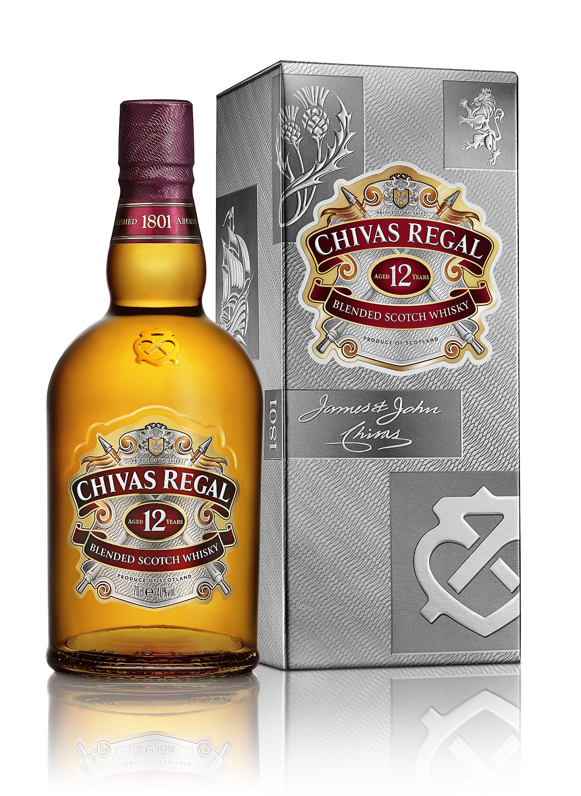

# 芝华士

芝华士（Chivas Regal）是苏格兰调和威士忌品牌，由[保乐力加](ref:producer)旗下的 Chivas Brothers 经营。品牌以 12 年、18 年等年份标识与柔顺的调和风格著称，是高端[调和威士忌](ref:blend)的代表性名字之一，也是中国市场认知度最高的[苏格兰威士忌](ref:scotch)品牌之一。

图：芝华士。图片：Chivas Holdings (IP) Limited，CC BY-SA 4.0，via Wikimedia Commons（[原图页面](https://commons.wikimedia.org/wiki/File:Chivas_image_for_wikipedia.jpg)）。

## 品牌定义

品牌、生产企业与产品是三个不同层级。芝华士是品牌，Chivas Brothers 是负责生产与品牌运营的企业实体，具体某一瓶酒则是产品。把品牌名与公司名混用，容易误以为 Chivas Brothers 只生产芝华士，或误以为所有芝华士产品都是同一配方。

芝华士不是单一麦芽威士忌，而是调和威士忌。按苏格兰威士忌的规则，调和威士忌由多家酒厂的麦芽威士忌与谷物威士忌调配而成，品牌负责选酒、调配与稳定风味。[威士忌](ref:whisky)是大类，调和只是其中一种工艺路线。

品牌名中的 Regal 意为“皇家、尊贵”，属于品牌定位语言，不是官方认证或产区等级。讨论“芝华士什么味道”，应先指明是 12 年、18 年还是无年份版本。

## 所属生产者

品牌的生产者为[保乐力加](ref:producer)。保乐力加是总部位于巴黎的跨国葡萄酒与烈酒集团，旗下同时拥有伏特加、威士忌、茴香酒与葡萄酒等业务。苏格兰威士忌部分由 Chivas Brothers 承担，芝华士是其核心调和品牌。

Chivas Brothers 在苏格兰拥有多家酒厂与调配、装瓶设施，其中一些酒厂位于斯佩塞（Speyside）产区，为调和提供麦芽原酒。品牌的原酒组合涉及不同产区与不同酒厂，因此“芝华士等于某一家酒厂”的说法并不成立。

品牌归属与生产地点需要分开看：品牌属于保乐力加，调和与装瓶由 Chivas Brothers 体系组织，具体原酒来源与产地信息通常不全部公开。消费者能直接核对的是标签上的生产商、装瓶商、酒龄标识与产地。

## 产品线

公开产品资料常见的核心系列包括芝华士 12 年、18 年与 25 年，数字代表瓶中所有原酒的最低陈年。12 年是流通与餐饮渠道的主力，18 年面向中高端礼赠与宴席，25 年定位更高端的收藏与礼赠场景。

除年份系列外，还有芝华士 Extra（不标酒龄，风味更浓）、芝华士 Mizunara（使用日本水楢桶处理或收尾的版本）以及不同市场的免税版、礼盒版与限量版。各版本的酒精度、容量、包装与在售区域会随市场调整，具体清单以品牌官网为准。

购买时应核对标签上的产品全名、酒龄标识、酒精度、容量、生产商与批次，而不是只看瓶身颜色或“皇家”字样。年份数字是最低陈年要求，不是平均酒龄，也不代表某一批原酒的实际年龄。

## 定位与价格带

品牌整体覆盖中端到高端的价格带：12 年承担日常饮用与餐饮场景，18 年上探商务宴请与礼赠，25 年及特别版面向高端收藏。价格会随市场、渠道、税率、促销与包装规格变化，本页不列具体零售价。

价格带是市场定位，不等于质量等级。调和威士忌的品质取决于原酒组合、[橡木桶陈年](ref:oak)条件与调配水平，不能仅凭年份数字或价格高低推断。免税版、礼盒版与普通流通版之间也可能存在版本差异。

对消费者而言，更实用的判断方式是先确定用途：纯饮、加冰、调酒还是送礼；再在同一用途内比较酒龄标识与口感。把“年份越高越好”当作唯一标准，会忽略调和风格与个人偏好。

## 历史

品牌叙事通常从 19 世纪初苏格兰阿伯丁（Aberdeen）的一家杂货商讲起。Chivas Brothers 经营杂货与高端食品，后来把业务扩展到威士忌；20 世纪初，芝华士以面向高端市场的调和威士忌形象出现，并借助出口与航运进入美国等市场。具体创立与上市年份，各官方品牌史的表述略有差异，应以官方资料为准。

20 世纪中期，12 年芝华士逐渐成为品牌的核心产品，年份标识与柔顺风格共同构成市场认知。此后品牌经历多次所有权与业务整合，最终随苏格兰威士忌业务进入保乐力加体系；具体交易年份与交易结构以官方披露为准。

品牌史中的“杂货商起点”“高端调和定位”“集团化”是不同层面的节点，不宜压缩成一个年份。广告、赞助与联名活动属于品牌传播，不是产品质量或年份的证明。

## 名称与标识

“芝华士”是 Chivas Regal 的中文音译，其中 Chivas 是家族姓氏，Regal 意为皇家或尊贵。中文译名不承载酒龄或等级信息；不同地区可能存在略微不同的译法，但指向同一品牌。

品牌标识包括瓶身徽章、盾牌图案、字体与配色。年份数字（12、18、25）是标签上的核心识别信息，代表最低陈年；无年份版本则以系列名与风味定位区分。徽章与“皇家”字样属于品牌视觉传统，不构成法定产区或官方认证。

仿冒产品可能复制瓶形与徽章，购买时应核对防伪标识、生产商、批次与正规渠道。中文标签上的进口商信息也值得查看，尤其是免税与跨境渠道产品。

## 常见误区

第一，把芝华士当作单一麦芽威士忌。它是调和威士忌，原酒来自多家酒厂。
第二，把 12 年当作平均酒龄。数字是瓶中所有原酒的最低陈年。
第三，把“柔顺”理解为低质或稀释。柔顺是调和目标与风味设计，不等于质量低。
第四，把“皇家”当作官方皇室认证。它是品牌命名与视觉语言。
第五，把芝华士等同于 Chivas Brothers 的全部产品。该公司还经营其他威士忌品牌与酒厂。
第六，用年份或价格直接判断品质。原酒组合、桶型与调配水平同样重要。

## 延伸阅读

- [保乐力加](ref:producer)：品牌所属生产者。
- [苏格兰威士忌](ref:scotch)：调和威士忌的法规与品类背景。
- [威士忌](ref:whisky)：威士忌的大类与基本工艺。
- [苏格兰](ref:scotland)：品牌的原产地与生产传统。
- [调和](ref:blend)：调和威士忌的基本概念。
- [橡木桶陈年](ref:oak)：陈年对风味与颜色的影响。
- [威士忌入门](ref:guide)：从品类到品饮的入门路径。

**关键事实。**

| 项目 | 内容 |
| --- | --- |
| 一句话定位 | 苏格兰调和威士忌品牌，由保乐力加旗下的 Chivas Brothers 经营；以 12 年、18 年等年份标识与柔顺的调和风格著称，是高端调和威士忌的代表性名字之一 |
| 持有公司 | 保乐力加 |
| 产区 | 苏格兰 |
| 官网 | chivas.com |
