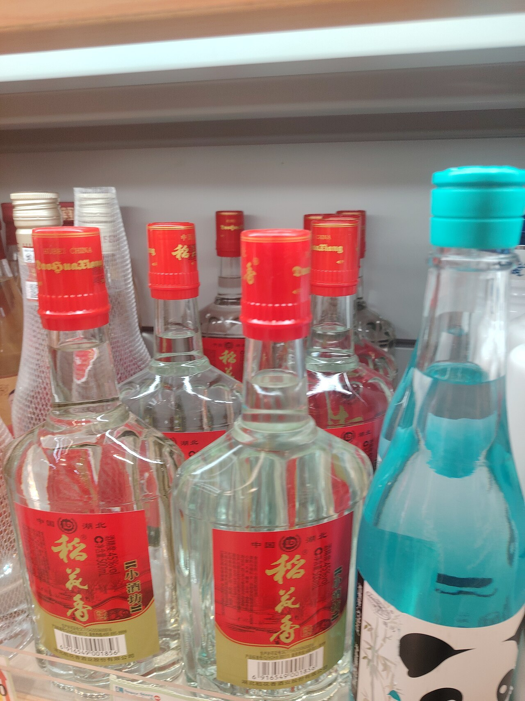

# 稻花香

稻花香是宜昌的白酒品牌，名字取自辛弃疾“稻花香里说丰年，听取蛙声一片”。它不只是一个浓香型商标：在高端有“清样”，在宴席有“活力家族”，在传统渠道有“珍品”，近年还推出“手抄件”酱香系列。品牌的产品结构，比“区域浓香”四个字复杂得多。

图：稻花香。摄影：经典装稻花香酒。署名：Lhzss8，CC BY-SA 4.0，来自 Wikimedia Commons（[来源](https://commons.wikimedia.org/w/index.php?curid=196443823)）。

## 品牌名：从宋词到货架

“稻花香”先是一个农业意象，再是一个白酒商标。宋词原句写的是夏夜稻田与丰收预期，品牌借用的是“丰年”与“乡土”的联想，而不是某种酿造工艺。理解这一点，就不会把名字里的诗意当成品质证明。

品牌名与集团名相同，是稻花香的特殊之处：集团、酒业公司与品牌共用三个字，消费者容易把集团多元化业务也算进品牌。看瓶标时，认准生产商与系列名更有效。

## 定位：区域浓香的多价位覆盖

稻花香的主体是[浓香型白酒](ref:strong-aroma)，价格从日常口粮延伸到千元以上高端，核心市场在湖北。它用多个系列分别占住宴席、礼赠、团购与乡镇市场，覆盖面广，但品牌记忆点相对分散。

## 产品线地图

公开产品中心可见四条主线：清样系列、活力家族、珍品系列、手抄件系列。清样承担高端形象，活力家族覆盖宴席与日常，珍品系列守传统流通渠道，手抄件系列以酱香风味做新尝试。

四条线不是四个独立品牌，而是同一品牌下的产品带，共同点是都使用“稻花香”主标，差异在香型、度数、包装与渠道。选购时先确定场景，再选系列。

## 清样：高端旗舰

清样是稻花香的高端旗舰，官方描述其酒体“浓头酱尾”：既有浓香的窖香浓郁、醇甜爽净，又带酱香的幽雅细腻、回味悠长。经典版酒精度 52%vol，容量 500mL，瓶型设计灵感来自曾侯乙编钟。

2024 年，企业相继推出清样鉴赏版、清样尊雅版、清样水晶版，形成“经典+鉴赏+尊雅+水晶”的高端矩阵，为整个品牌提供一个可被引用的“上限”。

## 活力家族：宴席与日常

活力家族包括活力号、活力星、活力型等产品，并有对应的升级版。命名强调“活力”，场景指向朋友聚饮、婚宴与节庆；包装多用明亮色块与大字体，货架识别度高。

这一家族是稻花香的销量基本盘，价格更接近大众宴席预算，渠道以烟酒店、乡镇超市与宴席团购为主。判断性价比，应看酒精度、容量与执行标准，而不是只看“升级版”三个字。

## 珍品系列：传统渠道

珍品系列包括珍品 1 号、珍品小 1 号、新珍品等，命名带有明显的“编号+珍品”特征。它承担的是传统流通渠道与熟人社会的礼赠需求，包装更偏正式，价格带介于活力家族与清样之间。

“1 号”“小 1 号”是产品名，不是等级编号，也没有行业统一的排序含义。不同年份、不同渠道可能出现相似命名，购买时应核对生产商、酒精度与批次。

## 手抄件：酱香尝试

手抄件系列是稻花香近年的新动作，公开可见酱香 15、酱香 10、酱香 5 等产品。数字通常对应产品档位或基酒年份表达，而不是法定等级；具体含义以瓶标与官方说明为准。

从浓香跨到酱香，说明企业希望在酱香热潮中占一个位置；但两条线的工艺与风味差异很大，判断手抄件仍要回到酱香型标准与标签。

## 风味与饮用场景

稻花香的浓香主线以窖香、粮香与甜香为主，入口较顺，回味带粮甜；清样因“浓头酱尾”而更复杂，适合慢饮与礼赠；活力家族更强调入口友好，适合宴席多人共饮；手抄件则偏酱香的幽雅与回味。

风味描述是感官概括，不是质量等级。同一系列不同度数、不同批次都可能有差异。真正可核对的是瓶标上的香型、酒精度、容量、执行标准与生产日期。

## 包装与视觉符号

稻花香的包装策略是“主标统一、系列分区”：主标保留书法字与稻穗意象，清样用编钟造型与深色礼盒，活力家族用亮色与大字体，珍品系列用金色与对称构图。视觉差异帮助消费者在货架上快速分区，但礼盒越大、金色越多，不等于酒体越好。

## 渠道与营销

稻花香的渠道以湖北为核心，宜昌是根据地，武汉与鄂西城市群是重点；省外以经销商扩张为主。营销动作集中在经销商年会、春季糖酒会、宴席推广与终端陈列，强调“家乡酒”和“丰年”意象。2025 年经销商年会发布 5 大系列 15 款新产品，说明企业在用“多系列+多新品”维持渠道热度。

## 荣誉与消费者认知

稻花香在湖北拥有较高的本土认知度，常被视为“宜昌名片”与“鄂西名酒”，优势来自长期渠道深耕与宴席场景。省外消费者对她的认知，则更多停留在“湖北酒”这一层。

## 与生产者的边界

[生产企业](ref:producer)负责酿造、产能、股权与财报；品牌负责名称、系列、价格带与消费者沟通。集团还有包装、物流等业务与其他白酒品牌，这些都不属于“稻花香”品牌的产品线。

## 选购辨识

第一步看生产商是否为湖北稻花香酒业股份有限公司；第二步看香型与酒精度；第三步看执行标准与容量；第四步看系列名与批次。浓香型产品可对照 GB/T 10781.1，酱香型产品则应对应酱香型标准。

宴席场景可优先看活力家族，礼赠场景可看清样与珍品，尝鲜场景可看手抄件。无论哪种场景，正规渠道与防伪查验都优先于“内部价”“特供”等说法。

## 常见误解

第一，把“稻花香”只当成一个浓香产品。品牌下还有酱香型的手抄件。
第二，把“清样”当成香型。它是系列名，风格是“浓头酱尾”。
第三，把“1 号”“小 1 号”当成等级。它们是产品名。
第四，把宋词出处当成品质证明。名字只是文化叙事。

## 延伸阅读

- [湖北稻花香酒业](ref:producer)：品牌背后的企业与集团结构。
- [湖北](ref:hubei)与[中国](ref:china)：品牌的地域与市场背景。
- [白酒](ref:baijiu)与[浓香型白酒](ref:strong-aroma)：品牌的主赛道。
- [制曲](ref:qu-making)：浓香型风格形成的关键环节。
