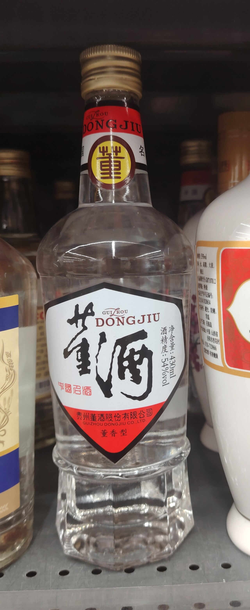

# 董酒

董酒是贵州遵义董公寺的董香型白酒品牌，由[贵州董酒股份有限公司](ref:producer)持有。董香型又称药香型，以百草入曲、大小曲串蒸与双窖发酵为工艺特征，代表产品包括国密董酒与国密佰草香。

图：董酒。图片：Lhzss8，CC BY-SA 4.0，via Wikimedia Commons（[原图页面](https://commons.wikimedia.org/wiki/File:%E4%B8%80%E7%93%B6%E7%BB%8F%E5%85%B8%E8%A3%85%E8%91%A3%E9%85%92.jpg)）。

## 品牌定义

董酒的品牌层要与企业层分开：品牌回答产品名称、系列与市场定位，生产者回答商标持有、生产组织与法律责任。董酒既是公司简称也是品牌名，国密与佰草香等系列各有基酒构成，不能笼统比较。

品牌也不等于单一产品。同一品牌下可以有多个系列、不同度数、不同容量与不同价格带，讨论“董酒什么味道”时，要先指明具体产品，因为国密系列与佰草香系列的基酒构成并不相同。

## 所属生产者

品牌的生产者为[贵州董酒股份有限公司](ref:producer)，位于遵义市汇川区董公寺。企业于 1994 年注册为股份有限公司，此后经过重组，2007 年起推动生产与品牌的恢复性建设。

生产者条目记录了注册信息、厂区位置与地方标准等细节。本页只保留与品牌直接相关的部分，避免把企业史与产品史混为一谈。

## 产品线

公开产品资料列出国密董酒、特级国密、国密佰草香与密藏经典董等系列。国密系列是流通与礼赠的主力，特级国密定位更高，佰草香系列自 2018 年上市后成为品牌恢复市场的重要产品，密藏系列侧重贮存与收藏表达。

产品页对工艺的描述包括：制曲时加入多种本草，双曲双窖，长期发酵，并以不同年份的原酒勾调。部分表述（如配方与工艺属于国家秘密技术）属于企业公开说法，本页照录其品牌主张，但不把营销表述当作独立可核查的技术结论。

产品线的度数、容量、包装与执行标准会随年份调整。购买时应核对瓶身标签上的生产商、酒精度、净含量与执行标准，而不是只看系列名。

## 定位与价格带

品牌整体覆盖从中端到高端的价格带：密藏与常规国密系列承担宴席与日常礼赠，特级国密与佰草香上探高端礼赠与收藏。价格会随年份、渠道与促销变化，本页不给出具体零售价，避免把某一次促销价当作长期定位。

董酒的价格带只是市场定位，不等于质量等级。判断酒体应看原料、制曲、发酵、贮存与标签标准，而不是只看价格或包装。

## 历史

董酒的现代史节点较清楚：1957 年恢复生产，1959 年获评贵州名酒，1963 年入选中国老八大名酒。这三步奠定了它在董香型中的代表地位，也让“董香”从地方风味变成可被行业讨论的香型类别。

2008 年，贵州地方标准把董酒确定为董香型的代表，香型名称与产品之间建立了更明确的对应关系。企业此后经历重组，2007 年起重建生产与文化叙述，2018 年以佰草香上市为标志恢复全国市场拓展，2021 年启动扩建工程。这些是企业公开的历程节点，与瓶中酒龄无关。

## 名称与标识

“董酒”得名于产地董公寺，“董”既是地名，也成了香型名称的来源。董香型又称药香型，两种叫法指向同一类风格，但“药香”容易被误解为药酒，需要区分：董酒是白酒，本草参与制曲，不是把药材浸泡在酒里。

购买时要核对商标、生产商、防伪标识与批次信息。市场上存在相似命名与仿冒包装，仅凭瓶形或“董”字判断并不可靠。

## 常见误区

第一，把董香型当成药酒或保健酒。它属于白酒，本草用于制曲，不是浸泡药材。
第二，把品牌与股份公司混为一谈。品牌是市场标识，公司是法律主体。
第三，把 1957 年恢复生产当作品牌创立年份。此前还有作坊与早期生产的历史。
第四，把“国家秘密配方”当作可独立核查的技术结论。这是企业公开的品牌表述。
第五，把价格当作质量等级。价格是市场定位，不是工艺标准。

董酒的辨识点不在“百草”二字，而在制曲与串蒸的组合：大小曲并用、草本入曲、双醅串蒸，使药香与酯香同时出现。读产品线时要区分国密与佰草香等系列的定位，不能把“董香型”当成质量等级；恢复生产、名酒评选与地方标准是三条不同的时间线，也不等于瓶中酒龄。董香型的“药香”来自草本参与制曲，不是把药材浸泡在酒里；这两件事在法规与工艺上完全不同。读产品时还要区分品牌主张、地方标准与瓶中酒龄，避免把企业叙事当成可独立复核的技术结论。

对照阅读：[贵州董酒股份有限公司](ref:producer)、[白酒](ref:baijiu)。

## 延伸阅读

- [贵州董酒股份有限公司](ref:producer)：生产者条目。
- [贵州](ref:guizhou)：遵义产区的背景。
- [白酒](ref:baijiu)：董酒所属的大类。
- [制曲](ref:qu-making)与[高粱](ref:sorghum)：董香工艺的原料与起点。

**关键事实。**

| 项目 | 内容 |
| --- | --- |
| 一句话定位 | 贵州遵义董公寺的董香型（药香型）白酒品牌，由贵州董酒股份有限公司持有；以百草入曲、大小曲串蒸与双窖发酵为工艺特征，代表产品包括国密董酒与国密佰草香 |
| 持有公司 | 贵州董酒股份有限公司 |
| 产区 | 贵州省 |
| 官网 | chinadongjiu.com |

**来源与边界。** 本页关于「董酒」的关键事实，主要由以下来源交叉核对：贵州董酒股份有限公司（厂区位置、董香型定位、2007 年重组与 2018 年佰草香上市；1957 年恢复生产、1959 年贵州名酒、1963 年中国八大名酒与 2008 年董香型地方标准）、国家市场监督管理总局、国家标准化管理委员会（白酒与串蒸相关术语）。产品、地址或营业状态变化较快时，以 chinadongjiu.com 的最新页面为准；价格、批次与状态会变，涉及这些字段时以页面所列来源的最新版本为准。正文为项目自写，来源只作核验，不复制原文。

**并读。** 把「董酒」与「贵州董酒股份有限公司」、「贵州省」、「白酒」放在一起读时，先确认它们是同一层级还是上下游关系：先确认品牌归属与核心产品，再比较产区、工艺与价格带。本页负责给出品牌的基本坐标，对照条目补上具体案例与差异；读完再回到本页，才能分清哪些差别属于品牌本身，哪些只是产地、批次或品牌选择。
