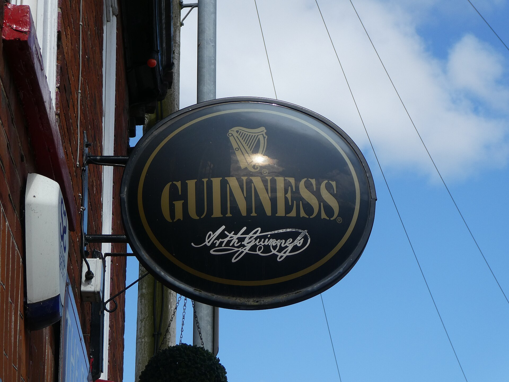

# 健力士

健力士（Guinness）是源自爱尔兰都柏林的啤酒品牌，以深色世涛著称，现由[帝亚吉欧](ref:producer)持有。品牌以圣詹姆斯门（St. James's Gate）酒厂、烘焙大麦带来的深色酒体与氮气泡沫口感为人熟知，是[世涛](ref:stout)品类最具代表性的名字之一，也是[啤酒](ref:beer)世界中辨识度最高的品牌之一。

图：健力士相关实景照片。图片：Sebastiandoe5，CC BY-SA 4.0，via Wikimedia Commons（[原图页面](https://commons.wikimedia.org/wiki/File:Guinness_Pub_Sign.jpg)）。

## 品牌定义

品牌、酒厂与品类是三个层面。健力士是品牌，世涛是啤酒的一个风格，“黑啤”只是中文口语里对深色啤酒的笼统称呼。把三者混为一谈，会得出“所有深色啤酒都是健力士”或“健力士只有一种产品”的错误结论。

同一品牌下有多个产品：面向餐饮与酒吧的生啤风格版本、面向零售的听装或瓶装版本、酒精度更高的出口版本，以及无酒精版本。它们的配方、酒精度、杀菌方式与包装并不相同，讨论“健力士什么味道”时，应先说明是哪一种产品。

品牌也不等于某一处酒厂。健力士在爱尔兰有历史悠久的圣詹姆斯门酒厂，同时在多个国家授权或设厂生产；具体一瓶酒的产地、生产商与授权关系，应以标签信息为准。

## 所属生产者

品牌的生产者为[帝亚吉欧](ref:producer)。帝亚吉欧是总部位于伦敦的跨国酒类集团，1997 年由健力士与格兰德大都会合并而成，健力士本身就是这次合并的一方。集团业务覆盖威士忌、伏特加、金酒、利口酒与啤酒，健力士是其啤酒板块的核心品牌。

集团负责品牌战略、全球分销与资本运作，具体酿造由爱尔兰及其他地区的酒厂与授权生产方承担。标签上的“生产商”“产地”与“进口商”是判断实际来源的直接依据；同一品牌在不同市场可能由不同主体灌装或分销。

需要区分“品牌归属”与“酿造地点”：品牌属于帝亚吉欧，不代表每一瓶都在都柏林酿造。授权生产在啤酒行业十分常见，产地差异会影响水质、原料与新鲜度，但品牌仍通过统一标准维持风味识别。

## 产品线

公开产品资料常见的版本包括：健力士生啤风格（Guinness Draught），以氮气辅助形成细密泡沫与顺滑口感，零售端常用带氮气装置的听装；健力士原味或特级世涛（Original／Extra Stout），风味更直接；健力士出口世涛（Foreign Extra Stout），面向部分市场，酒精度与风味强度更高；以及无酒精版本（Guinness 0.0），面向不饮酒或需要控制酒精摄入的消费者。

不同市场的命名、酒精度、容量与包装存在差异。氮气版本强调的是泡沫质地与入口感，而不是“更烈的酒”；出口版本则更强调浓度与耐运输性。产品线会随市场调整，具体在售清单以品牌官网与当地渠道为准。

购买时应核对标签上的产品名称、酒精度、容量、生产商、产地与保质期，而不是只凭颜色深浅判断。深色来自烘焙大麦与配方，不直接等于酒精度高或苦度高。

## 定位与价格带

品牌整体处于大众到中端的价格带：生啤风格版本是酒吧与餐饮渠道的常客，听装与瓶装版本覆盖零售与家庭场景，出口版本与特别版偏中高端，无酒精版本则面向新的消费需求。价格会随国家、渠道、税率、促销与包装规格变化，本页不列具体零售价。

价格带是市场定位，不等于质量等级。啤酒的新鲜度、原料、发酵与灌装条件对风味影响很大；同一品牌在不同市场、不同批次之间也可能有差异。把“进口”或“高价”直接等同于更好喝，并不成立。

对消费者而言，更实用的判断方式是看用途与场景：佐餐、聚会、独饮还是调酒；再比较标签上的酒精度、容量、产地与保质期。酒吧现打与听装版本的口感差异，部分来自气压、温度与泡沫结构，而不只是配方。

## 历史

品牌历史通常从 18 世纪中叶讲起：阿瑟·健力士（Arthur Guinness）在都柏林租下圣詹姆斯门酒厂，以长期租约经营，具体年份与租约细节以官方品牌史为准。18 至 19 世纪，波特（porter）与世涛（stout）在英国与爱尔兰的啤酒市场中发展，健力士逐渐从地方酒厂成长为跨市场品牌。

19 世纪至 20 世纪，铁路、航运与出口把健力士带到欧洲大陆、北美与更多地区；酒厂也经历过工艺、规模与所有权的多次调整。1997 年健力士与格兰德大都会合并为帝亚吉欧，品牌进入跨国集团体系。都柏林的圣詹姆斯门酒厂后来发展出面向公众的参观与体验业务，但参观业务与啤酒生产是两件事。

品牌史中的“租下酒厂”“世涛品类形成”“集团合并”是不同层面的节点，不能压缩为一个年份；品牌故事里的广告与文化活动，也不构成产品质量认证。

## 名称与标识

“健力士”是 Guinness 的常见中文译名，源自粤语区的音译传统，大陆市场也广泛使用。品牌名来自创始人姓氏，不指产地或品类。中文里另有“吉尼斯”的译法，多用于《吉尼斯世界纪录》，那是一项纪录业务，与啤酒产品不是同一件事，尽管其名称同样源自健力士家族与公司。

品牌标识包括竖琴图案、黑金配色、字体与罐装结构。竖琴是爱尔兰的传统象征，健力士长期将其作为商标元素；黑金配色与深色酒体共同构成货架识别。仿冒产品可能复制配色与字体，购买时应核对生产商、防伪标识、批次与正规渠道。

“黑啤”是中文口语标签，不等于健力士的法定分类；健力士的产品在标签上通常以 stout、draught 等名称出现。把中文俗称当作产品名，容易在选购时买错版本。

## 常见误区

第一，把健力士等同于所有深色啤酒。它只是世涛品牌之一，其他酒厂也生产深色啤酒。
第二，把颜色深当作更苦或更烈。颜色来自烘焙大麦，苦度与酒精度要看配方与标签。
第三，把《吉尼斯世界纪录》当作健力士的产品。纪录业务与啤酒业务各自独立。
第四，认为所有市场的健力士配方相同。出口版本、当地授权版本与生啤版本存在差异。
第五，把爱尔兰品牌当作所有产品的产地。授权生产与海外灌装很常见，应以标签为准。
第六，把氮气泡沫当作“加了氮气所以更烈”。氮气主要影响泡沫质地与入口感。

## 延伸阅读

- [帝亚吉欧](ref:producer)：品牌所属生产者。
- [啤酒](ref:beer)：啤酒的大类、原料与基本工艺。
- [世涛](ref:stout)：健力士所属的啤酒风格。
- [爱尔兰](ref:ireland)：品牌的原产地与啤酒传统。
- [如何读标签](ref:label-guide)：核对酒精度、产地与生产商的方法。
