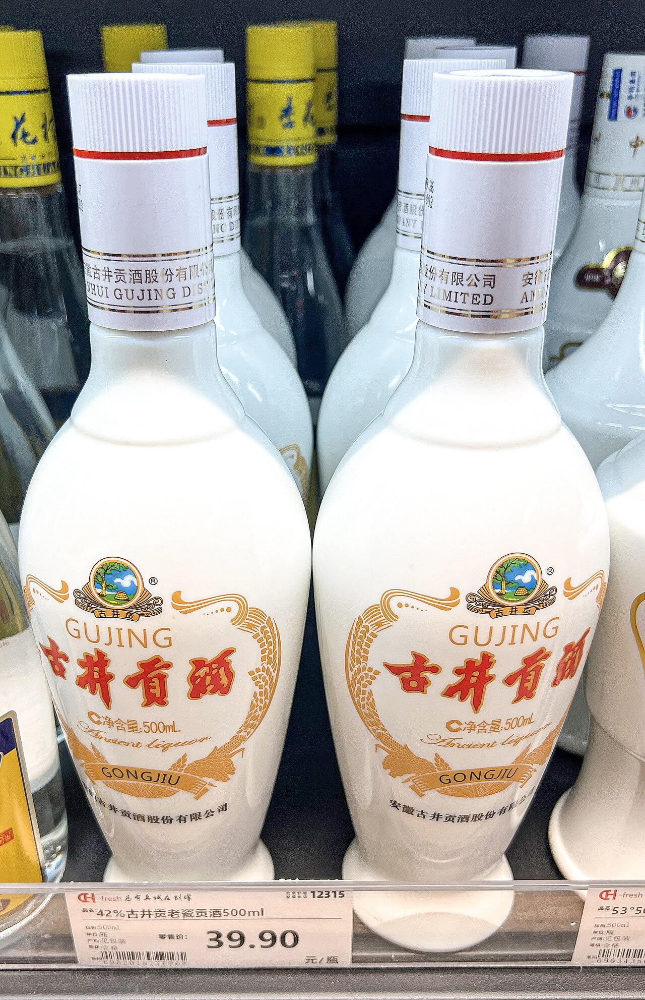

# 古井贡酒

古井贡酒产自[安徽亳州](ref:bozhou)，由[安徽古井贡酒股份有限公司](ref:producer)生产，是[浓香型白酒](ref:strong-aroma)品牌，以“年份原浆”系列最为知名。其酿造使用当地水源、泥窖固态发酵和续糟配料，产品覆盖 40%–52% vol 等不同度数。

图：古井贡酒。图片：N509FZ，CC BY-SA 4.0，via Wikimedia Commons（[原图页面](https://commons.wikimedia.org/wiki/File:Gujing_Gongjiu_at_a_supermarket_in_Beijing_(20241109164639).jpg)）。

## 定义与定位

古井贡酒是品牌名称，属于[白酒](ref:baijiu)中的浓香型路线。品牌由生产企业持有，具体产品则是另一层级：品牌回答“叫什么”，企业回答“谁在生产”，产品回答“这一瓶是什么”。

“贡酒”二字属于历史叙事与品牌命名，不宜直接当作可核实的历史事实。常见的说法与曹操、汉代进贡有关，但细节在不同资料中并不一致；本页只把它作为品牌名称的来源背景，不作为年代证据。生产企业的上市与经营信息，可在生产者页核对。

## 产区与环境

亳州位于安徽西北、淮北平原，涡河穿境，属暖温带半湿润季风气候，冬季寒冷干燥、夏季高温多雨。古井镇是核心产地，当地水源与窖池环境构成酿造的基础条件。产区页对地理与产业有更完整的说明。

气候影响制曲与发酵：冬季低温有利于控制发酵速度，夏季高温考验车间降温与卫生。亳州同时是中药材集散地，药业与酒业并存，产业配套与物流条件也影响生产组织。产区不是单一因素，而是气候、水、原料与长期实践的叠加。

## 原料与制曲

主要原料是高粱，制曲用小麦，部分产品加入大米、糯米、玉米等。浓香型强调多粮或单粮的不同路线，原料配比会影响香气结构。高粱的淀粉含量、颗粒完整度与蒸煮程度，决定发酵启动与出酒率。

制曲是风味的重要来源。浓香型多用中高温大曲，曲的微生物组成影响窖香与粮香。曲房温度、湿度与翻曲时间属于企业工艺，公开信息有限；标签上的原料表与执行标准，是消费者可直接核对的信息。

## 「古井贡酒」怎么做出来
典型流程是：原料粉碎、润料、蒸煮、摊凉、加曲、入窖发酵、出窖蒸馏、分级贮存、勾调与装瓶。浓香型采用泥窖固态发酵，窖池的连续使用与“续糟配料”使微生物环境逐步稳定，窖龄与养护影响风味。

蒸馏时分段摘酒，头段与尾段分开，中段作为主要基酒。新酒按等级贮存，再通过勾调统一风格。勾调不是简单加水降度，而是不同等级、不同酒龄基酒的比例组合；降度用水需处理，避免引入异味。

## 「古井贡酒」的闻与喝
古井贡酒通常表现为窖香、粮香和甜香并重，入口绵甜，酒体较柔和，尾味干净。不同系列和度数之间的差异明显，不能用一个风味描述覆盖全部产品。高度版本酒精刺激更强，低度版本更柔和。

品鉴时用小杯，先闻窖香是否干净、是否有明显杂味，再小口感受入口的甜感与酒体厚度。加水能降低刺激并打开香气，但会改变结构；加冰不是传统方式。与川派浓香比较时，应注意窖香强度与口感取向的差异。

## 产品体系与标签

“年份原浆”是产品系列名称，不等于瓶中每一滴酒的实际年份。具体年份标识、基酒比例和调味酒信息，应以产品标签和企业公开说明为准。系列内的不同产品在度数、容量与价格上差异明显。

核对古井贡酒时，应把生产商、香型、酒精度、执行标准与净含量五项对齐，再查批次。古井贡酒的仿冒风险多集中在近似商标、同名系列与礼盒改包，购买时应通过正规渠道并核对防伪。不同渠道的产品版本与礼盒装，也应在标签上核对生产信息，价格与包装不等于品质。

## 「古井贡酒」的饮用与搭配
适合小杯纯饮，常见于宴席与礼赠场景。搭配徽菜、卤味、烧鸡与牛羊肉较合适；重辣会放大酒精刺激，品鉴前应避免。低度产品开瓶后不宜久放，高度产品也应避光、阴凉保存。

用于调制时，高度酒会显著改变配方平衡，需要重新调整糖与酸。宴席上的劝酒习惯不等于品鉴标准，饮酒应适量，避免空腹快速饮用。驾车或服药期间不应饮酒。

## 「古井贡酒」容易被读错的地方
第一，把“年份原浆”当作每一滴酒的实际酒龄。它是产品系列名称。
第二，认为“贡酒”是可核实的历史年代。它更多是品牌叙事。
第三，把古井贡酒等同于整个亳州产区。它只是代表品牌之一。
第四，认为度数越高越正宗。度数服务于产品设计。
第五，用包装或价格判断真伪。防伪、渠道与标签核对才可靠。

对照阅读：[安徽古井贡酒股份有限公司](ref:producer)、[白酒](ref:baijiu)。

**关键事实。**

| 项目 | 内容 |
| --- | --- |
| 一句话定位 | 产自安徽亳州的浓香型白酒品牌，以“年份原浆”系列知名，产品覆盖多个酒精度 |
| 持有公司 | 安徽古井贡酒股份有限公司 |
| 产区 | 亳州市 |
| 官网 | gujing.com |

**来源与边界。** 本页关于「古井贡酒」的关键事实，主要由以下来源交叉核对：安徽古井集团有限责任公司（产地、产品系列与企业公开信息）、国家市场监督管理总局、国家标准化管理委员会（浓香型白酒与续糟配料等术语；白酒在饮料酒分类中的位置）、Oxford University Press（提供关于中国白酒与浓香风格的条目；由原条目末尾参考资料迁移，未逐条复核访问日期）。产品、地址或营业状态变化较快时，以 gujing.com 的最新页面为准；价格、批次与状态会变，涉及这些字段时以页面所列来源的最新版本为准。正文为项目自写，来源只作核验，不复制原文。

**并读。** 把「古井贡酒」与「安徽古井贡酒股份有限公司」、「亳州市」、「白酒」放在一起读时，先确认它们是同一层级还是上下游关系：先确认品牌归属与核心产品，再比较产区、工艺与价格带。本页负责给出品牌的基本坐标，对照条目补上具体案例与差异；读完再回到本页，才能分清哪些差别属于品牌本身，哪些只是产地、批次或品牌选择。

## 参考资料
- [安徽古井贡酒股份有限公司](ref:producer)：生产企业身份与上市信息。
- [亳州市](ref:bozhou)：产区地理、产业与参访地点。
- [白酒](ref:baijiu)：白酒的大类与香型体系。
- [浓香型白酒](ref:strong-aroma)：窖池、续糟与风味框架。
