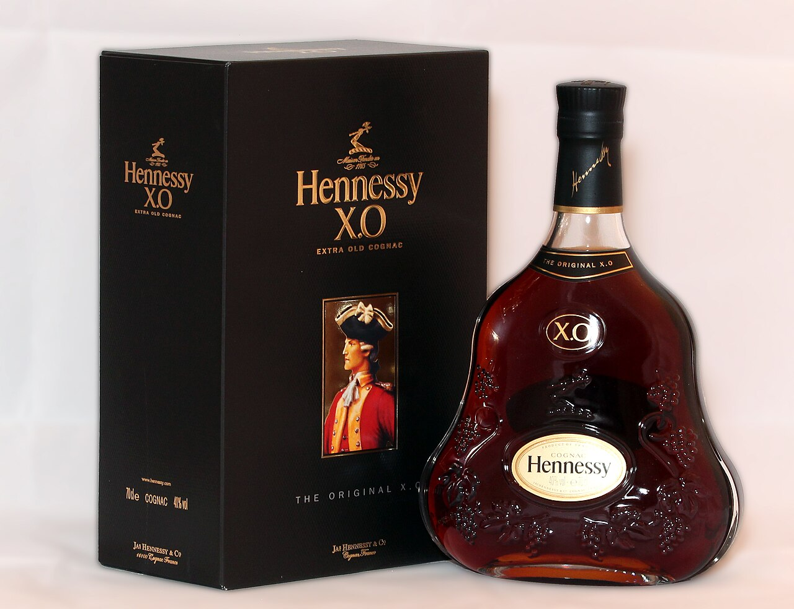

# 轩尼诗

轩尼诗（Hennessy）是法国干邑品牌，由[路威酩轩](ref:producer)（LVMH）旗下的酩悦轩尼诗（Moët Hennessy）经营。品牌以 VS、VSOP、XO 等干邑等级与长期陈酿的调和原酒著称，是[白兰地](ref:brandy)中干邑产区的代表性品牌之一，也是中国市场认知度最高的进口烈酒品牌之一。

图：轩尼诗。图片：Dmitrij Rodionov，CC BY-SA 4.0，via Wikimedia Commons（[原图页面](https://commons.wikimedia.org/wiki/File:Hennesy_XO_close.jpg)）。

## 品牌定义

品牌、产区与等级是三个不同概念。轩尼诗是品牌，干邑（Cognac）是受原产地保护的法国葡萄蒸馏酒产区与品类，VS、VSOP、XO 是干邑的等级标识。把品牌名当作品类名，会得出“所有干邑都是轩尼诗”的错误结论。

干邑必须是法国干邑地区生产、以葡萄为原料、经[蒸馏](ref:distillation)并在橡木桶中陈年的烈酒，受原产地命名规则约束。轩尼诗是这一产区内的酒庄与品牌，不是产区的同义词；其他酒庄也在同一产区生产干邑。

品牌下有不同等级与不同系列，它们的原酒组合、最低陈年、包装与定位不同。讨论“轩尼诗什么味道”，应先说明是 VS、VSOP、XO 还是更高端的系列。

## 所属生产者

品牌的生产者为[路威酩轩](ref:producer)。路威酩轩是总部位于巴黎的法国奢侈品集团，酒类业务由子公司酩悦轩尼诗承担，涵盖香槟、葡萄酒、干邑与威士忌等。轩尼诗是酩悦轩尼诗干邑板块的核心品牌。

集团负责品牌战略、全球分销与资本运作，干邑的生产、陈酿与调配则由品牌在法国干邑地区的酒庄、酒窖与调配体系承担。消费者能直接核对的是标签上的生产商、产地、等级、酒精度与进口商信息。

需要区分“品牌归属”与“生产地点”：品牌属于路威酩轩，生产与陈酿集中在法国干邑地区，但不同市场的包装、容量、中文标签与礼盒版本可能不同。品牌归属不改变干邑的产区法规。

## 产品线

公开产品资料常见的等级系列包括 VS（Very Special）、VSOP（Very Superior Old Pale）与 XO（Extra Old），数字与字母对应不同的最低橡木桶陈年要求，具体年限由干邑行业规则规定并以官方说明为准。更高端的系列如 Paradis 面向收藏与顶级礼赠。

除等级系列外，还有艺术家联名、生肖版、周年纪念版与免税渠道版本。各版本的酒精度、容量、包装与在售区域会随市场调整；同一等级在不同市场的版本也可能不同。产品线以品牌官网与当地渠道为准。

购买时应核对标签上的等级字母、酒精度、容量、产地、生产商与批次，而不是只看瓶形或颜色。等级字母代表最低陈年要求，不代表单一年份，也不代表瓶中所有原酒的实际年龄。

## 定位与价格带

品牌整体覆盖从主流到高端的价格带：VS 常用于调酒与入门场景，VSOP 是流通与餐饮渠道的主力，XO 面向高端宴请与礼赠，Paradis 等系列定位顶级收藏。价格会随市场、渠道、税率、促销与包装规格变化，本页不列具体零售价。

价格带是市场定位，不等于质量等级。干邑的品质取决于葡萄来源、[蒸馏](ref:distillation)方式、[橡木桶陈年](ref:oak)条件与调配水平，不能仅凭等级字母或价格推断。礼盒版、免税版与普通流通版之间也可能存在版本差异。

在中国市场，干邑常与宴席、商务礼赠和节庆场景关联，这种消费场景会影响价格与包装设计，但不改变产品的法定等级。判断一瓶酒，仍应回到标签与产区规则。

## 历史

品牌叙事通常从 18 世纪讲起：爱尔兰裔军官理查德·轩尼诗（Richard Hennessy）在法国干邑地区创立酒庄，具体年份以官方品牌史为准。此后家族经营逐步扩展到欧洲与其他市场，干邑的出口贸易与航运网络推动了品牌国际化。

20 世纪，轩尼诗与香槟酒商酩悦（Moët & Chandon）等业务整合，形成酩悦轩尼诗；1987 年路威酩轩成立后，酒类业务归入这一奢侈品集团体系。品牌在亚洲市场的增长，特别是中国宴席与礼赠需求，成为其全球业务的重要组成部分。

品牌史中的“酒庄创立”“与酩悦整合”“归入路威酩轩”是不同层面的节点，不宜压缩成一个年份。广告、联名与赛事活动属于品牌传播，不构成质量或等级认证。

## 名称与标识

“轩尼诗”是 Hennessy 的中文音译，品牌名来自创始人姓氏，不指产区或等级。中文译名在各地基本统一，英文常以 Hennessy 单独出现；“Cognac”是品类名，不是品牌名的一部分。

品牌标识包括家族徽记、字体、瓶形与等级标签。等级字母是核心识别信息：VS、VSOP、XO 各自对应不同的最低陈年要求；标签上还可能标注产区、酒精度、容量与批次。徽记与配色属于品牌视觉传统，不构成法定等级。

仿冒产品可能复制瓶形与徽记，购买时应核对防伪标识、生产商、批次与正规渠道。中文标签上的进口商与经销商信息也值得查看，尤其是礼盒与免税渠道产品。

## 常见误区

第一，把轩尼诗等同于所有干邑。它是干邑产区内的一家品牌，其他酒庄也生产干邑。
第二，把 XO 当作单一年份酒。XO 是等级，代表最低陈年要求，不是某一年的年份酒。
第三，把 VSOP 当作比 VS 更甜。等级与甜度无关，差异主要来自陈年与调配。
第四，把干邑等同于所有白兰地。干邑是受原产地保护的白兰地子类，其他白兰地不受同一规则约束。
第五，把中文译名差异当作不同品牌。轩尼诗是统一译名，英文 Hennessy 指向同一品牌。
第六，用等级或价格直接判断品质。原酒来源、陈年条件与调配水平同样重要。

## 延伸阅读

- [路威酩轩](ref:producer)：品牌所属生产者。
- [白兰地](ref:brandy)：白兰地的大类与基本工艺。
- [法国](ref:france)：干邑的产区背景。
- [橡木桶陈年](ref:oak)：陈年对干邑风味与颜色的影响。
- [蒸馏](ref:distillation)：葡萄蒸馏酒的关键工艺。
- [第一次品鉴](ref:guide)：从观色、闻香到入口的入门方法。

**关键事实。**

| 项目 | 内容 |
| --- | --- |
| 一句话定位 | 法国干邑品牌，由路威酩轩旗下的酩悦轩尼诗经营；以 VS、VSOP、XO 等干邑等级与长期陈酿的调和原酒著称，是干邑产区最具代表性的品牌之一 |
| 持有公司 | 路威酩轩 |
| 产区 | 法国 |
| 官网 | hennessy.com |
