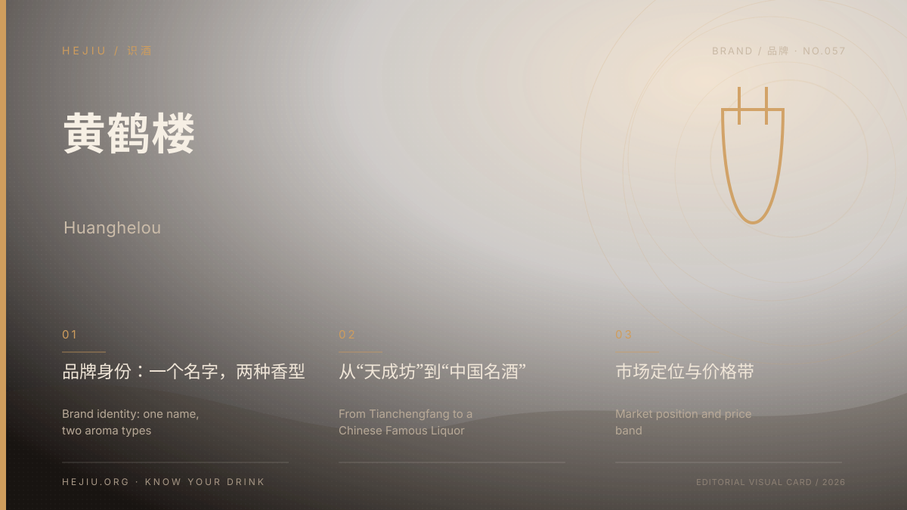

# 黄鹤楼

黄鹤楼是武汉的白酒品牌，由[黄鹤楼酒业](ref:producer)持有。它的特殊之处在于：品牌名下既有以“南派大清香”为旗号的清香型产品，也有标注为浓香型的“更上层楼”，还有以年份命名的陈香系列。买一瓶黄鹤楼，首先要确认的不是企业背景，而是瓶标上的香型与系列。

图：黄鹤楼栏目示意图。项目自产或类别插图，用于中国酒文化语境，不是该对象的实拍。

## 品牌身份：一个名字，两种香型

“黄鹤楼”三个字同时是地名、楼名与商标。作为品牌，它并不等同于某一种香型。[清香型](ref:light-aroma)是历史主线，来自武汉酒厂的汉汾工艺；浓香型产品则服务于更广的宴席市场。两条线共用品牌与渠道，却在工艺与风味上各自成立。

## 从“天成坊”到“中国名酒”

企业官网把品牌源头追溯到公元 223 年的“酒醉水淋群臣”，以及 1898 年张之洞进献御酒、赐名“天成坊”。这两段属于企业叙事，适合解释“天成坊”等产品名的来历，不宜当作独立史料。

可核对的时间轴从 1952 年国营武汉酒厂开始：1979 年产量突破一万吨；1984 年第四届全国评酒会获“中国名酒”称号；1989 年第五届蝉联；2011 年获“中华老字号”；2017 年获“中国驰名商标”；2024 年入选湖北省级非遗名录。品牌今天讲的“老名酒复兴”，支点就在这里。

## 市场定位与价格带

黄鹤楼的主力价格带集中在宴席与礼赠，向上由楼系列、陈香年份款承担形象，向下由生态原浆与更上层楼覆盖日常聚饮。公开资料没有统一的全国指导价，实际成交价随区域、渠道与促销波动，本文不写具体价格。

与同省的稻花香、白云边相比，黄鹤楼的差异化在于“清香名酒”的历史标签；与北方清香品牌相比，它又带有明显的武汉地域色彩。

## 南派大清香：清香主线

南派大清香是品牌当前的战略主线，官方表述强调其传承百年汉汾酒酿造工艺，风格被概括为“清净柔，丰满楼”。产品以高粱、大麦、豌豆等为原料，采用低温大曲与清蒸清烧路线，[制曲](ref:qu-making)与发酵环境的洁净度直接影响香气是否纯正。

“南派”二字是相对于山西清香而言：同样的清蒸清烧，在武汉的温湿气候下会呈现更柔和的入口与更饱满的酒体。它不是国家标准里的独立香型，而是企业的风格命名。

## 陈香系列：年份命名的产品带

陈香系列以年份数字命名，官网可见陈香 1952、陈香 1979、陈香 1989、陈香 1999 等单品。数字对应品牌史上的关键年份，而不是瓶贮年份；它表达的是“向历史节点致敬”，不能理解为酒龄。

该系列的口感描述集中在“香气更优雅、入口更绵柔、回味更顺爽”。官网系列页没有逐款标注香型，购买时应以瓶标为准；把年份数字当成陈酿年限，是这一系列最常见的误读。

## 生态原浆：宴席场景

生态原浆的官方定位是喜宴用酒，强调“品质、口感、包装”三大升级，以及“更香柔、不上头”的饮用体验。它的命名把“生态”与“原浆”两个词放在一起，前者指向原料与环境，后者指向不加水勾调的工艺表达。

需要说明的是，“原浆”在白酒行业没有统一的法定定义，不同企业的用法并不一致。判断一款酒，仍要看执行标准、酒精度与生产商。

## 楼系列与更上层楼

楼系列以“楼”命名，公开可见楼 20、楼 16 等单品，承担名酒形象与礼赠场景，官方称其远销海外。“更上层楼”则是一款标注为浓香型的产品，原料为水、高粱、糯米、大米、小麦、玉米，酒精度 52%vol 与 38%vol，容量 500ml。

同一品牌下出现清香与浓香两种标注，正好说明“品牌不等于香型”。选购时先看瓶标的“香型”一栏，再判断它属于哪条产品线。

## 包装与视觉符号

黄鹤楼的包装大量使用楼阁、江城水波与书法字体，礼盒常以红、金为主色，强调“武汉名片”与“名酒礼赠”。这类符号强化地域识别，也容易让人把包装档次当成酒体档次。

## 渠道与营销

品牌以湖北为根据地，武汉及周边是核心市场，宴席、团购、烟酒店与电商并行。控股之后，黄鹤楼被纳入古井贡酒的“双名酒矩阵、双市场共振、双品牌驱动”体系，渠道协同与费用投放带有母公司节奏。

营销上，品牌反复使用“老名酒”“南派大清香”“双名酒”三个关键词，并借助春季糖酒会等场合推新。其策略是用历史资产换取渠道信任，而不是单纯的价格战。

## 荣誉与消费者认知

“中国名酒”“中华老字号”“中国驰名商标”“湖北省级非遗”构成了品牌最常被引用的四项荣誉。它们分别来自 1984 年与 1989 年的评酒会、2011 年的商务部认定、2017 年的商标认定与 2024 年的非遗名录。

消费者认知呈现明显的地域分层：湖北本地消费者熟悉其宴席地位与历史，外省消费者更容易把它当成“武汉特产”或“古井贡酒旗下品牌”。

## 与生产者的边界

[生产企业](ref:producer)负责基地、产能、股权与财报；品牌负责名称、系列、价格带与消费者沟通。2016 年古井贡酒控股的是企业，不是把“黄鹤楼”商标迁往安徽；瓶标上的产地与生产商仍是判断依据。

## 选购辨识

第一步看生产商与产地；第二步看香型与酒精度；第三步看执行标准与容量；第四步看系列名与批次。清香型产品可对照 GB/T 10781.2，浓香型产品则应对应浓香型白酒标准。正规渠道与防伪查验优先于“内部价”“特供”等说法。

## 常见误解

第一，认为黄鹤楼只产清香型。品牌下还有浓香型的更上层楼。
第二，把陈香系列的年份数字当成酒龄。数字对应品牌史节点。
第三，把“原浆”当成法定等级。行业没有统一定义。
第四，把“中国名酒”当成现时质量保证。那是 1984 年、1989 年的评酒结果。

## 延伸阅读

- [黄鹤楼酒业](ref:producer)：品牌背后的企业与股权结构。
- [湖北](ref:hubei)与[中国](ref:china)：品牌的地域与市场背景。
- [白酒](ref:baijiu)与[清香型白酒](ref:light-aroma)：品牌所处的品类与香型。
- [制曲](ref:qu-making)：清香型风格形成的关键环节。
