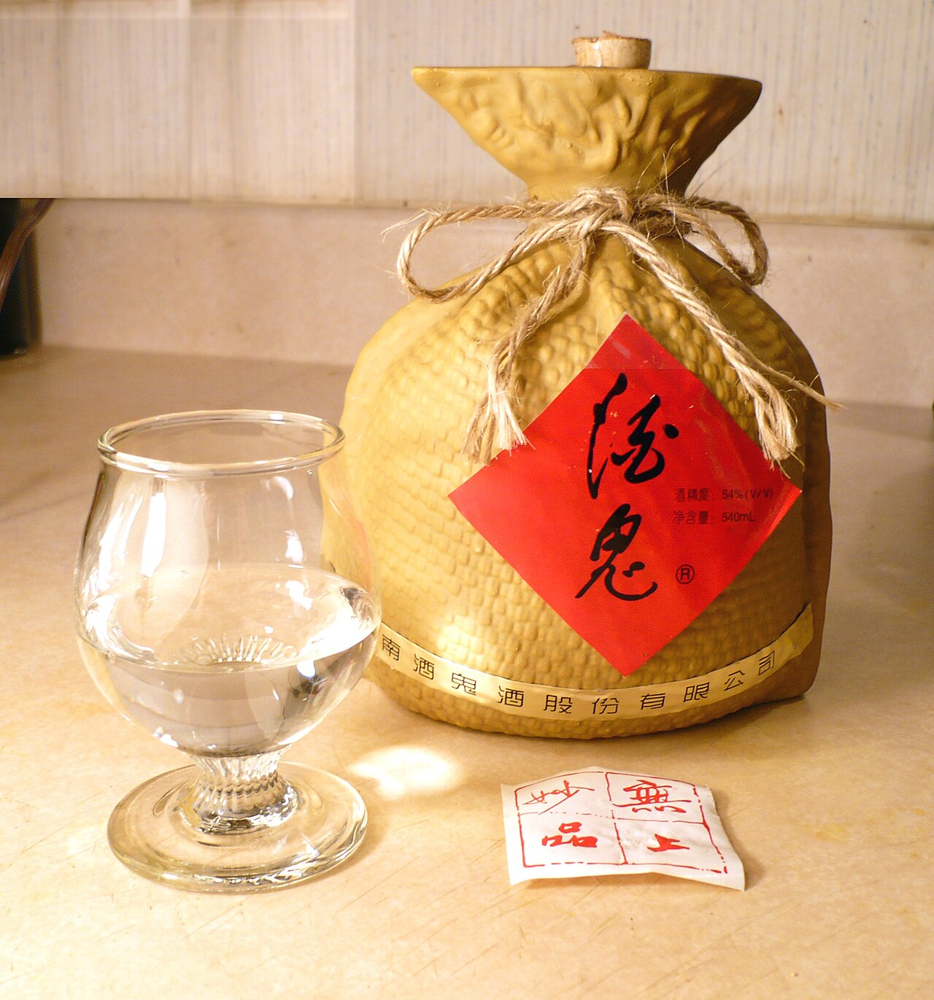

# 酒鬼酒

酒鬼酒是中国白酒里少有的“先有形象、再有品类”的品牌。它的麻袋形酒瓶、红纸标签和“无上妙品”印章，比大多数白酒包装更容易被记住；它的馥郁香型又很难用浓香、酱香、清香中的任何一类去解释。品牌属于酒鬼酒股份有限公司，产地在湘西吉首。理解它，要同时看黄永玉的设计、湘西的自然环境，以及 2012 年那场至今仍被提及的塑化剂风波。

图：酒鬼酒。图片：Badagnani，CC BY 3.0，via Wikimedia Commons（[原图页面](https://commons.wikimedia.org/wiki/File:Jiugui.jpg)）。

## 湘西与吉首：产地先于品牌

湘西土家族苗族自治州以山地为主，吉首处在武陵山脉的河谷地带，气候湿润、微生物活跃。酒鬼酒的生产基地在吉首，企业把当地的水、气候与微生物环境作为馥郁香型形成的外部条件。产地叙事在这里不是装饰：多粮、多曲、长期发酵的工艺，确实依赖稳定的温湿环境与窖池微生物群落。

## 1956 年：吉首酒厂

1956 年，吉首酒厂建立，是湘西州较早的作坊酒厂之一，也是酒鬼酒的产业前身。1997 年，酒鬼酒股份有限公司在深圳证券交易所上市；2016 年，公司成为中粮集团成员企业。把 1956 年、1997 年与 2016 年分开，能看清“产地作坊—上市公司—央企控股”三个阶段。

## 1983 年：湘泉的陶瓶

1983 年，在黄永玉的设计下，湘泉酒改用土赭色弦纹陶瓶。这个选择在当时并不常见：白酒多用玻璃瓶或透明瓶，湘泉却用陶的质感强调“土”和“手工”。湘泉后来成为大众价格带产品，但它的陶瓶仍然是品牌视觉史的起点。

## 1987 年：麻袋瓶与“酒鬼”

1987 年，黄永玉从香港回到凤凰，拿出麻袋形状的酒瓶包装设计，并题写“酒鬼”二字。麻袋瓶、红纸标签与“无上妙品”印章共同构成品牌的视觉标识，也让酒鬼酒成为陶瓷与麻袋造型包装的代表案例。这个设计把“土气”转成了“野趣”，把湘西的地域感变成了可识别的商品语言。

## 馥郁香型：一口三香

馥郁香型常被概括为“前浓、中清、后酱”，即入口有浓香的窖香与粮香，中段转为清香的爽净，尾段带酱香的焦糊与回味。工艺上，它采用多粮配料、多曲并用、长期发酵与长期贮存，在同一个窖池体系里完成多种香气的生成。把它理解为“浓香加酱香”是不准确的：它不是把两种酒勾调在一起，而是在发酵与蒸馏过程中形成复合香气。

## 产品阶梯

公开产品资料列出内参、酒鬼与湘泉等系列。内参定位高端，酒鬼覆盖商务与礼赠场景，湘泉面向更广的消费群体。三者共享生产体系，但价格带与渠道不同。内参常见 52% vol、500 mL 规格，酒鬼与湘泉则有更多度数与容量版本。

## 价格带与场景

湘泉大致在 50-150 元，承担日常饮用与宴席；酒鬼主力在 300-600 元，面向商务与礼赠；内参可以到 800-1200 元，进入高端与收藏场景。价格带是市场定位，不是质量等级；陶瓷瓶与麻袋造型也不是质量证明，判断酒体仍要看原料、工艺、贮存与标签。

## 包装与识别

麻袋瓶是酒鬼酒最强的识别符号，但也是最容易被仿冒的部分。购买时要看生产商全称、防伪标识、批次与执行标准，尤其是电商与礼品渠道的低价产品。内参与酒鬼的瓶形、颜色和礼盒不同，不能只凭“酒鬼”字样判断档次。

## 渠道与市场

酒鬼酒以湖南为核心，向广东、山东、河南、江苏等市场扩张，渠道包括经销商、团购、电商与礼品。馥郁香型的品类认知度不如浓香、酱香，品牌需要持续解释“一口三香”，这既是差异化优势，也是全国化的成本。2024 年以来白酒行业进入调整期，次高端价格带承压，酒鬼酒的增长节奏也受到影响。

## 历史节点

1956 年吉首酒厂建立；1983 年湘泉改用陶瓶；1987 年黄永玉设计麻袋瓶并命名“酒鬼”；1997 年公司在深交所上市；2016 年成为中粮集团成员企业。2012 年 11 月，媒体曝光 50 度酒鬼酒塑化剂 DBP 含量为 1.08 mg/kg、超标 260%，公司停牌、复牌并道歉，随后进行整改。这一事件是品牌历史上最严重的质量危机之一。

## 荣誉与争议

企业公开列出的身份包括中国驰名商标、湖南省名牌产品等，酒鬼酒的麻袋瓶设计也多次被作为包装案例讨论。争议主要有三：第一，2012 年塑化剂事件对品牌信任造成长期影响，尽管后续检测与整改显示相关风险已受控制；第二，馥郁香型的品类教育成本高，消费者容易把它误解为营销概念；第三，次高端价格带竞争激烈，内参的高端定位需要持续的渠道与品牌投入。

## 怎么读一瓶酒鬼酒

先看系列：内参、酒鬼还是湘泉；再看度数与容量；然后看原料与执行标准，确认是否为多粮馥郁香型；最后看生产商、批次与防伪。麻袋瓶是识别符号，不是质量等级；同一造型下可能有不同系列与不同价格带。

## 常见误区

第一，把酒鬼酒这个品牌与背后的股份公司当成同一主体。第二，把“酒鬼酒”当作单一产品。第三，把麻袋瓶设计当作现代包装的普遍标准。第四，把 1987 年当作企业成立年份。第五，把馥郁香型理解为浓香与酱香的简单混合。

对照阅读：[酒鬼酒股份有限公司](ref:producer)、[制曲](ref:qu-making)。

## 延伸阅读

- [酒鬼酒股份有限公司](ref:producer)：生产者条目。
- [白酒](ref:baijiu)：白酒的大类与基本工艺。
- [制曲](ref:qu-making)：白酒工艺的起点。

补充阅读：[馥郁香型白酒](ref:c-extra-1)、[绝对伏特加](ref:c-extra-2)。

相关条目：[白酒](ref:baijiu)。

**关键事实。**

| 项目 | 内容 |
| --- | --- |
| 一句话定位 | 酒鬼酒股份有限公司旗下的馥郁香型白酒品牌，产于湘西吉首；1987 年由黄永玉命名并设计麻袋瓶，代表产品包括内参、酒鬼与湘泉，以“一口三香”和多粮工艺为识别点 |
| 持有公司 | 酒鬼酒股份有限公司 |
| 产区 | 中国 |

**来源与边界。** 本页关于「酒鬼酒」的关键事实，主要由以下来源交叉核对：人民网（1983 年湘泉酒瓶设计与 1987 年酒鬼酒麻袋瓶包装；2012 年塑化剂事件后的检测与整改表述）、启信宝（馥郁香型始创与 1956 年前身）、酒鬼酒股份有限公司（公司名称、上市地与主营产品）。价格、批次与状态会变，涉及这些字段时以页面所列来源的最新版本为准。正文为项目自写，来源只作核验，不复制原文。
