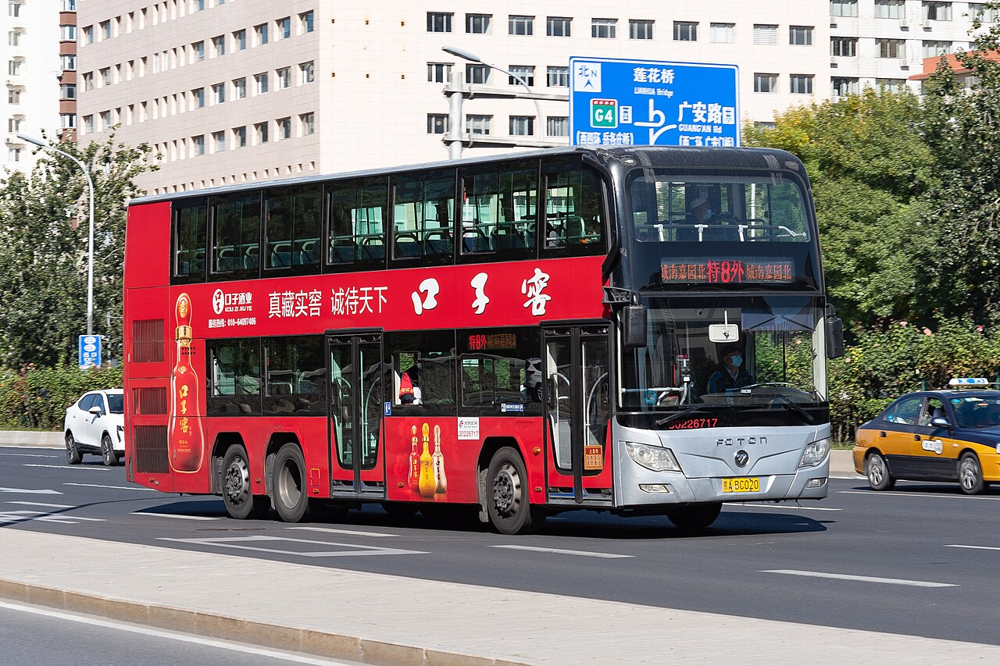

# 口子窖

口子窖的气质来自一个很具体的场景：淮北平原上的濉溪老城，河流与道路在此交汇，酿酒作坊沿街排开，形成“口子”这个地名。品牌把地名与“窖”结合，直接指向窖池发酵。它属于安徽口子酒业股份有限公司，是兼香型白酒最具代表性的品牌之一；理解它的关键，不是把“兼香”解释成浓香加酱香，而是看它如何用多曲、多粮、长期发酵和长期贮存，在一个窖池体系里同时做出两种香气的层次。

图：口子窖。图片：N509FZ，CC BY-SA 4.0，via Wikimedia Commons（[原图页面](https://commons.wikimedia.org/wiki/File:30226717_at_Liuliqiaonan_(20201017130410).jpg)）。

## 濉溪：先有作坊，后有品牌

濉溪的酿酒传统很长，地方资料把它追溯到春秋以后。2018 年，濉溪明清酿酒作坊群遗址发掘，公开报道称其为全国发掘面积最大的酿酒遗址，遗址中能看到发酵池、蒸馏设施与作坊布局。对品牌而言，这类考古发现提供的不是“年份背书”，而是工艺连续性的物证：口子窖所讲的“老窖”“老坊”，落在具体的城市空间里。

## 1949 年：国营酒厂的起点

1949 年 5 月 18 日，国营濉溪人民酒厂成立，这是安徽口子酒业股份有限公司的前身。此后企业经历改制、股份制改造与品牌整合，逐步把“口子窖”做成主线产品。把 1949 年当作现代企业的起点，比把地方酿酒传统直接等同于品牌年龄更准确。

## 兼香型：一个独立品类

兼香型不是把浓香酒与酱香酒倒在一起。它以浓香型的窖池、续糟、混蒸为基础，又吸收酱香型的高温制曲、堆积与多轮次发酵思路，形成“浓头酱尾”或“浓酱协调”的风格。口子窖公开表述的工艺要点是“多曲并用、多粮酿造、长期发酵、长期贮存”，企业称之为“一步兼香”。公司还是全国白酒标准化技术委员会兼香型白酒分技术委员会秘书处承担单位，这说明它在品类标准事务中扮演组织者角色。

## 产品阶梯

公开产品资料列出口子窖、老口子、口子坊与口子酒等系列。口子窖主线以年份数字区分档次，常见五年、十年、二十年等档位；老口子与口子坊承担宴席与日常饮用，口子酒则更接近基础款。不同系列的度数、容量与包装差异较大，购买时应以瓶身标签为准，而不是只认“口子窖”三个字。

## 价格带与场景

口子酒、口子坊多在 100 元以下，老口子大致在 100-200 元，口子窖十年常见于 300-400 元，二十年进入 600-800 元，三十年及更高档产品在 1000 元以上。这个阶梯与安徽、江苏、河南等地的宴席文化高度绑定：百元档讲“实惠”，三百元档讲“面子”，六百元以上讲“礼赠”。价格会随区域与促销变化，不能当作固定指导价。

## 包装与识别

口子窖的瓶体偏厚重，主色常用深红、金色与陶土色，年份数字放在视觉中心；礼盒强调“窖藏”和“年份”。这类设计在宴席桌上有明确的识别功能，也容易被模仿。核对生产商、防伪码、批次与执行标准，比看瓶形更可靠。

## 渠道与市场

口子酒业以安徽为核心，重点在淮北、宿州、亳州、合肥等地，并向江苏、河南、山东等相邻市场渗透。渠道以经销商和终端门店为主，配合宴席政策、团购与节庆促销。兼香型的品类认知在安徽较强，出了省则需要更长时间解释，这也是品牌全国化时的主要摩擦。

## 历史节点

1949 年 5 月 18 日国营濉溪人民酒厂成立；2015 年 6 月 29 日，安徽口子酒业股份有限公司在上海证券交易所挂牌上市，成为 A 股白酒板块第 17 家、兼香型白酒第 1 家上市公司；2018 年濉溪明清酿酒作坊群遗址发掘；2025 年，口子窖濉溪酿酒遗址进入酒旅融合目的地推介名单。上市是资本节点，遗址是产区节点，两者不能互相替代。

## 荣誉与争议

企业公开列出的身份包括国家地理标志保护产品、兼香型白酒分技术委员会秘书处承担单位，以及行业机构近年给出的“兼香型高端白酒领导品牌”等评价。争议主要有三：第一，年份数字是产品命名，消费者容易把它理解为瓶中所有基酒的酒龄；第二，“兼香”缺少像浓香、酱香那样广泛的日常认知，解释成本高；第三，徽酒省内竞争激烈，渠道库存与价格秩序会周期性承压。

## 怎么读一瓶口子窖

先确认系列：口子窖、老口子、口子坊还是口子酒；再看年份数字与度数；然后看原料与执行标准，判断是否为多粮兼香；最后看生产商与批次。若瓶身只写“兼香型”而没有具体产品名，信息是不完整的。

## 常见误区

第一，把口子窖这个品牌与背后的股份公司当成同一主体。第二，把“口子窖”当作单一产品。第三，把“兼香”理解为浓香与酱香的简单混合。第四，把濉溪酿酒传统长度当作现代品牌历史。第五，把年份数字当作全部基酒的准确酒龄。

对照阅读：[安徽口子酒业股份有限公司](ref:producer)、[安徽省](ref:anhui)。

## 延伸阅读

- [安徽口子酒业股份有限公司](ref:producer)：生产者条目。
- [白酒](ref:baijiu)：白酒的大类与基本工艺。
- [安徽](ref:anhui)：徽酒产区与白酒版图。
- [制曲](ref:qu-making)：白酒工艺的起点。

补充阅读：[兼香型白酒](ref:c-extra-1)。

相关条目：[白酒](ref:baijiu)。

**关键事实。**

| 项目 | 内容 |
| --- | --- |
| 一句话定位 | 安徽淮北濉溪出产的兼香型白酒品牌，以“一步兼香”和多曲多粮工艺为识别点；产品覆盖口子窖年份系列、老口子、口子坊与口子酒，2015 年随安徽口子酒业股份有限公司上市 |
| 持有公司 | 安徽口子酒业股份有限公司 |
| 产区 | 安徽省 |
| 官网 | kouzi.com |

**来源与边界。** 本页关于「口子窖」的关键事实，主要由以下来源交叉核对：安徽口子酒业股份有限公司（兼香型定位、濉溪酿酒传统与国营酒厂起点；上市日期、产品系列与兼香型标准化角色）。产品、地址或营业状态变化较快时，以 kouzi.com 的最新页面为准；价格、批次与状态会变，涉及这些字段时以页面所列来源的最新版本为准。正文为项目自写，来源只作核验，不复制原文。

**并读。** 把「口子窖」与「安徽口子酒业股份有限公司」、「白酒」、「安徽省」放在一起读时，先确认它们是同一层级还是上下游关系：先确认品牌归属与核心产品，再比较产区、工艺与价格带。本页负责给出品牌的基本坐标，对照条目补上具体案例与差异；读完再回到本页，才能分清哪些差别属于品牌本身，哪些只是产地、批次或品牌选择。
