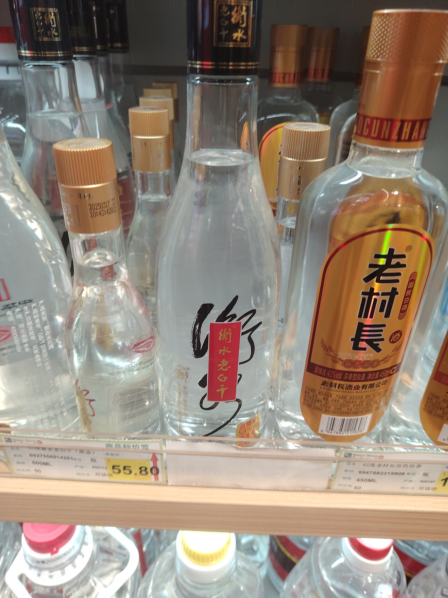

# 衡水老白干

衡水老白干是[河北衡水老白干酒业股份有限公司](ref:producer)旗下的老白干香型白酒品牌。企业源于 1946 年政府将衡水十八家传统私营酿酒作坊收归国有后组建的国营衡水制酒厂，2002 年 10 月在上海证券交易所上市。企业同时拥有板城烧锅酒、武陵酒与文王贡酒等品牌。

图：衡水老白干。图片：Lhzss8，CC BY-SA 4.0，via Wikimedia Commons（[原图页面](https://commons.wikimedia.org/wiki/File:%E7%BB%8F%E5%85%B8%E8%A3%85%E8%A1%A1%E6%B0%B4%E8%80%81%E7%99%BD%E5%B9%B2.jpg)）。

## 品牌定义

老白干的品牌层要拆成三件事：香型是工艺分类，品牌是市场标识，产品是具体度数与规格；生产者则回答商标持有、生产组织与法律责任。讨论“老白干”时，先确认说的是香型、品牌还是一瓶酒。

就「衡水老白干」而言，“老白干”既是香型名称，也是品牌名称与产品名称。香型是工艺与风味的分类，品牌是市场标识，产品是具体规格；三者不能互相替代。

## 所属生产者

品牌的生产者为[河北衡水老白干酒业股份有限公司](ref:producer)。该企业源于 1946 年组建的国营衡水制酒厂，2002 年 10 月 29 日在上海证券交易所上市。品牌与商标的持有、生产组织与信息披露以该公司及其下属企业为准。

生产者条目记录了组建、上市与多品牌结构。本页只保留与品牌直接相关的部分，避免把企业史与品牌史混为一谈。

## 产品线

核心品牌为衡水老白干，公开产品资料覆盖大众到中高端价格带。产品以不同度数、容量与包装形成系列差异，部分系列面向宴席、商务与礼赠场景。

企业旗下还有板城烧锅酒、武陵酒与文王贡酒，分别位于不同产区、使用不同香型与工艺。多品牌结构意味着不能用衡水老白干的口味概括整个企业的产品。

产品线的度数、容量、包装与价格会随年份与渠道调整。购买时应核对瓶身标签上的品牌、产品名称、酒精度、净含量、原料、生产商与执行标准。

三家品牌的地理与香型各不相同：板城烧锅酒产自河北承德，武陵酒产自湖南常德、走酱香路线，文王贡酒产自安徽临泉、以浓香为主。它们进入上市公司体系与 2018 年完成的一次酒业资产收购有关，因此“衡水老白干”只是集团品牌矩阵中的一支，而不是全部。

## 定位与价格带

品牌整体覆盖从中端到中高端的价格带：大众系列承担日常饮用与宴席，中高端系列承担商务与礼赠。价格会随年份、渠道与促销变化，本页不给出具体零售价。

衡水老白干的价格带只是市场定位，不等于质量等级。判断酒体应看原料、工艺、贮存时间与标签信息，而不是只看包装或香型名称。

## 历史

就「衡水老白干」而言，1946 年，政府将衡水十八家传统私营酿酒作坊收归国有，组建“冀南行署地方国营衡水制酒厂”，成为企业的直接前身。2002 年 10 月 29 日，河北衡水老白干酒业股份有限公司在上海证券交易所上市。

企业公开资料把酿造历史追溯到 1900 多年前，并以“兴于汉、盛于唐、定名于明”概括地方酿酒传统。这属于产区与品牌叙事，不能把历史长度直接换算成现代公司的成立年份。

工艺上，老白干香型以高粱为原料、中温大曲为糖化发酵剂，采用地缸发酵与清蒸清烧，产品执行 GB/T 20825《老白干香型白酒》。地缸把酒醅与泥土隔开，清蒸减少杂味；这套路线与清香型相邻，但香气更偏醇厚，酒体更有力度。

## 名称与标识

“老白干”原是对高度、干爽白酒的俗称，后来成为香型与品牌名称。“衡水”标明产地，二者组合形成今天的产品名。

就「衡水老白干」而言，商标、瓶形、颜色与标签排版属于品牌标识体系，但仿冒产品也可能模仿外观。购买时应核对生产商、防伪标识、批次与正规渠道，而不是只看瓶形或主色调。

## 常见误区

第一，把衡水老白干这个品牌与背后的股份公司当成同一主体。品牌是市场标识，股份公司是法律主体。
第二，把“老白干”只当作香型。它同时是品牌名称与产品名称。
第三，把 1946 年当作股份公司的成立年份。1946 年是国营制酒厂的组建年份。
第四，把 1900 多年的酿造传统当作现代公司的历史长度。产区传统与公司沿革是不同尺度。
第五，把旗下多品牌当作同一香型。板城烧锅酒、武陵酒与文王贡酒的香型与产区不同。

衡水老白干的边界在“老白干香型”与“老白干”日常说法之间：前者是有标准支撑的香型类别，后者常被泛化为高度白酒。品牌属于上市公司体系，产品线横跨不同价位；地缸发酵、清蒸清烧是理解其干净、醇厚风格的入口，而不是所有衡水白酒都自动具备的标签。

对照阅读：[河北衡水老白干酒业股份有限公司](ref:producer)、[中国](ref:china)。

## 延伸阅读

- [河北衡水老白干酒业股份有限公司](ref:producer)：生产者条目。
- [白酒](ref:baijiu)：白酒的大类与基本工艺。
- [中国](ref:china)：中国酒类版图与产区组织。
- [制曲](ref:qu-making)：白酒工艺的起点。

**关键事实。**

| 项目 | 内容 |
| --- | --- |
| 一句话定位 | 河北衡水老白干酒业股份有限公司旗下的老白干香型白酒品牌；企业源于 1946 年组建的国营衡水制酒厂，2002 年上市 |
| 持有公司 | 河北衡水老白干酒业股份有限公司 |
| 产区 | 中国 |
| 官网 | hengshuilaobaigan.net |

**来源与边界。** 本页关于「衡水老白干」的关键事实，主要由以下来源交叉核对：河北衡水老白干酒业股份有限公司（1946 年国营制酒厂与 2002 年上市；旗下品牌与生产基地）、衡水老白干（补充核对条目背景、术语与制度口径）。产品、地址或营业状态变化较快时，以 hengshuilaobaigan.net 的最新页面为准；价格、批次与状态会变，涉及这些字段时以页面所列来源的最新版本为准。正文为项目自写，来源只作核验，不复制原文。

**并读。** 把「衡水老白干」与「河北衡水老白干酒业股份有限公司」、「白酒」、「中国」放在一起读时，先确认它们是同一层级还是上下游关系：先确认品牌归属与核心产品，再比较产区、工艺与价格带。本页负责给出品牌的基本坐标，对照条目补上具体案例与差异；读完再回到本页，才能分清哪些差别属于品牌本身，哪些只是产地、批次或品牌选择。
