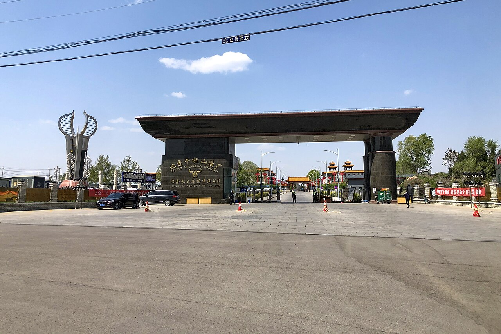

# 牛栏山

牛栏山是[北京顺鑫农业股份有限公司牛栏山酒厂](ref:producer)的白酒品牌，以二锅头工艺与大众价格带为核心。品牌产品线覆盖清香型二锅头、浓香型牛栏山陈酿与百年牛栏山等系列，既做日常口粮酒，也做宴席与礼赠产品。

图：牛栏山。图片：N509FZ，CC BY-SA 4.0，via Wikimedia Commons（[原图页面](https://commons.wikimedia.org/wiki/File:Niulanshan_Distillery_headquarters_(20200424130839).jpg)）。

## 品牌定义

牛栏山的品牌层要区分地名与商标：地名指向顺义区牛栏山镇，品牌名承载当地酿酒传统，生产者则是具体酒厂与上市公司。讨论时不能把产区地名当成任何企业都能使用的通用名称。

“牛栏山”既是地名，也是品牌名。地名指向北京市顺义区牛栏山镇，品牌名承载当地的酿酒传统；讨论时要分清“产区地名”与“注册商标”，不能把地名当成任意企业都能使用的通用名称。

## 所属生产者

品牌由[牛栏山酒厂](ref:producer)运营，该厂是顺鑫农业的分公司，前身为 1952 年 10 月成立的国营牛栏山制酒厂。1998 年，母公司北京顺鑫农业股份有限公司在深圳证券交易所上市。

品牌与酒厂、上市公司是三个层级：品牌是市场标识，酒厂是生产主体，上市公司是资本与信息披露主体。消费者看到的瓶标通常同时出现品牌与生产商，核对时要看清具体名称与地址。

## 产品线

第一条是二锅头系列，属清香型路线，以干净、爽冽与高性价比为特点，覆盖光瓶酒与不同价位产品。第二条是牛栏山陈酿，属[浓香型](ref:strong-aroma)路线，常见 42% vol、500 mL，执行固液法白酒标准，是大众餐饮渠道的常见产品。

第三条是百年牛栏山等宴席与礼赠系列，包装与价格带高于日常口粮酒。不同产品线的香型、执行标准与原料结构不同，不能用一条产品线的风格概括整个品牌。

产品线之间也有价格梯度：光瓶酒强调日常自饮与餐饮铺市，礼盒产品强调宴席与送礼。价格带是市场定位，不是质量等级表。

## 定位与价格带

牛栏山长期以大众价格带与高铺市率著称，核心优势是可得性、稳定供给与熟悉的风味。它不以高端稀缺为卖点，而是以“日常能买到、价格可接受、风味稳定”形成规模。

这一定位带来两个结果：一是产品覆盖面广，二是不同渠道的价格差异明显。讨论价格时应说明是官方指导价、商超零售价还是餐饮渠道价，不能用一个数字概括全国市场。

价格随渠道、地区与供需变化，本页不给出具体数字。把销量当作质量证明，或把低价当作低质，都是常见误读；质量判断应回到标签、执行标准与实际饮用。

## 历史

企业公开资料把牛栏山的酿酒传统追溯到数百年前的烧锅，并把二锅头传统酿制技艺列为国家级非物质文化遗产。1952 年国营牛栏山制酒厂成立，是现代企业的直接起点。

1998 年母公司上市后，牛栏山逐步扩大产能与产品线，形成以二锅头为核心、多香型并行的结构。历史叙事中的“数百年”指工艺与地名传统，“1952 年”指国营厂成立，“1998 年”指上市，三个时间尺度不能混用。

## 名称与标识

“牛栏山”作为商标承载产地与品牌的双重含义；瓶标上的“牛栏山”字样、生产商名称、香型、酒精度、净含量与执行标准，是识别产品的基本信息。不同系列还有各自的副标识与包装体系。

二锅头是工艺名称，不是品牌名。其他企业也可以生产二锅头工艺的白酒，因此“二锅头”不能等同于“牛栏山”；反过来，牛栏山也不只生产二锅头。

## 关系与延伸

品牌向下连接[生产者](ref:producer)，向旁连接[白酒](ref:baijiu)与[浓香型白酒](ref:strong-aroma)的香型体系，向产品连接[牛栏山陈酿](ref:chenniang)。这四条关系说明品牌在“企业—香型—产品”中的位置。

牛栏山的核心不是“便宜”二字，而是二锅头工艺与大众价格带的组合：掐头去尾、取中段酒，形成直接、干净的口感。品牌隶属于顺鑫农业体系，产品线里既有清香型二锅头，也有浓香型陈酿；不能因为价格亲民，就把所有牛栏山产品都当成同一种工艺或同一等级。二锅头是工艺路线，不是某一瓶的酒名；牛栏山陈酿又属于浓香型产品，两者在原料、曲种与发酵周期上并不相同。把品牌名直接当成香型或等级，会让标签上的执行标准与生产商信息变得无关。把瓶标上的香型与执行标准放在品牌名之前，判断会更稳。

对照阅读：[北京顺鑫农业股份有限公司牛栏山酒厂](ref:producer)、[浓香型白酒](ref:strong-aroma)。

## 延伸阅读

- [北京顺鑫农业股份有限公司牛栏山酒厂](ref:producer)：企业沿革、厂址与工艺传统。
- [白酒](ref:baijiu)：大类与香型体系。
- [浓香型白酒](ref:strong-aroma)：牛栏山陈酿所属的香型路线。
- [牛栏山陈酿](ref:chenniang)：具体规格、标准与风味。

**关键事实。**

| 项目 | 内容 |
| --- | --- |
| 一句话定位 | 北京顺鑫农业股份有限公司牛栏山酒厂的白酒品牌，以二锅头工艺与大众价格带为核心，产品线覆盖清香型二锅头、浓香型牛栏山陈酿与百年牛栏山等系列 |
| 持有公司 | 北京顺鑫农业股份有限公司牛栏山酒厂 |
| 产区 | 中国 |

**来源与边界。** 本页关于「牛栏山」的关键事实，主要由以下来源交叉核对：新华网（建厂时间、老字号、驰名商标与非遗信息；由原条目末尾参考资料迁移，未逐条复核访问日期）、北京顺鑫控股集团有限公司（二锅头传统酿制技艺与产品定位；由原条目末尾参考资料迁移，未逐条复核访问日期）、苏宁易购（牛栏山陈酿的香型、酒精度与容量；由原条目末尾参考资料迁移，未逐条复核访问日期）。价格、批次与状态会变，涉及这些字段时以页面所列来源的最新版本为准。正文为项目自写，来源只作核验，不复制原文。

**并读。** 把「牛栏山」与「北京顺鑫农业股份有限公司牛栏山酒厂」、「白酒」、「浓香型白酒」放在一起读时，先确认它们是同一层级还是上下游关系：先确认品牌归属与核心产品，再比较产区、工艺与价格带。本页负责给出品牌的基本坐标，对照条目补上具体案例与差异；读完再回到本页，才能分清哪些差别属于品牌本身，哪些只是产地、批次或品牌选择。
