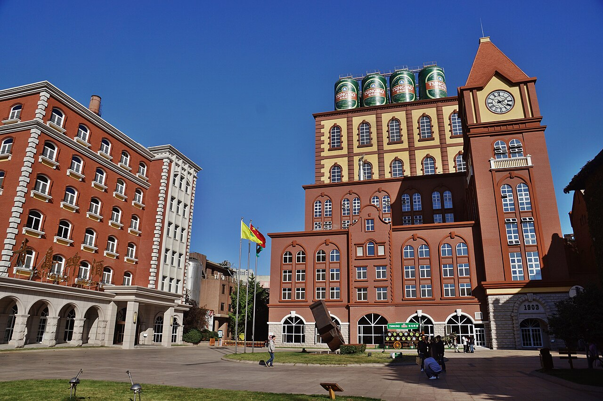

# 青岛啤酒

青岛啤酒是源于 1903 年青岛的啤酒品牌，由[青岛啤酒股份有限公司](ref:producer)持有。品牌以拉格啤酒为主力，覆盖经典 1903、纯生、白啤、奥古特与黑啤等系列，是中国认知度最高的啤酒品牌之一。

图：青岛啤酒。图片：Lennartbj，CC BY-SA 4.0，via Wikimedia Commons（[原图页面](https://commons.wikimedia.org/wiki/File:Tsingtao_Brewery_in_Qingdao.jpg)）。

## 品牌定义

青岛啤酒的品牌层要与企业层分开：品牌回答系列、酒精度、容量与渠道定位，生产者回答商标持有、生产组织与法律责任。青岛啤酒既是公司名也是主品牌，下面还有经典、纯生、奥古特等产品线。

品牌也不等于单一产品。同一品牌下有不同系列、不同酒精度、不同容量与不同渠道版本，讨论“青岛啤酒什么味道”或“青岛啤酒多少钱”时，要先指明具体产品。

## 所属生产者

品牌的生产者为[青岛啤酒股份有限公司](ref:producer)。该公司前身为 1903 年德英商人创办的日耳曼啤酒公司青岛股份公司，1993 年注册成立股份公司，同年 H 股与 A 股先后上市。品牌与商标的持有、生产组织与信息披露以该公司及其下属企业为准。

生产者条目记录了注册日期、上市节点与经营规模。本页只保留与品牌直接相关的部分，避免把企业史与产品史混为一谈。

## 产品线

公开产品资料列出经典 1903、纯生、白啤、奥古特与黑啤等系列。经典 1903 面向大众流通与餐饮渠道，纯生强调过滤工艺与新鲜度，白啤与黑啤属于风味差异较大的品类，奥古特偏中高端。

“经典 1903”中的数字指向品牌起源年份，不是瓶中酒龄。产品线中的度数、容量、原麦汁浓度、原料与包装会随年份与渠道调整，部分产品还有区域限定或节庆版本。

购买时应核对瓶身或罐身标签上的产品名称、酒精度、原麦汁浓度、原料、生产商与生产日期，而不是只凭颜色或系列名判断。

## 定位与价格带

品牌整体覆盖从大众到中高端的价格带：经典系列承担日常饮用与餐饮场景，纯生与白啤覆盖对新鲜度和风味有要求的消费者，奥古特等系列上探中高端礼赠与聚会场景。

价格会随年份、渠道、促销与包装规格变化，本页不给出具体零售价，避免把某一次促销价当作长期定位。价格带只是市场定位，不等于质量等级；判断酒体应看原料、工艺、新鲜度与标签信息。

## 历史

1903 年，德国与英国商人在青岛创办日耳曼啤酒公司青岛股份公司，引入德式酿造设备与技术，青岛啤酒的品牌叙事由此开始。1993 年，股份公司注册成立，H 股与 A 股先后在香港、上海上市，品牌进入资本市场。

2008 年与 2022 年，企业先后成为北京奥运会与北京冬奥会官方赞助商，品牌曝光扩展到场馆与赛事场景。按公司简介口径，2025 年全年产品销量 764.8 万千升，营业收入 324.7 亿元。

品牌史中的“1903 年创办”与“1993 年上市”是两个节点，不能合并成一个年份，也不能把赛事赞助当作产品质量认证。

## 名称与标识

“青岛”是地名，“啤酒”是品类名，中文品牌名直接由产地与品类组合而成。英文商标以 TSINGTAO 拼写，属于历史沿用的邮政式拼法，与现代汉语拼音 QINGDAO 不同。

商标、瓶形、颜色与标签排版都属于品牌标识体系，但仿冒产品也可能模仿外观。购买时应核对生产商、防伪标识、批次与正规渠道，而不是只看瓶形或主色调。

品牌名中的地名说明历史产地，不等于今天每一瓶酒都在青岛生产。企业在全国多地设厂，具体产地应以标签为准。

## 常见误区

第一，把青岛啤酒这个品牌与背后的股份公司当成同一主体。品牌是市场标识，股份公司是法律主体。
第二，把 1903 年当作股份公司的成立年份。1903 年是前身工厂的创办节点。
第三，把“经典 1903”当作瓶中酒龄。数字指向品牌起源年份。
第四，把“纯生”当作度数更高或等级更高。纯生描述过滤与热处理工艺。
第五，把青岛产地当作所有产品的灌装地。应以标签上的生产商与产地为准。

青岛啤酒的识别点在于历史悠久的拉格生产与现代品牌体系，而不是“德国工艺”这类笼统说法。经典、纯生、白啤与奥古特分属不同产品线；品牌、上市公司与产地也不是同一个概念，购买时要看生产商、产地与品类标注，不能只凭“青岛”二字判断。青岛啤酒的历史与德国酿造传统有关，但今天的原料、酵母与生产线已经本地化；经典、纯生、白啤与奥古特的产品标准也不相同。把“青岛”当成单一风味或产地保证，会忽略标签上的品类信息。

对照阅读：[青岛啤酒股份有限公司](ref:producer)、[啤酒](ref:beer)。

## 延伸阅读

- [青岛啤酒股份有限公司](ref:producer)：生产者条目。
- [青岛啤酒](ref:tsingtao-drink)：具体产品的规格与风味。
- [啤酒](ref:beer)：啤酒的大类、原料与基本工艺。
- [饮料酒分类](ref:gbt-17204)：啤酒在饮料酒体系中的位置。

**关键事实。**

| 项目 | 内容 |
| --- | --- |
| 一句话定位 | 源于 1903 年青岛的啤酒品牌，由青岛啤酒股份有限公司持有；主力产品为拉格啤酒，覆盖经典 1903、纯生、白啤与奥古特等系列 |
| 持有公司 | 青岛啤酒股份有限公司 |
| 产区 | 中国 |
| 官网 | tsingtao.com.cn |

**来源与边界。** 本页关于「青岛啤酒」的关键事实，主要由以下来源交叉核对：青岛啤酒股份有限公司（品牌起源、上市时间与经营规模；股份公司注册与上市日期）、国家市场监督管理总局、国家标准化管理委员会（啤酒在饮料酒分类中的位置）、青岛啤酒（补充核对条目背景、术语与制度口径）。产品、地址或营业状态变化较快时，以 tsingtao.com.cn 的最新页面为准；价格、批次与状态会变，涉及这些字段时以页面所列来源的最新版本为准。正文为项目自写，来源只作核验，不复制原文。

**并读。** 把「青岛啤酒」与「青岛啤酒股份有限公司」、「青岛啤酒」、「啤酒」放在一起读时，先确认它们是同一层级还是上下游关系：先确认品牌归属与核心产品，再比较产区、工艺与价格带。本页负责给出品牌的基本坐标，对照条目补上具体案例与差异；读完再回到本页，才能分清哪些差别属于品牌本身，哪些只是产地、批次或品牌选择。
