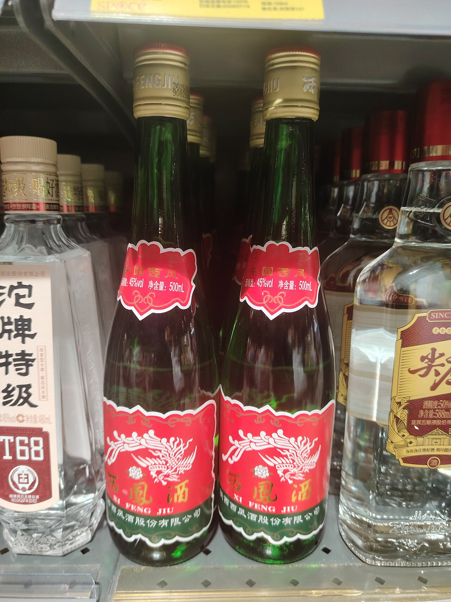

# 西凤酒

西凤酒的品牌辨识度来自两个词：凤香与酒海。前者说明它不属于清香、浓香、酱香中的任何一类，后者说明它用一种特殊的容器完成贮存。品牌把这些工艺概念做成产品名与包装语言，再用红西凤、老绿瓶等系列覆盖不同价位。读懂西凤，关键是分清“香型身份”与“产品档次”。

图：西凤酒。图片：Lhzss8，CC BY-SA 4.0，via Wikimedia Commons（[原图页面](https://commons.wikimedia.org/wiki/File:%E5%B0%8F%E7%93%B6%E8%A3%85%E8%A5%BF%E5%87%A4%E9%85%92.jpg)）。

## 品牌识别

西凤酒属于[白酒](ref:baijiu)中的凤香型，商标与产品体系由[陕西西凤酒集团股份有限公司](ref:producer)持有。品牌名与“西凤集团”“西凤股份”不是同一概念，讨论价格或收藏价值时，要先指明具体系列与度数。

识别西凤要看三处：商标、系列名与酒精度。官网产品中心列出的系列很多，命名方式包括颜色、年份概念、文化主题与贮存概念，消费者不能只凭“西凤”二字判断档次。

## 凤香型是什么

凤香型以高粱为原料，大麦、小麦与豌豆制曲，采用土暗窖固态发酵，经[制曲](ref:qu-making)、蒸馏分段摘酒，再以酒海贮存、勾调成成品。它常被描述为“清而不淡、浓而不艳”，介于清香与浓香之间。

但凤香不是清香与浓香的简单混合，而是一套独立工艺形成的香型。把凤香理解为“勾调出来的中间口味”，会忽略土暗窖、制曲配比与酒海贮存共同作用的结构。香型是工艺结果，不是营销标签。

## 产地与品牌名

西凤酒产自陕西关中西部的凤翔，现属宝鸡市凤翔区。这里属暖温带大陆性季风气候，四季分明、降水集中，空气相对干燥，有利于制曲与贮存。当地高粱、水源与窖池环境，共同构成凤香风格的基础。

“西凤”由“西府凤翔”简化而来。凤翔是历史地名，也是凤香型名称的来源之一。品牌名承载产地联想，但产地不是质量保证；同一产区内的不同企业、不同批次仍有差异。

## 红西凤

红西凤于 2019 年推出，是品牌高端化与全国化的核心产品。它以红色包装与“红”字强化识别，价格处于品牌价格带的顶端，承担商务宴请与高端礼赠。

高端产品的价值由品牌、酒体与场合共同构成。红西凤的品牌溢价明显，购买时应区分“场合价值”与“饮用价值”：前者来自面子与礼赠，后者来自酒体本身。把两者混为一谈，容易高估或低估一款酒。

## 珍藏版与酒海陈藏

珍藏版定位次高端，酒海陈藏定位中端，两者都用“陈”“藏”建立时间感。它们的价格低于红西凤，高于老绿瓶，是品牌承接宴席与商务场景的主力。

“陈藏”描述的是贮存方式与时间概念，不等于瓶中每一滴酒都达到某一酒龄。具体基酒构成与勾调比例，应以产品说明与标签为准。把系列名当作年份保证，是这一价位带最常见的误读。

## 老绿瓶

老绿瓶是西凤的大众民酒，以绿色玻璃瓶与简洁标签形成强烈的视觉记忆。它的价格亲民，口感稳定，承担日常自饮与大众餐饮场景，也是很多消费者认识西凤的入口。

老绿瓶的“老”来自包装延续与市场记忆，不是年份标识。它的成功说明品牌形象不必都靠高端产品建立；但大众产品的销量与高端产品的形象之间，需要品牌方持续平衡。

## 文化联名系列

华山论剑与国花瓷是文化联名系列，前者借用武侠文化，后者借用瓷器与国花意象。这类产品面向礼赠与收藏，包装设计投入较大，价格高于同规格常规产品。

联名产品的作用是制造话题与礼赠理由，不改变酒体本身。购买时应区分“联名溢价”与“品质溢价”：前者来自设计与文化主题，后者来自原料与工艺。把联名当作质量等级，是营销语境下最容易发生的误读。

## 酒海与贮存叙事

“酒海”指以荆条编成、内壁裱糊的大型贮酒容器，是凤香工艺的贮存特征。酒海透气，酒液在其中缓慢氧化与酯化，形成不同于陶坛或不锈钢罐的风味。

酒海是容器，不是包装噱头，也不是酒龄证明。部分产品以“酒海窖龄”命名，把容器与时间概念结合；消费者应看产品说明中的基酒构成，而不是只读系列名。

## 价格带

西凤酒的价格带从几十元的老绿瓶延伸到千元以上的红西凤。红西凤承担高端形象，珍藏版与酒海陈藏覆盖次高端与中端，老绿瓶维持大众价位，文化联名系列填补礼赠与收藏场景。

就「西凤酒」而言，价格带越宽，品牌管理越难。高端产品需要稀缺叙事，大众产品需要铺货与性价比，两者的营销语言并不一致。消费者应把价格当作定位信号，而不是质量等级。

## 包装与视觉

西凤的包装有明显的色彩分工：红西凤用红色，老绿瓶用绿色，国花瓷用瓷器质感，华山论剑用武侠主题。色彩与材质帮助消费者快速定位，但也容易被仿冒者模仿。

包装上的“珍藏”“陈藏”“窖龄”等字样属于品牌叙事，不是法定等级。判断产品应看生产商、酒精度、净含量与执行标准，这些信息比图案更难伪造。

## 荣誉与名酒叙事

公开资料常把西凤列为 1952 年首届全国评酒会的名酒之一。这类历史荣誉能建立品牌信任，但它是产区与企业长期积累的结果，不等于每一款产品都达到同一标准。

企业获奖、香型认定与产品奖项是三类不同的荣誉。讨论“西凤获过什么奖”时，应说明是品牌、企业还是某个具体产品，以及奖项的主办方与年份。把三类荣誉合并成一句“国家名酒”，会让信息失去可核查性。

## 消费者认知与常见误解

第一，把西凤酒这个品牌与背后的股份公司当成同一主体。品牌是市场标识，公司是法律主体。
第二，把凤香型当作清香与浓香的混合。它是独立工艺形成的香型。
第三，把“酒海”当作包装概念。它是参与贮存的容器。
第四，把系列名中的年份数字当作瓶中酒龄。应以标签说明为准。
第五，把文化联名当作质量等级。联名只说明设计主题。
第六，把价格当作质量等级。价格是市场定位。

## 与生产者页的分工

品牌页关心“买哪一款、什么场合、什么价位”；[生产者页](ref:producer)关心“谁持有企业、改制与股权如何、厂区在哪里”。两页都出现“西凤”，但一个面向选购，一个面向企业核查。把股权与产能写进品牌页，或把产品口感写进企业页，都会让读者抓错重点。

## 延伸阅读

- [陕西西凤酒集团股份有限公司](ref:producer)：生产者条目。
- [西凤酒](ref:xifeng-drink)与[红西凤](ref:hongxifeng)：具体产品条目。
- [白酒](ref:baijiu)：大类与香型体系。
- [制曲](ref:qu-making)：凤香工艺的起点。
